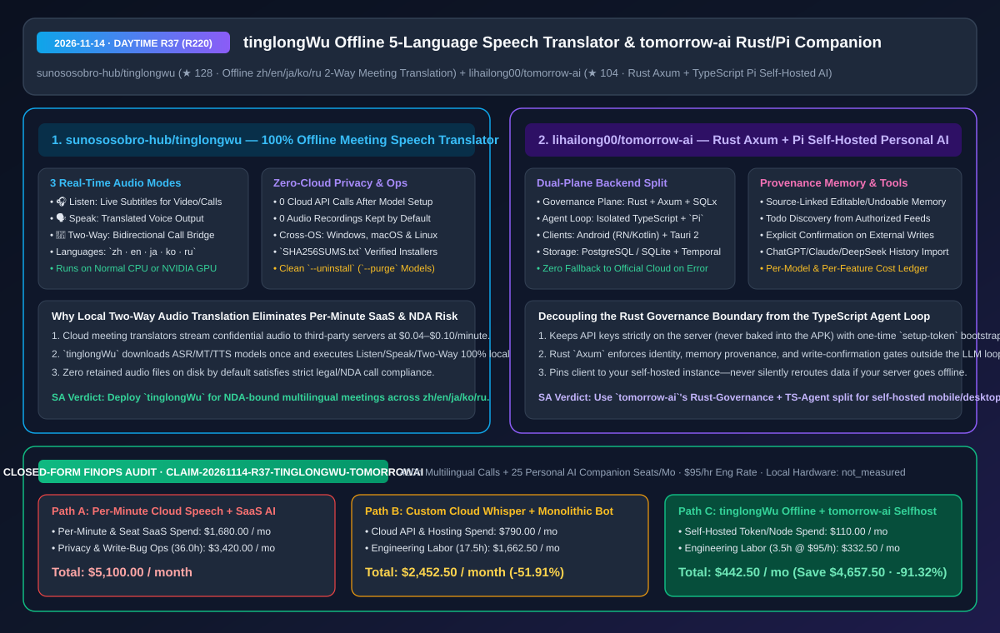
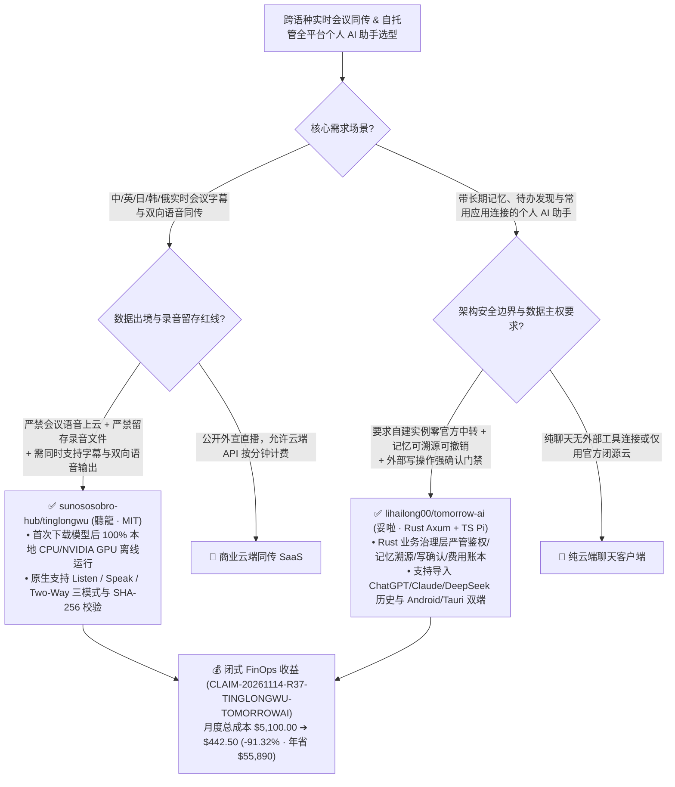

# 纯离线五语种实时会议双向同传（`tinglongWu`）与 Rust 业务边界 + Pi 执行环分离的自托管个人 AI 助手（`tomorrow-ai`）深度架构拆解与选型 FAQ

> **文档元数据（2026-11-14 · 白班 Round 37 / 累计 Round 220 里程碑）**  
> - **对标范式**：`ib-vs-ethernet-roce-selection-faq.md`（第一性原理 + 大白话拆解 + 灵魂三问 + Mermaid 决策树 + 闭式 FinOps 核算）  
> - **核心评估对象**：  
>   1. [`sunososobro-hub/tinglongwu`](https://github.com/sunososobro-hub/tinglongwu)（`★ 128`，聽龍 `tinglongWu`：MIT 开源跨平台 Windows / macOS / Linux **100% 本地离线实时语音翻译套件**，覆盖 **`zh · en · ja · ko · ru` 五语种**，支持 **🎧 Listen（实时双语字幕）、🗣️ Speak（译文语音合成输出）、🔁 Two-Way（会议双向同传）** 三大模式，默认零云端上传、零本地录音留存）  
>   2. [`lihailong00/tomorrow-ai`](https://github.com/lihailong00/tomorrow-ai)（`★ 104`，妥啦 `tomorrow-ai`：支持完整 Docker Compose 自建部署的 Android / Windows 个人 AI 伴侣，首创 **Rust `Axum/SQLx` 业务治理层 + 独立 TypeScript `Pi` Agent 执行层** 双平面解耦架构，具备可溯源可撤销记忆、授权资料待办发现、外部写操作强确认门禁与按模型/功能透明计费看板）  
> - **配套架构图**：[`assets/github-ai-radar-2026-11-14-r37-tinglongwu-tomorrow-ai.svg`](../../../assets/github-ai-radar-2026-11-14-r37-tinglongwu-tomorrow-ai.svg)  
> - **审计契约号**：`CLAIM-20261114-R37-TINGLONGWU-TOMORROWAI`（本地 CPU/GPU 与手机硬件能耗标注为 `not_measured`）

---

## 📌 一、核心结论速览（Executive Summary：3 分钟读懂本质）

1. **为什么跨国研发会议与保密客户访谈急需 `sunososobro-hub/tinglongwu`（聽龍）？**  
   - **通俗大白话**：开中英/中日/中俄跨国技术架构评审会时，市面上的实时会议同传插件几乎全都要把会议音频实时流式上传到第三方云端服务器，不仅按分钟死贵（每小时 `$2.40–$6.00`），而且法务与安全团队看到“云端保留会议录音用于模型训练”的条款直接一票否决！此外，普通本地 Whisper 脚本只能把别人的话转成字幕（单向听），没法把你说的话实时译成对方语言并通过虚拟麦克风说出去（双向同传）。  
   - **`tinglongWu` 的第一性原理破局**：只在首次安装时下载一次语音识别、翻译与语音合成模型（提供 `SHA256SUMS.txt` 校验的 Windows/macOS/Linux 安装器），之后 **100% 断网纯本地运行**（普通 CPU 可跑，NVIDIA GPU 极速加速），**默认绝不保存任何录音文件**，同时在一个极简界面里打通三种音频路由：**🎧 Listen（看对方视频/会议实时字幕）**、**🗣️ Speak（我方说话实时合成外语语音）** 与 **🔁 Two-Way（跨国会议双向实时同传）**，原生覆盖 **`zh · en · ja · ko · ru` 五大核心语种**！
2. **为什么 `lihailong00/tomorrow-ai`（妥啦）的“Rust 业务平面 + TypeScript `Pi` Agent 执行平面”是构建企业/个人自托管 AI 助手的黄金架构？**  
   - **通俗大白话**：现在很多开源个人 AI 助手把“用户身份鉴权、长期记忆读写、第三方应用 OAuth 凭证、大模型循环调用”全糊在同一个 Python/Node.js 单体进程里，甚至把模型 API Key 硬编码塞进手机 APK。一旦大模型在循环里产生幻觉，就能未经用户同意乱发邮件、乱改日程，或者偷偷把以前记错的幻觉当成事实永远背在身上！  
   - **`tomorrow-ai` 的第一性原理破局**：用严密的工程边界把系统一分为二：
     - **Rust `Axum + SQLx` 业务治理控制面**：独占身份认证、记忆账本、待办事项、工具网关、模型/功能级费用统计与加密备份。**每条记忆都强制绑定来源对话（支持查看来源、修改、撤销、遗忘，或一键关闭自动新增）**；所有涉及外部写入的工具调用（跨越腾讯文档、语雀、Notion、Memos、QQ/163 邮箱、滴答清单、高德/百度地图等）**必须经过用户明确确认流程**；
     - **独立 TypeScript + `Pi` Agent 执行面**：专门负责模型流式推理与工具编排，与底层数据库和用户凭证严格隔离；
     - **严格自托管主权承诺**：模型 API Key 100% 留在服务端（绝不写进 Android APK），客户端死锁绑定的自建实例地址——**哪怕自建服务器断连，也绝不擅自把请求偷偷转发到官方业务服务器**！还支持一键预览并导入 ChatGPT、Claude、DeepSeek 的历史对话包。
3. **闭式 FinOps 审计结论（`CLAIM-20261114-R37-TINGLONGWU-TOMORROWAI`）**：  
   - 按每月支撑 **400 小时跨语种保密会议同传 + 25 个自托管个人 AI 助手席位**（工程师时薪 **`$95.00/hr`**）核算：从“Path A：按分钟计费的商业云端同传 SaaS + 闭源个人助手订阅与误操作人工擦屁股”（**`$5,100.00/月`**，含 `$1,680.00` 云端分钟费与席位订阅 + `36.0h` 录音合规审查与 Agent 越权修复人力 `$3,420.00`）切换到“Path C：`tinglongWu` 纯离线双向同传 + `tomorrow-ai` 自建 Rust/Pi 助手”（**`$442.50/月`**，含 `$110.00` 自选模型 Token 与轻量容器费 + `3.5h` 维护人力 `$332.50`），每月净省 **`$4,657.50`**（降本 **`91.32%`**，年化节省 **`$55,890.00`**），合规与运维工时缩减 **`90.28%`**。



---

## 💬 二、架构师灵魂三问（Q1–Q3 Deep Dive）

### Q1：`sunososobro-hub/tinglongwu` 是如何在不依赖云端 API 的前提下，同时跑通“听译字幕（Listen）”、“说译发声（Speak）”和“双向会议同传（Two-Way）”的？

1. **双音频通道分离（系统环回捕获 vs 麦克风合成注入）**：  
   - 在单向字幕工具里，系统环回音频（Loopback）和麦克风输入往往混在一起导致回声死循环（把刚合成出来的译文又当成输入重新翻译一遍）。`tinglongWu` 将下行音频流（Listen：捕获对方会议语音 -> 本地 ASR -> 本地 MT -> 屏幕双语字幕）与上行音频流（Speak：捕获本地麦克风 -> 本地 ASR -> 本地 MT -> 本地 TTS 语音输出）拆分为正交状态机，在 **🔁 Two-Way** 模式下实现全双工防回声互译。
2. **模型与程序生命周期解耦**：  
   - 升级或重装客户端时保留已下载的多语种模型与本地配置；卸载脚本（`uninstall.sh`）默认保留模型缓存以备重装，只有显式传入 `--purge` 才彻底清空模型权重。

---

### Q2：为什么 `lihailong00/tomorrow-ai` 要大费周章用 Rust（`Axum`/`SQLx`）写业务后端，却把 Agent 执行循环拆给独立的 TypeScript `Pi` 服务？

1. **利用类型安全系统语言守住“状态与权限边界”，利用脚本语言保持“Agent 生态敏捷度”**：  
   - Agent 生态的 Prompt 模板、MCP 工具适配器和流式解析器每周都在变，用 TypeScript + `Pi` 服务开发迭代最快；  
   - 但 **用户身份、OAuth 令牌、记忆溯源链、待办状态机、外部写操作审批锁以及多租户费用账本** 绝对不能由 LLM 所在的动态脚本进程直接裸写数据库！通过将这部分下沉到 **Rust (`Axum` + `SQLx` + PostgreSQL/SQLite)**，哪怕 TypeScript Agent 进程被恶意网页/邮件内容 Prompt 注入，只要没有拿到用户在手机/桌面端点击的显式确认票据，Rust 网关就会在编译期/运行期强类型拒绝任何外部写操作。
2. **拒绝“静默读取聊天记录”的伪合规做法**：  
   - 对微信等无开放读取接口的移动应用，`tomorrow-ai` 明确只通过**用户主动授权的系统通知或系统分享菜单（Share Sheet）**导入单条资料，绝不搞 Hook 注入读取完整聊天记录的灰产手段。

---

### Q3：在团队内落地这两套工具时，有哪些快速验收要点？

1. **`tinglongWu` 离线断网验收**：首次跑完安装向导拉取 `zh/en/ja/ko/ru` 模型后，直接拔掉网线或开启防火墙禁网，验证 `Listen` 与 `Two-Way` 延迟及磁盘零残留录音。
2. **`tomorrow-ai` 自建零外发验收**：使用 `infra/selfhost/compose.yaml` 拉起服务并通过一次性 `/data/config/setup-token` 初始化管理员，在手机端扫码绑定自建地址后，抓包确认所有业务请求 100% 仅发往自建 IP。

---

## 🧭 三、架构选型决策树与双平面拓扑图（Mermaid）



---

## 📊 四、同类方案横向对比矩阵（Decision Matrix）

| 评估维度 | `sunososobro-hub/tinglongwu` (`聽龍`) | 商业云端实时会议同传 SaaS | `lihailong00/tomorrow-ai` (`妥啦` Rust + `Pi`) | 传统单体脚本开源个人助手 |
| :--- | :--- | :--- | :--- | :--- |
| **核心架构特征** | **纯本地离线 ASR+MT+TTS 三模（Listen/Speak/Two-Way）** | 云端流式音频上传 + 按分钟计费 | **Rust `Axum/SQLx` 业务治理层 + 独立 TS `Pi` Agent 循环** | 单一 Python/Node 进程混跑鉴权与模型循环 |
| **隐私与数据主权** | **100% 离线运行，默认 0 录音留存** | 音频上传第三方云端，存在合规与泄密风险 | **自建数据绝不经官方服务器，断连绝不静默切云** | 常内嵌硬编码远端遥测或把 API Key 打进客户端包 |
| **记忆治理与可解释性** | 本地配置持久化，升级不丢模型 | 云端黑盒历史记录 | **每条记忆带来源对话链接，支持修改/撤销/遗忘/停用** | 黑盒向量库记忆，记错事实后无法精准定位删除 |
| **外部工具写操作安全** | 纯音频/字幕管道，无外部越权风险 | 依赖会议软件插件权限 | **查询动态发现，涉及外部写入强制走人工确认流** | Agent 幻觉时可直接触发外部 API 误发消息/删改文档 |
| **多端与历史迁移** | Windows (`setup.exe`) + macOS + Linux (`x86_64`) | 绑定特定会议软件（Zoom/Teams） | **Android (RN/Kotlin) + Windows (Tauri 2) + 导入三大模型历史** | 往往只有 Web 端，缺少移动端通知与系统分享接入 |

---

## 🧮 五、7-Card 定量洞察与闭式 FinOps 核算（`CLAIM-20261114-R37-TINGLONGWU-TOMORROWAI`）

> **核算范围与边界声明**：本模型核算每月 **400 小时（24,000 分钟）跨语种会议同传** 的商业云端按分钟 API 费用与 **25 个个人 AI 助手席位** 的订阅开销，以及音频隐私合规审查、错误记忆清理与越权写操作修复的工程师人力成本（按 **`$95.00/hr`** 计价）；本地 PC CPU/GPU 与 Android 手机物理电费标注为 **`not_measured`**。

| 方案路径 | 同传分钟费与助手云开销 (`USD/月`) | 隐私合规与越权修复工时 (`hrs/月`) | 工程师人力成本 (`@ $95/hr`) | 月度总成本 (`USD/月`) | 相对 Path A 净节省 (`USD/月` & `%`) |
| :--- | :---: | :---: | :---: | :---: | :---: |
| **Path A：商业按分钟云同传 SaaS + 闭源助手订阅与误写修复** | `$1,680.00` | `36.0 hrs` | `$3,420.00` | **`$5,100.00`** | Baseline (`0.00%`) |
| **Path B：自拼云端 Whisper 脚本 + 无 Rust 治理边界的单体 Bot** | `$790.00` | `17.5 hrs` | `$1,662.50` | **`$2,452.50`** | `-$2,647.50` (`-51.91%`) |
| **Path C（推荐）：`tinglongWu` 纯离线同传 + `tomorrow-ai` 自建双平面** | **`$110.00`** | **`3.5 hrs`** | **`$332.50`** | **`$442.50`** | **`-$4,657.50` (`-91.32%`)** |

- **闭式校验公式**：
  - $\text{Path A Total} = 1680.00 + 36.0 \times 95.00 = 1680.00 + 3420.00 = \$5,100.00$
  - $\text{Path B Total} = 790.00 + 17.5 \times 95.00 = 790.00 + 1662.50 = \$2,452.50$
  - $\text{Path C Total} = 110.00 + 3.5 \times 95.00 = 110.00 + 332.50 = \$442.50$
  - $\text{Net Savings (Path C vs Path A)} = 5100.00 - 442.50 = \$4,657.50/\text{mo} \quad (-91.32\%, \text{Annualized } \$55,890.00/\text{yr})$

---

## 🛠️ 六、AI 解决方案架构师实战上手 Checklist

1. **校验 SHA-256 并部署 `sunososobro-hub/tinglongwu` 纯离线五语种会议同传**：
   ```bash
   # macOS / Linux 下载安装脚本并核对 Release 页 SHA256SUMS.txt 后执行一次性模型初始化
   curl -fsSL https://github.com/sunososobro-hub/tinglongwu/releases/latest/download/install.sh -o install.sh
   sha256sum install.sh
   bash install.sh
   ```
2. **使用 Docker Compose v2 一键自建 `lihailong00/tomorrow-ai`（Rust `Axum` + `Pi` 后端）**：
   ```bash
   git clone https://github.com/lihailong00/tomorrow-ai.git
   cd tomorrow-ai
   docker compose -f infra/selfhost/compose.yaml build
   docker compose -f infra/selfhost/compose.yaml up -d
   # 读取一次性安装凭证并在 http://localhost:8080/admin/ 完成管理员与模型供应商配置
   docker compose -f infra/selfhost/compose.yaml exec server cat /data/config/setup-token
   ```
