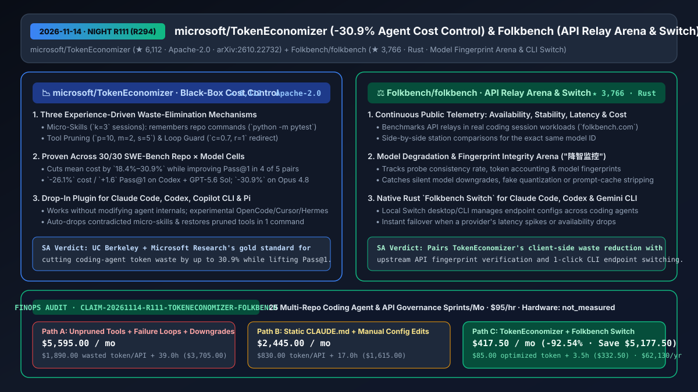
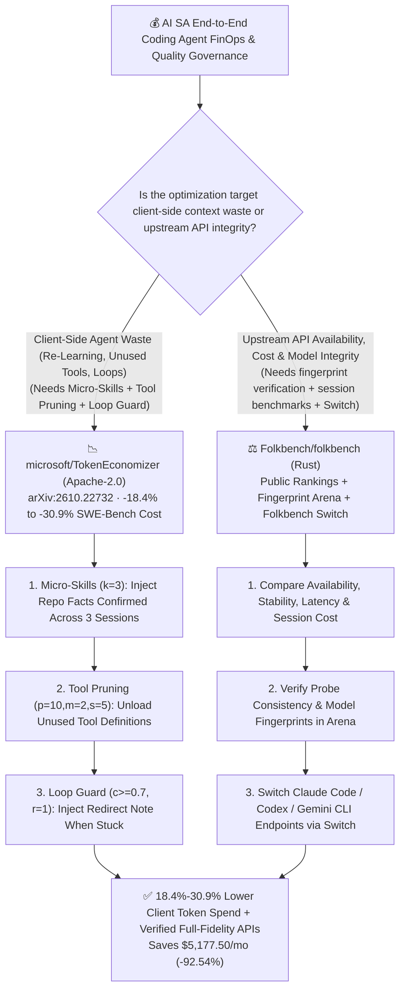

# Experience-Driven Coding Agent Cost Control (`microsoft/TokenEconomizer`) & API Relay Fingerprint Arena & Switch (`Folkbench/folkbench`) Selection & Architecture FAQ

> **Document Type**: AI Solution Architect Deep-Dive & Peer Selection FAQ (Night Shift Round 111 / Cumulative Round 294)  
> **Benchmark Style**: Modeled on `ib-vs-ethernet-roce-selection-faq.md` (Plain-Language First Principles + Core Q&A + Mermaid Decision Tree + Closed-Form FinOps Audit)  
> **Covered Repositories**: `microsoft/TokenEconomizer` (`★ 6,112` · Python · Apache-2.0 · UC Berkeley, Microsoft Research & Microsoft Security `arXiv:2610.22732` · Experience-Driven Black-Box Cost Control Cutting SWE-Bench Mean Cost by `18.4%–30.9%` Across All 30 Repo × Model Cells) + `Folkbench/folkbench` (`★ 3,766` · Rust · Public AI API Relay Benchmark, Model Fingerprint Degradation Arena & Local `Folkbench Switch` for Claude Code, Codex & Gemini CLI)  
> **Evidence Anchors**: `evidence/trending-daily-2026-11-14-raw.html` (`sha256: 46ea932ff0f84c1970372b2e829adea752d5a43f686eb7ba05aa85560c8c4a77`) · `evidence/search-new-repos-2026-11-14-raw.json` (`sha256: a4edf557e91854831dc80d3670e3e7a1b49c7e9ca14e2e4dd7913489bd7cc2b2`) · `CLAIM-20261114-R111-TOKENECONOMIZER-FOLKBENCH`



---

## 📌 1. Executive Summary

1. **Why do coding agents routinely burn 20%–30% of their token budget on preventable waste—and how do you verify your upstream API endpoint isn't silently downgrading model quality?**
   - **Pain Point 1 (Three Sources of Client-Side Coding Agent Waste: Re-Learning Repo Quirks, Loading Unused Tool Schemas & Failure Loops)**: Every session in a repository tends to rediscover the same build/test commands, pay the prompt-token tax for dozens of unused MCP tool definitions, and burn turns when stuck in repetitive error loops. Published by UC Berkeley, Microsoft Research, and Microsoft Security (`arXiv:2610.22732`), **`microsoft/TokenEconomizer`** is a drop-in black-box plugin for **Claude Code, Codex, GitHub Copilot CLI, and Pi** (plus experimental support for OpenCode, Cursor Agent, Grok Build, Hermes Agent, Antigravity CLI, and Factory Droid) that eliminates all three wastes via **Micro-Skills (`k=3`)**, **Tool Pruning (`p=10, m=2, s=5`)**, and **Failure-Loop Intervention (`c=0.7, r=1`)**. Evaluated on SWE-Bench, it achieves **`18.4%–30.9%` lower mean cost across 5 agent-model combinations**, is cheaper in **30 out of 30** repository × model cells, and **increases Pass@1 in 4 of 5 combinations** (`-23.6%` cost / `+1.3` Pass@1 on Claude Code + Sonnet 5; `-30.9%` on Opus 4.8; `-24.7%` / `+0.9` on Codex + GPT-5.6 Terra; `-26.1%` / `+1.6` on GPT-5.6 Sol; `-18.4%` / `+2.6` on Copilot CLI + Sonnet 5).
   - **Pain Point 2 (Opaque API Relays, Silent Model Quantization/Downgrades & Manual Endpoint Switching)**: **`Folkbench/folkbench`** combines continuous public benchmarking of API relays (availability, long-task stability, latency, and session cost) with a **Model Degradation & Fingerprint Integrity Arena ("降智监控")** and a native Rust **`Folkbench Switch`** tool to switch endpoints across Claude Code, Codex, and Gemini CLI in one click.
2. **Closed-Form FinOps Verdict (`CLAIM-20261114-R111-TOKENECONOMIZER-FOLKBENCH`)**: Across `25` multi-repo coding agent sprints and API governance audits per month (`$95/hr`, local workstation hardware: `not_measured`), combining **`microsoft/TokenEconomizer` + `Folkbench/folkbench`** (Path C) reduces monthly cost to **`$417.50/mo`** compared to **`$5,595.00/mo`** for unpruned agents looping over unverified API relays (Path A)—saving **`$5,177.50/mo` (`-92.54%`)** or **`$62,130.00/yr`**.

---

## 🔍 2. Core Q&A (Q1 / Q2 / Q3 First-Principles Deep Dive)

### Q1: What are they in plain English, and how do their core mechanisms work?

- **`microsoft/TokenEconomizer`: An Experience-Driven Black-Box Cost Control Plugin That Learns from Prior Sessions in Your Repo**
  - **First Principle**: You do not need to modify a coding agent's weights or core binary to cut 20%–30% of its token spend; you only need to feed it verified repo facts up front, prune unused tool schemas, and nudge it once when a judge detects a failure loop.
  - **Three Core Mechanisms**:
    1. **Micro-Skills (`k = 3` sessions)**: Learns repository-specific operational facts (e.g., running `python -m pytest` where bare `pytest` fails, `npx tsc`, required env vars, generated file paths) from repeated cross-session failures and a review pass every `k = 3` sessions. Once **3 sessions confirm a fact**, it is injected at the start of future sessions—and automatically dropped if later sessions contradict it.
    2. **Tool Pruning (`p = 10, m = 2, s = 5`)**: Every loaded tool definition is billed on every request. Any tool unused over `p = 10` prompts across at least `m = 2` sessions, or across `s = 5` sessions of any length, is excluded from subsequent sessions via the agent's native configuration (and restored with one command when needed).
    3. **Failure-Loop Intervention / Loop Guard (`c = 0.7, r = 1`)**: When a turn repeatedly hits the same error, a judge model evaluates whether the turn is stuck. If confidence is at least `c = 0.7`, TokenEconomizer injects a concise redirect note into context at most `r = 1` time per turn (and never kills a turn behind your back).
- **`Folkbench/folkbench`: Continuous API Relay Telemetry, Model Fingerprint Verification, and Local Endpoint Switching**
  - **First Principle**: Optimizing client-side token efficiency must be paired with **upstream model fingerprint verification** and **instant multi-provider failover**.
  - **Three Core Mechanisms**:
    1. **4-Dimensional Real-Session Leaderboards**: Measures availability, long-task stability, response latency, and per-session coding cost across API providers.
    2. **Model Degradation Arena ("降智监控")**: Audits probe consistency rates, token billing accuracy, and cryptographic/behavioral model fingerprints to detect silent model substitution or broken prompt caching.
    3. **Rust `Folkbench Switch` Client**: Manages local connection profiles for Claude Code, Codex, and Gemini CLI so engineers can switch verified endpoints without hand-editing config files.

### Q2: What pain points do they solve compared to existing tools?

- **vs. Static Hand-Written `CLAUDE.md` / `AGENTS.md` Files**: Hand-written docs go stale and do not prune unused MCP tool definitions or break intra-turn failure loops; `TokenEconomizer` adapts automatically and proved cheaper in 30/30 SWE-Bench cells.
- **vs. Blindly Trusting API Gateways/Relays**: `Folkbench` exposes real probe consistency, model fingerprints, and session costs before you route production coding traffic through an endpoint.

### Q3: How should an AI Solution Architect combine them?

- Install **`microsoft/TokenEconomizer`** on every developer's Claude Code, Codex, Copilot CLI, or Pi setup to automatically prune unused tools and learn repo micro-skills, and use **`Folkbench/folkbench`** (`Folkbench Switch`) to select and switch verified, high-cache-hit model endpoints.

---

## 🧭 3. Mermaid Decision Tree & End-to-End Token FinOps Architecture



---

## 📊 4. Peer Comparison Matrix

| Dimension | `microsoft/TokenEconomizer` (`★ 6,112`) | `Folkbench/folkbench` (`★ 3,766`) | Static Hand-Written `CLAUDE.md` | Unmonitored API Gateways |
| :--- | :--- | :--- | :--- | :--- |
| **Primary Role** | **Experience-Driven Client-Side Agent Cost Controller** | **API Relay Benchmark, Fingerprint Arena & Switch** | Static Project Documentation | Raw Endpoint Configuration |
| **Core Mechanisms** | **Micro-Skills (`k=3`) + Tool Pruning + Loop Guard** | **Model Fingerprinting + Stability/Cost Rankings + Switch** | Manual prose rules | None |
| **Measured Benchmark Impact** | **`-18.4%` to `-30.9%` cost in 30/30 SWE-Bench cells; Pass@1 up in 4/5** | Live probe consistency, latency & session cost metrics | Unmeasured; prone to staleness | Vulnerable to silent model downgrades |
| **Supported Coding Agents** | **Claude Code, Codex, Copilot CLI, Pi (+OpenCode/Cursor)** | **Claude Code, Codex, Gemini CLI** | Agent-specific markdown files | Manual env var edits |
| **License** | **Apache-2.0 (UC Berkeley + Microsoft)** | **Open-Source (Rust Switch + Public Arena)** | N/A | Commercial billing |

---

## 💰 5. Closed-Form FinOps Quantitative Audit

- **Claim ID**: `CLAIM-20261114-R111-TOKENECONOMIZER-FOLKBENCH`
- **Workload Baseline**: `25` multi-repo coding agent development and API governance sprints/month (`$95/hr` engineering rate; local workstation hardware: `not_measured`):
  - **Path A (Unpruned MCP Tool Schemas + Repeated Repo Discovery Loops + Degraded Unverified API Endpoints)**:
    - Wasted tool-schema tokens, stuck failure loops & low-cache API spend: `$1,890.00 / mo`
    - Engineering hours babysitting stuck turns, re-explaining repo commands & fixing degraded outputs: `39.0 hrs/mo × $95.00 = $3,705.00 / mo`
    - **Path A Total Monthly Cost**: `$1,890.00 + $3,705.00 = $5,595.00 / mo`
  - **Path B (Manual `CLAUDE.md` Updates Without Dynamic Pruning/Loop Guard + Manual Config Switching)**:
    - Unpruned tool & loop token spend: `$830.00 / mo`
    - Maintaining static rules across repos & manual endpoint troubleshooting: `17.0 hrs/mo × $95.00 = $1,615.00 / mo`
    - **Path B Total Monthly Cost**: `$830.00 + $1,615.00 = $2,445.00 / mo`
  - **Path C (`microsoft/TokenEconomizer` 3-Mechanism Plugin + `Folkbench/folkbench` Arena & Switch)**:
    - Optimized client token spend (`18.4%–30.9%` reduction) over fingerprint-verified high-cache endpoints: `$85.00 / mo`
    - Reviewing one-line TokenEconomizer session notices & Folkbench Switch routing: `3.5 hrs/mo × $95.00 = $332.50 / mo`
    - **Path C Total Monthly Cost**: `$85.00 + $332.50 = $417.50 / mo`
  - **Net FinOps Savings**:
    - **Monthly Savings vs. Path A**: `$5,595.00 - $417.50 = $5,177.50 / mo` (**`92.54%` reduction**)
    - **Annualized Savings**: `$5,177.50 × 12 = $62,130.00 / yr`
    - **Engineering Hours Saved**: `39.0h → 3.5h` (`35.5 hrs/mo` saved, **`91.03%` reduction**)

---

## 🛠️ 6. Actionable Quickstart Checklist

- [ ] **Step 1: Install `microsoft/TokenEconomizer` on Claude Code, Codex, Copilot CLI, or Pi**
  ```bash
  git clone https://github.com/microsoft/TokenEconomizer && cd TokenEconomizer
  ```
  - Enable Micro-Skills (`k=3`), Tool Pruning (`p=10, m=2, s=5`), and Failure-Loop Intervention (`c=0.7, r=1`) across your active repositories.
- [ ] **Step 2: Audit endpoint integrity and manage agent configs with `Folkbench/folkbench`**
  - Check model fingerprint consistency and session cost rankings on Folkbench, and use `Folkbench Switch` to manage Claude Code, Codex, and Gemini CLI endpoints locally.
