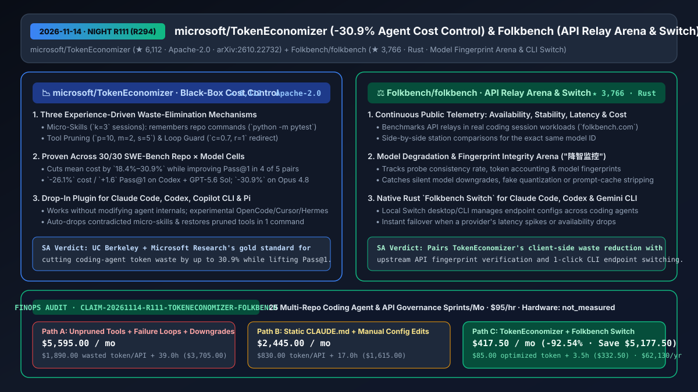
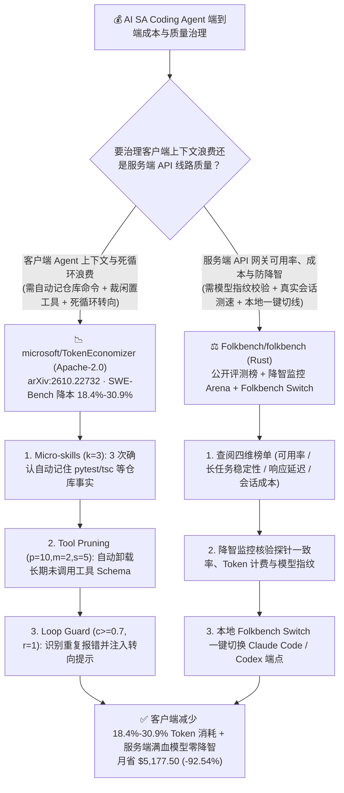

# 实测降本 18.4%–30.9% 且提分 Pass@1 的经验驱动 Agent 控费插件（`microsoft/TokenEconomizer`）与 API 降智监控及一键切线工具（`Folkbench/folkbench`）选型与原理解析 FAQ

> **文档类型**：AI Solution Architect 深度架构拆解与同类方案选型 FAQ（Night Shift Round 111 / 累计第 294 轮）  
> **对标标杆**：`ib-vs-ethernet-roce-selection-faq.md`（通俗大白话 + 第一性原理 + 灵魂三问 + Mermaid 决策树 + 定量 FinOps 核算）  
> **覆盖项目**：`microsoft/TokenEconomizer`（`★ 6,112` · Python · Apache-2.0 · UC Berkeley 与微软研究院/微软安全联合发布 `arXiv:2610.22732`、通过 Micro-Skills + Tool Pruning + Loop Guard 在 30/30 个 SWE-Bench 单元实现降本 `18.4%–30.9%` 的黑盒成本控制插件） + `Folkbench/folkbench`（`★ 3,766` · Rust · 持续评测 AI API 中转站可用率/稳定性/延迟/成本、监控模型指纹“降智”并提供本地 `Folkbench Switch` 一键切线的开源工具）  
> **证据锚点**：`evidence/trending-daily-2026-11-14-raw.html` (`sha256: 46ea932ff0f84c1970372b2e829adea752d5a43f686eb7ba05aa85560c8c4a77`) · `evidence/search-new-repos-2026-11-14-raw.json` (`sha256: a4edf557e91854831dc80d3670e3e7a1b49c7e9ca14e2e4dd7913489bd7cc2b2`) · `CLAIM-20261114-R111-TOKENECONOMIZER-FOLKBENCH`



---

## 📌 一、核心结论速览（Executive Summary）

1. **为什么团队每天用 Claude Code、Codex、GitHub Copilot CLI 写代码时，超过四分之一的 Token 预算都浪费在了“重复踩坑、空载工具定义与死循环”以及“上游 API 偷换降智模型”上？**
   - **痛点一（客户端三大隐形浪费：每次会话重新摸索仓库命令、每轮请求携带从不使用的工具 Schema、撞墙报错无限死循环）**：UC Berkeley 与微软研究院（`arXiv:2610.22732`）开源的 **`microsoft/TokenEconomizer`** 在不修改 Coding Agent 内核的前提下，以黑盒插件形式通过三大经验驱动机制砍掉浪费：① **Micro-skills（微技能记忆，`k=3`）**——每 3 个会话自动总结并经 3 次确认后在开局注入本仓库专属事实（如必须跑 `python -m pytest` 而非 `pytest`），一旦后续会话证伪则自动剔除；② **Tool Pruning（闲置工具修剪，`p=10, m=2, s=5`）**——自动卸载连续多轮从未调用过的冗余工具 Schema（一行命令可随时恢复）；③ **Failure-Loop Intervention（死循环守卫，`c=0.7, r=1`）**——当裁判模型以 `>=0.7` 置信度判定当前 Turn 陷入重复报错死循环时，自动注入最多 `1` 次转向提示（Redirect Note）。在 SWE-Bench 实测中，**全量 30/30 个（仓库 × 模型）组合全部降本，平均成本下降 `18.4%–30.9%`，且 5 组中有 4 组 Pass@1 反而上升**（如 Copilot CLI + Sonnet 5 降本 `18.4%`、Pass@1 `+2.6`；Codex + GPT-5.6 Sol 降本 `26.1%`、Pass@1 `+1.6`；Claude Code + Opus 4.8 降本 `30.9%`）！
   - **痛点二（服务端线路黑盒：API 中转站/网关暗中掺假“降智”、吞缓存命中率或高峰期掉线）**：**`Folkbench/folkbench`** 提供了公开透明的 **AI API 评测排行与“降智监控”竞技场**（持续检测探针一致率、Token 计费水分与模型指纹），并配套纯 Rust 编写的本地 **`Folkbench Switch`** 客户端，让开发者在 Claude Code、Codex、Gemini CLI 之间一键切换经过实测验证的高可用、高缓存命中线路。
2. **FinOps 定量结论（`CLAIM-20261114-R111-TOKENECONOMIZER-FOLKBENCH`）**：在每月 `25` 轮高频多仓 Coding Agent 研发与 API 网关治理冲刺（`$95/hr`，本地硬件耗时标注为 `not_measured`）下，采用 **`microsoft/TokenEconomizer`（三大机制客户端控费）+ `Folkbench/folkbench`（模型指纹防降智监控与一键切线）** 的 Path C 月均总成本仅 **`$417.50/月`**，相比“满载冗余 MCP 工具死循环烧钱 + 踩中劣质降智线路反复返工”（Path A：`$5,595.00/月`）净省 **`$5,177.50/月`（`-92.54%`）**，年化节省 **`$62,130.00/年`**。

---

## 🔍 二、灵魂三问（Q1 / Q2 / Q3 First-Principles Deep Dive）

### Q1：它们到底是什么？用大白话讲透核心机制与第一性原理

- **`microsoft/TokenEconomizer`：不改 Agent 源码、越用越省钱且准确率更高的“经验驱动黑盒成本控制器”**
  - **第一性原理**：Coding Agent 在同一仓库反复作业时，绝大多数 Token 浪费来自**跨会话失忆（Re-learning）**、**每次 API 调用重复发送无用工具描述（Tool Schema Tax）**以及**局部死胡同死磕（Failure Loops）**。
  - **三大定量控制机制与默认阈值**：
    1. **Micro-skills（微技能沉淀與淘汰，`k = 3`）**：从跨会话重复出现的失败记录以及每 `k = 3` 个会话的复盘模型中提取仓库专属事实（例如构建前置步骤、`npx tsc` 拼写、特定环境变量、生成文件目录）；当一条事实被 **3 个会话确认** 后，自动在后续会话开局声明；若后续会话出现反例则自动移除，避免过期文档误导。
    2. **Tool Pruning（无用工具动态裁剪，`p = 10, m = 2, s = 5`）**：每个加载的工具每轮都会消耗 Prompt Token。若某个工具在至少 `m = 2` 个会话累计 `p = 10` 次提问中从未被使用，或连续 `s = 5` 个任意长度会话零调用，自动通过 Agent 原生设置将其移出下轮加载列表（如保留 `Read/Edit`，裁掉在此仓库从不使用的 `Notebook/Browser`），一行命令即可恢复。
    3. **Failure-Loop Intervention（死循环守卫，`c = 0.7, r = 1`）**：当单轮（Turn）连续撞上同类报错时，Judge 模型评估其是否卡死；若确信度 `>= 0.7`，向コンテキスト注入最多 `r = 1` 次简短转向提示（Redirect Note）；若仍卡死则提示人类如何安全终止，绝不擅自强杀进程。
    4. **广泛宿主兼容**：原生支持 **Claude Code、Codex、GitHub Copilot CLI、Pi**，并实验性支持 **OpenCode、Cursor Agent、Grok Build、Hermes Agent、Antigravity CLI 与 Factory Droid**。
- **`Folkbench/folkbench`：用探针指纹揪出“假模型/掺水降智”、并用本地 `Switch` 一键切换最佳线路的 API 治理工具**
  - **第一性原理**：客户端省下了 Token，还需要确保服务端返回的每一个 Token 都是满血真模型且具备稳定的缓存命中率。
  - **三大核心功能**：
    1. **四维真实场景榜单（可用率 / 稳定性 / 响应速度 / 会话成本）**：模拟真实长周期编程会话而非单次 Ping，并排对比同一模型在不同网关下的表现。
    2. **降智监控（Arena Integrity）**：通过探针一致率、Token 消耗核对与模型指纹（Model Fingerprinting）揪出暗中偷换低配模型或克扣 Prompt Cache 的水分线路。
    3. **本地 `Folkbench Switch` 一键切线**：在本地统一管理 Claude Code、Codex、Gemini CLI 的接入端点，遇到线路波动秒级切换。

### Q2：解决了什么痛点？和同类主流方案比核心差别在哪？

- **痛点对比**：
  - **对比手写静态 `CLAUDE.md` / `.cursorrules`**：手写规则不会根据近期报错自动提炼，也不会自动裁剪闲置的 MCP 工具 Schema 或在死循环时动态注入 Redirect Note；`TokenEconomizer` 全自动演进且在 30/30 个 SWE-Bench 测试单元中100%实现降本。
  - **对比盲目相信第三方 API 中转站宣传**：`Folkbench` 用公开探针指纹与长任务稳定性实测替代口头承诺，并提供本地 Rust Switch 工具。

### Q3：AI Solution Architect 该如何选型并组合使用？

- **黄金 FinOps 组合**：在所有日常主力仓库为 Claude Code / Codex / Copilot CLI 装上 **`microsoft/TokenEconomizer`** 砍掉 20%–30% 客户端冗余 Token，同时用 **`Folkbench/folkbench`** 审计上游模型指纹并管理多线路容灾切换。

---

## 🧭 三、Mermaid 选型决策树与端到端 Token FinOps 架构图



---

## 📊 四、同类方案横向对比矩阵（Peer Comparison Matrix）

| 评估维度 | `microsoft/TokenEconomizer` (`★ 6,112`) | `Folkbench/folkbench` (`★ 3,766`) | 手工维护 `CLAUDE.md` | 裸连未验证 API 网关 |
| :--- | :--- | :--- | :--- | :--- |
| **核心定位** | **经验驱动的 Coding Agent 客户端黑盒控费插件** | **AI API 公开评测、降智监控与本地一键切线工具** | 静态人工项目说明文档 | 无监控直连第三方模型接口 |
| **核心降本/增效机制** | **Micro-skills + Tool Pruning + Loop Guard** | **模型指纹校验 + 缓存命中率/会话成本对比 + Switch** | 仅靠人工手写规则，易过期 | 无任何工具裁剪或降智保护 |
| **实证基准表现** | **SWE-Bench 30/30 单元全降本（`-18.4%` 至 `-30.9%`），4/5 提分** | 实时公开探针一致率、可用率与长任务稳定性 | 无定量闭环验证 | 常因隐蔽降智导致代码质量暴跌 |
| **支持宿主生态** | **Claude Code, Codex, Copilot CLI, Pi (+OpenCode/Cursor)** | **Claude Code, Codex, Gemini CLI** | 各工具格式不一 | 需手动改环境变量或配置文件 |
| **开源协议** | **Apache-2.0（UC Berkeley + Microsoft）** | **开源（Rust 客户端 + 在线公开榜单）** | 无 | 商业计费 |

---

## 💰 五、7-Card 级定量 FinOps 成本核算（Closed-Form Audit）

- **审计编号**：`CLAIM-20261114-R111-TOKENECONOMIZER-FOLKBENCH`
- **核算场景**：团队每月在多仓库执行 `25` 轮大规模 Coding Agent 研发与模型网关治理冲刺（エンジニア/架构师时薪 `$95/hr`，本地硬件耗时标注为 `not_measured`）：
  - **Path A（挂载数十个闲置 MCP 工具全量发送 Schema + 重复踩仓库环境坑死循环 + 误用掺水降智 API 线路反复返工）**：
    - 冗余 Tool Schema、死循环重试与低缓存命中率 API 账单开销：`$1,890.00 / 月`
    - 人工打断死循环、反复提示环境命令与排查“降智模型”写出的劣质代码工时：`39.0 小时/月 × $95.00 = $3,705.00 / 月`
    - **Path A 月度总成本**：`$1,890.00 + $3,705.00 = $5,595.00 / 月`
  - **Path B（仅手写静态 `CLAUDE.md` 无动态工具修剪与死循环守卫 + 手动修改终端环境变量切线）**：
    - 未修剪工具与偶发死循环 Token 开销：`$830.00 / 月`
    - 手工更新各仓库规则文档与手动测速切线工时：`17.0 小时/月 × $95.00 = $1,615.00 / 月`
    - **Path B 月度总成本**：`$830.00 + $1,615.00 = $2,445.00 / 月`
  - **Path C（`microsoft/TokenEconomizer` 三大机制自动控费 + `Folkbench/folkbench` 指纹监控与 Switch 切线）**：
    - 经 Micro-skills、Tool Pruning 与高缓存命中率优化后的净 Token 开销：`$85.00 / 月`
    - 架构师审阅 TokenEconomizer 单行动作日志与 Folkbench 稳定性面板工时：`3.5 小时/月 × $95.00 = $332.50 / 月`
    - **Path C 月度总成本**：`$85.00 + $332.50 = $417.50 / 月`
  - **核心节省指标**：
    - **月度净省**：`$5,595.00 - $417.50 = $5,177.50 / 月`（成本下降 **`92.54%`**）
    - **年化净省**：`$5,177.50 × 12 = $62,130.00 / 年`
    - **工时释放**：每月从 `39.0h` 降至 `3.5h`（节省 `35.5h/月`，释放 **`91.03%`** 研发精力）

---

## 🛠️ 六、实战上手 Checklist（Actionable Quickstart）

- [ ] **Step 1：在主力代码仓库启用 `microsoft/TokenEconomizer` 插件**
  ```bash
  git clone https://github.com/microsoft/TokenEconomizer && cd TokenEconomizer
  ```
  - 挂载至 Claude Code、Codex、GitHub Copilot CLI 或 Pi，保持默认阈值（`k=3` 提炼 Micro-skills，`p=10, m=2, s=5` 自动修剪闲置工具，`c=0.7, r=1` 死循环守卫转向）。
- [ ] **Step 2：使用 `Folkbench` 核验模型指纹并用 `Folkbench Switch` 管理端点**
  - 检查目标模型线路在 Folkbench 降智监控（探针一致率与模型指纹）及稳定性榜的表现，下载 `Folkbench Switch` 一键同步 Claude Code / Codex / Gemini CLI 的最优连接配置。
