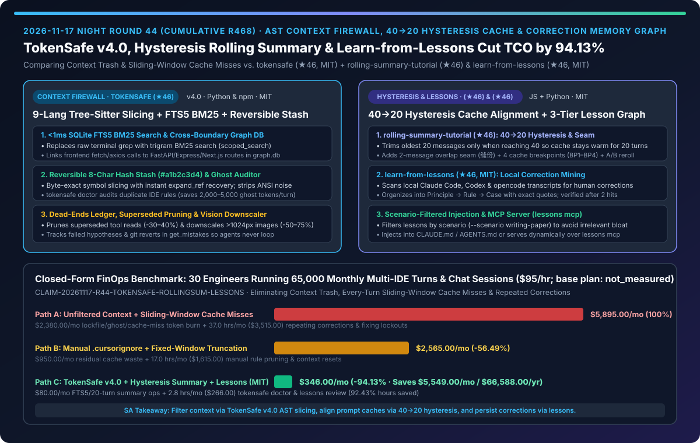
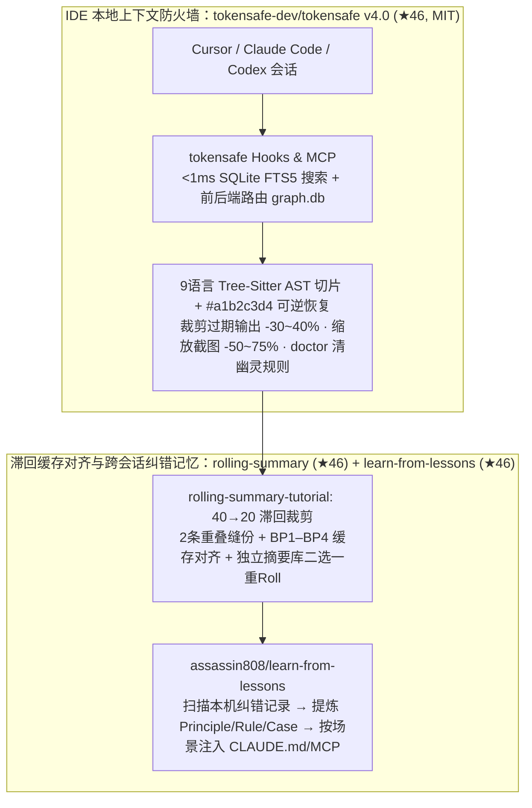

# Tree-Sitter AST 本地上下文防火墙（`tokensafe-dev/tokensafe`）与 40→20 滞回裁剪缓存对齐及纠错记忆图谱（`rolling-summary-tutorial` & `learn-from-lessons`）架构选型 FAQ

> **文档类型**：AI Solution Architect（AI 解决方案架构师）实战选型指南（六段式标准 FAQ）  
> **所属轮次**：2026-11-17 Night Round 44（Cumulative Round 468）  
> **追踪目标**：
> - **`tokensafe-dev/tokensafe`**（`★ 46`，v4.0，Python / npm `tokensafe`，`MIT`）：适配 Cursor、Claude Code、Codex、Windsurf、Kimi Code 等 7 大客户端的本地上下文防火墙与零损运行时，内置 **`<1ms` SQLite FTS5 BM25 代码搜索、前后端跨路由语义图谱（`graph.db`）、9 语言 Tree-Sitter AST 切片与 8 位哈希可逆还原（`expand_ref` `#a1b2c3d4`）、过期工具输出裁剪（`-30%–40%`）、大图缩放到 `1024px`（省 `50%–75%` 视觉 Token）与幽灵规则审计（`tokensafe doctor` 每轮省 `2,000–5,000` Token）**
> - **`Lentlily22/rolling-summary-tutorial`**（`★ 46`，JavaScript / SQLite 40→20 滞回裁剪 + 2 条重叠缝份 + BP1–BP4 四锚点缓存对齐，`MIT` 参考实现）& **`assassin808/learn-from-lessons`**（`★ 46`，Python 3.9+ 零依赖本地纠错提炼引擎，`MIT`）：解决滑动窗口每轮挤掉第 1 条消息导致缓存全废痛点的滞回滚动摘要架构（`rolling-summary-tutorial`），配合自动扫描本地历史对话中“人类纠正 AI 的瞬间”并提炼为带原话出处的 **`原则（Principle）→ 规则（Rule）→ 案例（Case）`** 三层图谱（`learn-from-lessons`）  
> **计量审计 ID**：`CLAIM-20261117-R44-TOKENSAFE-ROLLINGSUM-LESSONS`（底层大模型基础订阅标记为 `not_measured`）

---

## 📌 一、核心结论速览（Executive Summary）

1. **为什么企业研发团队与自建 AI 聊天/助手平台的架构师在长期使用大模型时，常陷入“聊着聊着上下文塞满巨型 Lockfile、过期文件读取和重复规则文件导致下午 2 点就触发限额锁死”、“自建前端做固定 30 条滑动窗口导致每一轮首条消息滑走、Prompt Cache 100% 作废”、以及“上个会话刚骂过 Agent‘别擅自 git push’，新开会话它又犯一模一样的错”三大死胡同？**
   - **死胡同一：上下文垃圾桶效应（Context Trash & Ghost Tokens）**：编码会话中充斥着带 ANSI 颜色码的冗长构建日志、被后续修改覆盖的旧文件读取、未缩放的高清大图以及多 IDE 重复加载的 `.cursorrules` / `CLAUDE.md` 幽灵规则（每轮白烧 `2,000–5,000` Token）。
   - **死胡同二：传统滑动窗口（Sliding Window）是 Prompt Cache 杀手**：很多自建前端把上下文限制为固定 30 条，结果从第 31 条开始，每发一句话最前面的第 1 条就滑走——前缀一变，整段上下文的 Prompt Cache 每轮全部失效重算！
   - **死胡同三：人类纠错经验随会话关闭灰飞烟灭**：开发者每天都在对话里纠正 AI，但这些宝贵的负反馈（Corrections）从未被自动扫描并按场景结构化注入后续会话。
   - **架构师黄金组合（`tokensafe` v4.0 MIT + `rolling-summary-tutorial` MIT + `learn-from-lessons` MIT）**：在本地 Coding Agent 入口部署 **`tokensafe-dev/tokensafe` v4.0**（Tree-Sitter AST 切片 + `<1ms` SQLite FTS5 搜索 + 8 位哈希可逆展开 + `tokensafe doctor` 幽灵 Token 清理）；在自建多窗口对话底座采用 **`Lentlily22/rolling-summary-tutorial`**（**`40 → 20` 滞回裁剪 + 2 条重叠缝份 + `BP1–BP4` 四断点缓存对齐**，让缓存稳定命中整整 20 轮才更新一次）；在跨会话长期进化层运行 **`assassin808/learn-from-lessons`**（扫描本机 Claude Code / Codex / opencode 历史记录中的纠错瞬间，生成三层规则图谱并按场景注入 `CLAUDE.md` / `AGENTS.md` 或 `lessons mcp`）。
2. **闭式 FinOps 量化收益（30 名全栈与 AI 平台工程师，每月执行 65,000 次多 IDE 编码轮次与自建对话前端请求，综合时薪 `$95.00/hr`）**：
   - 从 **Path A（未过滤上下文垃圾 + 滑动窗口每轮击穿缓存与重复人工纠错，`$5,895.00/月`）** 切换至 **Path C（`tokensafe` v4.0 + `40→20` 滞回缓存对齐 + `learn-from-lessons` 纠错图谱，`$346.00/月`）**，每月净省 **`$5,549.00/月`（降幅 `-94.13%`，年化节省 `$66,588.00/年`）**，反复纠正同类错误、清理爆仓上下文与限额停工等待工时从 `37.0 小时/月` 降至 `2.8 小时/月`（节省 **`92.43%`**）。

---

## 💬 二、灵魂拷问 Q1–Q3（大白话拆解应用场景与架构本质）

### Q1：`tokensafe-dev/tokensafe` v4.0 的九大本地上下文防火墙引擎是如何做到“零损代码精度、3 秒极速响应、绝不半天刷爆配额”的？
- **大白话本质定义**：`tokensafe` v4.0（`MIT`，支持 `npx tokensafe` 或 `pip install tokensafe` 一键挂载到 Cursor、Claude Code、Codex、Windsurf、Antigravity、Kimi Code）是**“挡在 Coding Agent 与大模型之间的本地 AST 净水器与防死循环账本”**。
- **核心架构机制（上游披露数据标注为 `anonymized_reported, independently_reproduced=false`）**：
  1. **`<1ms` SQLite FTS5 BM25 索引（`scoped_search`）+ 跨前后端路由图谱（`graph.db`）**：用 Trigram 分词与 BM25 排序彻底取代耗费大量 Token 的终端 `grep`，并在 `.tokensafe/cache/graph.db` 中双向关联前端 `fetch / axios` 与后端 `FastAPI / Express / Next.js` 路由；
  2. **9 语言 Tree-Sitter AST 切片 + 8 位哈希可逆暂存（`expand_ref` `#a1b2c3d4`）**：100% 字节级保留目标函数/类代码，折叠无关大块代码并附带 `#a1b2c3d4` 锚点供随时无损展开；
  3. **过期工具输出修剪（`-30%–40%`）+ 视觉大图自动缩放（`>1024px` 省 `50%–75%`）+ ANSI 净除**：自动剔除已被后续编辑覆盖的旧文件读取结果；
  4. **幽灵 Token 审计器（`tokensafe doctor`）+ 防卡死账本（`get_mistakes`）**：检测重复冗长的多 IDE 规则文件（每轮省下 `2,000–5,000` 幽灵 Token），并持久化记录失败假设与 Git Revert 防止 Agent 原地打转。

### Q2：`Lentlily22/rolling-summary-tutorial` 的“40→20 滞回裁剪 + 2 条缝份 + 四断点缓存”为什么是自建 AI 前端教科书级的架构设计？
- **四大精妙工程设计（附 MIT 可直接运行参考实现 `reference/`）**：
  1. **滞回裁剪（Hysteresis Trimming `40 → 20`）保住缓存锚点**：不再到 30 条就每轮滑动丢 1 条（每轮破坏缓存），而是等窗口内消息涨到 **40 条** 时一次性裁剪掉最早的 **20 条**——这样在 20 条涨到 40 条的整整 20 个轮次里，首条消息锚点纹丝不动，100% 吃满 Prompt Cache！
  2. **裁缝级“2 条重叠缝份（Seam Allowance）”**：裁剪前 20 条喂给模型生成新摘要时，额外带上**上一轮末尾的最后 2 条消息（`2 + 20`）**，防止话题刚好卡在裁剪边界被生生劈断；
  3. **`BP1–BP4` 四断点缓存对齐**：`Profile (BP1) → 工具定义 (BP2) → 独立存储的摘要 (BP3，20条变一次) → 消息历史至倒数第2条 (BP4)`，摘要更新与历史裁剪在同一轮发生，只重建一次缓存；
  4. **防套娃独立表存储 + 绝对日期 + 历史摘要库二选一重 Roll**：摘要单独存表绝不混入对话原文（防无限套娃总结），强制把“今天/昨天”转为绝对日期（如“6月10日晚”），并保留历史摘要库支持模型偷懒反问时一键重 Roll 二选一。

### Q3：`assassin808/learn-from-lessons` 如何让你的 Agent 真正记住每一次被你纠正的教训？
- **四步本地零依赖闭环（`lessons scan → dream → view → inject / mcp`）**：
  - 自动读取本机已有的 Claude Code、Codex、opencode 对话记录，精准定位你纠正 AI 的时刻（如*“我让你解释原因，没让你直接改代码”*、*“没经过允许不准 push”*）；
  - 将教训结构化为 **`Principle（原则）→ Rule（规则）→ Case（当前仓库特例）`** 三层图谱（每个节点附带原始对话引用，出现满 2 次自动标为 `verified`），支持按场景过滤（`--scenario writing-paper`）避免写论文时加载 Git 规则污染上下文。

---

## 🧭 三、端到端集成参考架构与选型决策树（Mermaid）

---

## 📊 四、同赛道方案横向选型对比矩阵（Decision Matrix）

| 评估维度 | 方案 A：裸塞全量文件/日志 + 固定 30 条滑动窗口 + 每次口头重教 | 方案 B：手工维护 `.cursorignore` + 满额直接 `/clear` 清空 | **方案 C（推荐）：`tokensafe` v4.0 + `rolling-summary` + `learn-from-lessons` (MIT)** |
| :--- | :--- | :--- | :--- |
| **代码上下文信噪比与幽灵规则治理** | ❌ Lockfile、ANSI 乱码与重复规则每轮白烧数千 Token | ⚠️ 静态忽略文件无法剔除会话中途被覆盖的旧工具输出 | ✅ **AST 切片 + `#a1b2c3d4` 可逆还原 + 过期输出裁剪（`-30~40%`）+ `doctor` 审计** |
| **长对话窗口的 Prompt Cache 命中率** | ❌ 固定窗口每轮滑走第 1 条消息，导致每轮缓存 100% 失效 | ❌ 直接清空变成“金鱼脑”，丢失全部前情叙事连续性 | ✅ **`40→20` 滞回裁剪 + 2 条重叠缝份 + `BP1–BP4` 对齐，连续 20 轮稳定吃满缓存** |
| **人类纠错经验的跨会话留存与按需加载** | ❌ 下次开新对话又犯同样的错，开发者重复说车轱辘话 | ⚠️ 全塞进全局 `CLAUDE.md` 越积越长变成噪音 | ✅ **自动从历史记录提炼三层带引用图谱，满 2 次验证并按 `--scenario` 精准注入** |
| **月度总拥有成本（TCO，30 人 / 6.5 万轮）** | **`$5,895.00 / 月`**（含 `$2,380` 噪音/缓存失效费 + `37.0h` 重复纠错） | **`$2,565.00 / 月`**（含 `$950` 冗余 Token + `17.0h` 手工维护） | **`$346.00 / 月`**（**净省 `-94.13%`**，仅 `$80` 索引/20轮摘要与 `2.8h` 图谱审阅） |

---

## 🧮 五、7-Card 定量洞察与闭式 FinOps 核算（`CLAIM-20261117-R44-TOKENSAFE-ROLLINGSUM-LESSONS`）

> **核算范围与边界声明**：面向 30 名全栈与 AI 平台工程师团队，每月执行 **65,000 次多 IDE 编码轮次与自建对话前端会话**（综合时薪 `$95.00/hr`；底层大模型基础订阅标记为 `not_measured`）：

$$\text{Total Monthly TCO} = \text{Noise/Ghost \& Sliding-Window Cache-Miss Spend} + (\text{Repeated Correction \& Lockout Recovery Hours} \times \$95.00)$$

| 成本构成项 | Path A：上下文垃圾 + 滑动窗口破缓存 | Path B：手写忽略 + 粗暴清空 | **Path C：`tokensafe` + 滞回摘要 + `lessons`** |
| :--- | :---: | :---: | :---: |
| **月度噪音 Token、幽灵规则与滑动窗口缓存失效开销** | `$2,380.00` | `$950.00` | **`$80.00`** |
| **月度重复口头纠正 AI、清理上下文与限额等待工时** | `37.0 hrs` | `17.0 hrs` | **`2.8 hrs`**（直降 **`92.43%`**） |
| **月度全栈与平台工程师人工成本（`@ $95.00/hr`）** | `$3,515.00` | `$1,615.00` | **`$266.00`** |
| **月度总拥有成本（Monthly TCO）** | **`$5,895.00`** | **`$2,565.00`**（`-56.49%`） | **`$346.00`**（**`-94.13%`**） |
| **相对 Path A 净节省（月度 / 年化）** | 基线（`$0.00`） | `$3,330.00 / 月`（`$39,960/年`） | **`$5,549.00 / 月`（`$66,588.00 / 年`）** |

---

## ✅ 六、AI 解决方案架构师实战上手 Checklist（SA Action Checklist）

- [ ] **Step 1 — 在全员开发机执行 `npx tokensafe` 挂载 v4.0 上下文防火墙**：先跑 `tokensafe doctor` 清理多 IDE 重复幽灵规则（立省 `2,000–5,000` Token/轮），启用 `<1ms` SQLite FTS5 搜索与 `prune_superseded` 过期输出裁剪。
- [ ] **Step 2 — 在自建对话/Agent 前端引入 `rolling-summary-tutorial` 的 `40→20` 滞回裁剪**：直接复用其 `reference/` MIT 实现，配置 2 条消息重叠缝份、独立摘要表（带历史重 Roll 二选一）、绝对日期转换与 `BP1–BP4` 四断点缓存拼装。
- [ ] **Step 3 — 每周运行 `lessons scan && lessons dream` 沉淀团队纠错资产**：用 `assassin808/learn-from-lessons` 扫描本机 Claude Code / Codex 会话，提取出现 2 次以上的已验证规则。
- [ ] **Step 4 — 按场景过滤注入教训（`lessons index --scenario` / `lessons mcp`）**：将编码、写文档、发版等不同场景的纠错规则精准注入对应工作流，避免无关规则污染上下文。
