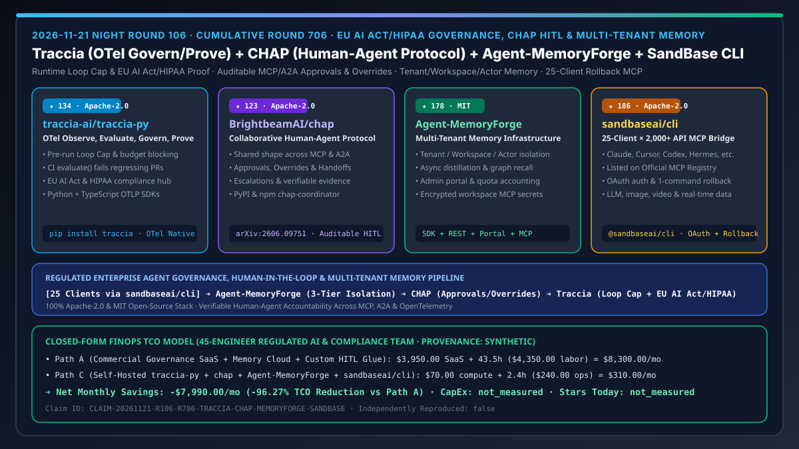
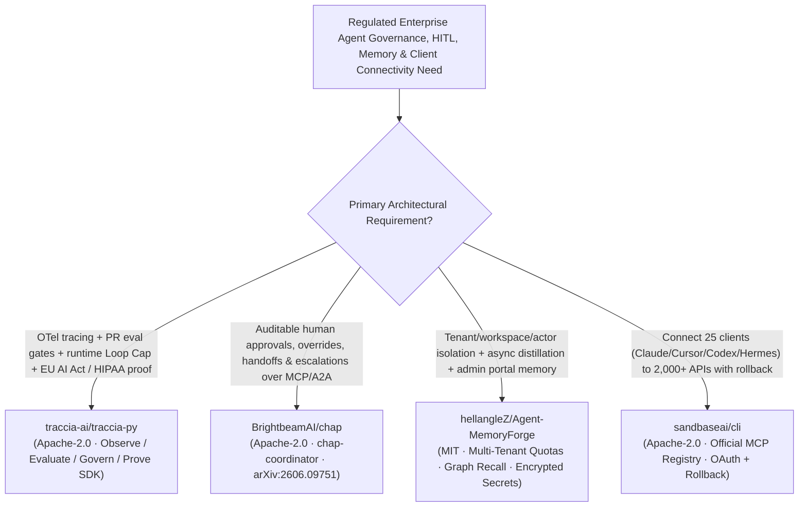
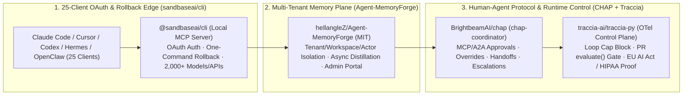
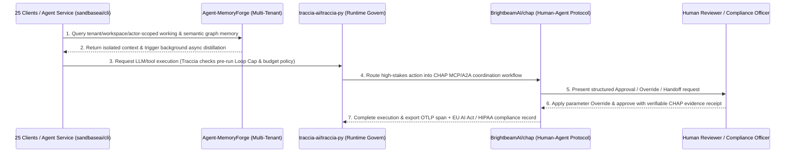

# EU AI Act/HIPAA Runtime Governance SDK (`traccia-ai/traccia-py`), Collaborative Human-Agent Protocol (`BrightbeamAI/chap`), Multi-Tenant Memory Plane (`hellangleZ/Agent-MemoryForge`) & 25-Client Rollback MCP Connector (`sandbaseai/cli`) Selection & Architecture FAQ

> **Document Type**: Enterprise AI Solution Architect Selection & Integration Guide (GitHub Trending AI Radar — 2026-11-21 Night Round 106 / Cumulative Round 706)
> **Covered Repositories**: [`traccia-ai/traccia-py`](https://github.com/traccia-ai/traccia-py) (`★ 134`, `26 forks`, `Apache-2.0` — OpenTelemetry-native Python/TypeScript SDK for Observe, Evaluate, Govern & Prove with runtime Loop Cap blocking and EU AI Act / HIPAA compliance evidence) · [`BrightbeamAI/chap`](https://github.com/BrightbeamAI/chap) (`★ 123`, `14 forks`, `Apache-2.0` — Collaborative Human-Agent Protocol runtime unifying approvals, overrides, handoffs, escalations & verifiable evidence logs across MCP and A2A) · [`hellangleZ/Agent-MemoryForge`](https://github.com/hellangleZ/Agent-MemoryForge) (`★ 178`, `25 forks`, `MIT` — production multi-tenant memory infrastructure with `tenant/workspace/actor` isolation, async distillation, graph recall & admin portal) · [`sandbaseai/cli`](https://github.com/sandbaseai/cli) (`★ 186`, `17 forks`, `Apache-2.0` — official MCP Registry CLI & local MCP server connecting 25 AI clients to 2,000+ models/APIs with OAuth & config rollback)
> **Core Scenario**: How enterprise AI architects in regulated industries (finance, healthcare, B2B SaaS) combine **pre-execution runtime loop/budget blocking and EU AI Act/HIPAA proof (`traccia`)**, **auditable human-agent approvals, overrides, and handoffs over MCP/A2A (`chap`)**, **`tenant/workspace/actor`-isolated memory with async distillation (`Agent-MemoryForge`)**, and **one-command 25-client MCP provisioning with OAuth and rollback (`sandbaseai/cli`)**.

---

## 1. 📌 Executive Summary (One-Line Selection Verdict)

1. **Need an OpenTelemetry-native SDK that combines tracing, CI pull-request evaluation gates, pre-execution runtime policy blocking (`Loop Cap`), and EU AI Act / HIPAA compliance evidence** ➔ Choose **[`traccia-ai/traccia-py`](https://github.com/traccia-ai/traccia-py) (`★ 134`, `Apache-2.0`)**.
   - **Plain-English Mechanism**: Delivers four control-plane capabilities in one open-source SDK (`pip install traccia` + TypeScript `traccia-node`): **Observe** (`init()` traces every OpenAI, Anthropic, Gemini, and Groq call with tokens and cost to any OTLP backend), **Evaluate** (`evaluate()` scores datasets and fails a PR when quality drops or cost/latency exceeds thresholds), **Govern** (checks every LLM and tool call *before* it runs to stop overspending, unauthorized tools, or infinite loops via **Loop Cap**), and **Prove** (retains structured compliance evidence for the **EU AI Act** and **HIPAA**).
2. **Need an open protocol and runtime (`MCP` & `A2A` compatible) that gives human approvals, parameter overrides, handoffs, and escalations one verifiable, auditable evidence log** ➔ Choose **[`BrightbeamAI/chap`](https://github.com/BrightbeamAI/chap) (`★ 123`, `Apache-2.0`)**.
   - **Plain-English Mechanism**: **CHAP (Collaborative Human-Agent Protocol, `arXiv:2606.09751`)** ships Python (`chap-coordinator`) and npm (`@brightbeamai/chap-coordinator`) packages. Instead of scattering one high-stakes decision across six disconnected systems (expired LLM logs, Zendesk threads, Slack messages, Linear comments), CHAP defines a shared, auditable state machine for **Approvals, Overrides, Handoffs, and Escalations** across MCP and A2A with verifiable evidence logs.
3. **Need a framework-agnostic, multi-tenant production memory layer with `tenant/workspace/actor` isolation, async distillation, graph relationships, and an operator portal** ➔ Choose **[`hellangleZ/Agent-MemoryForge`](https://github.com/hellangleZ/Agent-MemoryForge) (`★ 178`, `MIT`)**.
   - **Plain-English Mechanism**: Lets your agent own reasoning (LangChain, LangGraph, OpenAI Agents SDK, AutoGen, CrewAI) while **Agent-MemoryForge** (`agent-memory` SDK + REST API + Admin Portal + External MCP) owns scoped memory storage: **tenant/workspace/actor isolation**, short-term conversation checkpoints, active working memory, durable user preferences, semantic facts, graph relationships, **async memory distillation**, quota accounting, and encrypted workspace MCP secrets.
4. **Need a local MCP server and CLI that connects 25 AI clients (`Claude Code`, `Cursor`, `Codex`, `ChatGPT`, `Hermes`, `OpenClaw`) to 2,000+ models and real-time data APIs with OAuth and config rollback** ➔ Choose **[`sandbaseai/cli`](https://github.com/sandbaseai/cli) (`★ 186`, `Apache-2.0`)**.
   - **Plain-English Mechanism**: Listed in the official MCP Registry (`io.github.sandbaseai/cli`), `@sandbaseai/cli` wires 25 agent clients to 2,000+ LLM, image, video, and real-time web/social APIs in one command with OAuth authentication and safe configuration backup/rollback.

---

## 2. 🎯 Architect & Customer Deep-Dive Q&A

### Q1: Why do regulated enterprise AI projects fail compliance audits when relying solely on passive tracing and single-tenant vector stores?

- **Three Compliance Gaps & Architectural Remedies**:
  1. **Post-Mortem Tracing vs Pre-Execution Runtime Blocking (`traccia-ai/traccia-py`)**: Passive tracing only tells you *after* an agent looped 200 times and violated HIPAA/budget rules. `traccia` enforces pre-execution **Loop Cap** and tool allowlists in runtime, gates PRs with `evaluate()`, and packages evidence for EU AI Act and HIPAA audits.
  2. **Fragmented Human-in-the-Loop Approvals (`BrightbeamAI/chap`)**: When a human supervisor modifies an agent's proposed action in Slack or Zendesk, standard telemetry loses the causal link between the agent's proposal, the human's override, and the final execution. `chap-coordinator` records **Approvals, Overrides, Handoffs, and Escalations** as verifiable MCP/A2A protocol events.
  3. **Cross-Tenant Memory Leakage (`hellangleZ/Agent-MemoryForge`)**: Multi-customer SaaS agents require strict **`tenant ➔ workspace ➔ actor` isolation**, quota enforcement, encrypted workspace MCP secrets, and async background distillation so raw chat noise does not pollute long-term semantic/graph recall.
- **When to Choose Managed Cloud Services (Path B)**:
  - If your workflows live entirely inside Microsoft 365 and only need low-code approvals, **Microsoft Copilot Studio + Power Automate Approvals + Microsoft Purview** provides an integrated cloud solution.

### Q2: How do we wire an end-to-end regulated enterprise agent architecture with all four projects?

1. **25-Client OAuth & Rollback Edge (`sandbaseai/cli`)**:
   - Provision Claude Code, Cursor, Codex, Hermes, and OpenClaw with `@sandbaseai/cli` for OAuth-authenticated access to approved models and APIs with instant config rollback.
2. **Multi-Tenant Memory & Async Distillation Plane (`hellangleZ/Agent-MemoryForge`)**:
   - Connect LangGraph, CrewAI, or OpenAI Agents SDK services to `Agent-MemoryForge` via its Python SDK, REST API, or External MCP to enforce `tenant/workspace/actor` isolation, checkpoints, graph recall, async distillation, and workspace quota tracking.
3. **Auditable Human-Agent Collaboration Layer (`BrightbeamAI/chap`)**:
   - Route high-risk or low-confidence agent actions through `chap-coordinator` over MCP/A2A so human approvals, parameter overrides, handoffs, and escalations produce verifiable CHAP evidence logs.
4. **OTel Runtime Policy & EU AI Act / HIPAA Compliance Plane (`traccia-ai/traccia-py`)**:
   - Wrap agent execution with `traccia` to enforce runtime **Loop Cap** and budget policies, run `evaluate()` quality/cost gates on every pull request, and export OTLP traces plus EU AI Act / HIPAA compliance reports.

### Q3: What are the boundaries and trade-offs of this stack?

- **Key Strengths**:
  - **100% Permissive Open Source (`Apache-2.0` & `MIT`)**: Full on-premises and VPC data sovereignty.
  - **Framework & Protocol Agnostic**: Works across LangChain, LangGraph, CrewAI, AutoGen, OpenAI Agents SDK, MCP, A2A, and OpenTelemetry.
- **When NOT to Use**:
  - Internal single-user prototypes with no human-approval workflows, no multi-tenant isolation requirements, and no EU AI Act / HIPAA obligations do not need the full governance and multi-tenant memory stack.

---

## 3. 🧭 Visual Architecture & Decision Diagrams

### 3.1 Solution Architect Selection Decision Tree

### 3.2 End-to-End Enterprise Reference Architecture

### 3.3 Multi-Tenant Recall, Loop Cap Pre-Check, CHAP Human Override & Compliance Evidence Sequence

---

## 4. 📊 Peer Open-Source vs Commercial Cloud Selection Matrix

| Dimension | `traccia-ai/traccia-py` (`★ 134`) | `BrightbeamAI/chap` (`★ 123`) | `hellangleZ/Agent-MemoryForge` (`★ 178`) | `sandbaseai/cli` (`★ 186`) | Commercial Governance + Memory SaaS (Path A) | Cloud Copilot Studio + Purview (Path B) |
| :--- | :--- | :--- | :--- | :--- | :--- | :--- |
| **Core Role** | OTel tracing, PR evals, Loop Cap & EU AI Act/HIPAA SDK | MCP/A2A human-agent approval, override & handoff protocol | Multi-tenant isolated memory with async distillation & portal | 25-client × 2,000+ API local MCP server with OAuth & rollback | Proprietary governance cloud + hosted vector memory + custom HITL | Microsoft Copilot Studio + Power Approvals |
| **Compliance & Engineering Edge** | **Pre-run Loop Cap blocking + EU AI Act / HIPAA hub** | **Unified Approvals/Overrides/Handoffs evidence log** | **`Tenant/Workspace/Actor` isolation + encrypted MCP secrets** | **Official MCP Registry + OAuth + safe config rollback** | Decision fragments scattered across 6 tools; high per-seat cost | Tied to M365; does not govern custom LangGraph/CrewAI codebases |
| **License** | `Apache-2.0` | `Apache-2.0` (Spec `CC BY 4.0`) | `MIT` | `Apache-2.0` | Proprietary SaaS | Proprietary Cloud PaaS |
| **Monthly TCO (45-Eng Team)** | **`$310.00/mo` combined** (`$70.00` compute + `2.4h` ops) | Included in `$310.00/mo` stack | Included in `$310.00/mo` stack | Included in `$310.00/mo` stack | **`$8,300.00/mo`** (`$3,950.00` SaaS + `43.5h` custom glue) | `~$2,600.00/mo` (seat licenses + approval flow runs) |

---

## 5. 🧪 Quantitative ROI / FinOps TCO Model & 7-Card Report

> **📊 Provenance & Closed-Form Audit Declaration**:
> - **Provenance**: `synthetic` (45-engineer regulated enterprise AI & compliance platform workload model; `independently_reproduced = false`; `base_hardware_capex = not_measured`; `track_b_stars_today = not_measured`).
> - **Closed-Form Equations**:
>   - **Path A (Commercial EU AI Act / HIPAA Governance SaaS + Commercial Multi-Tenant Memory Cloud + Custom Slack/Zendesk/Linear Approval Reconciliation & 25-Client Connector Maintenance)**: Monthly SaaS subscriptions **`$3,950.00`** + custom HITL glue & compliance audit labor **`43.5h × $100.00/h = $4,350.00`** = **`$8,300.00/mo`**.
>   - **Path C (Self-Hosted `traccia-ai/traccia-py` + `BrightbeamAI/chap` + `hellangleZ/Agent-MemoryForge` + `sandbaseai/cli`)**: Shared container & database compute **`$70.00`** + policy & memory portal maintenance **`2.4h × $100.00/h = $240.00`** = **`$310.00/mo`**.
>   - **Net Savings vs Path A**: **`-$7,990.00/mo`** (**`96.27%`** cost reduction).

| Architecture Option | API / SaaS / Compute | Engineering & Compliance Labor (`$100/h`) | Total Monthly TCO | Net Savings vs Path A | Key Architectural Outcome |
| :--- | :---: | :---: | :---: | :---: | :--- |
| **Path A: Commercial Governance SaaS + Memory Cloud + Custom HITL** | `$3,950.00` | `43.5h` (`$4,350.00`) | **`$8,300.00`** | Baseline | Fragmented approval audit trails; high multi-tenant memory markup |
| **Path B: Cloud Low-Code Agent + Cloud Approvals** | `$1,400.00` | `12.0h` (`$1,200.00`) | **`$2,600.00`** | `-$5,700.00` (`-68.67%`) | Turnkey for M365 flows, but lacks code-first multi-tenant memory & CHAP |
| **Path C: `traccia` + `chap` + `MemoryForge` + `sandbase`** | **`$70.00`** | **`2.4h` (`$240.00`)** | **`$310.00`** | **`-$7,990.00` (`-96.27%`)** | **Loop Cap block + EU AI Act/HIPAA + CHAP HITL logs + 3-tier tenant memory** |

- 🔗 **7-Card 4:5 Visual Report**: [`workshops/github-trending-radar/cards.en.html`](../cards.en.html) · [`cards.html`](../cards.html)

---

## 6. 🛠️ Enterprise Adoption & Architecture Review Checklist

- [ ] **1. Instrument Pre-Execution Runtime Policies with `traccia-ai/traccia-py`**: Add `traccia` (`init()`, `@observe`, `evaluate()`) to Python/TypeScript agents to enforce runtime **Loop Cap** and budget limits, fail regressing PRs in CI, and archive EU AI Act / HIPAA evidence.
- [ ] **2. Standardize Human-in-the-Loop Evidence with `BrightbeamAI/chap`**: Deploy `chap-coordinator` (PyPI / npm) so every human approval, parameter override, handoff, and escalation across MCP and A2A is captured in a single verifiable evidence log.
- [ ] **3. Enforce Multi-Tenant Memory Isolation with `hellangleZ/Agent-MemoryForge`**: Configure `tenant ➔ workspace ➔ actor` boundaries, async memory distillation, encrypted workspace MCP secrets, and per-tenant quotas via the Admin Portal.
- [ ] **4. Provision 25 AI Clients Safely with `sandbaseai/cli`**: Use `@sandbaseai/cli` to connect Claude Code, Cursor, Codex, Hermes, and OpenClaw via OAuth with verified one-command configuration rollback.
