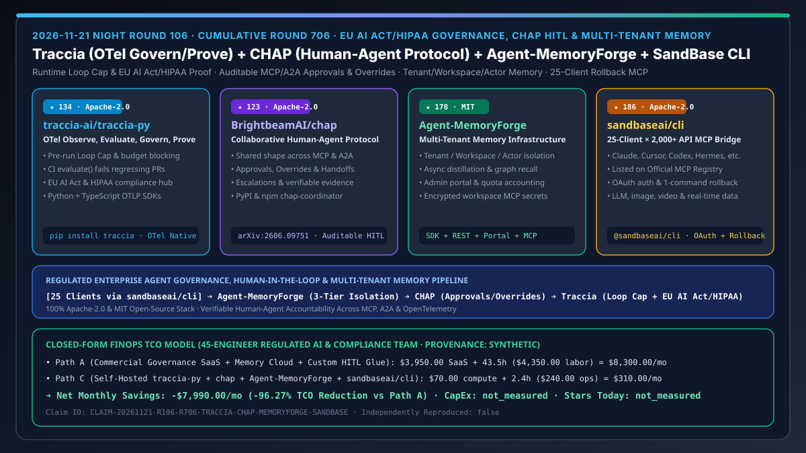
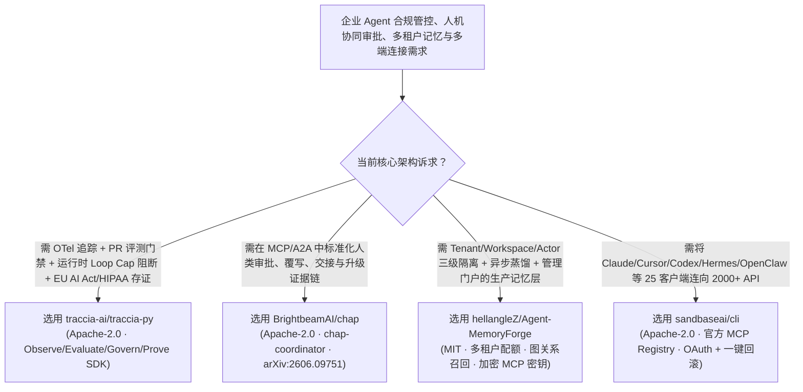
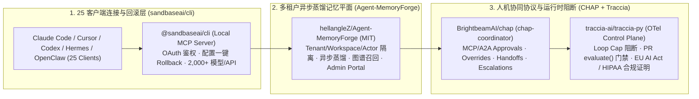
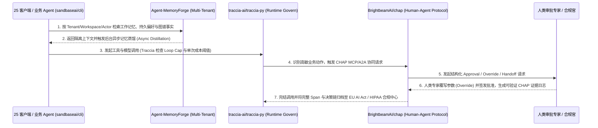

# EU AI Act/HIPAA 运行时阻断与 OTel 评测 SDK（`traccia-ai/traccia-py`）、MCP/A2A 人机协同审批与交接协议（`BrightbeamAI/chap`）、多租户异步蒸馏记忆平面（`hellangleZ/Agent-MemoryForge`）与 25 客户端 × 2000+ API 回滚连接器（`sandbaseai/cli`）选型与集成架构 FAQ

> **文档类型**：企业 AI 解决方案架构师（AI Solution Architect）选型决策指南（GitHub Trending AI 雷达 2026-11-21 Night Round 106 / 累计第 706 轮）
> **覆盖项目**：[`traccia-ai/traccia-py`](https://github.com/traccia-ai/traccia-py)（`★ 134`、`26 forks`、`Apache-2.0`，基于 OpenTelemetry 的 Observe/Evaluate/Govern/Prove 四位一体 SDK，支持死循环 Loop Cap 实时阻断与 EU AI Act/HIPAA 证据留存）· [`BrightbeamAI/chap`](https://github.com/BrightbeamAI/chap)（`★ 123`、`14 forks`、`Apache-2.0`，Collaborative Human-Agent Protocol——横跨 MCP 与 A2A 统一审批 Approvals、覆写 Overrides、交接 Handoffs 与升级 Escalations 的人机协同协议与运行时）· [`hellangleZ/Agent-MemoryForge`](https://github.com/hellangleZ/Agent-MemoryForge)（`★ 178`、`25 forks`、`MIT`，支持 Tenant/Workspace/Actor 三级隔离、异步记忆蒸馏、图关系召回与管理门户的生产级多租户记忆底座）· [`sandbaseai/cli`](https://github.com/sandbaseai/cli)（`★ 186`、`17 forks`、`Apache-2.0`，连接 Claude Code/Cursor/Codex/Hermes/OpenClaw 等 25 大客户端与 2,000+ 模型/API 且支持 OAuth 与一键回滚的本地 MCP Server）
> **核心场景**：当金融、医疗与大型企业 AI 架构师需要**在每次 LLM/工具调用前实时拦截超支与死循环（Loop Cap）并出具有效的 EU AI Act / HIPAA 合规证据**、**将跨散在 Slack/Zendesk/工单中的人工审批（Approval）、人工干预覆写（Override）与人机交接（Handoff）标准化为可验证的 MCP/A2A 协议记录**、**为多租户 SaaS 提供 `Tenant/Workspace/Actor` 严格隔离与异步蒸馏的独立记忆层**，以及**为 25 种异构客户端快速挂载带 OAuth 与配置回滚的外部 API 能力**时，如何选型并整合这四大开源项目？

---

## 一、📌 核心结论速览（选型一句话结论）

1. **需要在代码层用一套 OpenTelemetry 原生 SDK 同时搞定链路追踪、PR 成本/延迟门禁评测、运行时死循环/越权拦截（Loop Cap）以及 EU AI Act / HIPAA 合规存证** ➔ 选 **[`traccia-ai/traccia-py`](https://github.com/traccia-ai/traccia-py)（`★ 134`，`Apache-2.0`）**。
   - **通俗原理**：`pip install traccia`（另有配套 TypeScript SDK `traccia-node`）将企业 Agent 控制面浓缩为四大动作：**Observe**（自动追踪 OpenAI/Anthropic/Gemini/Groq 的 Token 与成本并导出至任意 OTLP 后端）、**Evaluate**（在本地或 CI 中运行 `evaluate()`，当质量下降或成本/延迟超标时自动阻断 PR）、**Govern**（在每次 LLM 和工具执行前检查运行时策略，通过 `Loop Cap` 实时阻断工具死循环、预算超支或违规工具调用）与 **Prove**（为 **EU AI Act** 与 **HIPAA** 保留完整合规审计证据）。
2. **想要把“人工审批、人工覆写、人机交接、异常升级”标准化为跨 MCP 与 A2A 通用的可验证证据链（彻底告别散落在 Slack/工单/过期日志里的碎片记录）** ➔ 选 **[`BrightbeamAI/chap`](https://github.com/BrightbeamAI/chap)（`★ 123`，`Apache-2.0`）**。
   - **通俗原理**：**CHAP（Collaborative Human-Agent Protocol，论文 `arXiv:2606.09751`）** 提供了 Python（`chap-coordinator`）与 npm（`@brightbeamai/chap-coordinator`）双栈协调器运行时。在传统架构中，一次高危客诉退款的上下文往往碎裂在过期的 OpenAI 日志、Zendesk 会话、Slack 聊天和 Linear 评论里，事后根本无法审计“到底是谁批准的、人类改了哪个参数”。CHAP 在 MCP 与 A2A 之上定义了统一的 **`Approval`（审批）、`Override`（人工修改覆写）、`Handoff`（人机交接）与 `Escalation`（升级）** 协议原语与可验证证据日志（Verifiable Evidence Logs）。
3. **正在构建多租户企业级 SaaS Agent，需要独立于编排框架（LangGraph/AutoGen/CrewAI）之外的 `Tenant ➔ Workspace ➔ Actor` 三级隔离、异步蒸馏与配额计费记忆基础设施** ➔ 选 **[`hellangleZ/Agent-MemoryForge`](https://github.com/hellangleZ/Agent-MemoryForge)（`★ 178`，`MIT`）**。
   - **通俗原理**：坚持“业务 Agent 管推理编排、MemoryForge 管多租户记忆治理”的解耦设计。它同时提供短期会话 Checkpoint、任务活跃工作记忆、持久用户偏好、语义事实与业务决策、图关系召回（Graph Relationships）以及后台**异步记忆蒸馏（Async Memory Distillation）**；内置认证 REST API、官方 Python SDK（`agent-memory`）、管理后台门户（Admin Portal）、租户配额计费以及加密的工作区 MCP 密钥管理。
4. **想用一行命令把 Claude Code、Cursor、Codex、ChatGPT、Hermes、OpenClaw 等 25 种客户端接入 2,000+ 多模态模型与实时数据 API，并具备 OAuth 与配置一键回滚能力** ➔ 选 **[`sandbaseai/cli`](https://github.com/sandbaseai/cli)（`★ 186`，`Apache-2.0`）**。
   - **通俗原理**：已收录于官方 MCP Registry（`io.github.sandbaseai/cli`）的开源 CLI 与本地 MCP Server（`@sandbaseai/cli`）。支持自动探测并注入 **25 种主流 AI 客户端**配置（附带配置备份与一键 Rollback 回滚机制），通过 OAuth 免 Key 繁琐配置直连 2,000+ LLM、文生图、视频生成与网页/社媒实时数据接口。

---

## 二、🎯 客户与架构师灵魂拷问 Q&A（深度架构拆解）

### Q1：金融与医疗企业在做 AI Agent 合规评审时，为什么普通的 LangFuse/OTel 日志过不了“人机责任界定”和“多租户记忆防串租”这两关？

- **三大合规盲区与架构解方**：
  1. **只记录不拦截 vs 运行时 Loop Cap + EU AI Act/HIPAA 存证（`traccia-ai/traccia-py`）**：事后看 Trace 发现 Agent 死循环刷掉了 `$500` 或调用了越权接口已经晚了。`traccia` 在工具执行前（Pre-execution）挂载运行时策略拦截，并在 PR 阶段对延迟/成本/准确率设硬门禁。
  2. **人机协同“黑盒化” vs CHAP 协议级审批与覆写证据链（`BrightbeamAI/chap`）**：当人类专家介入修改了 Agent 拟定的合同条款或诊疗建议（Override）后，普通日志看不出哪些字是 AI 写的、哪些是人改的、由谁签字放行的。`chap-coordinator` 把 `Approvals / Overrides / Handoffs / Escalations` 变成跨 MCP 与 A2A 的一等协议公民。
  3. **多租户向量库串租风险 vs 三级隔离异步蒸馏记忆（`hellangleZ/Agent-MemoryForge`）**：把所有客户的对话塞进同一个裸向量集合极易引发跨租户隐私泄露。`Agent-MemoryForge` 原生强制 `Tenant / Workspace / Actor` 三级硬隔离、异步蒸馏与配额审计。
- **何时直接用云厂商托管方案（Path B）？**
  - 若企业业务完全运行在 Microsoft 365 内部，仅需 Power Automate 审批流与 Copilot Studio 内置会话存储，直接使用 **Microsoft Copilot Studio + Power Platform Approvals + Azure Purview** 即可。

### Q2：典型企业级“25 客户端统一接入 (`sandbaseai/cli`) + 多租户记忆底座 (`Agent-MemoryForge`) + CHAP 人机责任协议 (`chap`) + OTel 运行时阻断与合规 (`traccia`)”参考架构怎么搭？

1. **多客户端统一工具与模型接入层（`sandbaseai/cli`）**：
   - 在研发与业务终端通过 `@sandbaseai/cli`（含 OAuth 与配置回滚保护）为 Claude Code、Cursor、Codex、Hermes、OpenClaw 等 25 种客户端统一挂载外部模型与实时数据 MCP 工具。
2. **多租户隔离与异步蒸馏记忆层（`hellangleZ/Agent-MemoryForge`）**：
   - 底层编排框架（无论是 LangGraph、OpenAI Agents SDK 还是 CrewAI）统一通过 `Agent-MemoryForge` 的 REST API / Python SDK / External MCP 读写记忆；按 `Tenant ➔ Workspace ➔ Actor` 隔离短期 Checkpoint、长期业务决策与图谱关系，并由后台 Worker 异步完成记忆蒸馏与配额核算。
3. **MCP/A2A 人机协同审批与交接控制层（`BrightbeamAI/chap`）**：
   - 当 Agent 触发高风险操作或置信度不足时，通过 `chap-coordinator` 发起标准 CHAP 事务：无论走自动规则放行、人类专家审批（Approval）、参数覆写（Override）还是跨团队升级（Escalation），均生成不可篡改的 CHAP 证据日志。
4. **OpenTelemetry 运行时策略阻断与法规证明层（`traccia-ai/traccia-py`）**：
   - 全程由 `traccia` 采集 OTLP Span（含 Token 与单步成本），在运行时执行 `Loop Cap` 与预算拦截，在 CI/CD 中运行 `evaluate()` 阻断劣质 PR，并导出符合 **EU AI Act** 与 **HIPAA** 要求的合规审计包。

### Q3：这套组合的适用边界是什么？

- **核心优势**：
  - **100% 商业友好开源许可（`Apache-2.0` 与 `MIT`）**：全部组件均可私有化部署于企业内网。
  - **框架无关与协议标准**：不绑死任何特定 Agent 框架，全面拥抱 OpenTelemetry、MCP 与 A2A 开放标准。
- **适用边界**：
  - 纯内部单人使用的无状态问答小工具无需部署多租户 `Agent-MemoryForge` 门户与 `CHAP` 人机责任协议。

---

## 三、🧭 直观可视化图解（Mermaid 决策树 + 集成架构 + 时序图）

### 3.1 架构师选型决策树

### 3.2 企业端到端生产集成参考架构图

### 3.3 多租户记忆召回、Loop Cap 运行时守卫、CHAP 人机覆写审批与 OTel 合规存证时序图

---

## 四、📊 同类开源与商业云服务横向选型决策矩阵

| 对比维度 | `traccia-ai/traccia-py` (`★ 134`) | `BrightbeamAI/chap` (`★ 123`) | `hellangleZ/Agent-MemoryForge` (`★ 178`) | `sandbaseai/cli` (`★ 186`) | 商业合规治理云 + 商业多租户记忆 SaaS (Path A) | 云原生 Copilot Studio + Purview (Path B) |
| :--- | :--- | :--- | :--- | :--- | :--- | :--- |
| **核心能力定位** | OTel 原生追踪、PR 评测、Loop Cap 阻断与法规存证 | MCP/A2A 人机审批、覆写、交接与升级开放协议 | 多租户三级隔离、异步蒸馏与门户级记忆基础设施 | 25 客户端 × 2000+ 模型/API 本地 MCP 与回滚 CLI | 商业 AI 治理 SaaS + 商业向量记忆云 + 自研审批流 | Microsoft Copilot Studio + Power Approvals |
| **合规与工程亮点** | **运行时拦截死循环/超支 + EU AI Act / HIPAA 证据** | **统一 Approvals/Overrides/Handoffs 可验证证据链** | **`Tenant/Workspace/Actor` 隔离 + 加密工作区 MCP 密钥** | **官方 MCP Registry 收录 + OAuth + 配置一键回滚** | 散落在 6 个工具里的碎片日志无法还原人机修改责任 | 绑定单一办公套件，不支持跨 25 种开源编码/终端 Agent |
| **开源协议** | `Apache-2.0` | `Apache-2.0`（规范 `CC BY 4.0`） | `MIT` | `Apache-2.0` | 闭源商业 SaaS | 闭源云服务 |
| **月度 TCO（45 人团队）** | **组合仅 `$310.00/月`**（含共享容器算力与 2.4h 运维） | 同左（`$70.00` 算力 + `$240.00` 人工） | 同左（自托管多租户记忆服务） | 同左（本地 MCP CLI 零月租） | **`$8,300.00/月`**（`$3,950.00` 订阅 + `43.5h` 胶水开发） | 约 `$2,600.00/月`（按席位与审批流执行次数计费） |

---

## 五、🧪 应用落地定量收益/TCO 对比与 7-Card 报告

> **📊 数据来源与闭式核算声明（Provenance & Closed-Form Schema）**：
> - **provenance**: `synthetic`（基于 45 人金融/医疗合规 AI 研发与平台团队工作负载模型：`independently_reproduced = false`；硬件采购基线 `base_hardware_capex = not_measured`；Track B 单日增量 `track_b_stars_today = not_measured`）。
> - **核算公式**：
>   - **Path A（商业 EU AI Act/HIPAA 可观测与治理 SaaS + 商业多租户记忆云 + 手写 Slack/Zendesk/Linear 跨系统人工审批对账脚本与 25 客户端连接维护）**：月度 SaaS 订阅费 **`$3,950.00`** + 手写人机协同胶水与合规对账人工 **`43.5h × $100.00/h = $4,350.00`** = **`$8,300.00/月`**。
>   - **Path C（自建 `traccia-ai/traccia-py` + `BrightbeamAI/chap` + `hellangleZ/Agent-MemoryForge` + `sandbaseai/cli` 开源组合）**：共享容器与数据库算力 **`$70.00`** + 协议策略与记忆门户维护 **`2.4h × $100.00/h = $240.00`** = **`$310.00/月`**。
>   - **净节省（Net Savings vs Path A）**：**`-$7,990.00/月`**（成本降低 **`96.27%`**）。

| 评估方案 | API / SaaS / 算力成本 | 工程与合规运维人工（`$100/h`） | 月度总 TCO | 相对 Path A 净节省 | 关键架构交付指标 |
| :--- | :---: | :---: | :---: | :---: | :--- |
| **Path A：商业合规治理云 + 商业记忆 SaaS + 手写审批流** | `$3,950.00` | `43.5h` (`$4,350.00`) | **`$8,300.00`** | Baseline | 决策碎片散落 6 大系统；多租户记忆按条高额计费 |
| **Path B：云厂商低代码 Agent + 云原生审批** | `$1,400.00` | `12.0h` (`$1,200.00`) | **`$2,600.00`** | `-$5,700.00` (`-68.67%`) | 适合简单办公流，无法支撑代码级 LangGraph/CrewAI 多租户记忆 |
| **Path C：`traccia` + `chap` + `MemoryForge` + `sandbase`** | **`$70.00`** | **`2.4h` (`$240.00`)** | **`$310.00`** | **`-$7,990.00` (`-96.27%`)** | **Loop Cap 阻断 + EU AI Act/HIPAA + CHAP 人机证据 + 三级隔离记忆** |

- 🔗 **关联 7-Card 4:5 视觉评测报告**：[`workshops/github-trending-radar/cards.html`](../cards.html) · [`cards.en.html`](../cards.en.html)

---

## 六、🛠️ 企业引入与架构评审 Checklist

- [ ] **1. 集成 `traccia-ai/traccia-py` 开启运行时策略守卫与 PR 门禁**：在 Python/Node.js Agent 服务中初始化 `traccia`，配置 `Loop Cap` 防止工具死循环与成本超支，并在 CI 中启用 `evaluate()` 质量/延迟门禁及 EU AI Act / HIPAA 合规归档。
- [ ] **2. 部署 `BrightbeamAI/chap` 统一 MCP/A2A 人机协同证据链**：安装 `chap-coordinator`（PyPI/npm），将所有高风险工具调用的人工审批（Approval）、参数覆写（Override）、交接（Handoff）与升级（Escalation）纳入统一的 CHAP 可验证证据日志。
- [ ] **3. 搭建 `hellangleZ/Agent-MemoryForge` 多租户记忆底座**：启用 `Tenant ➔ Workspace ➔ Actor` 三级权限隔离、后台异步记忆蒸馏（Async Distillation）与工作区加密 MCP 密钥管理，通过 Admin Portal 监控各租户记忆配额。
- [ ] **4. 使用 `sandbaseai/cli` 标准化 25 种客户端的外部 API 接入**：通过 `@sandbaseai/cli` 为 Claude Code、Cursor、Codex、Hermes 与 OpenClaw 统一配置 OAuth 鉴权与本地 MCP 路由，并验证配置异常时的一键 Rollback 恢复流程。
