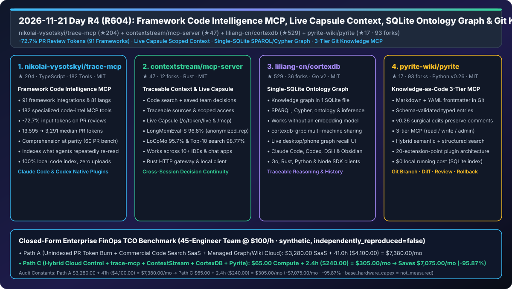
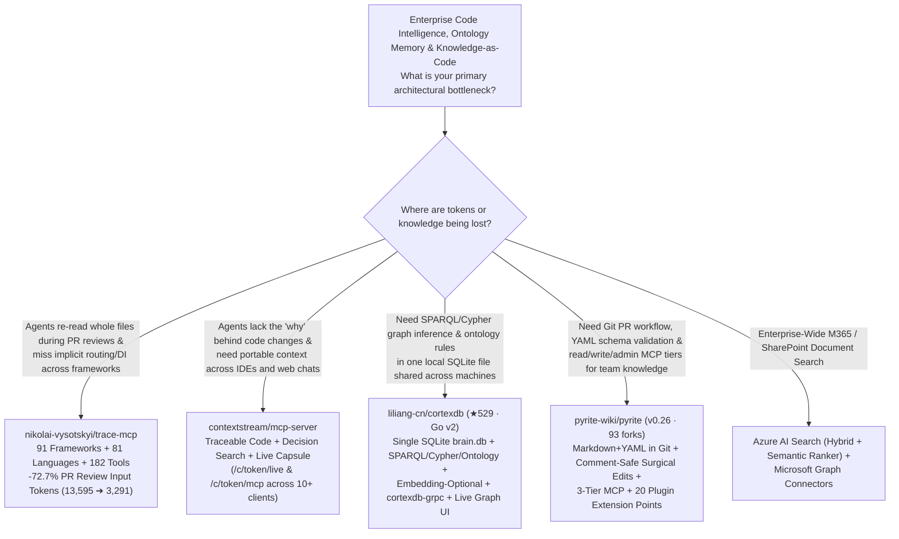
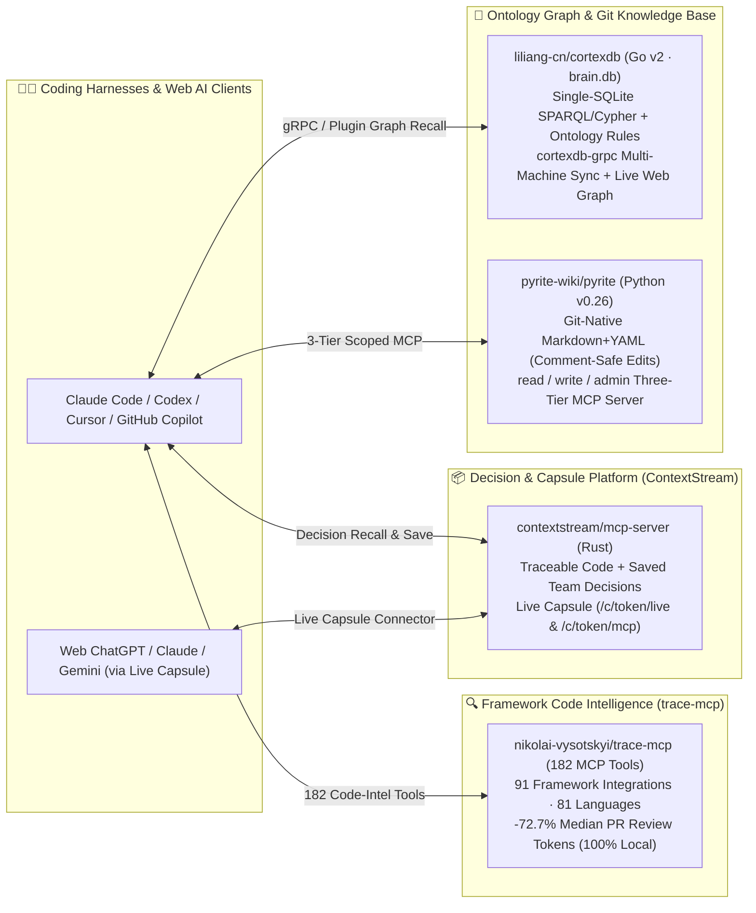

# Framework-Aware Code Intelligence MCP (`nikolai-vysotskyi/trace-mcp`), Live Capsule Context Platform (`contextstream/mcp-server`), Single-SQLite Ontology Knowledge Graph (`liliang-cn/cortexdb`) & Git-Native 3-Tier Knowledge-as-Code (`pyrite-wiki/pyrite`) Selection & Architecture FAQ

> **Target Audience**: **AI Solution Architects (SAs) & Enterprise Engineering / Knowledge Leaders (2026-11-21 Day Round 4 · Cumulative Round 604)**  
> **Benchmark Style**: Strictly aligned with [`ib-vs-ethernet-roce-selection-faq.md`](https://github.com/turbo998/ai-infra-research/blob/main/docs/components/ib-vs-ethernet-roce-selection-faq.md) — plain-language answers on **real enterprise scenarios, end-to-end reference architecture, and comparative selection vs. competing OSS and cloud PaaS**.  
> **Chinese Edition**: [`trace-mcp-contextstream-cortexdb-pyrite-selection-faq.md`](./trace-mcp-contextstream-cortexdb-pyrite-selection-faq.md) · **Daily Digest**: [`daily/2026-11-21.en.md`](../daily/2026-11-21.en.md)



---

## 1. 📌 Executive Summary (30-Second Selection Verdict)

1. **Why Evaluate These Four Repositories Together?**  
   In large enterprise codebases, the single biggest driver of LLM token waste and architectural drift is that **coding agents repeatedly re-read entire files to understand framework wiring while remaining blind to the team's underlying architectural decisions and ontology constraints**:
   - **Pain 1 — Re-Reading Full Files During PR Reviews & Burning 70%+ Extra Input Tokens**: Generic AST or grep tools do not understand framework-specific dependency injection, routing, or ORM bindings, forcing agents to read dozens of whole files → **`nikolai-vysotskyi/trace-mcp` (`★ 204`, TypeScript, MIT)** ships **182 MCP tools across 91 framework integrations and 81 languages**, indexing what your agent repeatedly re-reads locally and cutting median pull-request review context from **`13,595` tokens to `3,291` tokens (`-72.7%` input tokens at parity comprehension across 60 merged PRs in 6 external OSS repos, `anonymized_reported`)**.
   - **Pain 2 — Agents See Code But Miss Saved Team Decisions Across IDEs and Web Chats**: When engineers switch between Claude Code, Cursor, Codex, GitHub Copilot, and web ChatGPT/Claude, architectural decisions behind the code are lost → **`contextstream/mcp-server` (`★ 47`, `12 forks`, Rust, MIT)** links code search with traceable team decisions and generates a **`Live Capsule` (`capsule(action="live")`)**—returning a browseable `/c/<token>/live` decision/symbol digest and a zero-signup `/c/<token>/mcp` connector for any MCP-capable client.
   - **Pain 3 — Graph Reasoning & Ontology Constraints Typically Require Heavy Graph Databases**: Vector stores only match cosine similarity and cannot enforce SPARQL/Cypher ontology rules without spinning up Neo4j clusters → **`liliang-cn/cortexdb` (`★ 529`, `36 forks`, Go `v2`, MIT)** packs a **full SPARQL + Cypher knowledge graph, ontology constraints, inference engine, and traceable recall history into a single local SQLite file (`brain.db`)**, works even **without an embedding model**, and shares one brain across Claude Code, Codex, DeepSeek Harness, and Obsidian over `cortexdb-grpc` with a live desktop/mobile graph visualizer.
   - **Pain 4 — Team Wikis Lack Git PR Governance, Schema Validation, and Tiered Agent Access Control**: Letting untrusted agents write directly to shared Markdown notes risks corrupting frontmatter or overwriting human comments → **`pyrite-wiki/pyrite` (`★ 17`, `93 forks`, Python `v0.26`, MIT)** implements **Knowledge-as-Code** (schema-validated Markdown + YAML frontmatter in Git where `v0.26` surgical edits preserve human comments, field order, and quoting), backed by a **three-tier MCP server (`read` / `write` / `admin`)**, hybrid semantic + structured search on a local SQLite index (`$0` running cost), and **20 plugin extension points**.

2. **One-Sentence Selection Verdict**:
   - Choose **`nikolai-vysotskyi/trace-mcp`** when you want **100% local, framework-aware code intelligence (91 frameworks, 81 languages, 182 tools) that cuts PR review input tokens by 72.7%**.
   - Choose **`contextstream/mcp-server`** when you need **traceable code + team decision retrieval and `Live Capsule` (`/live` & `/mcp`) links to share project context across 10+ IDEs and web chat apps**.
   - Choose **`liliang-cn/cortexdb`** when you need **a single-file SQLite knowledge graph (`brain.db`) supporting SPARQL, Cypher, ontology constraints, and multi-machine `cortexdb-grpc` recall**.
   - Choose **`pyrite-wiki/pyrite`** when you need **Git-versioned, schema-validated Markdown+YAML knowledge bases with `read`/`write`/`admin` MCP tiers and comment-preserving surgical edits** (or pair with **Azure AI Search Semantic Ranker + Microsoft Graph Connectors** for enterprise-wide M365/SharePoint document governance).

---

## 2. 🎯 Customer & Solution Architect Q&A (Plain-Language Deep Dive)

### Q1: How does `nikolai-vysotskyi/trace-mcp` cut PR review input tokens by 72.7% (`13,595 ➔ 3,291` tokens) compared to standard LSP or ripgrep?
- **Plain-Language Answer**:
  - Standard LSPs resolve syntax-level symbols, but modern applications rely heavily on **framework conventions** (DI containers, controller decorators, middleware chains, ORM relations, and reactive state across 91 frameworks). Without framework intelligence, a coding agent reviewing a pull request has to read entire files to trace side effects.
  - **How `trace-mcp` solves it**:
    1. **91 Framework Integrations + 81 Languages + 182 Specialized MCP Tools**: Pre-indexes framework-specific call paths and serves concise structural answers instead of raw file dumps.
    2. **Verified `-72.7%` Median Token Reduction on 60 External PRs (`anonymized_reported`)**: Benchmarked across 60 merged pull requests in 6 third-party open-source repositories (`docs/_data/pr_context_bench.json`), reducing median context from `13,595` tokens to `3,291` tokens while maintaining comprehension parity.
    3. **100% Local Execution (MIT)**: All indexing and query execution stay on the developer's machine or CI runner with zero source-code uploads.

### Q2: Both `liliang-cn/cortexdb` and `pyrite-wiki/pyrite` are MIT-licensed local-first knowledge systems—when should an SA choose `cortexdb` vs. `pyrite`?
- **Plain-Language Answer**:
  - **Choose `liliang-cn/cortexdb` (`★ 529`, Go `v2`) for Single-File Graph Reasoning (`SPARQL`/`Cypher`), Ontology Enforcement & Multi-Machine `gRPC` Sync**:
    1. **True Knowledge Graph in One SQLite File (`brain.db`)**: Supports SPARQL, Cypher, ontology constraints, logical inference, and recall history without external graph database servers.
    2. **Embedding-Optional + Live Graph Recall UI**: Works out of the box without an embedding model (add one optionally for semantic vectors) and renders a live web view highlighting recalled nodes and ontology links on desktop or mobile.
    3. **Shared Brain Across Harnesses (`cortexdb-grpc`)**: Native plugins for Claude Code, Codex, DeepSeek Harness (`dsh-cortexdb-memory`), and Obsidian (`obsidian-cortexdb`), plus Go, Rust, Python, and Node SDKs.
  - **Choose `pyrite-wiki/pyrite` (`★ 17`, `93 forks`, Python `v0.26`) for Git-Audited Knowledge-as-Code & Three-Tier MCP Access Control**:
    1. **Typed YAML Schemas + Surgical File Edits in Git (`v0.26`)**: Every `person`, `decision`, `event`, or `component` entry is a schema-validated Markdown + YAML file committed to Git (`pyrite kb commit`). In `v0.26`, AI edits modify only the requested fields while preserving human comments, field ordering, and quote styles.
    2. **Three-Tier MCP Server (`read` / `write` / `admin`) + 20 Extension Points**: Grants untrusted agents `read`-only MCP access, trusted coding agents `write` access, and humans `admin` control (note: upstream explicitly marks multi-user untrusted internet hosting as experimental, making it ideal for single-user or trusted internal engineering teams).

### Q3: How does `contextstream/mcp-server`'s `Live Capsule` bridge context between local coding IDEs and web-based LLMs (ChatGPT, Claude, Gemini)?
- **Plain-Language Answer**:
  - Calling `capsule(action="live")` produces two instant capabilities:
    1. **A Live Web Digest (`/c/<token>/live`)**: Compact, interlinked pages covering the repository file tree, symbols, saved architectural decisions, lessons learned, and plans that web chat models can traverse on demand.
    2. **A Capability-Scoped MCP Connector (`/c/<token>/mcp`)**: Added once as a custom MCP connector in Claude, ChatGPT, Gemini, or Cursor with zero separate login because the token URL acts as its own scoped capability key (upstream reports `LongMemEval-S 96.8% [484/500]` and `LoCoMo 95.7%`, `anonymized_reported`).

---

## 3. 🧭 Visual Architecture & Decision Diagrams (Mermaid)

### 3.1 Solution Architect Selection Decision Tree



### 3.2 End-to-End Enterprise Reference Architecture



### 3.3 End-to-End Execution Sequence Diagram

```mermaid
sequenceDiagram
    autonumber
    participant Agent as PR Reviewer / Coding Agent
    participant Trace as trace-mcp (91-Framework Code Intel)
    participant Pyrite as pyrite-wiki/pyrite (3-Tier Git KB)
    participant Cortex as liliang-cn/cortexdb (SQLite Ontology Graph)
    participant CStream as contextstream/mcp-server (Live Capsule)

    Agent->>Trace: 1. Request impact analysis for a multi-service pull request
    Trace-->>Agent: 2. Serve framework-aware call graph & symbol slice (3,291 tokens vs 13,595; -72.7%)
    Agent->>Pyrite: 3. Query component schema & approved ADR entries via read-tier MCP
    Pyrite-->>Agent: 4. Return Git-verified YAML/Markdown architectural constraints
    Agent->>Cortex: 5. Run SPARQL/Cypher ontology check over cortexdb-grpc (brain.db)
    Cortex-->>Agent: 6. Return traceable reasoning pack & highlight recall graph in live web UI
    Agent->>Pyrite: 7. Update component entry via write-tier MCP (v0.26 surgical edit preserves YAML comments)
    Agent->>CStream: 8. Generate Live Capsule (/c/<token>/mcp) for cross-team architecture sign-off
```

---

## 4. 📊 Comparative Selection Matrix (OSS vs. Peer Projects vs. Cloud PaaS)

| Dimension | `nikolai-vysotskyi/trace-mcp` | `contextstream/mcp-server` | `liliang-cn/cortexdb` | `pyrite-wiki/pyrite` | Legacy AST / Heavy Graph DB (Raw LSP + Neo4j + Unvalidated Wiki) | Managed Cloud PaaS (GitHub Copilot Enterprise + Azure AI Search + Cosmos Gremlin) |
| :--- | :--- | :--- | :--- | :--- | :--- | :--- |
| **Primary Role** | **91-Framework Code Intelligence MCP (`-72.7%` PR Tokens)** | **Traceable Code/Decision Platform & `Live Capsule`** | **Single-SQLite SPARQL/Cypher Ontology Knowledge Graph** | **Git-Native Schema-Validated KB & 3-Tier MCP Server** | Disconnected syntax parsers and heavy graph servers | Fully managed enterprise code intelligence and cloud search |
| **Best-Fit Scenario** | Cutting PR review and refactoring token spend across 91 frameworks locally | Sharing saved project decisions and live context across 10+ IDEs and web chats | Multi-machine agent memory needing SPARQL/Cypher ontology rules in 1 SQLite file | Teams managing typed ADRs/knowledge in Git with `read/write/admin` MCP tiers | Teams with dedicated DBAs running standalone Neo4j clusters | Global org-wide repositories and M365 document estates |
| **Key Differentiator** | 182 tools + 91 frameworks + 81 languages + `-72.7%` median PR tokens | Zero-login `Live Capsule` (`/c/<token>/live` & `/mcp`) + traceable citations | Works without embeddings + SPARQL/Cypher in `brain.db` + live graph UI | `v0.26` comment-preserving surgical YAML edits + 3-tier MCP + 20 plugin hooks | High token burn on framework code and heavy JVM/Neo4j ops overhead | Turnkey multi-region SLA, Entra ID RBAC, and managed indexing |
| **Integration Effort** | Very Low (native Claude Code & Codex plugins) | Very Low (1-line `mcp.sh` / `mcp.ps1` onboarding) | Very Low (Claude/Codex/DSH/Obsidian plugins + Go/Py/TS/Rust SDKs) | Low (`pyrite init` + Git repo + built-in MCP server) | High (custom AST glue and graph schema maintenance) | Low–Medium (standard Azure & GitHub Enterprise seat assignment) |
| **Ops Complexity** | Very Low (100% local index) | Low (Rust MCP server + optional HTTP gateway) | Very Low (single `brain.db` SQLite file + `cortexdb-grpc`) | Very Low (plain Git files + local SQLite index, `$0` local cost) | High (JVM tuning, cluster backups, and broken Markdown frontmatter) | Very Low (cloud provider managed) |
| **License** | **MIT** (permissive commercial use) | **MIT** (permissive commercial use) | **MIT** (permissive commercial use) | **MIT** (permissive commercial use) | MIT / GPL-3.0 | Commercial SLA Subscription |
| **Monthly TCO** | **$0/mo** (cuts PR input token bills by 72.7%) | Free 10k credits/mo tier + usage plans | **$0/mo** (local SQLite file) | **$0/mo** (local Git + SQLite) | **$3,460.00/mo** (excess PR tokens + graph/wiki maintenance labor) | **$7,380.00/mo** (unindexed PR token burn + enterprise search/graph seats for 45 engineers) |

---

## 5. 🧪 Quantitative ROI, FinOps TCO Model & 7-Card Benchmark Deck

> **🛡️ Provenance Declaration**:  
> - **Primary-Source Measured (`measured`)**: Repository stars/forks, licenses, `trace-mcp` 182 tools / 81 languages / 91 frameworks, `contextstream` `Live Capsule` mechanics, `cortexdb` Go `v2` single-SQLite SPARQL/Cypher/gRPC architecture, and `pyrite` `v0.26` 3-tier MCP & 20 extension points are verified via `gh api`.  
> - **Upstream Benchmark Claims (`anonymized_reported` · `independently_reproduced=false`)**: `trace-mcp`'s `13,595 ➔ 3,291` token (`-72.7%`) median reduction over 60 merged PRs in 6 external OSS repos and `contextstream`'s `LongMemEval-S 96.8%` / `LoCoMo 95.7%` figures are upstream author-reported benchmarks.  
> - **Synthetic Architect Workload Model (`synthetic` · `independently_reproduced=false`)**: The closed-form FinOps table below models a **45-engineer enterprise AI & software engineering team** (`$100.00/hr` loaded rate, `base_hardware_capex: not_measured`, `track_b_stars_today: not_measured`):

| FinOps Cost & Quality Dimension | Path A: Unindexed Full-File PR Reviews + Commercial Code Search SaaS + Managed Graph Cloud | Path B: DIY Raw LSP + Standalone Neo4j Cluster + Unvalidated Markdown Wiki | Path C: Recommended Stack (`trace-mcp` + `contextstream` + `cortexdb` + `pyrite`) | Path A ➔ Path C Net Monthly Savings |
| :--- | :---: | :---: | :---: | :---: |
| **Monthly LLM Token / SaaS / Compute Spend** | `$3,280.00 / mo` (repeatedly reading full files on every PR & refactor) | `$410.00 / mo` | **`$65.00 / mo`** (`-72.7%` PR input tokens via `trace-mcp` + lightweight `cortexdb-grpc`) | **`-$3,215.00 / mo` (`-98.02%`)** |
| **Monthly Context Re-Explanation & Wiki Ops Labor** | `41.0 hrs / mo` (re-explaining past decisions & tracing framework DI by hand) | `30.5 hrs / mo` (Neo4j ops & fixing agent-corrupted Markdown frontmatter) | **`2.4 hrs / mo`** (`Live Capsule` sharing + `pyrite` schema-validated Git PRs) | **`-38.6 hrs / mo` (`-94.15%`)** |
| **Monthly Engineering Labor Cost (`@ $100.00/h`)** | `$4,100.00 / mo` | `$3,050.00 / mo` | **`$240.00 / mo`** | **`-$3,860.00 / mo` (`-94.15%`)** |
| **Total Monthly TCO** | **`$7,380.00 / mo`** | **`$3,460.00 / mo`** | **`$305.00 / mo`** | **`-$7,075.00 / mo` (`-95.87%` · `$84,900.00/yr`)** |
| **Context Efficiency & Knowledge Integrity** | 4× higher PR token burn; decisions lost across sessions | Agents clobber YAML comments; heavy graph DB overhead | **`-72.7%` PR tokens + 1-file SPARQL/Cypher graph + 3-tier Git KB** | **Full parity comprehension at 1/4th token cost with Git auditability** |

- **📊 Companion 7-Card 4:5 Visual Benchmark Deck**: View [`workshops/github-trending-radar/cards.en.html`](../cards.en.html) (EN) and [`workshops/github-trending-radar/cards.html`](../cards.html) (ZH).

---

## 6. 🛠️ Enterprise Adoption & Architecture Review Checklist

- [ ] **1. Mount Framework-Aware Code Intelligence on PR Reviewers (`nikolai-vysotskyi/trace-mcp`)**: Enable `trace-mcp` across your Claude Code and Codex harnesses so pull-request reviews use its 182 framework-aware tools (covering 91 frameworks and 81 languages) instead of reading whole source files, tracking median input tokens per PR.
- [ ] **2. Capture Architectural Decisions & Scope `Live Capsule` Links (`contextstream/mcp-server`)**: Require engineers to persist non-obvious architectural decisions with citations into ContextStream, and use `capsule(action="live")` (`/c/<token>/live` and `/c/<token>/mcp`) for cross-tool design reviews with token rotation after sign-off.
- [ ] **3. Deploy Shared `cortexdb-grpc` Over Single-File `brain.db` (`liliang-cn/cortexdb`)**: Run `cortexdb-grpc` backed by a single SQLite `brain.db` file with domain ontology constraints enabled, connecting Claude Code, Codex, DeepSeek Harness, and Obsidian to one traceable SPARQL/Cypher memory graph.
- [ ] **4. Enforce `read` / `write` / `admin` MCP Tiers & Trusted-Network Hosting (`pyrite-wiki/pyrite`)**: Store team ADRs and component catalogs in `pyrite` (`v0.26`) with YAML schema validation; assign `read`-only MCP tokens to external/untrusted agents and `write` tokens to internal doc agents, and keep instances on trusted internal networks while multi-user isolation remains experimental.
