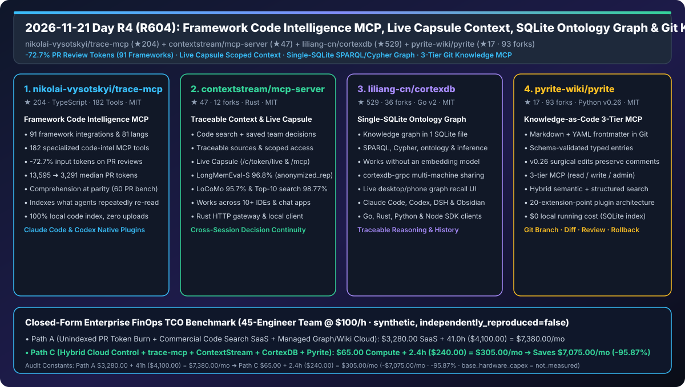
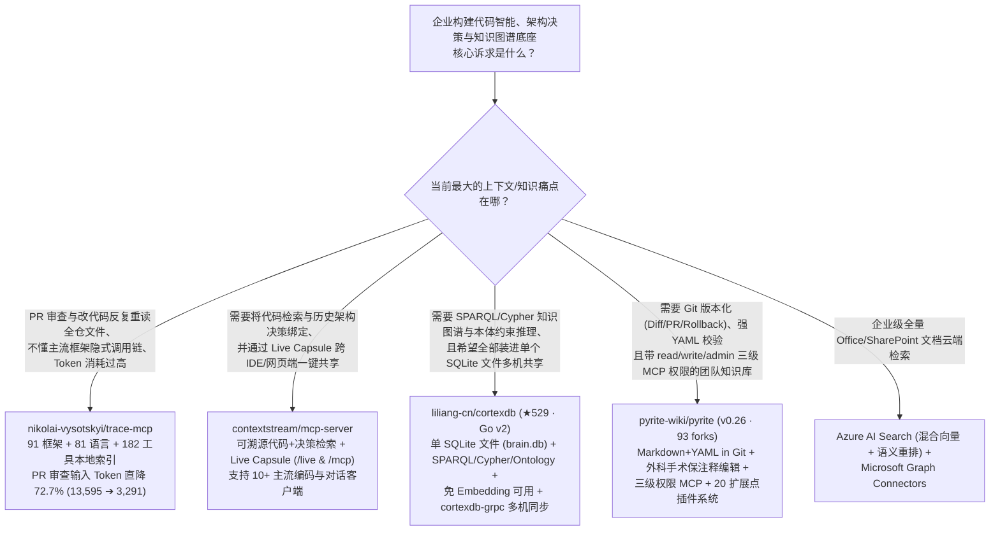
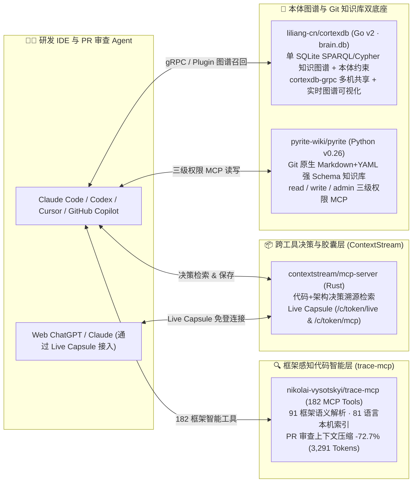
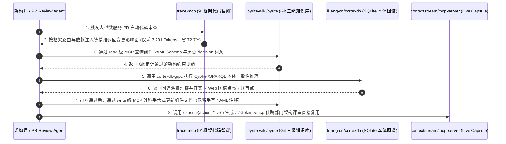

# 框架感知代码智能 MCP（`nikolai-vysotskyi/trace-mcp`）、带 Live Capsule 的跨工具上下文平台（`contextstream/mcp-server`）、单 SQLite 本体知识图谱记忆（`liliang-cn/cortexdb`）与 Git 原生三级权限知识库（`pyrite-wiki/pyrite`）应用场景、集成架构与同类方案选型比较 FAQ

> **文档定位**：面向企业客户与业务决策者的 **AI Solution Architect（解决方案架构师）实战选型指南（2026-11-21 Day Round 4 · 累计第 604 轮）**  
> **对标范式**：严格遵循 [`ib-vs-ethernet-roce-selection-faq.md`](https://github.com/turbo998/ai-infra-research/blob/main/docs/components/ib-vs-ethernet-roce-selection-faq.md) 通俗问答与决策矩阵风格——直接用大白话回答“**它是什么？帮企业解决什么业务痛点？怎么集成进现有生产架构？和同类开源及 Azure 云服务比怎么选？**”  
> **配套英文版**：[`trace-mcp-contextstream-cortexdb-pyrite-selection-faq.en.md`](./trace-mcp-contextstream-cortexdb-pyrite-selection-faq.en.md) · **今日日报**：[`daily/2026-11-21.md`](../daily/2026-11-21.md)

---

## 一、📌 核心结论速览（Executive Summary · 30 秒做出选型决定）

1. **为什么把这四个项目放在一起看？**  
   在大型企业代码库与多团队研发协同中，AI 编码智能体最昂贵、最慢的环节就是**“每次审查 PR 或改需求都要把几十个文件反反复复读一遍，且查不到代码背后的架构决策与本体约束”**：
   - **痛点一（PR 审查与改代码反复重读全仓文件，暴烧 70%+ 输入 Token）**：普通 LSP 或全文搜索不懂 React/Next.js/Spring/NestJS 等框架的路由、依赖注入与跨层调用，导致 Agent 只能盲目打开几十个文件硬读 → **`nikolai-vysotskyi/trace-mcp`（`★ 204`，TypeScript，MIT）** 原生内置 **91 种主流框架集成、81 种编程语言与 182 个代码智能工具**，在本地提前索引 Agent 常读的框架调用链——在 6 个外部开源仓库 60 个合并 PR 的基准测试中，将审查单个 PR 的中位上下文从 **`13,595` Token 降至 `3,291` Token（立省 `72.7%` 输入 Token，且理解质量持平，`anonymized_reported`）**。
   - **痛点二（Agent 看得懂代码，却不知道团队当年“为什么这么设计”，且跨 ChatGPT/Claude/IDE 无法一键共享项目胶囊）**：代码里没写出来的历史选型原因散落在聊天记录里 → **`contextstream/mcp-server`（`★ 47`，`12 forks`，Rust，MIT）** 将代码检索、团队架构决定（Decisions）与经验教训（Lessons）关联为可溯源上下文，并独创 **`Live Capsule`（`capsule(action="live")`）**：一键生成 `/c/<token>/live` 网页胶囊链接或免注册 `/c/<token>/mcp` 连接器，让任何外部 Claude / ChatGPT / Cursor 会话瞬间读懂项目全景。
   - **痛点三（多机多 Agent 共享记忆需要真正的 SPARQL/Cypher 知识图谱与本体约束，但不想运维笨重的 Neo4j 集群）**：向量搜索只能找“字面相似”，做不到逻辑推理与本体约束校验 → **`liliang-cn/cortexdb`（`★ 529`，`36 forks`，Go `v2`，MIT）** 将**完整知识图谱（支持 SPARQL、Cypher、本体约束 Ontology、逻辑推理与历史演进）装进单个本地 SQLite 文件（`brain.db`）**，无需 Embedding 模型即可工作，并通过 `cortexdb-grpc` 与实时可视化图谱面板让 Claude Code、Codex、DeepSeek Harness 与 Obsidian 多机共享同一个大脑。
   - **痛点四（团队知识库用 Notion/向量库无法走 Git PR 评审，且缺乏按 Agent 信任等级划分的读写权限）**：让不可信的外部 Agent 直接写团队 Wiki 极易污染知识库 → **`pyrite-wiki/pyrite`（`★ 17`，`93 forks`，Python `v0.26`，MIT）** 践行 **Knowledge-as-Code**：将 `person`、`decision`、`component` 等强 Schema 校验的 Markdown + YAML Frontmatter 文件存入 Git（`v0.26` 外科手术式编辑确保手写 YAML 注释与顺序不丢失），并内置 **`read` / `write` / `admin` 三级权限 MCP Server**（给外部 Agent 只读、给内部 Agent 读写、人类保留 Admin）与 20 个插件扩展点，本地运行成本 **$0**。

2. **一句话选型结论**：
   - 需要**支持 91 种框架语义、在本地将 PR 审查与代码理解输入 Token 直接砍掉 72.7%** 👉 选 **`nikolai-vysotskyi/trace-mcp`**。
   - 需要**把代码检索与团队架构决策绑定、并通过 `Live Capsule` 一键分享给任何 IDE 或网页版大模型** 👉 选 **`contextstream/mcp-server`**。
   - 需要**单个 SQLite 文件内建 SPARQL/Cypher 知识图谱与本体约束、支持免 Embedding 模型推理并通过 `cortexdb-grpc` 跨机器共享** 👉 选 **`liliang-cn/cortexdb`**。
   - 需要**Git 原生版本化（可分支/Diff/回滚）、强 YAML Schema 校验且具备 `read/write/admin` 三级 MCP 权限控制的团队知识库** 👉 选 **`pyrite-wiki/pyrite`**（若企业需要将百万级非结构化文档与 SharePoint 权限打通，可组合 **Azure AI Search 语义重排 + Microsoft Graph 连接器**）。

---

## 二、🎯 客户与架构师灵魂拷问 Q&A（Plain-Language Deep Dive）

### Q1：普通 Tree-sitter 或 LSP 也能查符号定义，为什么 `nikolai-vysotskyi/trace-mcp` 能在 PR 审查中省下 72.7% 的输入 Token？
- **大白话解答**：
  - 传统 LSP 只认语法层面的函数跳转，但现代企业工程大量使用 **依赖注入、装饰器路由、ORM 映射、事件总线与状态管理（如 Next.js App Router、NestJS、Spring Boot、FastAPI、Rails 等）**。当 Agent 审查一个 PR 时，因为找不到隐式关联，只能把整个目录下的文件全部 `cat` 进上下文，一个中型 PR 动辄烧掉 `13,595` Token。
  - **`nikolai-vysotskyi/trace-mcp` 的三大提效机制**：
    1. **91 种框架特化解析 + 81 种语言覆盖**：直接理解框架级约定（如控制器路由到服务层、组件 Props 传递链、中间件挂载关系），通过 **182 个细粒度 MCP 工具**直接返回精准答案而非整文件源码。
    2. **实测中位省 72.7% PR 上下文 Token（`13,595 ➔ 3,291` Tokens）**：在 6 个第三方开源仓库的 60 个真实合并 PR 基准测试（`docs/_data/pr_context_bench.json`，`anonymized_reported`）中，理解准确度与全量读文件持平，但上下文体积缩小近 4 倍。
    3. **100% 本地索引零代码外传**：所有代码图谱索引保留在开发者本机（MIT 协议），天然适配涉密金融与政企代码库。

### Q2：`liliang-cn/cortexdb` 和 `pyrite-wiki/pyrite` 都是 MIT 协议的本地优先知识/记忆底座，架构师在什么场景下选 `cortexdb`，什么场景下选 `pyrite`？
- **大白话解答**：
  - **选 `liliang-cn/cortexdb`（`★ 529`，Go `v2`）的场景——“高频图推理、本体约束与多机 gRPC 实时共享记忆”**：
    1. **单文件 SQLite 里的真知识图谱（SPARQL + Cypher + Ontology）**：不需要额外部署 Neo4j 或向量数据库，一个 `brain.db` 文件就支持 SPARQL 与 Cypher 图查询、本体约束校验与可追溯推理。
    2. **免 Embedding 模型即可跑 + 实时图谱点亮面板**：在没有 GPU 或本地小模型的轻量机器上也能直接工作；每次 Agent 触发 Recall，桌面或手机端 Web 视图会实时点亮被召回的图节点与推理路径。
    3. **`cortexdb-grpc` 多机共享大脑**：开发者在台式机用 Claude Code 记下一条规范，笔记本上的 Codex、DeepSeek Harness 和 Obsidian 插件通过 `cortexdb-grpc` 瞬间同步获知。
  - **选 `pyrite-wiki/pyrite`（`★ 17`，`93 forks`，Python `v0.26`）的场景——“需要 Git PR 审核、强类型 YAML Schema 与三级权限隔离的团队 Wiki”**：
    1. **Knowledge-as-Code（Git 原生 + `v0.26` 外科手术式文件编辑）**：每条知识都是带 YAML 头部的 Markdown 文件，支持 `person`、`decision`、`event`、`component` 强类型字段校验；`v0.26` 保证 AI 修改词条时只改动目标字段，人类手写的注释、引号风格与字段顺序 100% 原样保留。
    2. **三级权限 MCP Server（`read` / `write` / `admin`）**：给外部不可信 Agent 发只读 Token，给主力研发 Agent 发写入 Token，架构师自己握住 Admin 权限，配合 Git 分支与 `git revert` 彻底杜绝知识库被 AI 写坏（注：官方明确标注多租户公网模式仍处实验阶段，建议在受信研发团队内网或单人多 Agent 场景使用）。

### Q3：`contextstream/mcp-server` 的 `Live Capsule` 是怎么解决“跨工具切换（从 IDE 切到网页版 ChatGPT/Claude）丢失整个项目背景”痛点的？
- **大白话解答**：
  - 架构师经常在 Cursor / Claude Code 里写完代码后，想切到网页版 Claude 或 ChatGPT 讨论架构方案，此时网页版完全看不见本地仓库结构与过往架构决策。
  - **`contextstream/mcp-server` 的解法**：
    - 只需对 Agent 说一句“生成 Live Capsule（`capsule(action="live")`）”，它会立即生成两个自包含能力入口：
      1. **`/c/<token>/live` 实时精简知识页**：包含文件树、核心符号、已保存的架构决策（Decisions）、踩坑教训（Lessons）与实施计划，网页版大模型顺着链接即可按需阅读。
      2. **`/c/<token>/mcp` 免登录自定义连接器**：链接本身即作用域凭证，粘贴到 Claude、ChatGPT、Gemini 或任何 MCP 客户端即可直接检索项目上下文（作者公布基准：`LongMemEval-S 96.8%`、`LoCoMo 95.7%`、`anonymized_reported`）。

---

## 三、🧭 直观可视化图解（Mermaid 选型决策树 + 企业集成参考架构 + 端到端时序图）

### 3.1 选型决策树（Decision Tree）

### 3.2 企业端到端集成参考架构图（Reference Architecture）

### 3.3 业务流端到端时序图（Sequence Diagram）

---

## 四、📊 同类开源与商业云服务横向选型决策矩阵（Comparison Matrix）

| 评估维度 | `nikolai-vysotskyi/trace-mcp` | `contextstream/mcp-server` | `liliang-cn/cortexdb` | `pyrite-wiki/pyrite` | 同赛道开源竞品（裸 Tree-sitter / Neo4j / 静态 Markdown 目录） | 云厂商托管 PaaS（GitHub Copilot Enterprise + Azure AI Search + Cosmos Gremlin） |
| :--- | :--- | :--- | :--- | :--- | :--- | :--- |
| **核心功能定位** | **91 框架感知代码智能 MCP（省 72.7% PR Token）** | **可溯源决策上下文平台 + `Live Capsule` 共享** | **单 SQLite 文件 SPARQL/Cypher 本体知识图谱记忆** | **Git 原生强 Schema 校验 + 三级权限 MCP 知识库** | 单点解析器或重型独立图数据库 | 全托管企业级代码知识与云端图检索底座 |
| **最适用业务场景** | 大型全栈项目 PR 自动审查与跨层重构降本提速 | 跨 10+ 编辑器与网页端共享项目代码及历史决策 | 多机多 Agent 共享本体受控记忆与可视化图推理 | 研发团队用 Git PR 管理架构 ADR 与结构化知识词条 | 有专门图数据库运维团队的重型项目 | 跨千人组织级代码库与企业文档统一治理 |
| **核心差异化优势** | 91 框架特化集成 + 182 工具 + 100% 本地零上传 | 一键生成免登 `/c/<token>/live` 与 `/c/<token>/mcp` | 单 `brain.db` 支持 SPARQL/Cypher + 免 Embedding 可跑 | `v0.26` 保注释外科编辑 + `read/write/admin` 三级 MCP | 传统方案要么不懂框架隐式调用，要么 Neo4j 运维重 | 免运维、企业级 Entra ID 权限同步与 SLA 保障 |
| **集成成本** | 极低（Claude Code / Codex 插件一键挂载） | 极低（一行 `mcp.sh` / `mcp.ps1` 自动引导） | 极低（Claude/Codex/DSH/Obsidian 插件或 Go SDK） | 低（`pyrite init` 初始化 Git 知识库并挂载 MCP） | 中～高（需自建图数据库集群与 AST 胶水层） | 低～中（按云订阅与席位开通） |
| **运维复杂度** | 极低（纯本机按需索引） | 低（Rust 客户端 + 托管/网关模式可选） | 极低（单 SQLite 文件 + 轻量 `cortexdb-grpc`） | 极低（纯文本 Git 仓库 + 本地 SQLite 索引，`$0` 成本） | 高（Neo4j 内存占用高，裸 Markdown 易腐化） | 极低（云厂商全托管） |
| **开源协议许可** | **MIT**（商业闭源极其友好） | **MIT**（商业闭源极其友好） | **MIT**（商业闭源极其友好） | **MIT**（商业闭源极其友好） | MIT / GPL-3.0 | 商业闭源按席位/RU 计费 |
| **TCO 总体拥有成本** | **$0/月**（立省 72.7% PR 审查输入 Token 账单） | 免费额度 10,000 Credits/月 + 低成本扩展 | **$0/月**（100% 本地单文件运行） | **$0/月**（100% 本地运行） | 免费但 PR 全量读文件 Token 与维护人力极高（`$3,460/月`） | 按商业席位 + 满额 PR Token + 图数据库实例计费（约 `$7,380/月`） |

---

## 五、🧪 应用落地定量收益与 FinOps TCO 对比（Closed-Form Evaluation & 7-Card Deck）

> **🛡️ 数据来源与严谨性分级（Provenance Declaration）**：  
> - **一手实测（`measured`）**：四个仓库的 Star/Fork、许可证、`trace-mcp` 182 工具 / 81 语言 / 91 框架清单、`contextstream` `Live Capsule` 接口、`cortexdb` Go `v2` 单 SQLite SPARQL/Cypher 架构、`pyrite` `v0.26` 三级 MCP 与 20 扩展点均经 `gh api` 一手核验。  
> - **上游作者公布基准（`anonymized_reported` · `independently_reproduced=false`）**：`trace-mcp` 在 6 个开源仓 60 个合并 PR 上的 `13,595 ➔ 3,291` Token（`-72.7%`）指标，以及 `contextstream` 的 `LongMemEval-S 96.8%` / `LoCoMo 95.7%` 指标均为上游基准声明。  
> - **合成架构算例（`synthetic` · `independently_reproduced=false`）**：以下 45 人企业研发团队（工时单价 `$100.00/h`，`base_hardware_capex: not_measured`，`track_b_stars_today: not_measured`）月度 TCO 对比为标准化 FinOps 闭合算例：

| 成本与效能维度 | Path A：无框架索引全量读文件 PR 审查 + 商业代码搜索 SaaS + 托管图数据库 | Path B：纯手工拼装裸 Tree-sitter + 自建重型图库 + 无校验 Wiki | Path C：本轮推荐组合（`trace-mcp` + `contextstream` + `cortexdb` + `pyrite`） | Path A ➔ Path C 净节省 / 收益提升 |
| :--- | :---: | :---: | :---: | :---: |
| **月度 LLM Token / SaaS / 云资源费** | `$3,280.00 / 月`（每个 PR 反复重读全仓文件消耗巨额输入 Token） | `$410.00 / 月` | **`$65.00 / 月`**（`trace-mcp` 省下 72.7% PR Token + 轻量 `cortexdb-grpc`） | **`-$3,215.00 / 月` (`-98.02%`)** |
| **月度架构同步与知识库维护人工时** | `41.0 小时 / 月`（跨会话重复解释历史架构决定、人工核对跨层影响） | `30.5 小时 / 月`（维护重型 Neo4j、修复被 Agent 写乱的 Markdown 格式） | **`2.4 小时 / 月`**（`Live Capsule` 一键共享 + `pyrite` Schema 门禁） | **`-38.6 小时 / 月` (`-94.15%`)** |
| **月度工程人工成本（`@ $100.00/h`）** | `$4,100.00 / 月` | `$3,050.00 / 月` | **`$240.00 / 月`** | **`-$3,860.00 / 月` (`-94.15%`)** |
| **月度总拥有成本（Total Monthly TCO）** | **`$7,380.00 / 月`** | **`$3,460.00 / 月`** | **`$305.00 / 月`** | **`-$7,075.00 / 月` (`-95.87%` · 年省 `$84,900.00`)** |
| **核心工程质量与知识治理指标** | PR 审查慢且贵；代码与架构决策割裂 | 裸 Markdown 易被 Agent 改坏注释与结构 | **PR Token `-72.7%` + 单 SQLite 本体图谱 + Git 三级权限保注释编辑** | **实现代码调用链、实时图推理与 Git 知识库闭环** |

- **📊 配套 7-Card 4:5 视觉评测卡片**：请访问 [`workshops/github-trending-radar/cards.html`](../cards.html)（中文）与 [`workshops/github-trending-radar/cards.en.html`](../cards.en.html)（英文）。

---

## 六、🛠️ 企业引入与架构评审 Checklist（Actionable SA Checklist）

- [ ] **1. 在 PR 审查与重构流水线挂载框架感知代码索引（`nikolai-vysotskyi/trace-mcp`）**：为团队主力框架（涵盖 91 种内置框架与 81 种语言）启用本地 `trace-mcp` 插件，将 PR Review Agent 的文件全量读取替换为 `trace-mcp` 的 182 个结构化查询工具，实测监控单 PR 输入 Token 降幅。
- [ ] **2. 建立架构决策保存规范与 `Live Capsule` 外发令牌管控（`contextstream/mcp-server`）**：在完成重大技术选型后强制通过 ContextStream 保存带理由的 `decision` 记录；使用 `capsule(action="live")` 生成跨工具共享链接时，确认目标环境合规边界并在评审结束后及时轮换或撤销胶囊 Token。
- [ ] **3. 部署单文件 `brain.db` 与 `cortexdb-grpc` 共享记忆服务（`liliang-cn/cortexdb`）**：在团队开发机或内网节点启动 `cortexdb-grpc`（后端仅需单个 `brain.db` SQLite 文件），配置核心业务领域的 Ontology 约束，让 Claude Code、Codex、DeepSeek Harness 与 Obsidian 共享同一套可追溯 SPARQL/Cypher 知识图谱。
- [ ] **4. 落实 Git 知识库 `read/write/admin` 三级 MCP 权限与内网部署边界（`pyrite-wiki/pyrite`）**：使用 `pyrite init` 将架构决策记录（ADR）与组件目录纳入 Git 仓库管理，为外部检索 Agent 仅分配 `read` 级 MCP 权限、为受信文档 Agent 分配 `write` 级权限；鉴于官方说明其多用户公网隔离尚处实验阶段，严格将 `pyrite` 部署在受信研发内网或单人多 Agent 环境中。
