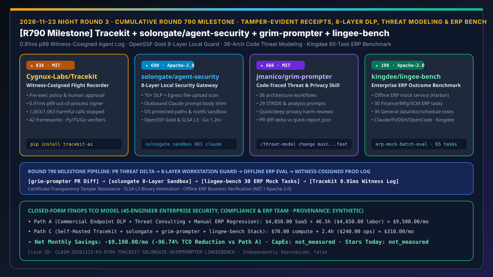
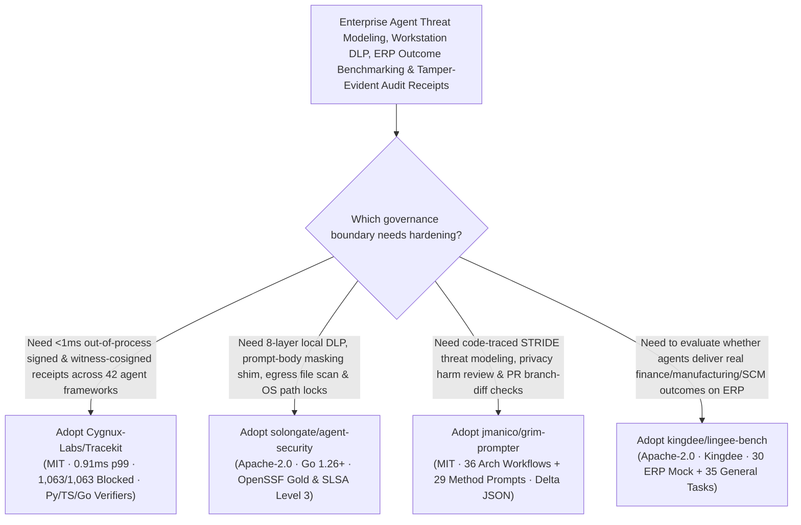
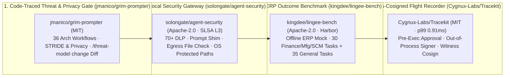

# 🏆 [Round 790 Milestone] Certificate-Transparency Tamper-Evident Agent Flight Recorder (`Cygnux-Labs/Tracekit`), OpenSSF Gold 8-Layer Local Agent Security Gateway (`solongate/agent-security`), 36-Workflow Evidence-Traced Threat Modeling & Privacy Skill (`jmanico/grim-prompter`) & Kingdee 65-Task Offline Enterprise ERP Benchmark (`kingdee/lingee-bench`) Selection & Architecture FAQ

> **Document Type**: Enterprise AI Solution Architect Selection & Integration Guide (GitHub Trending AI Radar · 2026-11-23 Night Round 3 / **Cumulative Round 790 Milestone!**)
> **Covered Repositories**: [`Cygnux-Labs/Tracekit`](https://github.com/Cygnux-Labs/Tracekit) (`★ 838`, `135 forks`, `MIT`: Certificate-Transparency-inspired tamper-evident flight recorder and pre-execution tool-call policy gate `pip install tracekit-ai` across 42 agent frameworks, using an out-of-process signer and independent witness cosigning with `0.91 ms p99` overhead, `1,063/1,063` harmful calls stopped across 11 classes, `8/8` tamper/insider attacks caught across 480 trials, and offline verifiers in Python, TypeScript, and Go) · [`solongate/agent-security`](https://github.com/solongate/agent-security) (`★ 690`, `107 forks`, `Apache-2.0`: OpenSSF Gold & SLSA Level 3 attested Go 1.26+ local-first security gateway for AI coding agents, enforcing **8 defensive layers: scoped `READ/WRITE/EXECUTE/NETWORK` policy rules, 70+ pattern 4-mode DLP, egress file-upload secret scanning, rate limits, outbound Claude Code prompt-body masking shim, tamper-protected guard state, OS-enforced protected paths, and minimal rootfs sandboxes**) · [`jmanico/grim-prompter`](https://github.com/jmanico/grim-prompter) (`★ 666`, `57 forks`, `MIT`: OWASP leader Jim Manico's evidence-traced threat modeling and privacy review skill `/threat-model` / `$threat-model` with **36 architecture workflows** and **29 analysis prompts**, supporting STRIDE, 6-stage deep reviews, data-processing privacy harm reviews, and branch-diff delta reviews `/threat-model change main...feature` against baseline JSON reports) · [`kingdee/lingee-bench`](https://github.com/kingdee/lingee-bench) (`★ 190`, `37 forks`, `Apache-2.0`: Kingdee's Harbor-based enterprise agent evaluation framework featuring an **offline ERP mock service**, **30 Enterprise tasks** across finance, manufacturing, and supply chain, **35 General tasks**, model/MCP proxies, and `.agents/skills/` runners for Claude Code, Pi, DeepSeek Harness, and OpenCode)
> **Core Scenario**: When financial, manufacturing, and regulated enterprises deploy AI coding and operations agents against ERP systems and production infrastructure, how do you solve **"self-reported agent logs that can be altered by the agent or insiders, simple tool hooks that miss secrets inside outbound prompt bodies or uploaded files, PR merges lacking code-traced threat/privacy delta modeling, and model/harness evaluations disconnected from real multi-step ERP finance/supply-chain workflows"** using **`Tracekit` + `solongate/agent-security` + `grim-prompter` + `kingdee/lingee-bench`**?

---

## 1. 📌 Executive Summary (Single-Sentence Selection Verdict)

1. **Need cryptographic, offline-verifiable proof of every tool call an agent made—with pre-execution human approval for risky actions, `< 1 ms` (`0.91 ms p99`) out-of-process signing, and independent witness cosigning across 42 frameworks** ➔ Choose **[`Cygnux-Labs/Tracekit`](https://github.com/Cygnux-Labs/Tracekit) (`★ 838`, `135 forks`, `MIT`)**.
   - **Plain-Language Mechanism**: An agent's own log files cannot prove compliance because the agent, a software bug, or a privileged insider can rewrite them. Modeled on **Certificate Transparency**, `Tracekit` evaluates each tool call before execution, holds risky calls for human approval, and signs every record in an append-only log via an isolated signer process that the agent cannot touch—cosigned by independent witnesses and verifiable offline via Python, TypeScript, or Go CLI verifiers (`8/8` tamper and insider attacks caught across 480 trials; `1,063/1,063` harmful calls blocked across 11 classes with only `1/1,015` false positives).
2. **Need a zero-telemetry, OpenSSF Gold & SLSA Level 3 local security gateway in Go that blocks `.env` access at the OS level, scans uploaded files for secrets, and masks sensitive data in Claude Code's outbound HTTP request body** ➔ Choose **[`solongate/agent-security`](https://github.com/solongate/agent-security) (`★ 690`, `107 forks`, `Apache-2.0`)**.
   - **Plain-Language Mechanism**: Conventional tool-call hooks miss secrets pasted directly into prompts, secrets hidden inside files being uploaded by a benign-looking command, or repo-local config overrides that disable the hook. `solongate` closes all three gaps with **8 local enforcement layers**: `READ/WRITE/EXECUTE/NETWORK` policy rules, 70+ pattern DLP (`off`/`detect`/`redact`/`block`), **egress file-content scanning**, rate limits, an **outbound prompt-body shim**, tamper-protected guard state, **OS-enforced `policy protect <path>` locks**, and **minimal rootfs sandboxes (`solongate sandbox 001 claude`)**.
3. **Need coding agents (Claude Code, Codex, or any `AGENTS.md` agent) to run structured, code-traced STRIDE threat models, privacy harm reviews, and branch-diff security delta checks (`/threat-model change main...feature`)** ➔ Choose **[`jmanico/grim-prompter`](https://github.com/jmanico/grim-prompter) (`★ 666`, `57 forks`, `MIT`)**.
   - **Plain-Language Mechanism**: Authored byJim Manico, Grim Prompter ships **36 architecture workflows** and **29 method/analysis prompts** linking every identified trust boundary, threat, existing control, and proposed mitigation directly to repository code—supporting both full 6-stage security/privacy reviews and fast PR diff delta checks against a prior `quick-report.json` baseline.
4. **Need to benchmark whether AI agents and models actually complete verifiable enterprise finance, manufacturing, and supply-chain ERP workflows against an offline ERP mock service** ➔ Choose **[`kingdee/lingee-bench`](https://github.com/kingdee/lingee-bench) (`★ 190`, `37 forks`, `Apache-2.0`)**.
   - **Plain-Language Mechanism**: Open-sourced by enterprise ERP leader **Kingdee** on top of Harbor (`KD-Lingee/lingee-bench`), it pairs an **offline ERP mock service**, model/MCP proxies, and deterministic graders across **30 Enterprise ERP tasks** (finance, manufacturing, supply chain) and **35 General office/data tasks**, with built-in `.agents/skills/` (`lg-bench-setup` and `erp-mock-batch-eval`) for Claude Code, Pi, DeepSeek Harness, and OpenCode.

---

## 2. 🎯 Key Architectural Q&A (Deep-Dive Breakdown)

### Q1: How do `grim-prompter`, `solongate/agent-security`, `kingdee/lingee-bench`, and `Tracekit` form a 4-stage enterprise agent governance lifecycle?

- **Four-Stage Defense-in-Depth Lifecycle**:
  1. **Design & PR Review Stage (`jmanico/grim-prompter`)**: Runs code-traced STRIDE threat modeling, privacy harm analysis, and branch-diff delta checks (`/threat-model change main...feature`) before code merges.
  2. **Developer Workstation Stage (`solongate/agent-security`)**: Enforces 8-layer local DLP, outbound prompt-body masking, egress file scanning, OS path locks, and minimal rootfs sandboxes with zero cloud telemetry.
  3. **Pre-Production Business Acceptance Stage (`kingdee/lingee-bench`)**: Evaluates candidate models and harnesses against 30 offline finance/manufacturing/SCM ERP tasks and 35 general tasks.
  4. **Production Execution & Audit Stage (`Cygnux-Labs/Tracekit`)**: Enforces pre-execution tool policy and human approval while writing `0.91 ms p99` out-of-process signed, witness-cosigned receipts verifiable offline by auditors.
- **When to Choose Managed Cloud Security Suites (Path B)**:
  - If all agents run strictly inside managed cloud SaaS with native cloud SIEM and no local CLI agents or custom ERP workflows, use **Microsoft Purview + Azure AI Content Safety + Defender for Cloud**; to protect local coding agents, prove tamper-free execution across 42 frameworks offline, or benchmark against offline ERP tasks, deploy this 4-repo OSS stack (Path C).

### Q2: How do you integrate these four repositories into an enterprise production architecture?

1. **Shift-Left Threat & Privacy Gate (`jmanico/grim-prompter`)**:
   - Generate a baseline `quick-report.json` per service and run `/threat-model change main...feature` on PR diffs touching auth, network boundaries, or PII.
2. **8-Layer Workstation Security Gateway (`solongate/agent-security`)**:
   - Lock sensitive directories with `solongate policy protect`, launch coding sessions via `solongate sandbox`, and enforce `block`/`redact` DLP across tool calls, uploaded files, and outbound prompt bodies.
3. **Offline ERP Acceptance Benchmark (`kingdee/lingee-bench`)**:
   - Run `erp-mock-batch-eval` inside isolated Docker containers via the model proxy to score candidate models/harnesses across 30 ERP and 35 general tasks.
4. **Tamper-Evident Production Flight Recorder (`Cygnux-Labs/Tracekit`)**:
   - Wrap production agent tool calls with `tracekit-ai`, route high-impact mutations to human approval, cosign append-only logs via an independent witness, and verify logs in CI/compliance audits using the Go/Python/TS verifiers.

### Q3: What are the production guardrails and compliance red lines?

- **Core Strengths**:
  - **100% Permissive Licensing (`MIT` + `Apache-2.0`) & Offline Verifiability**: Zero reliance on vendor cloud logging to prove compliance.
- **Architect Guardrails**:
  1. **Isolate the `Tracekit` Signer and Witness from the Agent UID**: Run the out-of-process signer under a separate OS user/container and host the cosigning witness on an independent node so a compromised agent cannot forge historical records.
  2. **Never Connect Live Production ERP Databases to Benchmark Harnesses**: Always use `kingdee/lingee-bench`'s offline ERP mock service and isolated model proxy (`.env.glm` excluded from Git) during evaluation runs.

---

## 3. 🧭 Visual Architecture & Decision Diagrams (Mermaid)



### 3.1 Solution Architect Selection Decision Tree



### 3.2 End-to-End Enterprise Production Reference Architecture



### 3.3 PR Delta Threat Model, 8-Layer Workstation Guard, Offline ERP Eval & Witness-Cosigned Execution Sequence

```mermaid
sequenceDiagram
    participant Arch as Security Architect / Auditor
    participant Grim as jmanico/grim-prompter
    participant Sol as solongate/agent-security (Local Go)
    participant Bench as kingdee/lingee-bench (ERP Mock)
    participant Trace as Cygnux-Labs/Tracekit (Signer + Witness)

    Arch->>Grim: 1. Run /threat-model change main...feature against baseline quick-report.json
    Grim-->>Sol: 2. Developer codes inside solongate sandbox; OS locks .env & blocks secret file egress
    Sol->>Bench: 3. Execute erp-mock-batch-eval across 30 offline finance/manufacturing/SCM ERP tasks
    Bench-->>Trace: 4. Promote passing agent to prod; Tracekit gates tool calls & cosigns receipts in 0.91ms p99
    Arch->>Trace: 5. External auditor runs offline Go/Python verifier to prove 0 log tampering
```

---

## 4. 📊 Comparative Selection Matrix (Open-Source vs. Commercial SaaS)

| Dimension | `Cygnux-Labs/Tracekit` (`★ 838`) | `solongate/agent-security` (`★ 690`) | `jmanico/grim-prompter` (`★ 666`) | `kingdee/lingee-bench` (`★ 190`) | Commercial SIEM + Endpoint DLP Seats + External Threat Consulting + Manual ERP QA (Path A) | Self-Logged JSONL + Naive Regex Hooks + Static Architecture Docs + Generic Code Evals (Path B) |
| :--- | :--- | :--- | :--- | :--- | :--- | :--- |
| **Core Role** | Certificate-Transparency witness-cosigned agent flight recorder | OpenSSF Gold 8-layer local coding agent security gateway | 36-workflow code-traced threat modeling & privacy skill | Kingdee 30-task offline ERP + 35-task general agent benchmark | Metered endpoint DLP seats, external security consultants & manual ERP regression teams | Unsigned agent logs, bypassable regex hooks & generic algorithm benchmarks |
| **Key Differentiator** | **`0.91ms p99` out-of-process signer + witness cosign + 42 frameworks** | **Prompt-body shim + egress file scan + OS path lock + SLSA L3** | **36 architectures + 29 methods + privacy review + PR diff delta** | **Offline ERP mock service + 4-harness automated batch skills** | High seat/consulting bills; manual threat models lag behind daily PRs | Agents/insiders can alter logs; regex hooks miss prompt-body & uploaded-file leaks |
| **License** | `MIT` | `Apache-2.0` | `MIT` | `Apache-2.0` | Proprietary SaaS / consulting | Custom scripts |
| **Monthly TCO (45-Eng Team)** | **Combined `$310.00/mo`** (`$70.00` witness/ERP mock containers + `2.4h` ops) | Included (zero-telemetry local Go binary) | Included (automated per-PR delta threat checks) | Included (open dual-source datasets & offline ERP mock) | **`$9,500.00/mo`** (`$4,850.00` SaaS/consulting + `46.5h` manual threat/audit/ERP QA labor) | ~`$3,350.00/mo` (audit failures, leaked secrets & ERP production regressions) |

---

## 5. 🧪 Quantitative ROI / TCO Comparison & 7-Card Benchmark Report

> **📊 Data Provenance & Closed-Form Schema Declaration**:
> - **provenance**: `synthetic` (45-person enterprise AI security, compliance, and ERP delivery team monthly workload model: `independently_reproduced = false`; hardware baseline `base_hardware_capex = not_measured`; Track B 24h delta `track_b_stars_today = not_measured`).
> - **Closed-Form Formula**:
>   - **Path A (Commercial endpoint AI DLP seats + commercial audit cloud + external security threat-modeling retainers + manual QA regression across 30 finance/SCM ERP workflows)**: Monthly commercial security SaaS & consulting fees **`$4,850.00`** + manual threat modeling, log verification, and manual ERP regression labor **`46.5h × $100.00/h = $4,650.00`** = **`$9,500.00/mo`**.
>   - **Path C (Self-hosted `Cygnux-Labs/Tracekit` + `solongate/agent-security` + `jmanico/grim-prompter` + `kingdee/lingee-bench` open-source governance stack)**: Monthly witness node and offline ERP mock container compute **`$70.00`** + policy and benchmark maintenance labor **`2.4h × $100.00/h = $240.00`** = **`$310.00/mo`**.
>   - **Net Monthly Savings vs. Path A**: **`-$9,190.00/mo`** (**`96.74%`** TCO reduction).

| Evaluation Path | Security SaaS / Consulting / Compute | Threat Modeling, Audit & ERP QA Labor (`$100/h`) | Monthly Total TCO | Net Savings vs. Path A | Key Architectural Delivery Metrics |
| :--- | :---: | :---: | :---: | :---: | :--- |
| **Path A: Commercial Endpoint DLP + Threat Consulting + Manual ERP QA** | `$4,850.00` | `46.5h` (`$4,650.00`) | **`$9,500.00`** | Baseline | Manual threat modeling lags PR velocity; slow manual ERP testing |
| **Path B: Unsigned Logs + Naive Hooks + Generic Coding Benchmarks** | `$1,550.00` | `18.0h` (`$1,800.00`) | **`$3,350.00`** | `-$6,150.00` (`-64.74%`) | Logs can be altered; generic benchmarks miss ERP workflow failures |
| **Path C: `Tracekit` + `solongate` + `grim-prompter` + `lingee-bench`** | **`$70.00`** | **`2.4h` (`$240.00`)** | **`$310.00`** | **`-$9,190.00` (`-96.74%`)** | **`0.91ms p99` witness-cosigned receipts + 8-layer SLSA L3 guard + PR threat delta + 30 ERP tasks** |

- 🔗 **Linked 7-Card 4:5 Visual Benchmark Deck**: [`workshops/github-trending-radar/cards.en.html`](../cards.en.html) · [`cards.html`](../cards.html)

---

## 6. 🛠️ Enterprise Adoption & Architecture Review Checklist

- [ ] **1. Run Code-Traced Threat & Privacy Delta Reviews with `jmanico/grim-prompter`**: Establish a baseline `quick-report.json` per service and require `/threat-model change main...feature` and `/threat-model quick privacy` on PRs modifying trust boundaries or personal data flows.
- [ ] **2. Enforce 8-Layer Workstation Protection via `solongate/agent-security`**: Lock credential paths with `solongate policy protect`, run coding agents inside `solongate sandbox`, and enable 70+ pattern DLP plus outbound prompt-body masking.
- [ ] **3. Gate Agent & Model Upgrades on `kingdee/lingee-bench` Offline ERP Tasks**: Execute `erp-mock-batch-eval` across all 30 finance, manufacturing, and supply-chain ERP tasks and 35 general tasks before promoting new models or harnesses.
- [ ] **4. Attach `Cygnux-Labs/Tracekit` Out-of-Process Signing & Witness Cosigning in Production**: Gate destructive tool calls on human approval, run the signer and cosigning witness in isolated trust domains, and verify signed logs offline during compliance audits.
