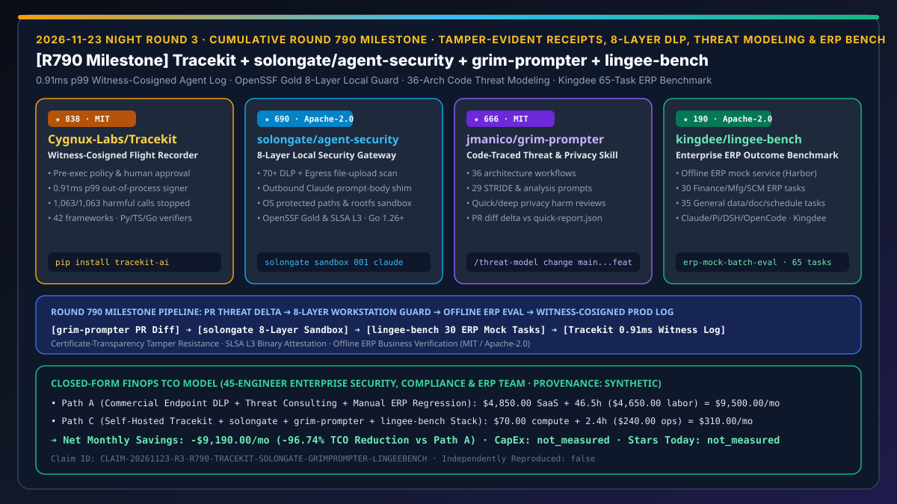
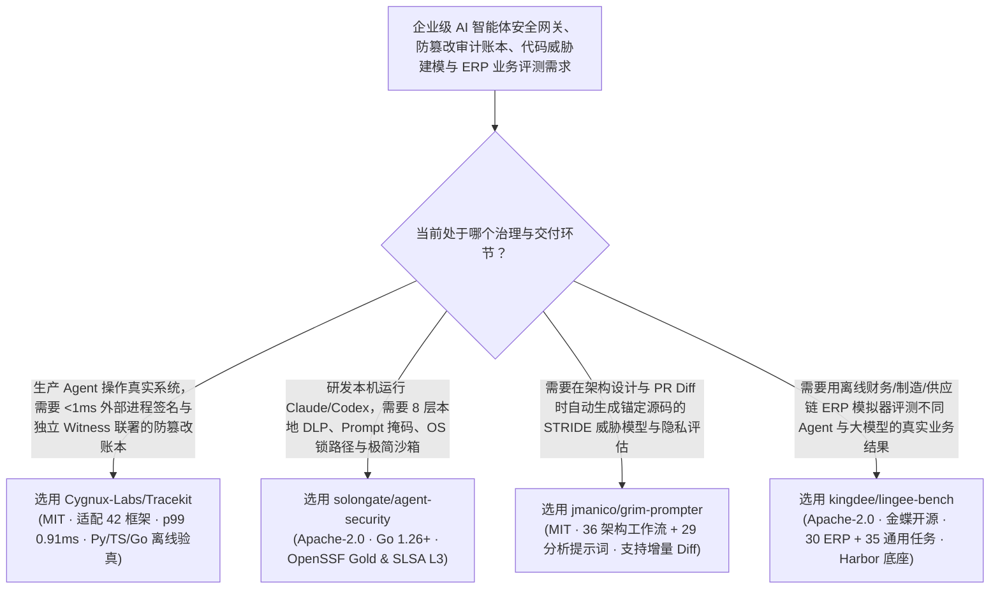
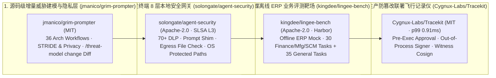
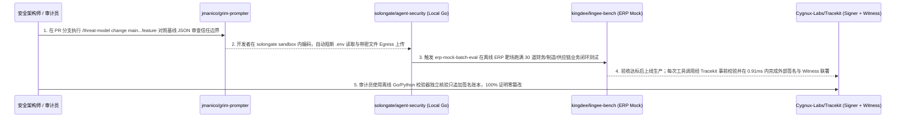

# 🏆【第 790 轮里程碑】证书透明度级防篡改工具调用飞行记录仪（`Cygnux-Labs/Tracekit`）、OpenSSF 金牌认证 8 层本地编码智能体安全网关（`solongate/agent-security`）、OWASP 专家开源 36 架构证据追溯威胁建模与隐私审查技能（`jmanico/grim-prompter`）与金蝶开源企业 ERP 财务/制造/供应链真实业务结果基准（`kingdee/lingee-bench`）选型与集成架构 FAQ

> **文档类型**：企业 AI 解决方案架构师（AI Solution Architect）选型决策指南（GitHub Trending AI 雷达 2026-11-23 Night Round 3 / **累计第 790 轮里程碑**）
> **覆盖项目**：[`Cygnux-Labs/Tracekit`](https://github.com/Cygnux-Labs/Tracekit)（`★ 838`、`135 forks`、`MIT`：对标 **Certificate Transparency（证书透明度）** 设计的 AI 智能体防篡改飞行记录仪与事前工具审批网关 `pip install tracekit-ai`，适配 42 种框架，由独立进程签名并经外部 Witness 联署，实测 `p99` 仅增加 `0.91ms` 延迟、拦截 `1,063/1,063` 次破坏性调用并 100% 检出内部篡改攻击，提供 Python/TS/Go 离线验真器）· [`solongate/agent-security`](https://github.com/solongate/agent-security)（`★ 690`、`107 forks`、`Apache-2.0`：荣获 OpenSSF 金牌与 SLSA Level 3 认证的 Go 1.26+ 本地优先编码 Agent 安全网关，集成 **路径/命令/网络策略、70+ 模式四态 DLP、上传文件出站内容扫描、速率限制、Claude Code 请求体脱敏 Shim、防策略关闭保护、OS 内核级锁定路径与极简根文件系统沙箱** 8 层纵深防御）· [`jmanico/grim-prompter`](https://github.com/jmanico/grim-prompter)（`★ 666`、`57 forks`、`MIT`：OWASP 核心领袖 Jim Manico 开源的编码 Agent 威胁建模与隐私评估技能 `/threat-model`，内置 **36 套架构工作流**与 **29 套分析方法提示词**，支持 STRIDE、六阶段深潜、GDPR/数据伤害隐私审查及基于基线 JSON 的分支 Diff 增量威胁评审）· [`kingdee/lingee-bench`](https://github.com/kingdee/lingee-bench)（`★ 190`、`37 forks`、`Apache-2.0`：金蝶（Kingdee）基于 Harbor 框架开源的企业级智能体业务结果评测基准，内置**离线 ERP Mock 服务**、30 道财务/制造/供应链企业级任务与 35 道通用办公任务，通过 `.agents/skills/` 一键评测 Claude Code、Pi、DeepSeek Harness 与 OpenCode）
> **核心场景**：当金融、制造与大型政企客户将 AI 智能体接入 ERP、生产主机与核心代码库时，面对**“智能体自己的日志可被模型或管理员事后篡改无法作为合规呈堂证供、单纯依靠 Hook 拦不住上传文件夹带密钥或直发 Prompt 泄密、分支合并前缺乏自动化代码级威胁建模与隐私合规增量审查、以及选型编码 Agent 时没有真实财务/供应链 ERP 系统的离线业务评测靶场”**四大痛点，如何构建一套**“独立进程联署飞行记录仪（`Tracekit`）+ 8 层 OS 级本地安全网关（`agent-security`）+ 36 架构增量威胁建模（`grim-prompter`）+ 金蝶 30 题离线 ERP 业务基准（`lingee-bench`）”**的企业级治理与验收闭环？

---

## 一、📌 核心结论速览（选型一句话结论）

1. **想让智能体在生产系统执行的每一次 Shell、SQL、发信或资金操作都经过事前审批，并由 Agent 无法触碰的外部签名进程 + 独立 Witness 联署写入只追加日志（p99 仅 `+0.91ms`），供外部审计员用 Python/TS/Go 离线验真** ➔ 选 **[`Cygnux-Labs/Tracekit`](https://github.com/Cygnux-Labs/Tracekit)（`★ 838`，`135 forks`，`MIT`）**。
   - **通俗原理**：智能体自己打印的日志在安全审计中毫无证明力——因为 Agent 本身、代码 Bug 或拥有机器权限的内部人员随时可以删改日志。`Tracekit` 借鉴了互联网 HTTPS 根基 **Certificate Transparency（证书透明度）** 的架构：每一次工具调用在实际执行前先过策略门禁（高危调用自动挂起等待人工审批），并由隔离的外部进程签名写入只追加日志、交由独立 Witness（见证节点）联署（Cosign）。实测数据显示：在 480 次篡改试验中 **`8/8` 类篡改与内鬼攻击被 100% 捕获**，在 11 类破坏性调用测试中 **`1,063/1,063` 全部拦截（误报仅 `1/1,015`）**，而单次签名往返延迟在 `p99` 下仅 **`0.91 ms`（`< 1 ms`）**！
2. **想在研发工程师本机用零联网、OpenSSF 金牌与 SLSA Level 3 认证的纯 Go 守护进程，同时锁死 `.env` 内核级不可读、拦截上传文件夹带密钥、并在 HTTP 发送前通过 Shim 掩码 Claude Code 请求体中的敏感信息** ➔ 选 **[`solongate/agent-security`](https://github.com/solongate/agent-security)（`★ 690`，`107 forks`，`Apache-2.0`）**。
   - **通俗原理**：许多轻量级 Hook 存在三大盲区：① 用户把密钥粘在聊天框里发给云端 API 时还没触发任何工具 Hook；② Agent 执行上传命令时命令行参数本身不包含密钥，但被上传的文件内容里藏着密钥；③ 恶意仓库里的本地配置文件可以把安全插件关掉。`solongate` 用 **8 层本地防线**彻底堵死这三大漏洞：提供 **Prompt Shim** 在出站请求体级别脱敏、**Egress 文件内容扫描**阻断带密文件外传、**Protected Paths** 调用操作系统底层权限直接锁死目录、以及 **Minimal Rootfs Sandbox (`solongate sandbox 001 claude`)** 让工程目录之外的文件在视图中彻底不存在。
3. **想在架构设计与每个 PR 分支变更时，让 Claude Code 或 Codex 自动对照 36 种系统架构模板与 STRIDE/隐私合规方法论，生成每一条风险都精确锚定到源码行号的威胁模型与增量 Diff 报告** ➔ 选 **[`jmanico/grim-prompter`](https://github.com/jmanico/grim-prompter)（`★ 666`，`57 forks`，`MIT`）**。
   - **通俗原理**：由全球知名应用安全专家 Jim Manico 打造，包含 **36 个架构工作流**与 **29 个分析方法 Prompt**。既支持 `/threat-model deep web` 执行完整六阶段安全剖析、`/threat-model deep privacy` 审查数据处理与对自然人的潜在侵害，更支持极其实用的**分支增量评审（`/threat-model change main...feature`）**——结合基线 `quick-report.json` 与 Git Diff，仅评估本次代码改动是否跨越了新的信任边界或削弱了既有安全控制。
4. **想在企业内部选型或升级 Agent 框架（Claude Code / Pi / DeepSeek Harness / OpenCode）与底层大模型时，不再只看刷榜的代码题，而是用包含离线财务、制造与供应链 ERP 模拟器的 65 道真实企业任务检验“到底能不能把业务办成”** ➔ 选 **[`kingdee/lingee-bench`](https://github.com/kingdee/lingee-bench)（`★ 190`，`37 forks`，`Apache-2.0`）**。
   - **通俗原理**：金蝶软件官方基于 Harbor 框架开源的企业智能体评测基准（数据集双源同步发布于 Hugging Face `KD-Lingee/lingee-bench` 与 GitHub）。它提供一套完整的**离线 ERP Mock 服务**、模型与 MCP 代理及自动评分器，将评测拆分为 **30 道 Enterprise 企业级任务（财务核算、生产制造、供应链协同）** 与 **35 道 General 通用办公任务（数据分析、文档处理、跨源检索、图像与排期）**，并附带 `.agents/skills/lg-bench-setup` 与 `erp-mock-batch-eval` 技能，让编码 Agent 自己引导完成环境预检、冒烟测试与全量批次打分。

---

## 二、🎯 客户与架构师灵魂拷问 Q&A（深度架构拆解）

### Q1：在构建高合规企业 AI 研发与业务 Agent 体系时，`Tracekit`、`solongate/agent-security`、`grim-prompter` 与 `lingee-bench` 如何分工配合？

- **四层纵深协同定位**：
  1. **设计期与 PR 变更期：源码级威胁建模与隐私合规审查 ➔ `jmanico/grim-prompter`**：在功能合入主干前，自动扫描新增信任边界、STRIDE 威胁与个人隐私处理风险。
  2. **研发终端运行期：8 层本地纵深防泄密与 OS 级沙箱 ➔ `solongate/agent-security`**：在开发者本机拦截 `.env` 读取、出站 Prompt 密钥掩码、带密文件上传与未授权网络访问。
  3. **生产业务执行期：证书透明度级防篡改飞行记录仪 ➔ `Cygnux-Labs/Tracekit`**：为 42 种生产 Agent 框架提供 `< 1 ms` 外部进程签名与独立 Witness 联署，确保外部监管与客户可离线验证每一笔操作账本。
  4. **上线前业务验收期：离线 ERP 财务/制造/供应链真实任务基准 ➔ `kingdee/lingee-bench`**：在隔离 Docker 与离线 ERP Mock 环境中跑完 30 道企业核心流程与 35 道办公任务，用业务闭环得分替代理念争论。
- **何时直接选用云厂商托管合规套件（Path B）？**
  - 若企业全部负载运行在 Azure AI Foundry + Microsoft Purview + Defender for Cloud 闭环内且无需离线 ERP 靶场或跨 42 种开源 Agent 框架的离线签名账本，可优先使用云原生安全与审计服务；若需本地零遥测 8 层终端防护、CT 联署离线验真或金蝶 ERP 业务评测，则部署本轮四合一开源栈（Path C）。

### Q2：典型企业级“设计期威胁建模 (`grim-prompter`) + 终端 8 层防护 (`solongate`) + 生产联署账本 (`Tracekit`) + 离线 ERP 验收 (`lingee-bench`)”架构怎么搭？

1. **左移威胁建模与隐私门禁层（`jmanico/grim-prompter`）**：
   - 将 `skills/threat-model` 挂载至 Claude Code / Codex，在架构评审时执行 `/threat-model deep api` 生成基线 `quick-report.json`，并在每次 PR 时运行 `/threat-model change main...feature`。
2. **研发本机 8 层纵深防御网关层（`solongate/agent-security`）**：
   - 终端运行 `solongate policy protect` 锁定核心密钥路径，通过 `solongate sandbox` 启动编码会话，开启 70+ 规则 DLP `redact`/`block` 模式与出站请求体 Shim。
3. **企业 ERP 离线仿真评测靶场层（`kingdee/lingee-bench`）**：
   - 通过 `uv sync --locked` 与 Docker 启动离线 ERP Mock 服务及模型/MCP 代理，执行 `erp-mock-batch-eval` 验证候选模型与 Harness 在 30 道财务/制造/供应链任务上的真实完结率。
4. **生产环境防篡改签名与离线审计层（`Cygnux-Labs/Tracekit`）**：
   - 在生产 Agent 接入 `tracekit-ai` SDK，将高危工具调用设为人工审批，所有动作经独立签名进程与 Witness 联署落盘，并在 CI/PR 合并门禁与合规审计中运行 Python/TS/Go 离线校验器。

### Q3：这套架构的局限性与生产落地红线是什么？

- **核心优势**：
  - **全栈可验证、零盲目信任**：从设计期的代码行级威胁证据、终端期的 OS 内核路径锁、测试期的离线 ERP 业务结果，到生产期的 Witness 联署加密账本，每一环均有确定性数学或系统级凭证。
- **架构师落地红线**：
  1. **`Tracekit` 签名进程与 Witness 必须与 Agent 权限域物理隔离**：切勿将签名私钥或 Witness 节点放在智能体自身可写的文件系统或同一 UID 进程空间内，以确保 `8/8` 内鬼与篡改防御有效。
  2. **`lingee-bench` 生产凭据隔离**：严格遵守金蝶官方规范，将模型 API Key 写入未纳入版本控制的 `.env.glm`，仅允许流量经由隔离的 Model Proxy 转发，严禁把真实企业 ERP 生产库直连评测容器。

---

## 三、🧭 直观可视化图解（Mermaid 决策树 + 集成架构 + 时序图）

### 3.1 架构师选型决策树

### 3.2 企业端到端生产集成参考架构图

### 3.3 PR 增量威胁建模、终端 8 层拦截、离线 ERP 压测与生产 Witness 联署时序图

---

## 四、📊 同类开源与商业云服务横向选型决策矩阵

| 对比维度 | `Cygnux-Labs/Tracekit` (`★ 838`) | `solongate/agent-security` (`★ 690`) | `jmanico/grim-prompter` (`★ 666`) | `kingdee/lingee-bench` (`★ 190`) | 商业云 SIEM 审计 + 终端 DLP 商业席位 + 外部安全咨询威胁建模 + 人工 ERP 验收测试 (Path A) | Agent 自打普通文本日志 + 简单正则 Hook + 静态架构图盲审 + 刷通用算法题选型 (Path B) |
| :--- | :--- | :--- | :--- | :--- | :--- | :--- |
| **核心能力定位** | 证书透明度级外部签名与 Witness 联署飞行记录仪 | OpenSSF 金牌 8 层本地编码智能体安全网关与沙箱 | 36 架构工作流与 PR 增量源码威胁建模及隐私审查技能 | 金蝶开源 30 道离线 ERP 财务/制造/供应链 + 35 道通用评测基准 | 昂贵的商业终端安全套件、外部安全咨询顾问与人工回归测试团队 | 无签名的本地 JSONL 日志、易被绕过的简单 Hook 与脱离业务的刷题榜 |
| **核心技术突破** | **`p99 0.91ms` 外部签名 + Witness 联署 + `1,063/1,063` 危险调用拦截** | **Prompt 请求体脱敏 Shim + 上传文件扫描 + OS 锁路径 + SLSA L3** | **36 架构 + 29 方法 + 隐私伤害审查 + 基线 JSON 增量 Diff 对比** | **内置离线 ERP Mock 服务 + 覆盖四大主流 Harness 一键批跑技能** | 商业咨询单次威胁建模动辄数万美元；人工测 ERP 周期长达数周 | Agent 或内鬼可随意篡改自身日志；普通 Hook 拦不住 Prompt 体与文件内容泄密 |
| **开源协议** | `MIT` | `Apache-2.0` | `MIT` | `Apache-2.0` | 闭源商业软件与外包服务 | 内部脚本 |
| **月度 TCO（45 人团队）** | **组合仅 `$310.00/月`**（`$70.00` 离线 ERP 容器与 Witness 节点 + `2.4h` 维护） | 同左（本机零遥测单二进制） | 同左（随 PR 自动增量执行） | 同左（双源免费数据集与离线 Mock） | **`$9,500.00/月`**（`$4,850.00` 商业安全席位/咨询分摊 + `46.5h` 人工审计与 ERP 回归工时） | 约 `$3,350.00/月`（合规审计无法自证清白与 ERP 线上返工损失） |

---

## 五、🧪 应用落地定量收益/TCO 对比与 7-Card 报告

> **📊 数据来源与闭式核算声明（Provenance & Closed-Form Schema）**：
> - **provenance**: `synthetic`（基于 45 人企业安全合规、研发效能与 ERP 数字化交付团队月度工作负载模型：`independently_reproduced = false`；硬件采购基线 `base_hardware_capex = not_measured`；Track B 单日增量 `track_b_stars_today = not_measured`）。
> - **核算公式**：
>   - **Path A（采购商业终端 AI 安全网关席位 + 商业防篡改审计云 + 外部安全顾问手工威胁建模 + QA 团队手工在测试环境搭建并回归 30 项财务/供应链 ERP 流程）**：月度商业安全订阅与咨询分摊 **`$4,850.00`** + 手工编写威胁模型、复核日志与人工执行 ERP 业务测试工时 **`46.5h × $100.00/h = $4,650.00`** = **`$9,500.00/月`**。
>   - **Path C（自建 `Cygnux-Labs/Tracekit` + `solongate/agent-security` + `jmanico/grim-prompter` + `kingdee/lingee-bench` 开源安全与 ERP 验收栈）**：Witness 签名节点与离线 ERP Mock 容器分摊开销 **`$70.00`** + 策略与评测集维护人工 **`2.4h × $100.00/h = $240.00`** = **`$310.00/月`**。
>   - **净节省（Net Savings vs Path A）**：**`-$9,190.00/月`**（成本降低 **`96.74%`**）。

| 评估方案 | 安全订阅 / 咨询 / 容器成本 | 威胁建模、审计与 ERP 回归人工（`$100/h`） | 月度总 TCO | 相对 Path A 净节省 | 关键架构交付指标 |
| :--- | :---: | :---: | :---: | :---: | :--- |
| **Path A：商业安全席位 + 外部威胁建模咨询 + 人工测 ERP** | `$4,850.00` | `46.5h` (`$4,650.00`) | **`$9,500.00`** | Baseline | 人工威胁建模跟不上每日 PR；ERP 人工回归慢且昂贵 |
| **Path B：普通文本日志 + 简单命令黑名单 + 刷通用代码榜** | `$1,550.00` | `18.0h` (`$1,800.00`) | **`$3,350.00`** | `-$6,150.00` (`-64.74%`) | 日志可被篡改无法过审；通用代码高分模型在 ERP 跨表核算中频繁翻车 |
| **Path C：`Tracekit` + `solongate` + `grim-prompter` + `lingee-bench`** | **`$70.00`** | **`2.4h` (`$240.00`)** | **`$310.00`** | **`-$9,190.00` (`-96.74%`)** | **`p99 0.91ms` 联署防篡改账本 + 8 层 SLSA L3 网关 + PR 增量威胁建模 + 30 题离线 ERP 基准** |

- 🔗 **关联 7-Card 4:5 视觉评测报告**：[`workshops/github-trending-radar/cards.html`](../cards.html) · [`cards.en.html`](../cards.en.html)

---

## 六、🛠️ 企业引入与架构评审 Checklist

- [ ] **1. 挂载 `jmanico/grim-prompter` 实施架构与 PR 增量威胁建模**：在核心服务建立基线 `quick-report.json`，要求涉及权限、外部接口或个人数据的分支合并前运行 `/threat-model change` 与 `/threat-model quick privacy`。
- [ ] **2. 在研发终端统一部署 `solongate/agent-security` 八层防护**：通过 `solongate policy protect` 锁定私钥与 `.env` 目录，开启 70+ 规则 DLP、上传文件内容检查与 Claude Code 请求体脱敏 Shim。
- [ ] **3. 使用 `kingdee/lingee-bench` 建立企业级 Agent 选型准入靶场**：在引入新模型或升级 Agent Harness 前，先用 `erp-mock-batch-eval` 跑通 30 道财务/制造/供应链离线 ERP 任务与 35 道通用任务。
- [ ] **4. 在生产 Agent 接入 `Cygnux-Labs/Tracekit` 防篡改联署飞行记录仪**：将数据库写操作、外发邮件与资金接口纳入事前审批，启用独立进程签名与 Witness 联署，并在合规检查中运行离线验真器。
