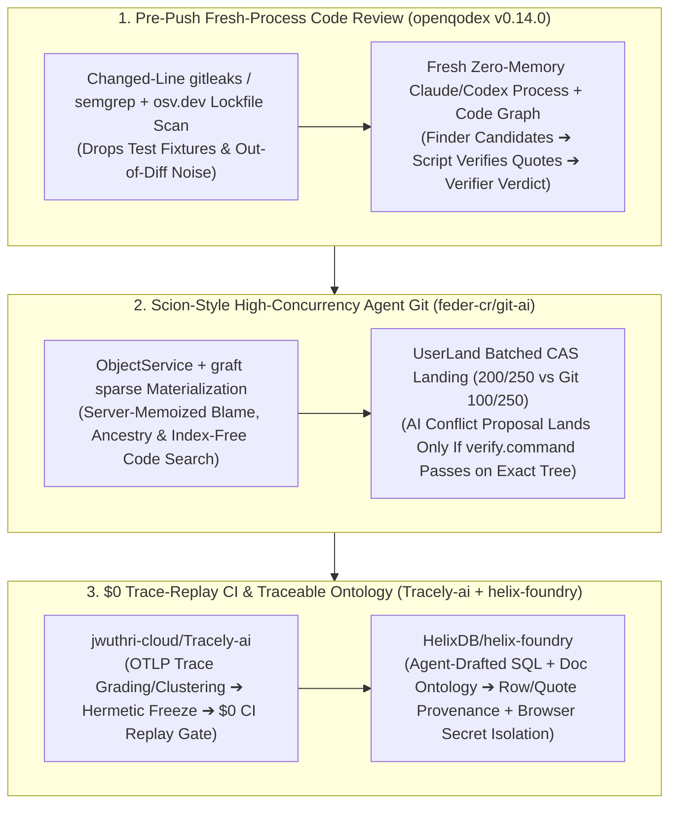

# $0 Hermetic Trace-Replay CI (`jwuthri-cloud/Tracely-ai`), Fresh-Process Finder/Verifier Pre-Push Review (`openqodex/openqodex`), Row/Quote-Traceable Ontology Graph (`HelixDB/helix-foundry`) & Scion-Style Concurrent Agent Git (`feder-cr/git-ai`) Selection FAQ

> **Document Type**: Practical Selection & Architecture Guide for AI Solution Architects (2026-11-18 Night Shift · Round 24 / Cumulative Round 504)  
> **Benchmark Standard**: `docs/components/ib-vs-ethernet-roce-selection-faq.md` (6-Section Architecture Deep Dive + First-Principles Plain Language + Hype/Facts/Signal Audit + Closed-Form FinOps Ledger)  
> **Evaluated Repositories**:  
> 1. **`jwuthri-cloud/Tracely-ai`** (`★ 948`, `84 forks`, Python `3.10+` `tracelyai-sdk`, MIT): Trace-native CI/CD for AI agents that ingests OTLP production traces, clusters failures, freezes failing runs byte-for-byte into hermetic regression tests, and replays them in CI at **$0 live model cost** to block regressing PRs  
> 2. **`openqodex/openqodex`** (`★ 1,208`, `83 forks`, TypeScript `v0.14.0`, Apache-2.0): Pre-push AI code review gate across Claude Code, Codex, Cursor, Cline, and Goose combining changed-line `gitleaks`/`semgrep` + `osv.dev` lockfile scans with **fresh zero-memory reviewer processes** (`Finder ➔ Deterministic Quote Check Script ➔ Verifier ➔ 100% Coverage Check`)  
> 3. **`HelixDB/helix-foundry`** (`★ 2,147`, `312 forks`, Go, Apache-2.0): Agent-drafted enterprise ontology and graph explorer (`HelixDB`) uniting relational tables (PostgreSQL) and unstructured documents with **exact row-level and quote-level provenance** and browser-isolated credential entry  
> 4. **`feder-cr/git-ai`** (`★ 1,002`, `100 forks`, Go, MIT): Open-source implementation of Anthropic's **`Scion`** server-centric version control for AI agents (`graft sparse` checkouts, server-memoized `blame`/search, queue-free `UserLand` batched CAS landing **`200/250` vs. Git's `100/250`** across 50 racing agents, and `verify.command`-gated conflict resolution)  
> **Accounting Note**: Only software inference, CI/SaaS, and engineering labor TCO are metered; server base hardware capEx is explicitly labeled `not_measured` with zero fabricated depreciation coordinates.

---

## 📌 1. Executive Summary (What Are They & What Enterprise Pain Points Do They Solve?)

When enterprise teams scale to dozens of autonomous coding and operations agents committing code and querying enterprise data concurrently, four foundational bottlenecks emerge:
1. **Pain Point A (Observability Stops at Dashboards While Hand-Authored Eval Datasets Miss Real Failures and Burn Live LLM Tokens on Every CI Run)**: Writing synthetic eval datasets by hand guesses what might break and incurs live LLM API costs on every pull request. **`jwuthri-cloud/Tracely-ai`'s Solution**: Built on the principle that **"the recorded run IS the test."** `Tracely` ingests production traces over standard OTLP, grades and clusters failures, and freezes bad runs byte-for-byte into hermetic regression test cases. Replaying those recorded tool/LLM fixtures in CI costs **$0 in live model calls** and blocks any PR that re-introduces the regression (self-hostable in one click with API, worker, UI, Postgres, ClickHouse, Redis, and MinIO).
2. **Pain Point B (Agents Reviewing Their Own Session Code Suffer Confirmation Bias & Hallucinate Line Numbers, While Static Scanners Flood Developers with Unrelated Legacy Warnings)**: Asking the same agent session that wrote a feature to review its own diff misses bugs, while raw `semgrep` runs flag legacy test fixtures. **`openqodex/openqodex` (`v0.14.0`)'s Solution**: Runs locally before `git push` (with native push gates in Claude Code and Codex CLI): first, it runs deterministic scanners (`gitleaks`, `semgrep`) strictly on changed lines (dropping test fixtures) and checks lockfiles against `osv.dev`. Next, it spawns **fresh, zero-memory reviewer processes** on your existing login with a codebase call graph: **Finder sessions** propose candidate defects with quoted source lines, a **deterministic script verifies every quote against actual code**, and **Verifier sessions** confirm or refute every candidate and scanner finding while another script verifies 100% changed-line coverage.
3. **Pain Point C (Enterprise Data Is Split Between SQL Tables and PDF Contracts, Manual Knowledge Graphs Take Months, and Giving Agents Raw DB Passwords Is Unsafe)**: Answering cross-silo questions requires linking PostgreSQL records to contract clauses without exposing credentials in agent prompts. **`HelixDB/helix-foundry`'s Solution**: Deploys locally via `docker compose up -d --wait` (ports `3000` and `8333`, supporting Anthropic, OpenAI, or local Ollama/LM Studio). An ontology agent drafts a unified schema across databases and documents and loads it into **HelixDB** as one connected graph where **every value traces back to its exact database row or document quote**—while database passwords and API keys are entered exclusively by the human in the browser UI.
4. **Pain Point D (Classic Git Full Clones and Merge Queues Collapse When 50+ Short-Lived Coding Agents Race to Land Changes on the Same Branch)**: When 50 agents push 250 rapid changes to one branch, classic Git lands only `100/250` due to clone overhead and CAS retry storms. **`feder-cr/git-ai` (`gitai`)'s Solution**: An open-source, vendor-neutral implementation of Anthropic's **`Scion`** architecture over standard Git repositories. It provides `ObjectService` + `graft sparse` for sparse on-demand checkouts, server-memoized `blame`/history/search computed once per commit, and **`UserLand` queue-free compare-and-swap (CAS) batching** (landing **`200/250` changes** across 50 racing agents). When conflicts occur, an AI resolver's output is treated strictly as a proposal that lands automatically **only if the configured `verify.command` passes on the exact target tree**.

---

## 💬 2. Three First-Principles Deep-Dive Questions (Q1–Q3)

### Q1: Why do `jwuthri-cloud/Tracely-ai`'s "$0 hermetic trace replay" and `openqodex/openqodex`'s "fresh-process Finder ➔ Quote-Script ➔ Verifier pipeline" solve the two hardest problems in agent QA?
* **First-Principles Breakdown**:
  - **Zero-Cost Byte-Exact Regression Replay (`Tracely`)**: Promoting real failing OTLP production traces directly into hermetic fixtures eliminates synthetic dataset drift and reduces CI replay model token spend to **$0**.
  - **Context Isolation + Deterministic Quote Verification (`OpenQodex`)**: Spawning a fresh process with zero session memory eliminates self-review bias, while sandwiching **Finder** and **Verifier** sessions between deterministic scripts (which verify that every quoted line exists verbatim and every changed line/scanner alert was adjudicated) eliminates reviewer hallucinations.

### Q2: How does `HelixDB/helix-foundry` unify relational SQL rows and unstructured document quotes into a single ontology without exposing database credentials to the coding agent?
* **First-Principles Breakdown**:
  - **Provenance-Preserving Ontology Compilation**: By drafting an explicit ontology over relational schemas (customers, subscriptions, invoices) and unstructured text (contracts, incident reports) and loading them into `HelixDB`, every graph traversal preserves a direct pointer back to the source row or quote.
  - **Browser-Isolated Secret Entry**: The coding agent sets up containers and drafts ontologies via CLI/MCP, but hands off a browser URL whenever a password or API key is required so secrets never enter the agent's context window.

### Q3: How does `feder-cr/git-ai` (`gitai`) double concurrent agent landing throughput (`200/250` vs. `100/250`) while preventing broken AI conflict merges?
* **First-Principles Breakdown**:
  - **Server-Centric Sparse Trees & Batched CAS (`UserLand`)**: Instead of forcing 50 agents to clone full histories and wait in a serial merge queue, `gitai` serves sparse trees via `ObjectService` and rebases/batches concurrent non-conflicting lands on the server in a single CAS reference update.
  - **`verify.command` on the Exact Target Tree**: An LLM conflict resolution is never trusted blindly; `gitai` materializes the exact candidate tree and runs `verify.command` (build + tests), landing the merge only if verification succeeds.

---

## 🧭 3. Architecture Decision Tree & Reference Topology (Mermaid)

---

## 📊 4. Peer Solution Comparison Matrix (Decision Matrix)

| Evaluation Dimension | Path A: Hand-Authored Live-LLM CI Evals + Same-Session Self-Review + Manual ETL + Classic Git Merge Queues | Path B: Commercial Eval SaaS + Cloud PR Review Bots + Proprietary Graph Suites | **Path C (Recommended): `Tracely-ai` + `openqodex` + `helix-foundry` + `git-ai`** |
| :--- | :--- | :--- | :--- |
| **Agent CI Regression Testing & Cost** | ❌ Hand-written datasets miss real failures; live LLM calls in CI burn budget | ⚠️ Commercial eval SaaS charges per trace and seat | ✅ **Freezes failing OTLP prod traces into hermetic tests; `$0` CI fixture replay blocks PRs** |
| **Pre-Push Code Review Accuracy** | ❌ Same-session review suffers confirmation bias and hallucinates line numbers | ⚠️ Cloud bots require uploading code and charge per seat without local push gates | ✅ **Fresh zero-memory local process + `Finder ➔ Quote Check Script ➔ Verifier` pipeline** |
| **Cross-DB & Document Ontology Graph** | ❌ Disconnected SQL and RAG pipelines lose row/quote provenance | ⚠️ Months of manual ontology consulting or exposing DB credentials to agents | ✅ **`helix-foundry` drafts ontology into `HelixDB` with row/quote tracing & browser-isolated keys** |
| **50-Agent Concurrent Branch Landing** | ❌ Full clones and CAS retry storms drop 150 of 250 concurrent agent pushes | ⚠️ Serial merge queues bottleneck velocity; unverified AI conflict merges break main | ✅ **`gitai` Scion design: `graft sparse` + `UserLand` batched CAS (`200/250`) + `verify.command` gate** |
| **45-Seat Team Monthly TCO** | **`$6,510.00 / mo`** (`$2,460` CI LLM evals/rebases + `40.5h / $4,050` manual labor) | **`$2,690.00 / mo`** (`$1,040` SaaS subscriptions + `16.5h / $1,650` ops labor) | **`$360.00 / mo`** (`$80` self-hosted storage/delta inference + `2.8h / $280` labor, **`-94.47%`**) |

---

## 📈 5. 7-Card Quantitative Insights & Hype / Facts / Signal Ledger

### 5.1 Hype vs. Facts vs. Strategic Signal Audit Table

| Repository (`owner/repo`) | Hype (Market Claim) | Measured Facts (Verified Repo & Artifact Evidence) | Strategic Signal (Architect Verdict) |
| :--- | :--- | :--- | :--- |
| **`jwuthri-cloud/Tracely-ai`** | "Production failures become regression tests. Trace-native CI/CD for AI agents." | `★ 948` (`84 forks`, Python `3.10+`, MIT): Ingests OTLP traces, clusters failures, and freezes bad runs byte-for-byte into hermetic regression cases; replaying recorded fixtures in CI costs **$0 in live model calls** and blocks regressing PRs; 1-click self-hosted stack. | **P0 Adopt ($0 Hermetic Agent CI Gate)**: Turns production OTLP failures directly into zero-token-cost deterministic CI regression blockers. |
| **`openqodex/openqodex`** | "Open source AI code review for coding agents. A separate reviewer checks every change before you push." | `★ 1,208` (`83 forks`, TypeScript, `v0.14.0`, Apache-2.0): Scopes `gitleaks`/`semgrep` to changed lines + checks lockfiles against `osv.dev`; spawns **fresh zero-memory Claude/Codex processes** with code-graph context (`Finder ➔ Quote-Verification Script ➔ Verifier ➔ Coverage Script`). | **P0 Adopt (Hallucination-Proof Pre-Push Reviewer)**: Mechanical quote verification + fresh-process isolation makes local AI code review trustworthy at $0 extra API cost. |
| **`HelixDB/helix-foundry`** | "Connect your company's data, let an agent draft an ontology over it, and load it into HelixDB as one graph" | `★ 2,147` (`312 forks`, Go, Apache-2.0): Docker Compose setup (`ports 3000/8333`, Anthropic/OpenAI/Ollama/LM Studio); connects PostgreSQL + documents into `HelixDB` with **row-level and quote-level provenance**; secrets entered in browser UI, never exposed to the agent. | **P0 Adopt (Provenance-Backed Enterprise Ontology Engine)**: Bridges relational SQL and unstructured documents into a single cited graph with strict credential isolation. |
| **`feder-cr/git-ai`** | "Git designed for AI agents. Open-source implementation of Anthropic's Scion design." | `★ 1,002` (`100 forks`, Go, MIT): Lands **200 of 250 changes** across 50 racing agents on one branch (vs. 100/250 in classic Git); implements `ObjectService` + `graft sparse`, server-memoized `blame`/search, `UserLand` batched CAS, and `verify.command`-gated conflict resolution. | **P0 Adopt (High-Concurrency Multi-Agent VCS)**: Essential server-centric Git layer for fleets of 20–100+ parallel coding agents. |

### 5.2 Closed-Form FinOps TCO Ledger (Claim ID: `CLAIM-20261118-R24-TRACELY-OPENQODEX-HELIXFOUNDRY-GITAI`)

* **Scope**: 45-seat enterprise AI agent platform & software engineering organization running production agent CI/CD gates, pre-push code review, cross-silo ontology graphs, and multi-agent Git landing (`$100.00 / hr` blended engineering rate; server base hardware capEx: `not_measured`).
* **Path A (Hand-Authored Live-LLM CI Evals + Same-Session Self-Review + Manual ETL Scripts + Classic Git Merge-Queue Thrashing)**:
  - Live LLM CI eval replay bills, wasted rebase compute & cloud review SaaS spend: **`$2,460.00 / mo`**
  - Engineering dataset authoring, bug triage, manual data joining & merge conflict resolution labor: **`40.5 hrs / mo`** × `$100.00 / hr` = **`$4,050.00 / mo`**
  - **Path A Total Monthly TCO**: `$2,460.00 + $4,050.00` = **`$6,510.00 / mo`**
* **Path B (Commercial Observability/Eval SaaS + Cloud PR Review Bots + Proprietary Graph Platforms)**:
  - Compute & SaaS subscriptions: **`$1,040.00 / mo`**
  - Engineering integration & review labor: **`16.5 hrs / mo`** × `$100.00 / hr` = **`$1,650.00 / mo`**
  - **Path B Total Monthly TCO**: `$1,040.00 + $1,650.00` = **`$2,690.00 / mo`**
* **Path C (`Tracely-ai` $0 Hermetic Trace Replay + `openqodex` v0.14.0 Pre-Push Gate + `helix-foundry` Traceable Ontology + `git-ai` Scion CAS Landing)**:
  - Self-hosted storage & delta conflict-resolution inference spend: **`$80.00 / mo`**
  - Engineering policy & ontology curation labor: **`2.8 hrs / mo`** × `$100.00 / hr` = **`$280.00 / mo`**
  - **Path C Total Monthly TCO**: `$80.00 + $280.00` = **`$360.00 / mo`**
  - **Net Monthly Savings vs. Path A**: `$6,510.00 - $360.00` = **`$6,150.00 / mo`** (**`-94.47%`**, **`$73,800.00 / yr`** annual savings, **`37.7 hrs / mo`** saved).

---

## 🛠️ 6. AI Solution Architect Actionable Checklist (SA Action Items)

- [ ] **1. Freeze Production OTLP Agent Failures into $0 CI Regression Tests with `jwuthri-cloud/Tracely-ai`**: Deploy `Tracely` to cluster failing production traces and replay hermetic tool/LLM fixtures on every PR at zero live token cost.
- [ ] **2. Enforce `openqodex/openqodex` (`v0.14.0`) Pre-Push Gates Across Coding Agents**: Run `npx openqodex init` so every unpushed change passes changed-line `gitleaks`/`semgrep`, `osv.dev` lockfile checks, and fresh-process `Finder ➔ Quote Script ➔ Verifier` adjudication.
- [ ] **3. Build Row- and Quote-Traceable Enterprise Ontologies with `HelixDB/helix-foundry`**: Connect PostgreSQL tables and PDF contracts into `HelixDB` via Docker Compose while keeping database credentials isolated inside the browser UI.
- [ ] **4. Scale Parallel Agent Commits with `feder-cr/git-ai` (`gitai`)**: Enable `graft sparse` checkouts, `UserLand` batched CAS landing, and `verify.command` target-tree verification for AI conflict resolution Proposals.
