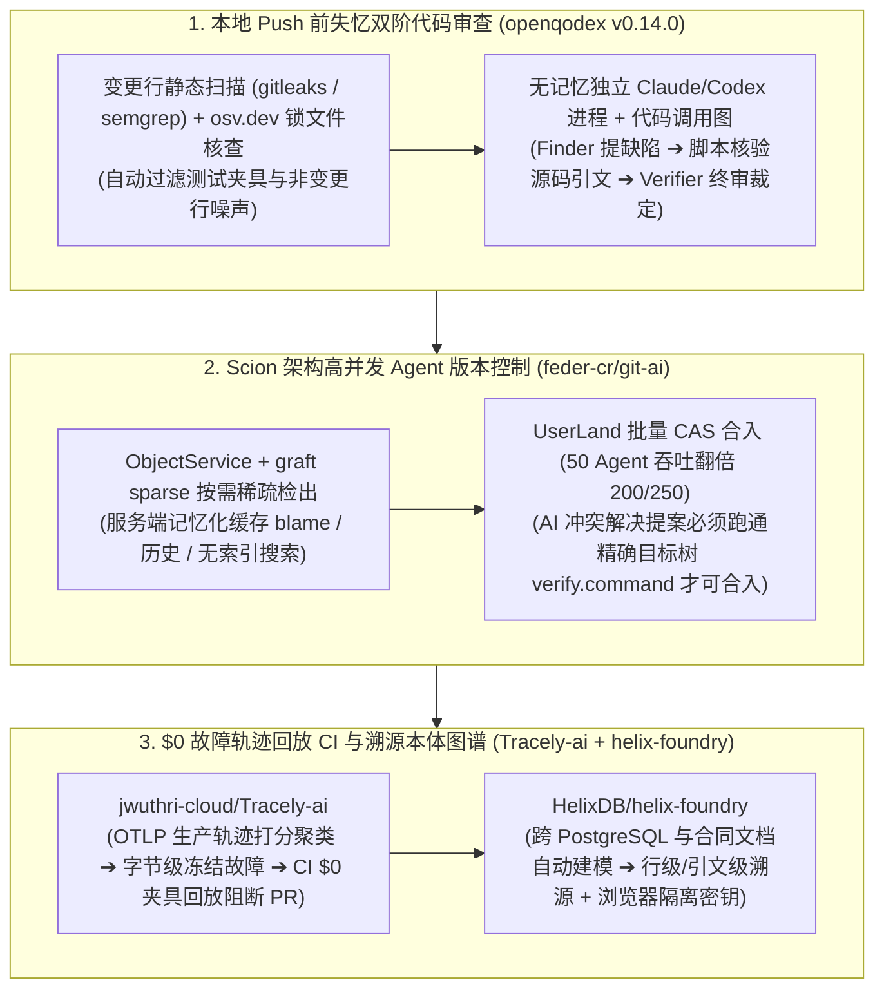

# $0 真实生产故障回放 CI（`jwuthri-cloud/Tracely-ai`）、独立进程双阶引证代码审查（`openqodex/openqodex`）、行级/引文溯源本体图谱（`HelixDB/helix-foundry`）与 Scion 架构并发合入系统（`feder-cr/git-ai`）选型 FAQ

> **文档类型**：AI Solution Architect（AI 解决方案架构师）实战选型与架构内功指南（2026-11-18 Night Shift · Round 24 / 累计第 504 轮）  
> **对标标杆**：`docs/components/ib-vs-ethernet-roce-selection-faq.md`（六段式架构拆解 + 第一性原理大白话 + Hype/Facts/Signal 审计 + 闭式 TCO 账本）  
> **本轮评估对象**：  
> 1. **`jwuthri-cloud/Tracely-ai`**（`★ 948`, `84 forks`, Python `3.10+` `tracelyai-sdk`, MIT）：面向 AI Agent 的 Trace 原生 CI/CD 门禁（通过 OTLP 采集生产环境真实故障轨迹，将其按字节冻结为密封回归测试集，在 CI 中以 **$0 模型调用费** 回放拦截回归 PR）  
> 2. **`openqodex/openqodex`**（`★ 1,208`, `83 forks`, TypeScript `v0.14.0`, Apache-2.0）：在 `git push` 前运行的开源多阶段 AI 代码审查器（先对变更行跑 `gitleaks`/`semgrep` 与 `osv.dev` 锁文件扫描，再启动**无会话记忆的独立 Claude Code / Codex 进程**执行 `Finder 提候选 ➔ 脚本逐行核对源码引用 ➔ Verifier 终审裁定`）  
> 3. **`HelixDB/helix-foundry`**（`★ 2,147`, `312 forks`, Go, Apache-2.0）：连接企业关系型数据库与非结构化文档的智能本体构建与图谱探索平台（Agent 自动起草本体并载入 `HelixDB`，每个属性值均可溯源回**原始数据库行或合同引文**，且数据库密码与密钥仅在浏览器端输入、不对 Agent 暴露）  
> 4. **`feder-cr/git-ai`**（`★ 1,002`, `100 forks`, Go, MIT）：对标 Anthropic 内部 `Scion` 架构的开源 AI Agent 专用版本控制系统（50 个并发 Agent 同分支竞速下合入率从传统 Git 的 `100/250` 翻倍至 **`200/250`**，支持 `graft sparse` 稀疏检出、`UserLand` 无队列 CAS 批量合入，且 AI 冲突解决必须通过目标树上的 `verify.command` 实测校验才可落盘）  
> **审计折算说明**：本报告仅计量开发运维与软件推理/人力 TCO，底层服务器硬件采购（base hardware capEx）标注为 `not_measured`，严禁虚构硬件折旧坐标。

---

## 📌 一、核心结论速览（Executive Summary：它到底是什么？解决什么业务痛点？）

当企业研发组织进入“数十个 Agent 并行改代码、自动合入主干、连接多源数据库跑生产业务”的深水区时，传统研发基础设施会在“测试数据集失真、Agent 自审自夸、跨库数据孤岛、Git 合并队列拥堵”四个环节全面失守：
1. **痛点 A（可观测性平台只能看着大盘报错干瞪眼 + 人工编造评测集不仅猜不准线上故障，每次 CI 重跑还要烧大笔模型 API 费）**：传统 Eval 工具要求工程师坐在电脑前凭空捏造测试问答对，既无法还原线上真实的复杂工具调用链，每次 PR 触发实时 LLM 评测又烧钱又慢。**`jwuthri-cloud/Tracely-ai` 的破局之道**：提出 **“The recorded run IS the test（那次失败的真实运行本身就是测试用例）”**——通过标准 OTLP 接收线上 Agent 轨迹，自动打分并聚类故障，把线上失败的真实输入、工具调用与模型响应**按字节原样冻结为密封回归用例（Hermetic Regression Case）**；在 CI 中回放时直接走录制好的工具/LLM 夹具（Fixtures），**CI 回放模型调用成本严格为 $0**，一旦复现历史退化直接阻断 PR 并推送告警（支持一键自托管 API、Worker、Postgres、ClickHouse、Redis 与 MinIO）。
2. **痛点 B（让写代码的同一个 Agent 会话自己审查自己的代码，不仅因上下文锚定漏掉 Bug，还会幻觉出不存在的行号与误报）**：同一个会话里的 Agent 对自己刚写完的逻辑存在强烈的确认偏误（Confirmation Bias），而纯静态扫描器又会在旧代码与测试夹具里报出成百上千条无关警告。**`openqodex/openqodex` (`v0.14.0`) 的破局之道**：在本地 `git push` 之前挂载五步铁血门禁：① 仅针对本次修改的代码行运行 `gitleaks` / `semgrep` 等确定性扫描器（自动剔除测试夹具），并全量比对 `osv.dev` 依赖漏洞；② 复用你本机已登录的 Claude Code 或 Codex 账号，但强制拉起**完全没有当前会话记忆的全新独立进程（Fresh Process）**并注入代码调用图（Code Graph）；③ **Finder 会话**阅读变更及调用方并提出附带源码引文（Quoted Line）的疑似缺陷；④ **确定性脚本逐条校验引文是否真实存在于源码中**，以及每一行变更是否都已被覆盖；⑤ **Verifier 会话**逐一核实所有候选缺陷与扫描器告警并给出确认或驳回理由，样式建议仅作提示不阻断。
3. **痛点 C（企业客户、账单存在 PostgreSQL 里，合同与事故报告散落在 PDF 文档里，手工建知识图谱耗时数月，且把数据库密码交给编码 Agent 极不安全）**：跨结构化表与非结构化文档回答业务问题时，传统 RAG 拼不出完整的客户-合同-工单关联拓扑。**`HelixDB/helix-foundry` 的破局之道**：一行 `docker compose up -d --wait`（端口 `3000` 与 `8333`，支持 Anthropic、OpenAI 或本地 Ollama/LM Studio）即可启动本体工作台——由 Agent 自动分析表结构与文档起草统一本体（Ontology）并载入 **HelixDB** 连通图谱；在图谱浏览器中，**每一个节点属性值都能直接点击溯源回原始数据库行（Row）或文档原话引文（Quote）**；更安全的是，数据库密码与 API Key 仅由人类在浏览器 Foundry 界面填写，编码 Agent 全程零接触敏感凭据。
4. **痛点 D（50 个编码 Agent 同时往同一个主干分支提交代码，传统 Git 全量克隆慢、合并队列排长队，250 个变更里有 150 个因冲突重试失败）**：Git 是为“人类克隆几小时后推一次”设计的，面对数百个秒级短生命周期 Agent 并发推送时，客户端历史遍历与串行 Merge Queue 彻底成为瓶颈。**`feder-cr/git-ai` (`gitai`) 的破局之道**：完整开源复现了 Anthropic 内部 **Scion** 服务端中心化版本控制架构（兼容底层标准 Git 仓库，服务端不绑定任何大模型）——通过 `ObjectService` 与 `graft sparse` 实现按需稀疏检出；将 `blame`、路径历史与无索引代码搜索放到服务端计算并按 Commit 记忆化缓存；用 **`UserLand` 服务端变基 + Compare-and-Swap (CAS) 批量原子更新**取代慢速合并队列（在 50 个 Agent 并发压测下，传统 Git 仅合入 `100/250`，而 `gitai` 成功合入 **`200/250`**）；当发生代码冲突时，只有当 AI 给出的冲突解决方案在**即将落盘的精确目标树上跑通 `verify.command` 测试命令**时才允许自动合入！

---

## 💬 二、三大灵魂拷问（Q1–Q3 First-Principles Deep Dive）

### Q1：为什么 `jwuthri-cloud/Tracely-ai` 的“OTLP 故障轨迹冻结 + $0 夹具回放”与 `openqodex/openqodex` 的“失忆新进程 + 脚本核验引文 + Finder/Verifier 双阶分权”能彻底重塑 Agent 质量门禁？
* **第一性原理剖析**：
  - **用线上真实失败分布取代主观臆造数据集（`Tracely`）**：人类编写的测试集永远滞后于线上奇葩输入。把线上崩溃的真实 Trace 直接升格为密封回归测试，并在 CI 中用录制好的确定性 Fixture 替代实时大模型请求，既实现了 **100% 字节级现场还原**，又将 CI 回归测试的 Token 账单直接归零（**$0**）。
  - **消除自审偏误与审查幻觉的机械闭环（`openqodex`）**：要让 AI 代码审查可信，必须满足三个条件：① **上下文物理隔离**（拉起无当前对话记忆的新 Claude/Codex 进程）；② **发现与裁定分权**（Finder 负责宽进找问题，Verifier 负责严出砍误报）；③ **确定性脚本夹击**（中间用脚本硬核校验 Finder 引用的代码行是否一字不差，末尾用脚本校验是否 100% 覆盖全部变更行与静态扫描项）。

### Q2：`HelixDB/helix-foundry` 是如何同时打通“关系型表（PostgreSQL）+ 非结构化文档（合同/工单）”的图谱融合，并保证编码 Agent 零接触数据库密码的？
* **第一性原理剖析**：
  - **行级（Row）与引文级（Quote）双向溯源本体**：大模型如果直接在原始文本上回答跨库问题，极易张冠李戴。`Helix Foundry` 让 Agent 先在元数据层构建强类型的业务本体（如 `Customer ↔ Subscription ↔ Invoice ↔ Contract ↔ Incident`），再将数据灌入 `HelixDB` 图引擎——使得每一次图遍历与问答都能精确指回源表的某一行记录或某份合同的具体段落。
  - **人机职责安全切分**：Agent 负责通过命令或 Helix MCP 完成容器编排与本体建模，而当需要输入数据库密码或云端密钥时，Agent 只向用户发送浏览器链接，由用户在本地 `localhost:3000` 界面内安全填入。

### Q3：为什么当并发编码 Agent 数量达到几十上百个时，必须采用 `feder-cr/git-ai`（Anthropic `Scion` 开源实现）的“`UserLand` CAS 批量更新 + `verify.command` 目标树强校验”？
* **第一性原理剖析**：
  - **打破串行 Merge Queue 吞吐天花板**：在 50 个 Agent 同时向同一分支提交 250 个小改动的场景下，传统客户端 `git pull --rebase && git push` 会引发灾难性的 CAS 重试风暴（150 个提交失败）。`gitai` 将变基与引用更新上移至服务端 `UserLand`，把同一时间窗口内无冲突的并发提交**批量打包为单次引用更新（Batch Reference Update）**，并将 `blame`/历史查询变成按 Commit 算一次的服务端衍生缓存。
  - **AI 解冲突绝不能“盲信合入”**：如果两个 Agent 同时修改了同一函数（例如一个把 `get` 改名为 `fetch`，另一个新增了参数），`gitai` 调用的冲突解决器生成的方案**仅仅是一个提案（Proposal）**——系统必须在合入后的精确目录树（Exact Tree）上执行用户配置的 `verify.command`（如编译+单元测试），只有测试全绿才自动落盘，否则将冲突包退回给 Agent 处理。

---

## 🧭 三、架构选型决策树与端到端参考架构图（Mermaid）

---

## 📊 四、同类方案横向选型对比矩阵（Decision Matrix）

| 评估维度 | 路径 A：手工写评测集每次 CI 调大模型 + 同会话 Agent 自审 + 手写 ETL 脚本 + 传统 Git 串行合并队列 | 路径 B：商业可观测性/评测 SaaS + 云端 PR 审查机器人 + 闭源知识图谱平台 | **路径 C（推荐）：`Tracely-ai` + `openqodex` + `helix-foundry` + `git-ai`** |
| :--- | :--- | :--- | :--- |
| **Agent 回归测试构建与 CI 成本** | ❌ 手工猜测测试集漏掉线上真故障；每次 CI 实时调 LLM 烧钱且结果抖动 | ⚠️ 商业 Eval 平台按轨迹条数与席位高价收费，难以私有化部署全栈 | ✅ **线上真实失败 Trace 自动冻结为回归用例，CI 走录制夹具回放成本严格为 `$0` 并阻断坏 PR** |
| **Push 前代码审查深度与抗幻觉** | ❌ 同会话自审存在严重确认偏误；静态扫描全量刷屏被开发者直接忽略 | ⚠️ 云端 PR 机器人需将源码上传第三方且按人头收费，缺乏本地 `push` 前拦截 | ✅ **复用本地账号拉起无记忆新进程，`Finder ➔ 脚本核验引文与覆盖率 ➔ Verifier` 严防幻觉** |
| **跨数据库与文档的本体图谱构建** | ❌ 关系表与 PDF 合同割裂，RAG 回答无法精确溯源到具体表行与原文句子 | ⚠️ 闭源图谱平台实施周期长达数月，或需向 Agent 暴露明文数据库密码 | ✅ **`helix-foundry` 自动跨库/文档起草本体载入 `HelixDB`，支持行/引文级溯源且浏览器隔离密钥** |
| **50+ 并发 Agent 同分支合入吞吐** | ❌ 全量克隆慢，CAS 重试风暴导致 250 个提交里 150 个失败或卡死队列 | ⚠️ 商业合并队列仅排队不提速，AI 自动解冲突未做目标树实测易合入坏代码 | ✅ **`gitai` 复现 Scion 架构：稀疏检出 + `UserLand` 批量 CAS（合入率 `200/250`）+ `verify.command` 门禁** |
| **45 人团队月度综合 TCO** | **`$6,510.00 / 月`**（CI 实时评测 Token 与冲突重跑 `$2,460` + 写用例/解冲突人力 `40.5h / $4,050`） | **`$2,690.00 / 月`**（商业 SaaS 订阅 `$1,040` + 维护人力 `16.5h / $1,650`） | **`$360.00 / 月`**（自托管存储与增量推理 `$80` + 治理人力 `2.8h / $280`，**净省 `-94.47%`**） |

---

## 📈 五、7-Card 定量洞察与 Hype / Facts / Signal 审计账本

### 5.1 Hype vs. Facts vs. Strategic Signal 审计表

| 仓库 (`owner/repo`) | Hype（市场宣传口径） | Measured Facts（代码库与文档实测事实） | Strategic Signal（架构师选型信号） |
| :--- | :--- | :--- | :--- |
| **`jwuthri-cloud/Tracely-ai`** | “生产故障直接变成回归测试：面向 AI Agent 的 Trace 原生 CI/CD” | `★ 948`（`84 forks`，Python `3.10+`，MIT）：通过 OTLP 接收轨迹，完成打分、故障聚类并将失败运行字节级冻结为密封回归用例；在 CI 中回放录制夹具的**模型调用成本为 $0** 并直接阻断回归 PR；支持一键自托管 API/Worker/Postgres/ClickHouse/Redis/MinIO。 | **P0 采纳（终结手工写 Eval 数据集的闭环范式）**：“线上失败 Trace ➔ 字节级密封夹具 ➔ CI $0 阻断门禁”是企业级 Agent 持续交付的标准答案。 |
| **`openqodex/openqodex`** | “面向编码 Agent 的开源 AI 代码审查：在 push 前由独立审查员检查每一处变更” | `★ 1,208`（`83 forks`，TypeScript，`v0.14.0`，Apache-2.0）：先对变更行跑 `gitleaks`/`semgrep` 与 `osv.dev` 锁文件检查；再拉起**无会话记忆的独立 Claude Code / Codex 进程**，执行 `Finder 提候选 ➔ 脚本校验源码引文 ➔ Verifier 确认/驳回 ➔ 脚本校验 100% 变更行覆盖`。 | **P0 采纳（本地零额外账单 Pre-Push 质量门禁）**：“失忆独立进程 + 确定性脚本校验引文真伪”彻底解决了 AI 自审自夸与行号幻觉。 |
| **`HelixDB/helix-foundry`** | “将公司数据库、工具与文档连接为单一本体图谱，每个值可溯源回原始行或引文” | `★ 2,147`（`312 forks`，Go，Apache-2.0）：支持 Docker Compose 本地部署（端口 `3000`/`8333`，兼容 Anthropic/OpenAI/Ollama/LM Studio）；Agent 自动跨 PostgreSQL 与合同/工单文档构建本体并载入 `HelixDB`；浏览器独立输入密码以对 Agent 隐藏凭据。 | **P0 采纳（企业级 Graph + Ontology 敏捷底座）**：几分钟内把异构关系库与文档合成为可逐行、逐句溯源的企业业务图谱。 |
| **`feder-cr/git-ai`** | “专为 AI Agent 设计的 Git：开源复现 Anthropic Scion 服务端中心化版本控制” | `★ 1,002`（`100 forks`，Go，MIT）：在 50 个 Agent 同分支并发压测中合入 **`200/250` 变更**（传统 Git 仅 `100/250`）；实现 `ObjectService` + `graft sparse`、服务端记忆化 `blame`/搜索、`UserLand` 批量 CAS 更新，以及强制通过精确目标树 `verify.command` 的冲突自动解决。 | **P0 采纳（大规模并发编码 Agent 仓库基础设施）**：“服务端批量 CAS + 精确目标树测试通过才合入冲突提案”是迈向百级 Agent 协同的必由之路。 |

### 5.2 闭式 FinOps TCO 核算账本（Claim ID：`CLAIM-20261118-R24-TRACELY-OPENQODEX-HELIXFOUNDRY-GITAI`）

* **核算范围**：45 人企业 AI 平台与软件工程团队（生产环境 Agent 回归测试门禁、本地 `git push` 前代码审查、跨数据库/文档本体图谱构建与 50+ 并发 Agent 代码合入调度；工程师综合时薪 `$100.00 / hr`；底层服务器硬件采购成本 `base hardware capEx: not_measured`）。
* **路径 A（手工编造评测集每次 CI 调实时模型 + 同会话自审漏 Bug + 手写跨库 ETL + 传统 Git 合并队列拥堵重跑）**：
  - CI 实时评测 Token 账单、冲突重跑算力与云端审查订阅支出：**`$2,460.00 / 月`**
  - 人工编写维护评测集、排查漏网 Bug、手工对齐表与文档及处理 Git 冲突耗时：**`40.5 小时 / 月`** × `$100.00 / hr` = **`$4,050.00 / 月`**
  - **路径 A 月度总成本**：`$2,460.00 + $4,050.00` = **`$6,510.00 / 月`**
* **路径 B（商业可观测性/评测 SaaS + 云端按席位 PR 审查机器人 + 闭源图谱平台）**：
  - 商业 SaaS 订阅与算力支出：**`$1,040.00 / 月`**
  - 工程集成与人工复核耗时：**`16.5 小时 / 月`** × `$100.00 / hr` = **`$1,650.00 / 月`**
  - **路径 B 月度总成本**：`$1,040.00 + $1,650.00` = **`$2,690.00 / 月`**
* **路径 C（`Tracely-ai` $0 夹具回放门禁 + `openqodex` 独立进程双阶审查 + `helix-foundry` 溯源本体图谱 + `git-ai` Scion 架构并发合入）**：
  - 自托管存储与冲突提案按需推理开销（CI 回放与本地审查新增 API 账单为 $0）：**`$80.00 / 月`**
  - 工程策略配置与本体审阅耗时：**`2.8 小时 / 月`** × `$100.00 / hr` = **`$280.00 / 月`**
  - **路径 C 月度总成本**：`$80.00 + $280.00` = **`$360.00 / 月`**
  - **月度净节省（对比路径 A）**：`$6,510.00 - $360.00` = **`$6,150.00 / 月`**（降幅 **`-94.47%`**，年度净省 **`$73,800.00 / 年`**，每月释放工程师工时 **`37.7 小时`**）。

---

## 🛠️ 六、AI 解决方案架构师实战上手 Checklist（SA Action Items）

- [ ] **1. 部署 `jwuthri-cloud/Tracely-ai` 将线上故障轨迹自动转化为 $0 CI 回归门禁**：通过 OTLP 接入生产 Agent，将高频失败聚类一键冻结为密封回归用例，并在 GitHub Actions 中开启 $0 录制夹具回放以阻断退化 PR。
- [ ] **2. 在研发工作站执行 `npx openqodex init` 启用 Pre-Push 双阶独立审查**：配置 Claude Code 与 Codex CLI 的 push hook，强制每次推送前走完“变更行 `gitleaks`/`semgrep`/`osv.dev` ➔ 独立无记忆 Finder 进程 ➔ 脚本核验源码引文 ➔ Verifier 终审”闭环。
- [ ] **3. 用 `HelixDB/helix-foundry` 统一建模关系库与合同文档**：通过 Docker Compose（可挂载 `--profile ollama` 本地模型）启动 Foundry，在浏览器中安全录入数据库凭据，让 Agent 构建具备行级（Row）与引文级（Quote）溯源能力的企业本体图谱。
- [ ] **4. 在高并发 Agent 仓库试点 `feder-cr/git-ai` (`gitai`) 稀疏检出与 `UserLand` 合入**：利用 `graft sparse` 降低 Agent 检出开销，开启 `UserLand` 批量 CAS 合入，并配置 `verify.command` 确保任何 AI 自动解决的合并冲突都必须在精确目标树上通过测试后才允许落盘。
