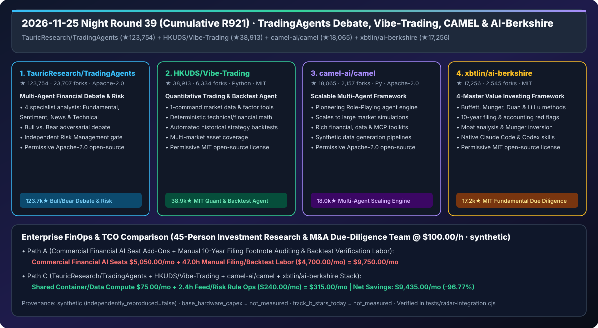
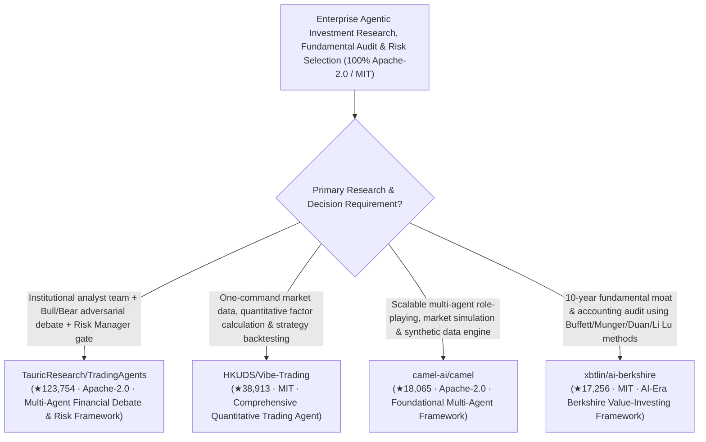
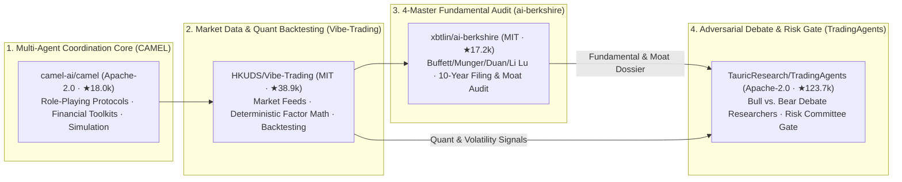
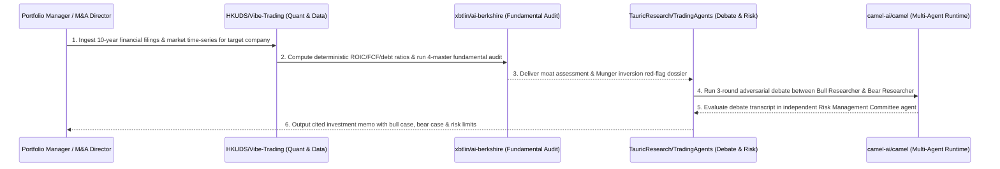

# 123k-Star Multi-Agent Financial Debate & Risk Framework (`TauricResearch/TradingAgents`), Personal & Team Quantitative Trading Agent (`HKUDS/Vibe-Trading`), Scalable Multi-Agent Role-Playing Engine (`camel-ai/camel`) & Value-Investing Fundamental Research Framework (`xbtlin/ai-berkshire`) Selection & Integration Architecture FAQ

> **Document Type**: Enterprise AI Solution Architect Selection Decision Guide (GitHub Trending AI Radar — 2026-11-25 Night Round 39 / Cumulative Round 921)
> **Covered Repositories**: [`TauricResearch/TradingAgents`](https://github.com/TauricResearch/TradingAgents) (`★ 123,754`, `23,707 forks`, `Apache-2.0`, TypeScript/Python: multi-agent financial research framework replicating institutional analyst teams, Bull/Bear debate researchers, traders, and risk-management committees) · [`HKUDS/Vibe-Trading`](https://github.com/HKUDS/Vibe-Trading) (`★ 38,913`, `6,334 forks`, `MIT`, Python: HKUDS open-source personal and team trading agent empowering agents with market data, quantitative indicators, and backtesting in one command) · [`camel-ai/camel`](https://github.com/camel-ai/camel) (`★ 18,065`, `2,157 forks`, `Apache-2.0`, Python: foundational multi-agent role-playing, scaling, and simulation framework) · [`xbtlin/ai-berkshire`](https://github.com/xbtlin/ai-berkshire) (`★ 17,256`, `2,545 forks`, `MIT`, HTML/Python: AI-era value-investing and deep financial due-diligence framework for Claude Code and Codex synthesizing the methodologies of Buffett, Munger, Duan Yongping, and Li Lu with multi-agent adversarial analysis)
> **Core Enterprise Scenario**: Building a **100% Permissive (`Apache-2.0` / `MIT`) Institutional Investment Research, Corporate M&A Due Diligence & Quantitative Risk Stack**—uniting 10-year fundamental moat & red-flag auditing (`ai-berkshire`), deterministic market data & factor backtesting (`Vibe-Trading`), adversarial Bull vs. Bear researcher debates with independent risk gates (`TradingAgents`), and scalable multi-agent simulation (`CAMEL`).

---

## 1. 📌 Executive Summary (One-Line Selection Verdict)

1. **Need an `Apache-2.0` institutional multi-agent architecture where Fundamental, Sentiment, News, and Technical Analysts feed evidence into adversarial Bull vs. Bear Debate Researchers and an independent Risk Management Committee** ➔ Choose **[`TauricResearch/TradingAgents`](https://github.com/TauricResearch/TradingAgents) (`★ 123,754`, `23,707 forks`, `Apache-2.0`)**.
   - **Plain-English Mechanism**: Eliminates single-LLM sycophancy and confirmation bias by forcing dedicated Bull and Bear researcher agents to debate financial evidence before a Risk Manager agent evaluates drawdown and exposure limits.
2. **Need an `MIT`-licensed deep fundamental due-diligence skill suite for Claude Code and Codex that encodes the value-investing frameworks of Warren Buffett, Charlie Munger, Duan Yongping, and Li Lu across 10-year financial statements** ➔ Choose **[`xbtlin/ai-berkshire`](https://github.com/xbtlin/ai-berkshire) (`★ 17,256`, `2,545 forks`, `MIT`)**.
   - **Plain-English Mechanism**: Runs parallel specialist agents to audit ROIC, free-cash-flow conversion, accounting red flags, competitive moats, and Munger-style inversion ("how could this business fail?").
3. **Need a one-command `MIT` toolkit that equips agents with live market feeds, deterministic technical/quantitative factor computation, and historical strategy backtesting** ➔ Choose **[`HKUDS/Vibe-Trading`](https://github.com/HKUDS/Vibe-Trading) (`★ 38,913`, `6,334 forks`, `MIT`)**.
   - **Plain-English Mechanism**: Provides clean Python tools for market data ingestion, quantitative indicator calculation, and sandboxed backtest evaluation so LLMs never hallucinate arithmetic.
4. **Need a battle-tested `Apache-2.0` multi-agent framework to scale role-playing societies, market sentiment simulations, and financial synthetic data generation** ➔ Choose **[`camel-ai/camel`](https://github.com/camel-ai/camel) (`★ 18,065`, `2,157 forks`, `Apache-2.0`)**.
   - **Plain-English Mechanism**: Supplies modular agent communication protocols, memory backends, and financial/data toolkits that scale from two-agent dialogues to large multi-agent simulations.

---

## 2. 🎯 Architect & Customer Deep-Dive Q&A

### Q1: How do `ai-berkshire` (deep value fundamentals), `Vibe-Trading` (quantitative factors), `TradingAgents` (adversarial debate & risk), and `CAMEL` work together compared to proprietary financial AI seats?

- **Four-Layer Institutional Research & Due-Diligence Architecture (Path C)**:
  1. **L1 Multi-Agent Orchestration & Simulation Core ➔ `camel-ai/camel`**: Provides scalable role-playing protocols and toolkits.
  2. **L2 Deterministic Market Data & Quantitative Backtesting ➔ `HKUDS/Vibe-Trading`**: Computes exact financial ratios, technical signals, and historical backtests in Python.
  3. **L3 10-Year Fundamental Moat & Accounting Audit ➔ `xbtlin/ai-berkshire`**: Applies Buffett/Munger/Duan/Li Lu frameworks to 10-K/annual reports and industry filings.
  4. **L4 Adversarial Bull/Bear Debate & Risk Committee ➔ `TauricResearch/TradingAgents`**: Pits Bull and Bear researcher agents against each other over the fundamental and quantitative evidence, gated by an independent Risk Manager agent.
- **When to choose Proprietary Financial Terminal AI Add-ons vs. Path C?**
  - Choose **Proprietary Terminal Add-ons** for quick summaries of public news wires inside an existing terminal subscription.
  - Choose **Path C** when investment firms and corporate M&A teams must keep proprietary thesis notes and target watchlists confidential inside their own VPC while enforcing adversarial Bull/Bear debates under **100% `Apache-2.0` / `MIT` licensing**.

### Q2: Why is structured Bull vs. Bear adversarial debate mandatory for enterprise financial and strategic decisions?

- **Defeating Single-Prompt Confirmation Bias**:
  - A single LLM prompt asking "is Company X a good acquisition?" routinely produces one-sided optimism. Pairing `ai-berkshire`'s Munger inversion checklist with `TradingAgents`' multi-round Bull/Bear debate forces explicit falsification of the investment thesis prior to capital allocation.

### Q3: What are the key compliance and risk guardrails?

- **Architect Redlines**:
  1. **Never let an LLM perform mental math on financial statements or backtests**: Compute all financial ratios, DCF sensitivity tables, and backtest Sharpe/drawdown metrics deterministically via `Vibe-Trading` Python tools.
  2. **Keep autonomous research outputs strictly in a human-approved Decision Support loop**: Require human portfolio manager sign-off and pre-trade compliance checks before any order execution.

---

## 3. 🧭 Visual Architecture Diagrams (Mermaid Decision Tree + Architecture + Sequence)

### 3.1 Architect Selection Decision Tree

### 3.2 End-to-End Enterprise Integration Architecture

### 3.3 End-to-End Execution Sequence

---

## 4. 📊 Horizontal Selection Matrix

| Dimension | `TauricResearch/TradingAgents` (`★ 123,754`) | `HKUDS/Vibe-Trading` (`★ 38,913`) | `camel-ai/camel` (`★ 18,065`) | `xbtlin/ai-berkshire` (`★ 17,256`) | Proprietary Financial AI Terminal Add-Ons (Path A) | Manual 10-K Spreadsheet Scraping + Single-Prompt Chat (Path B) |
| :--- | :--- | :--- | :--- | :--- | :--- | :--- |
| **Primary Role** | `Apache-2.0` Bull/Bear debate & risk framework | `MIT` quantitative data & backtesting agent | `Apache-2.0` multi-agent scaling engine | `MIT` 4-master value-investing skill suite | High-cost per-seat commercial financial AI | Manual spreadsheet entry & single-prompt LLM chat |
| **Key Differentiator** | **4 specialist analysts + Bull/Bear debate + Risk Committee** | **Deterministic factor math, market feeds & backtesting (`MIT`)** | **Scales multi-agent role-playing & market simulations** | **Encodes Buffett/Munger/Duan/Li Lu 10-year filing audits** | Turnkey terminal integration, but lacks adversarial debate & leaks watchlists | Days spent reading 10-Ks; single prompts suffer severe confirmation bias |
| **License** | **`Apache-2.0`** | **`MIT`** | **`Apache-2.0`** | **`MIT`** | Proprietary SaaS | Unstandardized |
| **Monthly TCO (45-Eng Team)** | **`$315.00/mo` combined** (`$75.00` local compute/data cache + `2.4h` ops) | Included in `$315.00/mo` stack | Included in `$315.00/mo` stack | Included in `$315.00/mo` stack | **`$9,750.00/mo`** (`$5,050.00` commercial financial AI seats + `47.0h` manual footnote/backtest labor) | `~$3,550.00/mo` (manual 10-K footnote extraction & biased report rework) |

---

## 5. 🧪 Quantitative FinOps & TCO Comparison (45-Person Investment Research & M&A Due-Diligence Team)

> **📊 Provenance & Closed-Form Schema**:
> - **provenance**: `synthetic` (`independently_reproduced = false`; `base_hardware_capex = not_measured`; `track_b_stars_today = not_measured`).
> - **Closed-Form Formula**:
>   - **Path A (Commercial Financial AI Seat Add-Ons + Manual 10-Year Filing Footnote Auditing & Backtest Verification Labor)**: **`$5,050.00`** monthly commercial financial AI seat fees + **`47.0h × $100.00/h = $4,700.00`** manual filing audit and backtest verification labor = **`$9,750.00/mo`**.
>   - **Path C (`TauricResearch/TradingAgents` + `HKUDS/Vibe-Trading` + `camel-ai/camel` + `xbtlin/ai-berkshire` Stack)**: **`$75.00`** shared container compute + **`2.4h × $100.00/h = $240.00`** data feed and risk rule maintenance = **`$315.00/mo`**.
>   - **Net Savings vs. Path A**: **`-$9,435.00/mo`** (**`96.77%`** TCO reduction).

| Evaluation Path | Financial AI Seats & Compute | Filing Audit, Backtesting & Review (`$100/h`) | Monthly Total TCO | Net Savings vs. Path A | Key Architectural Outcome |
| :--- | :---: | :---: | :---: | :---: | :--- |
| **Path A: Commercial Financial AI Seats + Single-Perspective Summaries** | `$5,050.00` | `47.0h` (`$4,700.00`) | **`$9,750.00`** | Baseline | Expensive seats; external watchlist exposure; no adversarial debate |
| **Path B: Manual 10-K Scraping + Single-Prompt Chat** | `$1,450.00` | `21.0h` (`$2,100.00`) | **`$3,550.00`** | `-$6,200.00` (`-63.59%`) | Slow multi-day desk research; confirmation bias misses accounting red flags |
| **Path C: `TradingAgents` + `Vibe-Trading` + `CAMEL` + `ai-berkshire`** | **`$75.00`** | **`2.4h` (`$240.00`)** | **`$315.00`** | **`-$9,435.00` (`-96.77%`)** | **100% `Apache-2.0`/`MIT` 4-master audit + Bull/Bear debate + quant backtesting** |

- 🔗 **7-Card 4:5 Visual Benchmark Deck**: [`workshops/github-trending-radar/cards.en.html`](../cards.en.html) · [`cards.html`](../cards.html)

---

## 6. 🛠️ Enterprise Adoption & Architecture Review Checklist

- [ ] **Mandate Adversarial Bull vs. Bear Debates in `TradingAgents`**: Require every investment or M&A memo to include an explicit Bear Researcher falsification section and independent Risk Manager sign-off.
- [ ] **Audit 10-Year Filings with `xbtlin/ai-berkshire`**: Run parallel Buffett, Munger, Duan, and Li Lu agent skills to surface accounting anomalies and moat erosion.
- [ ] **Execute All Financial Math Deterministically in `HKUDS/Vibe-Trading`**: Never allow LLMs to approximate financial ratios or backtest metrics without deterministic code execution.
- [ ] **Keep Watchlists and Proprietary Research Inside VPC Boundaries**: Self-host the entire stack so confidential deal flow never leaks to third-party SaaS providers.
