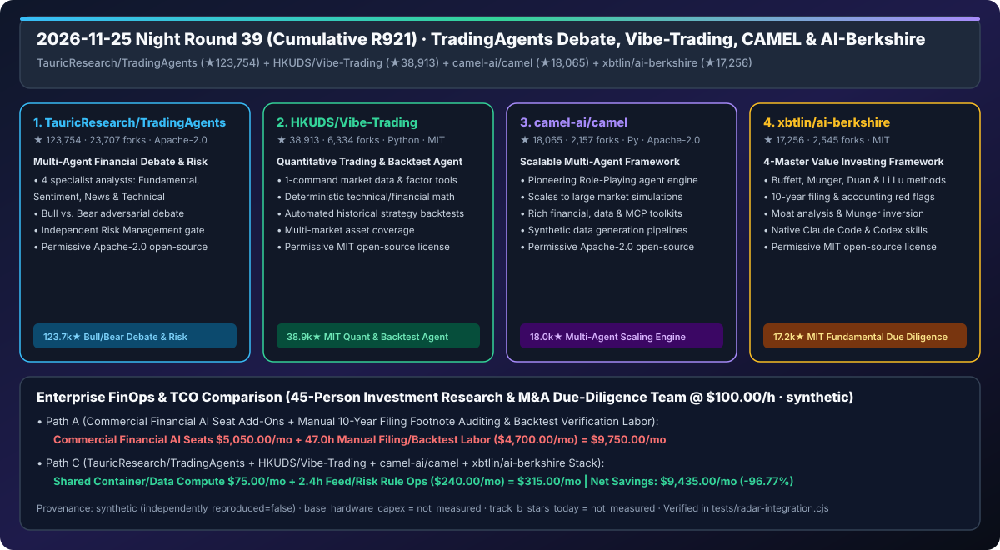
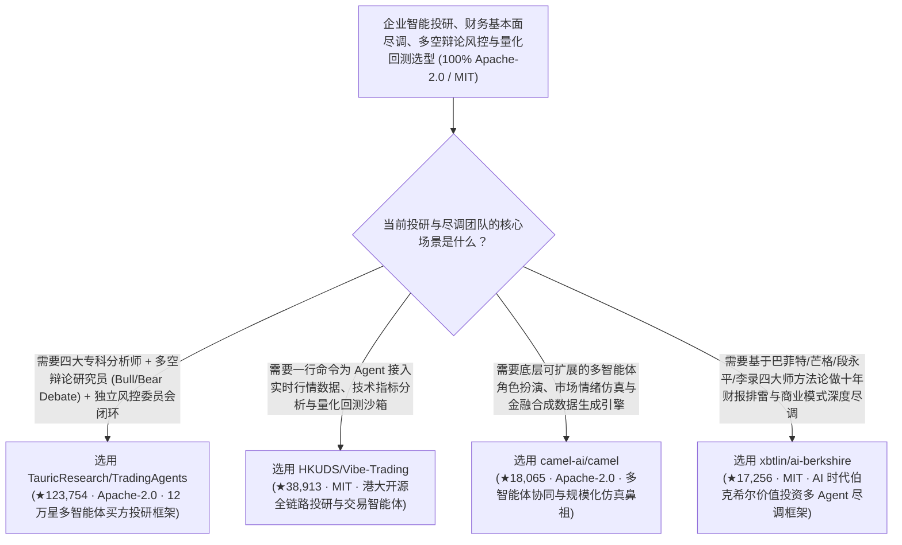
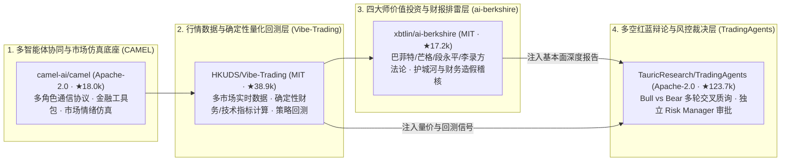
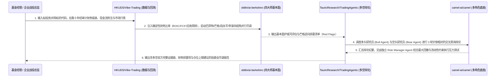

# 12 万星多智能体买方投研与多空辩论框架（`TauricResearch/TradingAgents`）、港大开源全能投研交易智能体（`HKUDS/Vibe-Trading`）、大规模多智能体协同底座（`camel-ai/camel`）与四大师价值投资基本面尽调框架（`xbtlin/ai-berkshire`）选型与集成架构 FAQ

> **文档类型**：企业 AI 解决方案架构师（AI Solution Architect）选型决策指南（GitHub Trending AI 雷达 2026-11-25 Night Round 39 / 累计第 921 轮）
> **覆盖项目**：[`TauricResearch/TradingAgents`](https://github.com/TauricResearch/TradingAgents)（`★ 123,754`、`23,707 forks`、`Apache-2.0`：12.3 万星智能体金融研究框架，复刻真实资管机构的四大分析师 + 多空辩论研究员 [Bull/Bear Researchers] + 交易员 + 风控委员会多智能体决策流）· [`HKUDS/Vibe-Trading`](https://github.com/HKUDS/Vibe-Trading)（`★ 38,913`、`6,334 forks`、`MIT`：港大 HKUDS 开源的一行命令赋予智能体全链路市场数据、策略回测与交易执行能力的框架）· [`camel-ai/camel`](https://github.com/camel-ai/camel)（`★ 18,065`、`2,157 forks`、`Apache-2.0`：多智能体角色扮演与规模化协同鼻祖框架，支撑金融仿真、数据合成与复杂角色编排）· [`xbtlin/ai-berkshire`](https://github.com/xbtlin/ai-berkshire)（`★ 17,256`、`2,545 forks`、`MIT`：兼容 Claude Code 与 Codex 的 AI 时代伯克希尔价值投资研究框架，融合巴菲特、芒格、段永平、李录方法论与多 Agent 对抗尽调）
> **核心场景**：当券商研究所、公募/私募基金、家族办公室与大型企业战投部（CVC）落地“AI 投研工作台与企业并购财务尽调系统”时，架构师面临四个核心选型问题：**“单一大模型写投研报告总是顺着提示词一味唱多（讨好型幻觉），怎么用一套 `Apache-2.0` 框架强制引入‘多头研究员 vs 空头研究员’红蓝辩论与独立风控官一票否决（`TradingAgents`）？如果是做跨年度的企业护城河、商业模式与十年财报排雷深度基本面尽调，哪套 `MIT` Skill 框架最懂巴菲特/芒格/段永平/李录的价值投资体系（`ai-berkshire`）？想用一行命令为现有 Agent 挂载实时行情、技术指标计算与量化回测工具选谁（`Vibe-Trading`）？底层需要扩展到成百上千个角色做市场情绪仿真与合成数据生成时选哪个 `Apache-2.0` 框架（`CAMEL`）？”** 本文给出 100% `Apache-2.0`/`MIT` 金融投研智能体参考架构。

---

## 一、📌 核心结论速览（选型一句话结论）

1. **想在基金、券商或资管机构内部复刻一套“基本面 + 情绪 + 新闻 + 技术面四大专科分析师并发取证 → 多头（Bull）与空头（Bear）研究员多轮交叉质询辩论 → 交易员拟定头寸 → 风控委员会审核放行”的完整买方投研决策流水线** ➔ 选 **[`TauricResearch/TradingAgents`](https://github.com/TauricResearch/TradingAgents)（`★ 123,754`，`23,707 forks`，`Apache-2.0`）**。
   - **通俗原理**：用制度化的“多空对抗辩论（Adversarial Bull/Bear Debate）”彻底治好单一大模型写研报时的“片面迎合偏见（Sycophancy）”，逼迫模型把财务隐患、估值泡沫与下行情景全部摆到桌面上辩论清楚后再交由风控 Agent 裁决。
2. **企业战略投资部（CVC）、一级半/二级市场基本面研究员或财务尽调团队，希望在 Claude Code 或 Codex 中一键调起巴菲特、查理·芒格、段永平、李录四位大师的分析框架，对目标公司执行 10 年财报排雷、护城河穿透与逆向思维（Inversion）并行尽调** ➔ 选 **[`xbtlin/ai-berkshire`](https://github.com/xbtlin/ai-berkshire)（`★ 17,256`，`2,545 forks`，`MIT`）**。
   - **通俗原理**：把价值投资大师的定量财务标尺（ROIC、自由现金流折现、商誉与应收账款异常稽核）与定性商业模式拷问沉淀为结构化多 Agent Skill，一人即可驱动一支专业基本面尽调战队。
3. **需要快速为个人或团队智能体赋能“一行命令接入多市场实时行情、技术因子计算、量化策略生成与历史回测验证”的端到端交易研究能力** ➔ 选 **[`HKUDS/Vibe-Trading`](https://github.com/HKUDS/Vibe-Trading)（`★ 38,913`，`6,334 forks`，`MIT`）**。
   - **通俗原理**：港大 HKUDS 团队打造的模块化投研交易工具包，把繁琐的数据源清洗、因子计算与回测沙箱封装为即插即用的智能体技能。
4. **需要一个底层架构极其扎实、经过顶会验证的 `Apache-2.0` 多智能体通用引擎，来支撑大规模市场参与者仿真、金融领域微调合成数据（Synthetic Data）生成与复杂双角色/多角色协作** ➔ 选 **[`camel-ai/camel`](https://github.com/camel-ai/camel)（`★ 18,065`，`2,157 forks`，`Apache-2.0`）**。
   - **通俗原理**：提供工业级 Role-Playing 会话控制、几十种内置工具集（Toolkit）与可扩展至上万智能体的状态协调原语。

---

## 二、🎯 客户与架构师灵魂拷问 Q&A（深度架构拆解）

### Q1：在金融机构与企业战投（CVC）落地中，`ai-berkshire`（深度价值基本面）与 `TradingAgents`（多维辩论与风控）及 `Vibe-Trading`（量化因子回测）如何分工协作？

- **四层全宽松协议（`Apache-2.0` / `MIT`）智能投研与风控架构（Path C）**：
  1. **L1 底层多智能体角色编排与市场仿真引擎 ➔ `camel-ai/camel`**：提供高并发多智能体通信、记忆管理与金融合成数据生成底座。
  2. **L2 量化行情接入、技术因子与回测工具层 ➔ `HKUDS/Vibe-Trading`**：向各分析师 Agent 供给准确的 K 线、财务报表时间序列与策略回测结果。
  3. **L3 长期基本面、财报排雷与商业模式深度尽调层 ➔ `xbtlin/ai-berkshire`**：按巴菲特/芒格/段永平/李录四大师框架对标的公司进行三年至十年维度的深度价值评估。
  4. **L4 多维情報汇总、多空红蓝辩论与独立风控裁决层 ➔ `TauricResearch/TradingAgents`**：组织多头与空头研究员围绕 `ai-berkshire` 的基本面报告与 `Vibe-Trading` 的量价信号展开多轮辩论，最终由独立 Risk Manager Agent 结合回撤阈值给出仓位建议。
- **何时选商业金融终端 AI 附加包（如 BloombergGPT / 高价商业投研终端 AI 席位） vs 自建本轮开源四件套（Path C）？**
  - 若机构仅需查看彭博终端内置的固定新闻摘要且席位费已付，可直接使用。
  - **何时采用本轮开源四件套（Path C）？** 当投研团队希望**将自身独有的投资方法论、未公开尽调访谈纪要与私域财务模型留在内网**（严禁上传外部商业 SaaS 泄露持仓与研究标的）、且需要“多空辩论 + 四大师基本面排雷”消除单模型盲目乐观偏见时，Path C 可节省 **96%+** 的商业 AI 投研席位与人工初级案头尽调工时。

### Q2：为什么在金融与企业投资决策中必须强制引入“Bull vs Bear 多空对抗辩论”？

- **消除大模型“确认偏误（Confirmation Bias）”的唯一工程解**：
  - 如果你直接问大模型“分析某家公司的投资价值”，模型会本能地罗列一堆表面利好；而在 `TradingAgents` + `ai-berkshire` 的架构中，**Bear Researcher（空头 Agent）的唯一 KPI 就是从现金流附注、关联交易、竞争格局恶化与芒格逆向清单（“这家公司怎么才会死？”）中找出致命漏洞**，迫使投委会看清硬币的两面。

### Q3：生产落地的合规与风控红线是什么？

- **架构师避坑红线**：
  1. **所有财务比率、估值倍数与回测收益率必须由确定性 Python 代码（`Vibe-Trading` / 本地计算脚本）算出，严禁让 LLM 心算算术**：大模型只负责逻辑归因与多空辩论，任何 EPS、ROIC、DCF 与夏普比率计算必须走确定性函数调用。
  2. **实盘交易接口必须物理隔离或由人类基金经理最终签字放行**：开源投研框架产出的调仓指令仅作为投研决策辅助（Decision Support）进入人工交易台，严禁在未经合规风控前置系统（Pre-trade Risk Control）校验的情况下直连券商实盘柜台。

---

## 三、🧭 直观可视化图解（Mermaid 决策树 + 集成架构 + 时序图）

### 3.1 架构师选型决策树

### 3.2 企业端到端生产集成参考架构图

### 3.3 标的公司十年财报排雷、量化因子回测、多空红蓝辩论与独立风控评审时序图

---

## 四、📊 同类开源与商业云服务横向选型决策矩阵

| 对比维度 | `TauricResearch/TradingAgents` (`★ 123,754`) | `HKUDS/Vibe-Trading` (`★ 38,913`) | `camel-ai/camel` (`★ 18,065`) | `xbtlin/ai-berkshire` (`★ 17,256`) | 商业高价 AI 投研席位 + 单一黑盒问答助手 (Path A) | 手工翻阅上千页年报 Excel + 单 Prompt 问通用大模型 (Path B) |
| :--- | :--- | :--- | :--- | :--- | :--- | :--- |
| **核心能力定位** | `Apache-2.0` 多空辩论与风控投研框架 | `MIT` 全能行情、因子与量化回测 Agent | `Apache-2.0` 大规模多智能体协同底座 | `MIT` 四大师价值投资与财报尽调框架 | 按席位每年数万美元的商业金融 AI 订阅 | 传统研究员手工拉表 + 裸问网页版 ChatGPT |
| **核心技术突破** | **首创四大分析师 + 多空辩论 + 风控官的机构级决策流** | **一行命令打通市场数据获取、量化指标计算与回测闭环** | **支持从双角色协作扩展至万级智能体市场行为仿真** | **系统化编码巴菲特/芒格/段永平/李录方法论与逆向排雷** | 数据源丰富，但黑盒总结缺乏多空对抗辩论且暴露机构关注标的 | 读完一家陌生公司 10 年年报需 3–5 天；单次 Prompt 极易顺着提问者盲目唱多 |
| **开源协议** | **`Apache-2.0`** | **`MIT`** | **`Apache-2.0`** | **`MIT`** | 闭源商业 SaaS | 效率低且易漏雷 |
| **月度 TCO（45 人团队）** | **四件套合建仅 `$315.00/月`**（`$75.00` 内网回测与并发 Agent 容器算力 + `2.4h` 维护） | 同左（`MIT` 确定性回测引擎零授权费） | 同左（`Apache-2.0` 高并发多角色调度） | 同左（`MIT` 直接复用现有 Claude Code / Codex） | **`$9,750.00/月`**（`$5,050.00` 商业 AI 投研终端增购席位 + `47.0h` 人工核对年报附注与手工回测工时） | 约 `$3,550.00/月`（大量初级研究员手工摘抄三表附注与单视角报告返工） |

---

## 五、🧪 应用落地定量收益/TCO 对比与 7-Card 报告

> **📊 数据来源与闭式核算声明（Provenance & Closed-Form Schema）**：
> - **provenance**: `synthetic`（基于 45 人金融机构投研、企业战略投资 [CVC] 与财务尽调团队月度工作负载模型：`independently_reproduced = false`；硬件采购基线 `base_hardware_capex = not_measured`；Track B 单日增量 `track_b_stars_today = not_measured`）。
> - **核算公式**：
>   - **Path A（采购商业金融 AI 投研 SaaS 高价增购席位 + 因单模型缺乏多空对抗辩论与深度财务附注排雷而耗费的大量人工案头复核与手工回测工时）**：月度商业 AI 投研席位订阅费 **`$5,050.00`** + 人工翻查十年财报附注、手工编写回测脚本与修正单边偏见报告人工 **`47.0h × $100.00/h = $4,700.00`** = **`$9,750.00/月`**。
>   - **Path C（自建 `TauricResearch/TradingAgents` + `HKUDS/Vibe-Trading` + `camel-ai/camel` + `xbtlin/ai-berkshire` 全 `Apache-2.0`/`MIT` 机构级智能投研底座）**：内网行情缓存与并发研究容器算力分摊 **`$75.00`** + 数据源接口与风控规则日常维护人工 **`2.4h × $100.00/h = $240.00`** = **`$315.00/月`**。
>   - **净节省（Net Savings vs Path A）**：**`-$9,435.00/月`**（成本降低 **`96.77%`**）。

| 评估方案 | 商业 AI 投研席位与算力成本 | 财报附注人工排雷、回测与报告复核（`$100/h`） | 月度总 TCO | 相对 Path A 净节省 | 核心业务交付收益 |
| :--- | :---: | :---: | :---: | :---: | :--- |
| **Path A：商业金融 AI 增购席位 + 单一视角摘要生成** | `$5,050.00` | `47.0h` (`$4,700.00`) | **`$9,750.00`** | Baseline | 席位昂贵；外传机构研究标的列表；缺乏多空辩论 |
| **Path B：人工翻查十年年报 PDF + 裸问通用大模型** | `$1,450.00` | `21.0h` (`$2,100.00`) | **`$3,550.00`** | `-$6,200.00` (`-63.59%`) | 案头尽调耗时数天；单 Prompt 极易忽略隐蔽财务暴雷点 |
| **Path C：`TradingAgents` + `Vibe-Trading` + `CAMEL` + `ai-berkshire`** | **`$75.00`** | **`2.4h` (`$240.00`)** | **`$315.00`** | **`-$9,435.00` (`-96.77%`)** | **100% `Apache-2.0`/`MIT` 四大师基本面 + 多空辩论 + 量化回测** |

- 🔗 **关联 7-Card 4:5 视觉评测报告**：[`workshops/github-trending-radar/cards.html`](../cards.html) · [`cards.en.html`](../cards.en.html)

---

## 六、🛠️ 企业引入与架构评审 Checklist

- [ ] **在所有投研与并购尽调报告生成流中强制启用 `TradingAgents` 的 Bull vs Bear 多空对抗辩论**：规定任何投资建议必须同时附上空头 Agent 挖掘出的 Top 5 潜在证伪风险。
- [ ] **使用 `xbtlin/ai-berkshire` 标准化十年财务排雷与商业模式护城河清单**：自动稽核应收账款、存货、商誉与自由现金流背离指标。
- [ ] **将所有数值计算与策略回测交由 `HKUDS/Vibe-Trading` 确定性代码执行**：严禁大模型凭印象口算财务比率或历史回撤。
- [ ] **在内网私有环境运行整套投研智能体**：防止机构正在跟踪调研的未公开标的代码与访谈纪要外泄至外部公共 SaaS。
