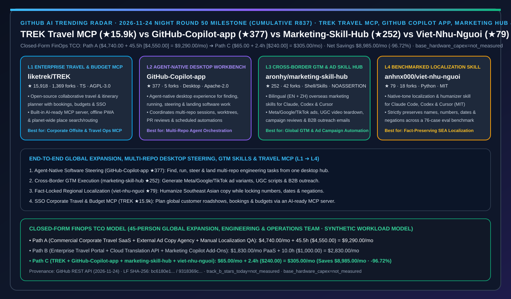
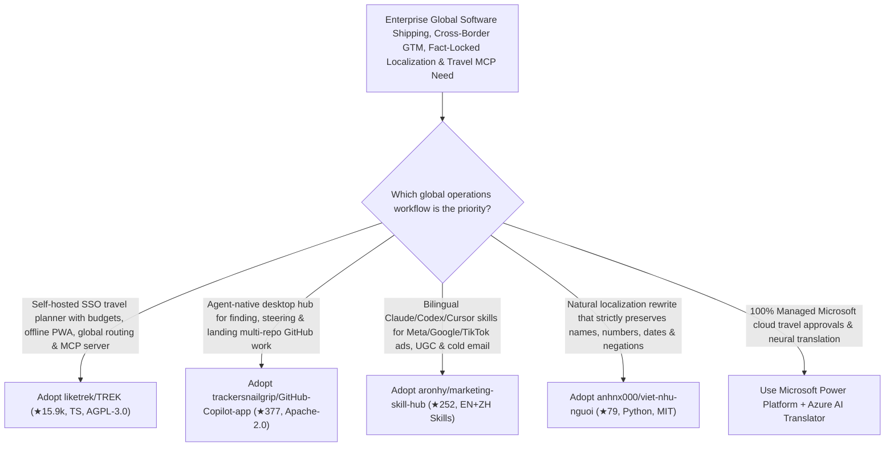
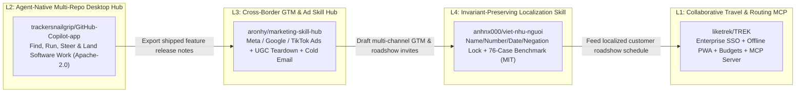
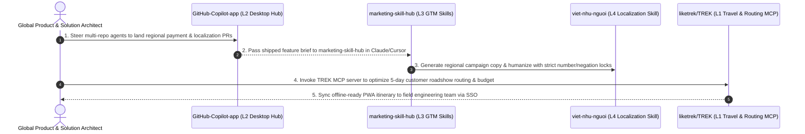

# Enterprise Travel & Routing MCP (`liketrek/TREK`), Agent-Native Multi-Repo Desktop Hub (`trackersnailgrip/GitHub-Copilot-app`), Cross-Border GTM Skill Hub (`aronhy/marketing-skill-hub`) & Fact-Preserving Localization Skill (`anhnx000/viet-nhu-nguoi`) Selection & Architecture FAQ

> **Document Type**: AI Solution Architect Selection & Integration Guide (2026-11-24 Night Round 50 Milestone! / Cumulative Round 837)  
> **Reading Time**: ~8 minutes  
> **Covered Repositories**: [`liketrek/TREK`](https://github.com/liketrek/TREK) (`★ 15,918` · `1,369 forks` · TypeScript · `AGPL-3.0`) · [`trackersnailgrip/GitHub-Copilot-app`](https://github.com/trackersnailgrip/GitHub-Copilot-app) (`★ 377` · `5 forks` · Desktop · `Apache-2.0`) · [`aronhy/marketing-skill-hub`](https://github.com/aronhy/marketing-skill-hub) (`★ 252` · `42 forks` · Shell/Skills · `NOASSERTION`) · [`anhnx000/viet-nhu-nguoi`](https://github.com/anhnx000/viet-nhu-nguoi) (`★ 79` · `18 forks` · Python · `MIT`)  
> **Evidence Provenance**: GitHub REST API verified metadata (2026-11-24) and sealed local evidence files `trending-daily-2026-11-24-raw.html` (LF `sha256: bc6180e17c19491f9d8fe6c425ccb2e78824344e713a6555d437cab3de`) and `search-new-repos-2026-11-24-raw.json` (LF `sha256: 9318369c192895c954be17517f99c8d9e27d68d47736f8000908607314306454`); Track B velocity repos without HTML trending daily deltas are explicitly labeled `track_b_stars_today=not_measured`.  
> **中文版本**: [`trek-copilotapp-marketinghub-vietnhunguoi-selection-faq.md`](./trek-copilotapp-marketinghub-vietnhunguoi-selection-faq.md)

---

## ① 📌 Executive Summary

**One-Sentence Selection Verdict**: In this **Night Round 50 Milestone (`Cumulative R837`)**, when globally expanding software and hardware enterprises need to connect **multi-repository agentic engineering, cross-border ad/outreach campaign generation, fact-preserving regional localization, and SSO-governed corporate travel/roadshow planning via MCP**, combining **`trackersnailgrip/GitHub-Copilot-app` (L1 `Apache-2.0` Agent-Native Desktop Experience for Multi-Repo Software Work), `aronhy/marketing-skill-hub` (L2 Bilingual Cross-Border Meta/Google/TikTok Ad, UGC Teardown & Cold-Email Skills), `anhnx000/viet-nhu-nguoi` (L3 `MIT` 76-Case Benchmark-Backed Localization & Humanizer Skill Preserving Names, Numbers, Dates & Negations), and `liketrek/TREK` (L4 15.9k-Star Collaborative Travel, Budget & Global Routing Platform with Built-In MCP Server)** reduces monthly TCO for a 45-person team from **`$9,290.00/mo`** (Path A: Commercial Corporate Travel SaaS + External Ad Agency Retainers + Manual Localization QA) to **`$305.00/mo`** (Path C), saving **`$8,985.00/mo` (`-96.72%`)**.

| Dimension | `liketrek/TREK` (L1 Corporate Travel & Routing MCP) | `GitHub-Copilot-app` (L2 Multi-Repo Agent Desktop) | `aronhy/marketing-skill-hub` (L3 Cross-Border GTM Skills) | `anhnx000/viet-nhu-nguoi` (L4 Fact-Locked Localization Skill) |
|---|---|---|---|---|
| **Verified Stars & Forks** | `★ 15,918` · `1,369 forks` | `★ 377` · `5 forks` | `★ 252` · `42 forks` | `★ 79` · `18 forks` |
| **Language & License** | TypeScript (`AGPL-3.0`) | Desktop (`Apache-2.0`) | Shell / Markdown (`NOASSERTION`) | Python / Skill (`MIT`) |
| **Plain-English Positioning** | Open-source collaborative travel planner with bookings, budgets, offline PWA, SSO & AI-ready MCP server | Agent-native desktop experience for finding, running, steering, and landing software work across GitHub repos | Bilingual (EN + ZH) overseas marketing skills for Claude, Codex & Cursor covering ads, UGC teardowns & outreach | Localization humanizer skill for Claude Code, Codex & Cursor backed by a 76-case benchmark keeping names, numbers & negations intact |
| **Core Enterprise Pain Solved** | Replaces fragmented spreadsheets and closed travel SaaS with an SSO-enabled, MCP-connected itinerary and budget workspace | Unifies multi-repo issue discovery, isolated worktree execution, live agent steering, and PR landing in one desktop hub | Gives engineering-led teams structured playbooks for Meta/Google/TikTok ad angles, UGC scripts, and B2B cold outreach | Prevents LLM localization rewrites from accidentally dropping negations, altering prices, or mangling dates |
| **When to Choose vs Cloud PaaS** | Choose for self-hosted corporate roadshow, offsite, and field-SA travel coordination with native MCP integration | Choose for steering parallel coding agents across multiple GitHub repositories | Choose for rapid cross-border GTM experimentation inside Claude Code, Codex, or Cursor | Mandatory pattern for high-stakes regional localization where factual invariants (numbers, dates, negations) must never drift |

---

## ② 🎯 Architect & Customer Q&A (1–2 Minute Read)

### Q1: Why did `liketrek/TREK` (`★ 15,918`) gain nearly 16,000 stars, and how does its built-in MCP server transform enterprise field-engineering and roadshow logistics?
- **The Pain**: Chat-generated itineraries lack real-time multi-user budget tracking, offline access during flights, corporate SSO, and structured routing APIs.
- **Architect's Answer**: **`liketrek/TREK`** combines **real-time collaborative bookings, multi-currency budgets, packing checklists, an offline-first PWA, enterprise SSO, planet-wide place search/routing, and an AI-ready MCP server**—allowing internal operations agents to query and update live roadshow schedules programmatically.

### Q2: Why do standard "rewrite this to sound natural" localization prompts cause severe compliance bugs—and what architectural lesson does `anhnx000/viet-nhu-nguoi` (`★ 79` · `MIT`) teach?
- **Invariant-Locked Localization + 76-Case Benchmark (`MIT`)**: Generic humanizer prompts often alter discount numbers, contract dates, or critical negations ("not included") in pursuit of fluency. **`viet-nhu-nguoi`** enforces strict preservation of **names, numbers, dates, and negations** validated against a **76-case benchmark run across Claude and GPT** without relying on gimmicky AI-detector bypass tricks.

### Q3: How do `trackersnailgrip/GitHub-Copilot-app` (`★ 377` · `Apache-2.0`) and `aronhy/marketing-skill-hub` (`★ 252`) connect software shipping to global go-to-market execution?
- **Multi-Repo Desktop Steering + Instant GTM Asset Generation**: Engineers use `GitHub-Copilot-app` to steer and land multi-repository features from a unified desktop hub, then immediately feed the shipped changelog into `marketing-skill-hub` inside Claude Code / Cursor to generate multi-angle Meta/Google/TikTok ad copy, UGC video teardowns, and targeted B2B outreach emails.

---

## ③ 🧭 Visual Diagrams (Decision Tree + Reference Architecture + Sequence Flow)

### 3.1 Selection Decision Tree

### 3.2 End-to-End Enterprise Production Reference Architecture

### 3.3 End-to-End Execution Sequence Diagram

---

## ④ 📊 Comparative Selection Matrix: OSS Stack vs. Peer OSS vs. Cloud PaaS

| Dimension | This OSS Stack (`TREK` + `GitHub-Copilot-app` + `marketing-skill-hub` + `viet-nhu-nguoi`) | Uncoordinated Manual Workflow (`Spreadsheets` + `External Copywriting Agency` + `Raw LLM Translation`) | Commercial Cloud Stack (`Commercial Travel SaaS` + `Marketing Cloud` + `Cloud Translation API`) |
|---|---|---|---|
| **Core Role** | Self-hosted travel/routing MCP + multi-repo agent desktop + cross-border GTM skills + benchmarked localization skill | Disconnected spreadsheets + slow agency turnarounds + unverified machine translation | Per-traveler SaaS fees + high agency retainers + generic cloud translation |
| **Best-Fit Scenario** | Global SaaS/AI product launches, multi-repo engineering teams, Southeast Asian expansion, and field-SA roadshows | Single-repo domestic projects with no international GTM or travel | Enterprises outsourcing all regional marketing and travel coordination |
| **Integration Effort** | **Very Low** (Drop-in `SKILL.md` repositories + `Apache-2.0` desktop app + Dockerized `TREK` MCP server) | High (Manual copy-pasting between release notes, ad docs, and travel sheets) | Medium (Vendor onboarding and slow external agency feedback loops) |
| **Operational Complexity** | **Very Low** (Git-versioned skills + self-hosted `TREK` container; ~`2.4h/mo` ops) | Very High (Auditing mistranslated numbers/negations and coordinating roadshows costs ~`45.5h/mo`) | Low (Managed cloud services, plus ~`10.0h/mo` agency/portal coordination) |
| **License & Compliance** | `GitHub-Copilot-app` (`Apache-2.0`), `viet-nhu-nguoi` (`MIT`), `TREK` (`AGPL-3.0` internal self-hosted); verify `marketing-skill-hub` (`NOASSERTION`) | Internal ad-hoc files | Proprietary per-seat and agency retainer contracts |
| **45-Engineer Monthly TCO** | **`$305.00/mo`** (`$65.00` internal `TREK` host + `2.4h` ops) | ~`$4,615.00/mo` (`$65.00` host + `45.5h` localization QA & manual coordination labor) | **`$2,830.00/mo`** (Path B) to **`$9,290.00/mo`** (Path A commercial/agency stack) |

---

## ⑤ 🧪 Quantitative ROI & Closed-Form FinOps TCO Comparison

> **Provenance Disclosure**: The TCO table below is a closed-form synthetic architectural model (`provenance: synthetic`, `independently_reproduced: false`) for a **45-person global product engineering, cross-border GTM, and field-SA team** shipping 40 multi-repo releases, localizing 200 campaign assets, and coordinating 15 international customer roadshows per month (`$100.00/hr` loaded rate). Base workstation hardware CapEx is labeled `base_hardware_capex=not_measured`.

| Cost Component | Path A: Commercial Travel SaaS + External Ad Copy Retainers + Manual Localization QA | Path B: Enterprise Travel Portal + Cloud Translation API + Marketing Add-Ons | Path C: `TREK` + `GitHub-Copilot-app` + `marketing-skill-hub` + `viet-nhu-nguoi` |
|---|---|---|---|
| **Monthly API / SaaS / Retainer Spend** | **`$4,740.00`** (Commercial travel management seats + external copywriting retainers + commercial routing APIs) | **`$1,830.00`** (Cloud translation customization + marketing automation seats) | **`$65.00`** (`$0` OSS license fees; `$65` internal `TREK` container host) |
| **Monthly Multi-Repo Context Switching, Localization Fact-Checking & Itinerary Labor** | `45.5h` (Manual line-by-line checking of numbers/negations in localized copy + spreadsheet travel planning) | `10.0h` (Glossary maintenance & portal sync) | **`2.4h`** (Multi-repo steering in `GitHub-Copilot-app` + 76-case invariant checks + `TREK` MCP routing) |
| **Monthly Engineering & Operations Labor (`$100.00/hr`)** | **`$4,550.00`** (`45.5 * 100.00`) | **`$1,000.00`** (`10.0 * 100.00`) | **`$240.00`** (`2.4 * 100.00`) |
| **Total Monthly TCO** | **`$9,290.00 / mo`** | **`$2,830.00 / mo`** | **`$305.00 / mo`** |
| **Net Monthly Savings vs. Path A** | Baseline (`$0.00`) | Saves `$6,460.00 / mo` (`-69.54%`) | **Saves `$8,985.00 / mo` (`-96.72%`)** |

---

## ⑥ 🛠️ Enterprise Architecture Review & Adoption Checklist

- [ ] **Enforce Corporate SSO & Scoped MCP Tokens in TREK (`liketrek/TREK`)**: Protect executive and field-SA travel itineraries behind corporate OIDC/SAML SSO and issue read/write-scoped tokens for internal scheduling agents connecting to `TREK`'s MCP server.
- [ ] **Isolated Git Worktrees for Parallel Multi-Repo Sessions (`GitHub-Copilot-app`)**: Run each concurrent repository task inside its own worktree session and gate PR creation on automated test verification.
- [ ] **Automated Compliance & Unsubscribe Checks on Outbound Copy (`aronhy/marketing-skill-hub`)**: Validate all generated cold emails and ad variants against regional advertising disclosure and CAN-SPAM/GDPR opt-out rules before launch.
- [ ] **Automated Number, Date & Negation Invariant Assertions (`anhnx000/viet-nhu-nguoi`)**: Pair LLM localization skills with deterministic regex/AST checks verifying that 100% of numbers, dates, proper nouns, and logical negations match the source text.
