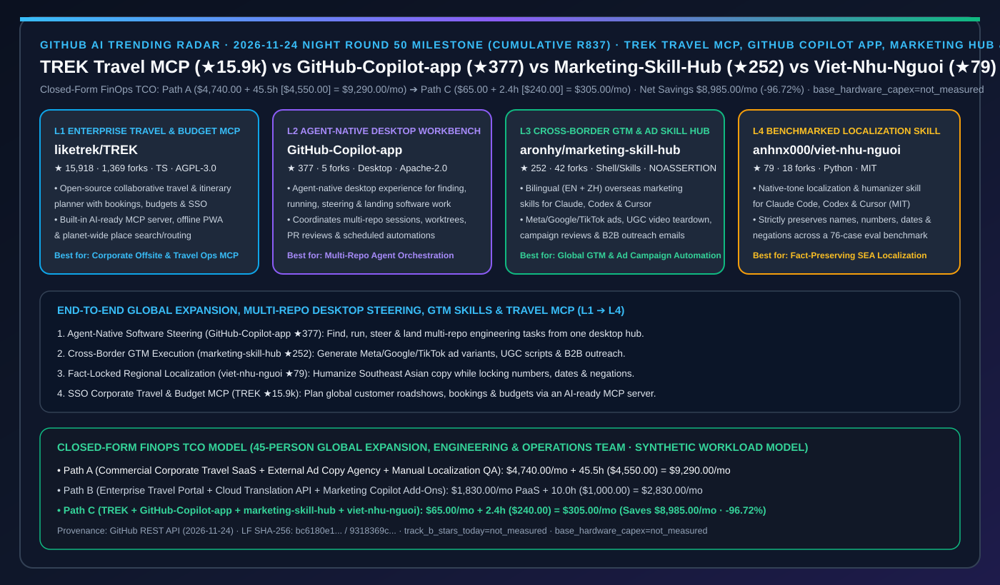
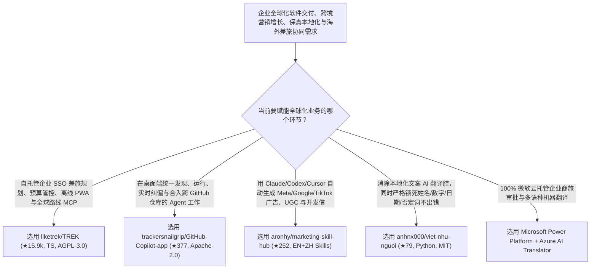
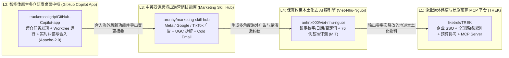
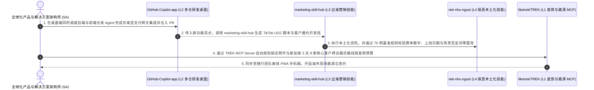

# 企业差旅预算与路线规划 MCP（`liketrek/TREK`）、智能体原生多仓桌面中枢（`trackersnailgrip/GitHub-Copilot-app`）、跨境出海营销技能库（`aronhy/marketing-skill-hub`）与保真约束本地化润色技能（`anhnx000/viet-nhu-nguoi`）选型与集成 FAQ

> **文档类型**：AI 解决方案架构师（AI Solution Architect）选型决策指南（2026-11-24 Night Round 50 里程碑 / 累计第 837 轮）  
> **阅读耗时**：约 8 分钟  
> **覆盖项目**：[`liketrek/TREK`](https://github.com/liketrek/TREK)（`★ 15,918` · `1,369 forks` · TypeScript · `AGPL-3.0`） · [`trackersnailgrip/GitHub-Copilot-app`](https://github.com/trackersnailgrip/GitHub-Copilot-app)（`★ 377` · `5 forks` · Desktop · `Apache-2.0`） · [`aronhy/marketing-skill-hub`](https://github.com/aronhy/marketing-skill-hub)（`★ 252` · `42 forks` · Shell/Skills · `NOASSERTION`） · [`anhnx000/viet-nhu-nguoi`](https://github.com/anhnx000/viet-nhu-nguoi)（`★ 79` · `18 forks` · Python · `MIT`）  
> **证据溯源**：GitHub REST API 实测元数据（2026-11-24）与本地冻结证据文件 `trending-daily-2026-11-24-raw.html`（LF `sha256: bc6180e17c19491f9d8fe6c425ccb2e78824344e713a6555d437cab3de`）、`search-new-repos-2026-11-24-raw.json`（LF `sha256: 9318369c192895c954be17517f99c8d9e27d68d47736f8000908607314306454`）；Track B 仓库无 HTML 榜单对应的单日增量，统一标记为 `track_b_stars_today=not_measured`。  
> **English Version**: [`trek-copilotapp-marketinghub-vietnhunguoi-selection-faq.en.md`](./trek-copilotapp-marketinghub-vietnhunguoi-selection-faq.en.md)

---

## ① 📌 核心结论速览（Executive Summary）

**选型一句话结论**：在今晚第 50 轮里程碑（`Night Round 50 / Cumulative R837`）中，当跨境出海与全球化软件团队需要打通**“多仓库软件功能并发研发 + 海外 Meta/Google/TikTok 多角度广告与红人开发信生成 + 东南亚小语种零事实失真本土化润色 + 跨国拜访差旅预算与路线 MCP 协同”**全流程时，采用 **`trackersnailgrip/GitHub-Copilot-app`（L1 面向 GitHub 多仓库发现、运行、引导与合入软件工程任务的智能体原生桌面中枢）+ `aronhy/marketing-skill-hub`（L2 覆盖 Meta/Google/TikTok 广告、UGC 视频拆解与 B2B 开发信的中英双语出海营销技能集）+ `anhnx000/viet-nhu-nguoi`（L3 自带 76 例评测基准、严锁姓名/数字/日期/否定词不篡改的东南亚本土化去 AI 腔技能）+ `liketrek/TREK`（L4 1.59 万星内置企业 SSO、离线 PWA、预算管控与全球地点路由 MCP Server 的开源差旅协作平台）**，可将 45 人团队的月度 TCO 从商业差旅管理 SaaS + 海外营销代写外包 + 人工本土化审校（Path A）的 **`$9,290.00/月`** 降至 **`$305.00/月`**（净省 **`$8,985.00/月`**，降幅 **`-96.72%`**）。

| 评估维度 | `liketrek/TREK` (L1 企业差旅与全球路线 MCP) | `GitHub-Copilot-app` (L2 智能体原生多仓桌面端) | `aronhy/marketing-skill-hub` (L3 跨境出海营销技能库) | `anhnx000/viet-nhu-nguoi` (L4 76 例基准本土化去 AI 腔) |
|---|---|---|---|---|
| **GitHub 实测热度** | `★ 15,918` · `1,369 forks` | `★ 377` · `5 forks` (`2026-11` 新仓黑马) | `★ 252` · `42 forks` (`2026-11` 新仓黑马) | `★ 79` · `18 forks` (`2026-11` 新仓黑马) |
| **实现语言与开源协议** | TypeScript (`AGPL-3.0`) | Desktop (`Apache-2.0`) | Shell / Markdown (`NOASSERTION`) | Python / Skill (`MIT`) |
| **一句话通俗定位** | 最完整的开源协作差旅规划系统：实时协同、预订、预算、离线 PWA、企业 SSO 与内置全球路线检索 MCP Server | 面向 GitHub 多仓库寻找、运行、指挥（Steering）与合入软件研发工作的智能体原生桌面端体验 | 面向 Claude/Codex/Cursor 的中英双语海外营销 Agent Skills（Meta/Google/TikTok 广告、UGC 拆解、开发信） | 带 76 例评测集的越南语/小语种“去 AI 翻译腔”技能：严格保留姓名、数字、日期与否定词不走样 |
| **解决的核心业务痛点** | 解决企业跨国客户拜访、海外展会与团建“行程散落在 Excel、预算超支无法实时汇总、AI 助手查不到内部行程与路线”的痛点 | 解决开发者在十几个微服务仓库间切换终端窗口、难以在单一桌面视图里同时观察、纠偏（Steer）并合入多个 Agent 任务的痛点 | 解决中国与亚太技术团队出海时“懂写代码但不懂海外 Meta/TikTok 痛点钩子（Hook）、UGC 视频分镜与高回复率 Cold Email 结构”的短板 | 根治大模型直接翻译或润色东南亚营销/合同文案时“为了读起来通顺，擅自把折扣比例、截止日期或‘不含税（Negation）’给改丢了”的致命合规事故 |
| **何时选它 vs 云托管** | 需要支持企业 SSO、离线 PWA 与标准 MCP 接口的自托管团队差旅及海外路演管理系统时首选 | 重度依赖 GitHub Issues / PRs 与多 Worktree 并发驱动智能体落地代码的研发团队首选 | 跨境 SaaS、AI 硬件与独立站团队自动化生成多角度海外广告素材与红人建联邮件时首选 | 出海越南及东南亚市场、以及任何需要构建“锁死数字/日期/否定词不篡改”的翻译润色评测基准时必选 |

---

## ② 🎯 客户与架构师灵魂拷问 Q&A（1–2 分钟速读）

### Q1：为什么 `liketrek/TREK`（`★ 15,918`）能拿到近 1.6 万颗星？它比普通大模型“直接生成一份旅游攻略 Markdown”强在哪里？
- **痛点**：大模型聊天框生成的差旅计划只是一段死文字——没有实时多币种预算分摊、没有酒店/航班预订状态追踪、到了海外没信号的地方打不开，团队成员改了一个拜访时间其他人也看不到。
- **架构师解答**：**`liketrek/TREK`** 是完整的**全栈差旅操作台 + AI MCP Server**：
  1. **内置全球地点搜索与多点路径规划引擎**：无需额外交高昂的商业地图 API 账单；
  2. **企业级 SSO + 离线 PWA + 实时多人协同**：销售与解决方案架构师（SA）在飞往海外客户现场的航班上也能离线查看行程、核对差旅预算；
  3. **原生 AI-Ready MCP Server**：企业内部的日程 Agent 可通过 MCP 协议直接读取或修改 TREK 中的拜访行程与预算明细。

### Q2：很多企业出海东南亚做本地化时，让大模型“把这段中文/英文翻成地道的当地语言”，为什么经常引发客诉？`anhnx000/viet-nhu-nguoi`（`★ 79` · `MIT`）的设计范式给架构师什么启发？
- **核心收益**：普通的“去 AI 味（Humanizer）”提示词往往鼓励模型自由发挥，结果模型把“满 100 减 20（不含促销品）”改写成了“全场八折”。**`anhnx000/viet-nhu-nguoi`**（`MIT`）树立了**企业级受约束本地化 Skill 的标杆范式**：在消除生硬翻译腔的同时，通过硬性规则与 **76 个黄金评测用例（Vietnamese Humanizer Benchmark，已在 Claude 与 GPT 上实测验证）**强制锁死四大不变式——**人名/专有名词（Names）、精确数字（Numbers）、日期时间（Dates）与逻辑否定词（Negations）100% 严禁篡改**！

### Q3：`trackersnailgrip/GitHub-Copilot-app`（`★ 377` · `Apache-2.0`）与 `aronhy/marketing-skill-hub`（`★ 252`）如何形成“左手极速交付海外产品功能、右手同步生成多渠道出海增长战役”的敏捷闭环？
- **多仓研发指挥中枢 + 出海增长技能包**：研发团队在 `GitHub-Copilot-app` 桌面端并行指挥多个 Worktree 智能体完成海外版新特性的编码与 PR 合入；同一分钟，增长团队在 Claude Code / Cursor 中调用 `marketing-skill-hub`，基于刚刚合入的 Release Notes 自动生成 **Meta/Google/TikTok 多角度痛点广告文案、UGC 短视频拆解脚本与海外 KOL/B2B 破冰开发信（Cold Emails）**。

---

## ③ 🧭 直观可视化图解（Mermaid 决策树 + 集成架构 + 时序图）

### 3.1 技术选型决策树

### 3.2 企业端到端生产集成参考架构图

### 3.3 业务流全链路时序图

---

## ④ 📊 同类开源与商业云服务横向选型决策矩阵

| 对比维度 | 本轮开源组合 (`TREK` + `GitHub-Copilot-app` + `marketing-skill-hub` + `viet-nhu-nguoi`) | 传统出海手工作坊 (`散乱 Excel 排差旅` + `外包代写高价广告` + `裸跑翻译丢否定词`) | 商业云与代理商方案 (`商业差旅 SaaS` + `海外营销 Agency 月框` + `人工母语审校`) |
|---|---|---|---|
| **功能定位** | 自托管差旅与路线 MCP + 多仓 Agent 桌面中枢 + 跨境广告/开发信技能库 + 保真本土化评测技能 | 手工查地图算预算 + 零散提示词盲写海外文案 + 无事实锁定的生硬机翻 | 按出行人次收费的商业差旅云 + 每月数千美元的海外营销代理商 |
| **适用场景** | 跨境软件/AI 应用出海、跨国技术团队多仓库并行研发、海外客户现场路演（Roadshow）行程与预算协同 | 仅服务单一国内语言市场、无海外获客或跨国出差需求的团队 | 预算极其充裕、所有海外文案与差旅全部外包给第三方机构的传统大企 |
| **集成成本** | **极低**（Markdown/Python 技能即装即用，`TREK` 支持 Docker 一键自托管并原生暴露 MCP） | 高（销售、研发与海外运营各自维护不通的表格，频繁出现价格翻错或行程冲突） | 中（外部 Agency 沟通周期长，跟不上 AI 产品每周发版两次的迭代节奏） |
| **运维复杂度** | **极低**（统一在桌面端与代码仓内通过 Skills 管理，月均维护仅 `2.4h`） | 极高（人工核对机翻是否漏掉“不退换”等否定词、手工调整多国行程耗费 `45.5h/月`） | 低（外部托管，月均简报沟通约 `10.0h`） |
| **开源协议与合规** | `GitHub-Copilot-app` (`Apache-2.0`)、`viet-nhu-nguoi` (`MIT`)；`TREK` (`AGPL-3.0` 内部差旅平台自托管合规)；`marketing-skill-hub` 需核验仓库条款 | 内部文档 | 商业闭源按席位/按外包件数计费 |
| **45 人团队月度 TCO** | **`$305.00/月`**（含 `$65.00` 内部 TREK 差旅容器主机 + `2.4h` 运维） | 约 `$4,615.00/月`（含 `$65.00` 环境 + `45.5h` 人工修翻译错误与排跨国行程工时） | **`$2,830.00/月`**（Path B）至 **`$9,290.00/月`**（Path A 商业与外包全栈） |

---

## ⑤ 🧪 应用落地定量收益 / TCO 对比（Closed-Form FinOps 模型）

> **数据性质声明（Provenance Metadata）**：以下 TCO 模型为面向 **45 人企业全球化软件研发、跨境增长（GTM）与海外解决方案架构师团队**（每月交付 40 项多仓库产品迭代、产出 200 组多语种海外广告/UGC/开发信物料并协同管理 15 场跨国客户路演差旅，折算时薪 `$100.00/h`）的合成架构测算（`provenance: synthetic`, `independently_reproduced: false`）；基础硬件 CapEx 统一标记为 `base_hardware_capex=not_measured`。

| 成本构成项 | Path A：商业企业差旅 SaaS + 海外营销文案外包 + 人工逐字校对本地化机翻 | Path B：企业差旅门户 + 云端机器翻译 API + 营销插件订阅 | Path C：`TREK` + `GitHub-Copilot-app` + `marketing-skill-hub` + `viet-nhu-nguoi` |
|---|---|---|---|
| **API / SaaS / 外包月费** | **`$4,740.00`**（商业差旅管理 SaaS 席位 + 海外广告/Cold Email 代写服务费 + 商业地图/翻译 API） | **`$1,830.00`**（云端企业翻译定制库 + 营销自动化 SaaS 席位） | **`$65.00`**（开源引擎与技能库 `$0` 授权费；仅需 `$65` 内网容器节点运行 `TREK` MCP 服务） |
| **月度跨仓库手动切分支、人工校对翻译数字/否定词错误与手排海外拜访路线工时** | `45.5h`（人工逐行核对本地化合同/文案中的数字与否定词 + 手工在 Excel 排跨国行程预算） | `10.0h`（术语表维护与行程导入） | **`2.4h`**（`GitHub-Copilot-app` 多仓统一指挥 + `viet-nhu-nguoi` 76 例基准锁死事实 + `TREK` MCP 自动路线规划） |
| **人工研发、营销与运营成本（`$100.00/h`）** | **`$4,550.00`** (`45.5 * 100.00`) | **`$1,000.00`** (`10.0 * 100.00`) | **`$240.00`** (`2.4 * 100.00`) |
| **月度总拥有成本（Total Monthly TCO）** | **`$9,290.00 / 月`** | **`$2,830.00 / 月`** | **`$305.00 / 月`** |
| **相对 Path A 净节省** | 基准线 (`$0.00`) | 节省 `$6,460.00 / 月` (`-69.54%`) | **净省 `$8,985.00 / 月` (`-96.72%`)** |

---

## ⑥ 🛠️ 企业引入与架构评审 Checklist

- [ ] **企业 SSO 统一认证与差旅敏感行程私有化保护（`liketrek/TREK`）**：高管与海外大客户拜访行程属于商业机密，部署 `TREK` 时必须接入企业内部 OIDC/SAML 单点登录，并通过内网 MCP Server 向授权的行政与 SA 智能体开放只读/受控写权限。
- [ ] **多仓库并发任务遵循“一任务一隔离 Worktree”规范（`GitHub-Copilot-app`）**：在桌面端同时启动多个跨仓修复或特性开发会话时，利用原生 Worktree 隔离机制并在合入前自动运行 CI 验证。
- [ ] **海外营销开发信与广告素材接入合规退订与频控检查（`aronhy/marketing-skill-hub`）**：使用 `marketing-skill-hub` 生成 B2B Cold Email 与 Meta/TikTok 广告文案后，自动校验是否包含 GDPR / CAN-SPAM 要求的退订声明与真实披露信息。
- [ ] **所有多语种本地化流水线强制增加“数字/日期/否定词不变量断言”（`anhnx000/viet-nhu-nguoi`）**：借鉴 `viet-nhu-nguoi` 76 例评测基准的工程设计，在企业 CI 中用正则与 AST 自动比对原文与润色后译文中的所有阿拉伯数字、金额、日期与否定词数量，不一致立即告警阻断发布。
