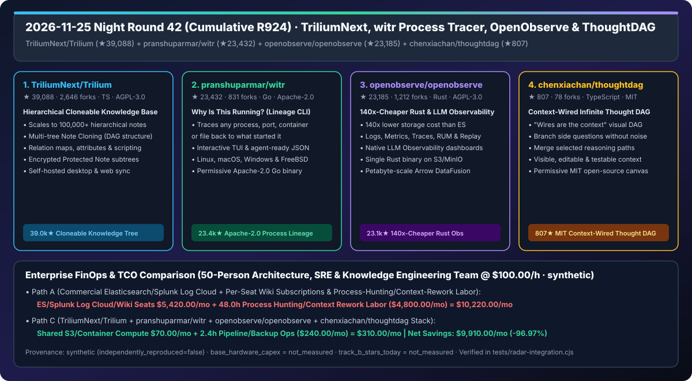
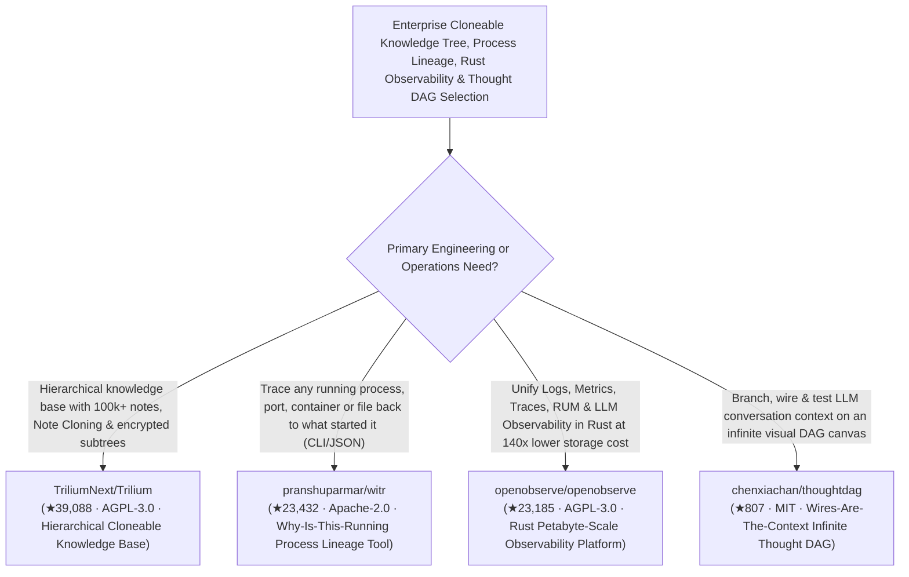
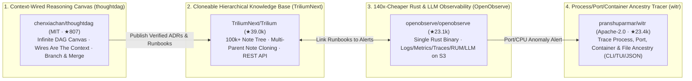

# Hierarchical Cloneable Knowledge Base (`TriliumNext/Trilium`), Process/Port/Container Lineage Tracer (`pranshuparmar/witr`), 140x-Lower-Cost Rust Full-Stack & LLM Observability (`openobserve/openobserve`) & Infinite-Canvas Thought DAG (`chenxiachan/thoughtdag`) Selection & Integration Architecture FAQ

> **Document Type**: Enterprise AI Solution Architect Selection Decision Guide (GitHub Trending AI Radar — 2026-11-25 Night Round 42 / Cumulative Round 924)
> **Covered Repositories**: [`TriliumNext/Trilium`](https://github.com/TriliumNext/Trilium) (`★ 39,088`, `2,646 forks`, `AGPL-3.0`, TypeScript: hierarchical knowledge base supporting 100k+ notes, multi-location Note Cloning, relation maps, scripting, and self-hosted sync) · [`pranshuparmar/witr`](https://github.com/pranshuparmar/witr) (`★ 23,432`, `831 forks`, `Apache-2.0`, Go: "Why is this running?"—traces any process, port, container, or file back to the exact chain that started it via CLI, interactive TUI, or machine-readable JSON) · [`openobserve/openobserve`](https://github.com/openobserve/openobserve) (`★ 23,185`, `1,212 forks`, `AGPL-3.0`, Rust/TypeScript: single-binary observability platform for logs, metrics, traces, RUM, session replay, and LLM observability with up to 140x lower storage costs than Elasticsearch) · [`chenxiachan/thoughtdag`](https://github.com/chenxiachan/thoughtdag) (`★ 807`, `78 forks`, `MIT`, TypeScript: open-source infinite canvas where LLM conversations grow into an editable thought DAG—"Wires are the context")
> **Core Enterprise Scenario**: Building an **End-to-End Architecture Reasoning Canvas, Multi-Dimensional Knowledge Tree, 140x-Lower-Cost Rust Observability & Process-Lineage Diagnostics Stack**—combining non-linear context-wired LLM reasoning (`thoughtdag`), cloneable hierarchical knowledge management (`Trilium`), petabyte-scale Rust + S3 observability (`openobserve`), and instant process/container root-cause lineage (`witr`).

---

## 1. 📌 Executive Summary (One-Line Selection Verdict)

1. **Need an `MIT`-licensed infinite canvas where every LLM exchange is a node and **"Wires are the context"**—allowing architects to branch side questions without polluting the main thread and merge selected paths into downstream prompts** ➔ Choose **[`chenxiachan/thoughtdag`](https://github.com/chenxiachan/thoughtdag) (`★ 807`, `78 forks`, `MIT`)**.
   - **Plain-English Mechanism**: Replaces linear chat scrollbars with an explicit Directed Acyclic Graph (DAG) of conversation nodes so you see, edit, branch, and wire the exact context window sent to the model on every step.
2. **Need a self-hostable hierarchical knowledge base that scales to 100,000+ notes and supports **Note Cloning** (mounting the exact same runbook or ADR under multiple organizational trees simultaneously) with E2E encrypted subtrees** ➔ Choose **[`TriliumNext/Trilium`](https://github.com/TriliumNext/Trilium) (`★ 39,088`, `2,646 forks`, `AGPL-3.0`)**.
   - **Plain-English Mechanism**: Models notes as a DAG rather than a rigid single-parent folder tree—so a single canonical specification can live under Product, Security, and SRE hierarchies simultaneously without duplication drift.
3. **Need a fast `Apache-2.0` Go CLI/TUI (`witr`) that answers "Why is this running?" in one command—tracing any process, open port, Docker container, or file lock back to the exact parent chain (systemd, cron, K8s, or runaway coding agent) in human TUI or agent-ready JSON** ➔ Choose **[`pranshuparmar/witr`](https://github.com/pranshuparmar/witr) (`★ 23,432`, `831 forks`, `Apache-2.0`)**.
   - **Plain-English Mechanism**: Eliminates chaining `ps`, `lsof`, `systemctl`, and `docker inspect` manually by reconstructing the complete causal process ancestry tree across Linux, macOS, Windows, and FreeBSD.
4. **Need a single-binary Rust observability platform that unifies Logs, Metrics, Traces, Web/Mobile RUM, Session Replay, and **LLM Observability** while cutting storage costs by up to **140x** compared to Elasticsearch** ➔ Choose **[`openobserve/openobserve`](https://github.com/openobserve/openobserve) (`★ 23,185`, `1,212 forks`, `AGPL-3.0`)**.
   - **Plain-English Mechanism**: Uses Rust, Apache Arrow DataFusion, and high-compression Parquet files on S3/MinIO object storage to replace sprawling Elasticsearch, Splunk, and Datadog clusters.

---

## 2. 🎯 Architect & Customer Deep-Dive Q&A

### Q1: How do `ThoughtDAG`, `TriliumNext`, `OpenObserve`, and `witr` link architecture design, knowledge curation, and production incident response?

- **Four-Stage Architecture Reasoning, Knowledge & Diagnostics Loop (Path C)**:
  1. **L1 Context-Wired Branching Reasoning Canvas ➔ `chenxiachan/thoughtdag`**: Architects explore competing designs and incident hypotheses on an infinite DAG canvas without context pollution.
  2. **L2 Cloneable Hierarchical Enterprise Knowledge Tree ➔ `TriliumNext/Trilium`**: Publishes finalized ADRs and runbooks across multiple departmental trees via Note Cloning.
  3. **L3 140x-Lower-Cost Full-Stack & LLM Observability ➔ `openobserve/openobserve`**: Monitors logs, metrics, traces, RUM session replays, and LLM token/latency metrics on S3 object storage.
  4. **L4 Instant Process/Port/Container Ancestry Diagnostics ➔ `pranshuparmar/witr`**: Gives humans and SRE agents instant JSON/TUI ancestry traces whenever `OpenObserve` detects rogue ports, zombie containers, or CPU spikes.
- **When to choose Commercial SaaS (Elasticsearch/Splunk Cloud + Commercial Wiki Seats) vs. Path C?**
  - Choose **Commercial SaaS** for tiny deployments with negligible log volume.
  - Choose **Path C** when replacing costly Elasticsearch/Splunk clusters with Rust + S3 storage (`OpenObserve`), equipping SRE agents with `Apache-2.0` process-ancestry diagnostics (`witr`), and giving architects explicit context-graph control (`ThoughtDAG` `MIT`) plus multi-tree knowledge organization (`TriliumNext`).

### Q2: Why is `witr` (`pranshuparmar/witr`) uniquely valuable in multi-agent engineering environments?

- **Tracing Orphaned & Runaway Agent Subprocesses**:
  - Autonomous coding and ops agents frequently spawn background test servers, tunnels, or containers that outlive the parent turn and block ports. Running `witr :8080 --json` immediately reveals the exact parent agent session, container, and command line that spawned the process.

### Q3: What are the key security and operational guardrails?

- **Architect Redlines**:
  1. **Back `OpenObserve` with object storage (S3/MinIO/Blob) and local SSD caching**: Achieve the 140x storage cost reduction by writing compressed Parquet segments to object storage rather than expensive block disks.
  2. **Use Protected (encrypted) subtrees in `TriliumNext` for sensitive runbooks**: Encrypt security architecture notes and credential rotation guides inside `Trilium`.

---

## 3. 🧭 Visual Architecture Diagrams (Mermaid Decision Tree + Architecture + Sequence)



### 3.1 Architect Selection Decision Tree



### 3.2 End-to-End Enterprise Integration Architecture



### 3.3 End-to-End Execution Sequence

```mermaid
sequenceDiagram
    participant SRE as Architect / On-Call SRE
    participant OObs as openobserve/openobserve (Rust Obs)
    participant Witr as pranshuparmar/witr (Lineage CLI)
    participant TDag as chenxiachan/thoughtdag (Thought DAG)
    participant Tril as TriliumNext/Trilium (Knowledge Tree)

    OObs->>SRE: 1. Alert on rogue port conflict, CPU spike & elevated LLM latency
    SRE->>Witr: 2. Run witr :8080 --json to trace exact container/systemd/agent parent chain
    Witr-->>TDag: 3. Feed ancestry JSON & OpenObserve logs into ThoughtDAG; branch 3 remediation hypotheses
    TDag-->>SRE: 4. Wire winning branches together to synthesize verified fix without context pollution
    SRE->>Tril: 5. Save postmortem in TriliumNext & clone note across SRE and Platform trees
```

---

## 4. 📊 Horizontal Selection Matrix

| Dimension | `TriliumNext/Trilium` (`★ 39,088`) | `pranshuparmar/witr` (`★ 23,432`) | `openobserve/openobserve` (`★ 23,185`) | `chenxiachan/thoughtdag` (`★ 807`) | Elasticsearch/Splunk Cloud + Per-Seat Wiki + Linear Chat (Path A) | Single-Parent Folders + Manual `ps/lsof` + Heavy ES Cluster (Path B) |
| :--- | :--- | :--- | :--- | :--- | :--- | :--- |
| **Primary Role** | Hierarchical cloneable knowledge base | `Apache-2.0` process/port/container tracer | Rust full-stack & LLM observability | `MIT` context-wired LLM thought DAG | Metered log cloud, wiki seats & linear chat | Rigid folders, manual shell probes & JVM ES |
| **Key Differentiator** | **Note Cloning across multiple trees + 100k-note scalability** | **1-command causal ancestry for processes, ports, containers & files** | **140x lower storage cost than ES + unified RUM/Session/LLM telemetry** | **"Wires are the context"—explicit visual context branching & merging** | Hosted cloud, but massive per-GB log bills & polluted linear chat threads | Duplicate docs drift out of sync; slow manual process tree hunting |
| **License** | `AGPL-3.0` | **`Apache-2.0`** | `AGPL-3.0` | **`MIT`** | Proprietary SaaS | High Ops Friction |
| **Monthly TCO (50-Eng Team)** | **`$310.00/mo` combined** (`$70.00` OpenObserve S3 & Trilium compute + `2.4h` ops) | Included in `$310.00/mo` stack | Included in `$310.00/mo` stack | Included in `$310.00/mo` stack | **`$10,220.00/mo`** (`$5,420.00` ES/Splunk cloud & wiki seats + `48.0h` process hunting/context-rework labor) | `~$3,720.00/mo` (heavy Elasticsearch node maintenance & manual incident triage) |

---

## 5. 🧪 Quantitative FinOps & TCO Comparison (50-Person Architecture, SRE & Knowledge Engineering Team)

> **📊 Provenance & Closed-Form Schema**:
> - **provenance**: `synthetic` (`independently_reproduced = false`; `base_hardware_capex = not_measured`; `track_b_stars_today = not_measured`).
> - **Closed-Form Formula**:
>   - **Path A (Commercial Elasticsearch/Splunk Log Cloud + Per-Seat Enterprise Wiki Subscriptions & Manual Process-Ancestry/Context-Pollution Rework Labor)**: **`$5,420.00`** monthly log cloud and wiki seat fees + **`48.0h × $100.00/h = $4,800.00`** manual process-chain hunting, ES shard tuning, and linear-chat rework labor = **`$10,220.00/mo`**.
>   - **Path C (`TriliumNext/Trilium` + `pranshuparmar/witr` + `openobserve/openobserve` + `chenxiachan/thoughtdag` Stack)**: **`$70.00`** shared S3 object storage and lightweight container compute + **`2.4h × $100.00/h = $240.00`** pipeline and knowledge-tree backup maintenance = **`$310.00/mo`**.
>   - **Net Savings vs. Path A**: **`-$9,910.00/mo`** (**`96.97%`** TCO reduction).

| Evaluation Path | Log/Observability Cloud / Wiki Seats & Compute | Process Triage, ES Ops & Context Rework (`$100/h`) | Monthly Total TCO | Net Savings vs. Path A | Key Architectural Outcome |
| :--- | :---: | :---: | :---: | :---: | :--- |
| **Path A: Commercial ES/Splunk Cloud + Per-Seat Wiki + Linear Chat** | `$5,420.00` | `48.0h` (`$4,800.00`) | **`$10,220.00`** | Baseline | 100x+ higher log storage bills; linear chat context pollution |
| **Path B: Self-Hosted JVM Elasticsearch + Manual `ps/lsof` Probes** | `$1,620.00` | `21.0h` (`$2,100.00`) | **`$3,720.00`** | `-$6,500.00` (`-63.60%`) | High JVM RAM footprint; slow manual container/port ancestry tracing |
| **Path C: `Trilium` + `witr` + `OpenObserve` + `ThoughtDAG`** | **`$70.00`** | **`2.4h` (`$240.00`)** | **`$310.00`** | **`-$9,910.00` (`-96.97%`)** | **140x cheaper Rust/S3 observability + `witr` lineage + DAG context + cloned notes** |

- 🔗 **7-Card 4:5 Visual Benchmark Deck**: [`workshops/github-trending-radar/cards.en.html`](../cards.en.html) · [`cards.html`](../cards.html)

---

## 6. 🛠️ Enterprise Adoption & Architecture Review Checklist

- [ ] **Replace Heavy Elasticsearch Log Clusters with `openobserve/openobserve` on S3/MinIO**: Consolidate logs, metrics, traces, RUM, and LLM observability at 140x lower storage cost.
- [ ] **Deploy `pranshuparmar/witr` (`Apache-2.0`) Across DevBoxes and Production Hosts**: Expose `witr --json` to SRE agents for instant process, port, and container ancestry resolution.
- [ ] **Use `chenxiachan/thoughtdag` (`MIT`) for Multi-Branch Architectural Reasoning**: Wire context nodes explicitly so side-branch explorations never pollute the main reasoning chain.
- [ ] **Organize Cross-Cutting Specifications with `TriliumNext/Trilium` Note Cloning**: Mount shared runbooks and ADRs across multiple organizational hierarchies without copy-paste drift.
