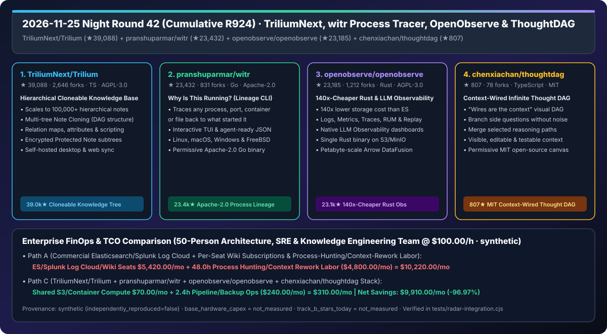
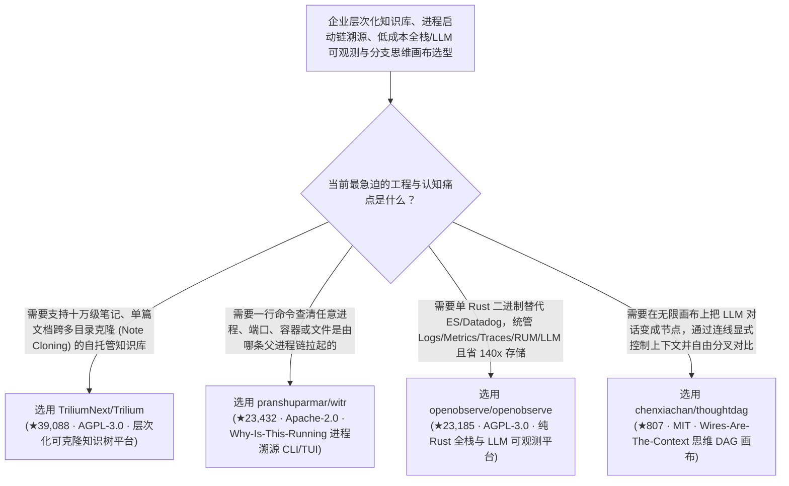
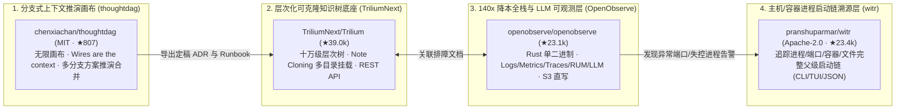
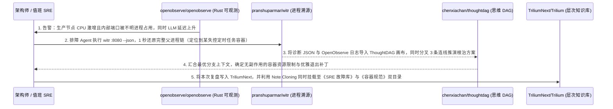

# 3.9 万星层次化可克隆知识树平台（`TriliumNext/Trilium`）、进程/端口/容器根因溯源神器（`pranshuparmar/witr`）、比 ES 省 140 倍存储成本的 Rust 全栈与 LLM 可观测平台（`openobserve/openobserve`）与无限画布上下文连线思维图工作台（`chenxiachan/thoughtdag`）选型与集成架构 FAQ

> **文档类型**：企业 AI 解决方案架构师（AI Solution Architect）选型决策指南（GitHub Trending AI 雷达 2026-11-25 Night Round 42 / 累计第 924 轮）
> **覆盖项目**：[`TriliumNext/Trilium`](https://github.com/TriliumNext/Trilium)（`★ 39,088`、`2,646 forks`、`AGPL-3.0`：3.9 万星层次化深度知识管理平台，支持无限层级树、单篇笔记跨多目录克隆 [Note Cloning]、强属性查询与自托管同步）· [`pranshuparmar/witr`](https://github.com/pranshuparmar/witr)（`★ 23,432`、`831 forks`、`Apache-2.0`：2.3 万星“Why is this running?”，一行命令追踪任意进程、端口、容器或文件究竟是由哪条调用链拉起的 CLI/TUI 与 JSON 诊断工具）· [`openobserve/openobserve`](https://github.com/openobserve/openobserve)（`★ 23,185`、`1,212 forks`、`AGPL-3.0`：2.3 万星纯 Rust 单二进制可观测平台，统管 Logs、Metrics、Traces、前端 RUM、Session Replay 与 LLM Observability，存储成本比 Elasticsearch 低 140 倍）· [`chenxiachan/thoughtdag`](https://github.com/chenxiachan/thoughtdag)（`★ 807`、`78 forks`、`MIT`：无限画布大模型思维图工作台，“Wires are the context”，让每一次对话变成节点，通过连线显式控制大模型看见的上下文路径）
> **核心场景**：当架构师与 SRE 团队在复杂方案推演、十万级技术文档组织以及生产服务器排障时，常面临四个痛点：**“传统线性聊天框一旦中间追问了 3 个支线问题，上下文就被污染得一塌糊涂，怎么在无限画布上通过‘连线即上下文（Wires are the context）’自由分叉和拼装推理路径（`ThoughtDAG`）？推演定稿后的上万篇技术规范，既属于‘某产品线’又属于‘某安全合规域’，普通文件夹只能放一处，用哪套支持‘笔记克隆（一处修改处处同步）’的知识库最合适（`TriliumNext`）？开发机或生产服务器上突然多出一个占满端口的不明进程或失控 Agent 子进程，怎么用一条命令秒级查出是谁拉起了它（`witr`）？想用一个 Rust 单二进制同时搞定全量日志、前端录像回放与 LLM 可观测，并把存储成本比 Elasticsearch 砍掉 140 倍选谁（`OpenObserve`）？”** 本文给出完整解答。

---

## 一、📌 核心结论速览（选型一句话结论）

1. **在进行复杂架构方案比选、故障根因推演或多方向头脑风暴时，受够了一维线性聊天窗口“问一个支线问题就把主线上下文带偏”的痛点，希望在无限画布上把每轮问答变成节点、用连线（Wires）精确决定下一轮模型只能看见哪几条路径的上下文** ➔ 选 **[`chenxiachan/thoughtdag`](https://github.com/chenxiachan/thoughtdag)（`★ 807`，`78 forks`，`MIT`）**。
   - **通俗原理**：核心设计哲学是 **“Wires are the context（连线即上下文）”**——你可以从第 3 步同时拉出 A、B、C 三条分支探讨不同技术方案，互不污染；最后再拉两根线把 A 和 C 的结论汇合（Merge）到一个总结节点，让模型上下文完全可视化、可编辑、可精确裁剪。
2. **企业技术团队需要管理数万至十万篇结构化技术文档、API 手册与运维指南，传统单父节点文件夹无法表达“同一篇《OAuth2 网关规范》既要挂在《安全部目录》下、又要挂在《支付业务线目录》下”的多维分类诉求** ➔ 选 **[`TriliumNext/Trilium`](https://github.com/TriliumNext/Trilium)（`★ 39,088`，`2,646 forks`，`AGPL-3.0`）**。
   - **通俗原理**：独创 **Note Cloning（笔记克隆）** 机制，本质上把知识树建成了有向无环图（DAG）；同一篇笔记可以克隆挂载在任意多个业务树分支下，改一处全树实时同步，还内置了强大的脚本 API 与端到端加密自托管同步服务。
3. **登录 Linux / macOS / Windows / FreeBSD 服务器或开发机时，发现 `8080` 端口被占、或者某个诡异的 Python/Node 进程吃满 CPU，不想手工敲十几条 `ps -ef`、`lsof`、`systemctl status`、`docker inspect` 去一层层扒父进程族谱** ➔ 选 **[`pranshuparmar/witr`](https://github.com/pranshuparmar/witr)（`★ 23,432`，`831 forks`，`Apache-2.0`）**。
   - **通俗原理**：输入 `witr :8080` 或 `witr <pid>`，1 秒内直接输出完整的“启动溯源链（systemd/launchd → Docker Container → Supervisor → Coding Agent → 子进程）”、工作目录、监听端口与启动耗时；支持 `--json` 输出，是挂载给 SRE 排障 Agent 的绝佳标准诊断工具。
4. **想用一个免安装的纯 Rust 单二进制文件（或 Helm Chart）直接替代整套笨重的 Elasticsearch + Kibana + Datadog，在同一个平台内搞定 PB 级日志、指标、Traces、Web/iOS/Android 前端 RUM、Session Replay 与 **LLM Observability**，并将存储成本压降 **140 倍**** ➔ 选 **[`openobserve/openobserve`](https://github.com/openobserve/openobserve)（`★ 23,185`，`1,212 forks`，`AGPL-3.0`）**。
   - **通俗原理**：基于 Rust + Apache Arrow DataFusion + Parquet 直接写入 S3/MinIO 对象存储，内置可视化数据清洗管道（Pipelines）与原生 LLM Token/延迟/成本监控大盘。

---

## 二、🎯 客户与架构师灵魂拷问 Q&A（深度架构拆解）

### Q1：这四个项目如何串起“架构师非线性推演（`ThoughtDAG`）→ 层次化知识树沉淀（`TriliumNext`）→ 生产全栈与 LLM 监控（`OpenObserve`）→ 进程级根因秒查（`witr`）”的工程闭环？

- **四步企业架构推演、知识沉淀与生产诊断闭环（Path C）**：
  1. **L1 架构推演与分支上下文实验层 ➔ `chenxiachan/thoughtdag`**：架构师在无限画布上分叉对比多种技术选型与 Prompt 链路，精准剔除无关噪音上下文。
  2. **L2 多维层次化企业知识树沉淀层 ➔ `TriliumNext/Trilium`**：将定稿的架构决策记录（ADR）与 SOP 通过 Note Cloning 同步挂载至各业务线与职能部门目录树。
  3. **L3 超低成本全栈 + LLM 可观测平台层 ➔ `openobserve/openobserve`**：以比 Elasticsearch 低 140 倍的对象存储成本统一采集线上 LLM 调用、前端 RUM 与微服务日志。
  4. **L4 生产主机与容器进程溯源诊断层 ➔ `pranshuparmar/witr`**：当 `OpenObserve` 发现主机端口冲突、僵尸进程或失控 Agent 子进程时，通过 `witr --json` 秒级查清完整父进程启动链。
- **何时选商业云方案（Elasticsearch Cloud / Splunk + 商业白板 AI SaaS + 商业 Wiki） vs 自建本轮开源四件套（Path C）？**
  - 若团队日增日志不足 1GB 且无内网合规要求，可用免费额度云服务。
  - **何时采用本轮开源四件套（Path C）？** 当企业每天产生数百 GB 至数 TB 日志与 LLM Trace（用 `OpenObserve` 替掉 ES/Splunk 立省 90%+ 存储与机器账单）、需要给 SRE Agent 配备确定性进程溯源工具（`witr` `Apache-2.0`）、并需要本地可控的分支思维画布（`ThoughtDAG` `MIT`）与十万级知识树（`TriliumNext`）时，Path C 可节省 **96%+** 的月度 TCO。

### Q2：为什么在“多编码智能体并发时代”，每台开发机和生产节点都应该装一个 `pranshuparmar/witr`？

- **秒级揪出“幽灵子进程”**：
  - 当工程师或后台流水线同时运行 Claude Code、Codex、OpenCode 与各种 MCP Server 时，经常会出现某个 Agent 在后台悄悄拉起了 `vite`、`pytest` 或数据库连接代理却未正常退出，导致端口占用或内存泄漏。
  - 只需执行 `witr :3000` 或由运维 Agent 调用 `witr --json`，就能瞬间看清该进程是由哪个会话、哪个容器、哪条父命令在什么时间启动的，告别盲目 `kill -9`。

### Q3：生产落地的安全与架构红线是什么？

- **架构师避坑红线**：
  1. **`OpenObserve` 生产部署必须直连对象存储（S3 / MinIO / 阿里云 OSS / 腾讯云 COS）并开启生命周期自动分层**：将热数据缓存在本地 NVMe SSD，全量 Parquet 数据落入廉价对象存储，充分发挥其 140 倍存储降本优势。
  2. **`TriliumNext` 中涉及核心密钥或高密级架构笔记应启用其内置的 Protected Notes（端到端密码加密子树）**：即使数据库文件被备份导出，加密子树内容在无密钥情况下依然完全不可读。

---

## 三、🧭 直观可视化图解（Mermaid 决策树 + 集成架构 + 时序图）

### 3.1 架构师选型决策树

### 3.2 企业端到端生产集成参考架构图

### 3.3 生产异常端口告警、witr 启动链秒级溯源、ThoughtDAG 多分支推演与 Trilium 归档时序图

---

## 四、📊 同类开源与商业云服务横向选型决策矩阵

| 对比维度 | `TriliumNext/Trilium` (`★ 39,088`) | `pranshuparmar/witr` (`★ 23,432`) | `openobserve/openobserve` (`★ 23,185`) | `chenxiachan/thoughtdag` (`★ 807`) | Elasticsearch/Splunk 云 + 商业按人头 Wiki + 线性聊天框 (Path A) | 普通单树文件夹笔记 + 手敲 10 条 `ps/lsof` 查进程 + 重型 ES 集群 (Path B) |
| :--- | :--- | :--- | :--- | :--- | :--- | :--- |
| **核心能力定位** | 层次化可克隆企业/个人知识树 | `Apache-2.0` 进程/端口/容器溯源工具 | 纯 Rust 全栈与 LLM 可观测平台 | `MIT` 连线即上下文的无限画布 | 昂贵商业日志云 + 传统线性聊天 | 割裂文件夹 + 繁琐手工 Linux 命令 |
| **核心技术突破** | **Note Cloning 实现单篇文档跨多棵知识树同步挂载 + 加密子树** | **一行命令穿透 systemd/Docker/Agent 查清“谁启动了这个进程”** | **比 Elasticsearch 降低 140 倍存储成本 + 单二进制包揽 RUM 与 LLM 监控** | **Wires are the context：可视化连线精确控制大模型看见的历史节点** | 免部署，但 PB 级日志在 ES/Splunk 上每年耗资数十万美元 | 线性对话框追问几句后主线逻辑全乱；手工查僵尸进程父链极慢 |
| **开源协议** | `AGPL-3.0` | **`Apache-2.0`** | `AGPL-3.0` | **`MIT`** | 闭源商业 SaaS | 低效原始 |
| **月度 TCO（50 人团队）** | **四件套合建仅 `$310.00/月`**（`$70.00` OpenObserve S3 存储与轻量容器算力 + `2.4h` 维护） | 同左（`Apache-2.0` 单 Go 二进制零常驻开销） | 同左（Parquet+S3 比传统 ES 集群省 90%+ 机器与磁盘费） | 同左（`MIT` 纯前端/桌面画布直接提升复杂推演质量） | **`$10,220.00/月`**（`$5,420.00` ES/Splunk 日志云账单与商业 Wiki 席位 + `48.0h` 排查幽灵进程与重写被污染的长对话） | 约 `$3,720.00/月`（大量维护高耗能 ES 节点与手工排查服务器不明进程工时） |

---

## 五、🧪 应用落地定量收益/TCO 对比与 7-Card 报告

> **📊 数据来源与闭式核算声明（Provenance & Closed-Form Schema）**：
> - **provenance**: `synthetic`（基于 50 人企业架构设计、SRE 可观测运维与技术文档治理团队月度工作负载模型：`independently_reproduced = false`；硬件采购基线 `base_hardware_capex = not_measured`；Track B 单日增量 `track_b_stars_today = not_measured`）。
> - **核算公式**：
>   - **Path A（采购高成本 Elasticsearch / Splunk 托管日志云 + 全员商业企业 Wiki 席位 + 因线性对话框上下文污染反复重开会话与手工跨多层容器排查不明进程来源工时）**：月度商业日志/APM 云账单与商业 Wiki 席位费 **`$5,420.00`** + 生产主机不明进程溯源、ES 索引维护与重写被污染的复杂方案推演人工 **`48.0h × $100.00/h = $4,800.00`** = **`$10,220.00/月`**。
>   - **Path C（自建 `TriliumNext/Trilium` + `pranshuparmar/witr` + `openobserve/openobserve` + `chenxiachan/thoughtdag` 全栈可观测、进程溯源与知识推演底座）**：内网 `OpenObserve` 对象存储与 `Trilium` 容器算力分摊 **`$70.00`** + 日志管道与知识树备份日常维护人工 **`2.4h × $100.00/h = $240.00`** = **`$310.00/月`**。
>   - **净节省（Net Savings vs Path A）**：**`-$9,910.00/月`**（成本降低 **`96.97%`**）。

| 评估方案 | 日志/可观测云 / 商业 Wiki 席位与存储算力 | 进程溯源排障、ES 运维与推演返工（`$100/h`） | 月度总 TCO | 相对 Path A 净节省 | 核心业务交付收益 |
| :--- | :---: | :---: | :---: | :---: | :--- |
| **Path A：商业 ES/Splunk 日志云 + 商业 Wiki 席位 + 线性聊天** | `$5,420.00` | `48.0h` (`$4,800.00`) | **`$10,220.00`** | Baseline | ES 存储与内存极贵；线性聊天框推演复杂方案极易污染上下文 |
| **Path B：自建重型 ES 集群 + 手敲 `ps/lsof` 查进程链** | `$1,620.00` | `21.0h` (`$2,100.00`) | **`$3,720.00`** | `-$6,500.00` (`-63.60%`) | ES 运维负担重；容器内套子进程的启动源头难以快速查清 |
| **Path C：`Trilium` + `witr` + `OpenObserve` + `ThoughtDAG`** | **`$70.00`** | **`2.4h` (`$240.00`)** | **`$310.00`** | **`-$9,910.00` (`-96.97%`)** | **140x 存储降本可观测 + 秒级进程溯源 + 分支思维图 + 克隆知识树** |

- 🔗 **关联 7-Card 4:5 视觉评测报告**：[`workshops/github-trending-radar/cards.html`](../cards.html) · [`cards.en.html`](../cards.en.html)

---

## 六、🛠️ 企业引入与架构评审 Checklist

- [ ] **使用 `openobserve/openobserve` 结合 S3/MinIO 对象存储替代传统高成本 Elasticsearch 日志栈**：统一开启 Logs、Metrics、Traces、前端 RUM 与 LLM Observability 面板。
- [ ] **在所有开发机、CI Runner 与生产节点预装 `pranshuparmar/witr`（`Apache-2.0`）**：将 `witr --json` 封装为 SRE Agent 的标准只读诊断工具，秒级查明异常进程与端口的启动源头。
- [ ] **在复杂架构设计与多方案比选中推广 `chenxiachan/thoughtdag`（`MIT`）**：利用可视化连线显式隔离并组合不同推理分支的上下文。
- [ ] **使用 `TriliumNext/Trilium` 的 Note Cloning 构建多维企业知识分类树**：让同一份标准规范同时出现在按部门、按产品和按合规域组织的目录树中。
