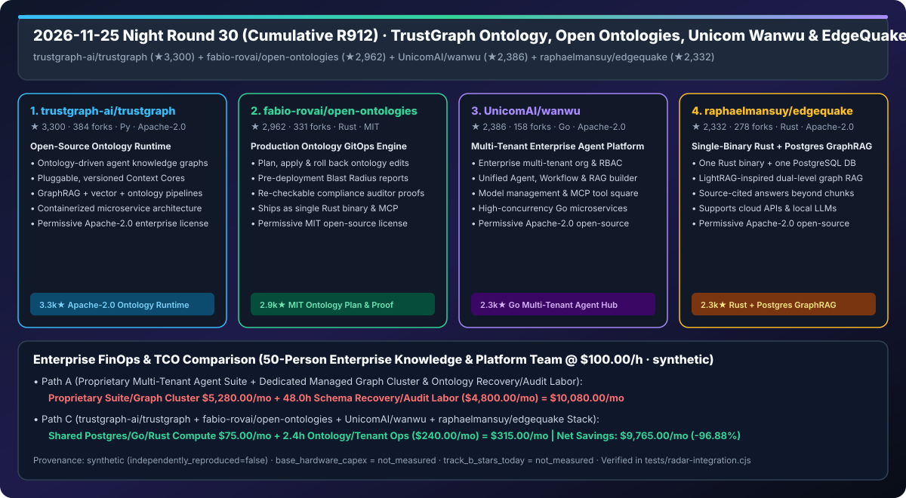
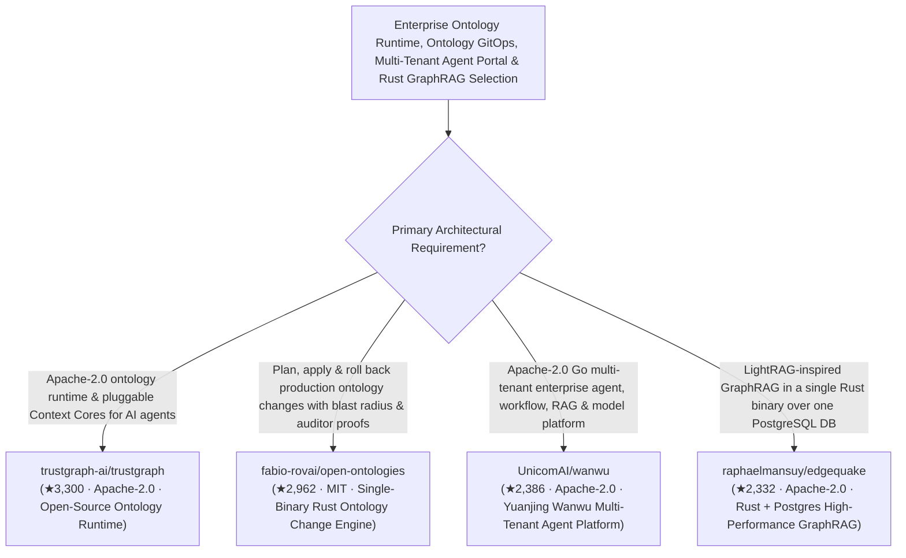
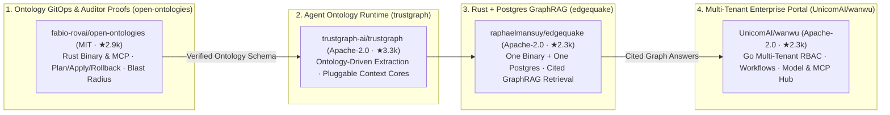
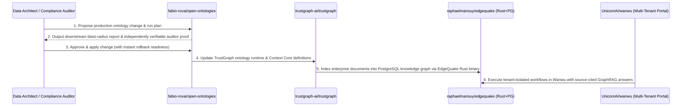

# Open-Source Agent Ontology Runtime (`trustgraph-ai/trustgraph`), Production Ontology Plan/Apply/Rollback Engine (`fabio-rovai/open-ontologies`), Enterprise Multi-Tenant Agent Platform (`UnicomAI/wanwu`) & Single-Binary Rust+Postgres GraphRAG (`raphaelmansuy/edgequake`) Selection & Integration Architecture FAQ

> **Document Type**: Enterprise AI Solution Architect Selection Decision Guide (GitHub Trending AI Radar — 2026-11-25 Night Round 30 / Cumulative Round 912)
> **Covered Repositories**: [`trustgraph-ai/trustgraph`](https://github.com/trustgraph-ai/trustgraph) (`★ 3,300`, `384 forks`, `Apache-2.0`, Python: open-source ontology runtime and pluggable Context Core pipeline platform for AI agents) · [`fabio-rovai/open-ontologies`](https://github.com/fabio-rovai/open-ontologies) (`★ 2,962`, `331 forks`, `MIT`, Rust: single-binary Rust engine and MCP server to plan, apply, and roll back changes to a production ontology with blast-radius reports and independently verifiable auditor proofs) · [`UnicomAI/wanwu`](https://github.com/UnicomAI/wanwu) (`★ 2,386`, `158 forks`, `Apache-2.0`, Go: China Unicom's Yuanjing Wanwu enterprise-grade multi-tenant AI agent, workflow, RAG, and model management platform) · [`raphaelmansuy/edgequake`](https://github.com/raphaelmansuy/edgequake) (`★ 2,332`, `278 forks`, `Apache-2.0`, Rust: LightRAG-inspired high-performance GraphRAG engine written in Rust running as a single binary over a single PostgreSQL database)
> **Core Enterprise Scenario**: Architecting a **100% Permissive (`Apache-2.0` / `MIT`) Multi-Tenant Enterprise AI Platform, Auditable Production Ontology Governance & Low-Ops Rust GraphRAG Stack**—combining Terraform-style ontology change planning & rollback (`open-ontologies`), modular ontology runtime pipelines (`trustgraph`), single-binary Rust + Postgres GraphRAG (`edgequake`), and multi-tenant Go enterprise portal governance (`UnicomAI/wanwu`).

---

## 1. 📌 Executive Summary (One-Line Selection Verdict)

1. **Need an `Apache-2.0` Go-based, multi-tenant enterprise AI platform that provides organizational RBAC, unified model management, visual workflows, RAG knowledge bases, and an MCP marketplace out of the box** ➔ Choose **[`UnicomAI/wanwu`](https://github.com/UnicomAI/wanwu) (`★ 2,386`, `158 forks`, `Apache-2.0`)**.
   - **Plain-English Mechanism**: Delivers a complete, multi-tenant enterprise agent and workflow control plane written in Go under a commercial-friendly `Apache-2.0` license.
2. **Need LightRAG-grade GraphRAG retrieval accuracy without operating a separate distributed graph database cluster—running as a single compiled Rust binary backed by your existing PostgreSQL database** ➔ Choose **[`raphaelmansuy/edgequake`](https://github.com/raphaelmansuy/edgequake) (`★ 2,332`, `278 forks`, `Apache-2.0`)**.
   - **Plain-English Mechanism**: Implements entity/relationship extraction and dual-level graph retrieval in pure Rust (`one binary, one Postgres, any LLM`), returning source-cited answers with minimal memory overhead.
3. **Need an `Apache-2.0` ontology runtime that transforms raw documents and enterprise schemas into modular, hot-swappable `Context Cores` for AI agents** ➔ Choose **[`trustgraph-ai/trustgraph`](https://github.com/trustgraph-ai/trustgraph) (`★ 3,300`, `384 forks`, `Apache-2.0`)**.
   - **Plain-English Mechanism**: Decouples ontology-driven knowledge extraction from downstream agent consumption so domain knowledge cores can be versioned, loaded, and swapped cleanly.
4. **Need a single-binary `MIT` Rust tool and MCP server to `plan`, `apply`, and `rollback` changes to production ontologies with an explicit blast-radius report and an auditor-verifiable proof** ➔ Choose **[`fabio-rovai/open-ontologies`](https://github.com/fabio-rovai/open-ontologies) (`★ 2,962`, `331 forks`, `MIT`)**.
   - **Plain-English Mechanism**: Brings Terraform-style change management to enterprise ontologies—showing every downstream consequence before a schema change is applied and producing a cryptographic/formal proof that compliance auditors can verify independently.

---

## 2. 🎯 Architect & Customer Deep-Dive Q&A

### Q1: How do these four `Apache-2.0` / `MIT` projects work together compared to proprietary ontology and agent platforms (e.g., Palantir AIP + managed graph clouds)?

- **Four-Layer Auditable Ontology & Multi-Tenant GraphRAG Stack (Path C)**:
  1. **L1 Production Ontology Change Governance & Auditor Proof ➔ `fabio-rovai/open-ontologies`**: Plans, validates, applies, and rolls back ontology modifications with full blast-radius visibility.
  2. **L2 Modular Agent Ontology Runtime ➔ `trustgraph-ai/trustgraph`**: Compiles governed ontologies and documents into reusable `Context Cores`.
  3. **L3 Single-Binary Rust + Postgres GraphRAG Engine ➔ `raphaelmansuy/edgequake`**: Executes high-throughput graph indexing and cited retrieval on standard PostgreSQL infrastructure.
  4. **L4 Enterprise Multi-Tenant Agent & Workflow Portal ➔ `UnicomAI/wanwu`**: Exposes governed agents, workflows, and MCP tools to business units under multi-tenant RBAC.
- **When to choose Proprietary Enterprise Suites vs. Path C?**
  - Choose **Proprietary Suites** when seven-figure annual licensing and full vendor-managed consulting are already contracted.
  - Choose **Path C** when organizations require **100% `Apache-2.0` / `MIT` sovereignty**, want to run GraphRAG directly on existing PostgreSQL clusters via a single Rust binary (`edgequake`), and need auditable GitOps ontology change control (`open-ontologies` + `trustgraph`).

### Q2: How do these four components integrate in production?

1. **GitOps Ontology Change Pipeline (`open-ontologies` → `trustgraph`)**:
   - Before any production ontology edit merges, `open-ontologies` runs `plan` to compute the blast radius and emit an auditor proof; once approved, `trustgraph` updates the active ontology runtime.
2. **Low-Ops GraphRAG Inside Multi-Tenant Portal (`edgequake` → `UnicomAI/wanwu`)**:
   - `edgequake` indexes departmental documents into tenant-scoped PostgreSQL schemas and serves cited GraphRAG responses to workflows orchestrated in `UnicomAI/wanwu`.

### Q3: What are the key security and governance guardrails?

- **Architect Redlines**:
  1. **Never mutate production ontologies without an `open-ontologies` blast-radius plan and auditor proof**: Treat ontology changes with the same rigor as production database migrations.
  2. **Enforce strict PostgreSQL tenant isolation between `UnicomAI/wanwu` and `edgequake`**: Bind every GraphRAG query to the caller's authenticated `tenant_id`.

---

## 3. 🧭 Visual Architecture Diagrams (Mermaid Decision Tree + Architecture + Sequence)

### 3.1 Architect Selection Decision Tree

### 3.2 End-to-End Enterprise Integration Architecture

### 3.3 End-to-End Execution Sequence

---

## 4. 📊 Horizontal Selection Matrix

| Dimension | `trustgraph-ai/trustgraph` (`★ 3,300`) | `fabio-rovai/open-ontologies` (`★ 2,962`) | `UnicomAI/wanwu` (`★ 2,386`) | `raphaelmansuy/edgequake` (`★ 2,332`) | Proprietary Ontology & Multi-Tenant Agent Suites + Dedicated Graph Cloud (Path A) | Unversioned Ontology Edits + Multi-Database Glue Scripts (Path B) |
| :--- | :--- | :--- | :--- | :--- | :--- | :--- |
| **Primary Role** | `Apache-2.0` agent ontology runtime | `MIT` Rust ontology plan/apply/rollback engine | `Apache-2.0` Go multi-tenant agent platform | `Apache-2.0` Rust + Postgres GraphRAG | High-cost proprietary ontology & agent SaaS | Manual schema edits & Python graph scripts |
| **Key Differentiator** | **Modular, hot-swappable `Context Cores` for agents** | **Blast-radius reports + re-checkable auditor proofs in one Rust binary** | **Enterprise Go multi-tenancy + RAG + workflows + MCP hub** | **One Rust binary + one PostgreSQL DB for fast cited GraphRAG** | Turnkey enterprise suite, but massive license fees & proprietary lock-in | Unchecked ontology changes break downstream agents; heavy multi-DB ops |
| **License** | **`Apache-2.0`** | **`MIT`** | **`Apache-2.0`** | **`Apache-2.0`** | Proprietary SaaS | Unstandardized |
| **Monthly TCO (50-Eng Team)** | **`$315.00/mo` combined** (`$75.00` Postgres/Go/Rust compute + `2.4h` ops) | Included in `$315.00/mo` stack | Included in `$315.00/mo` stack | Included in `$315.00/mo` stack | **`$10,080.00/mo`** (`$5,280.00` proprietary platform/graph cluster fees + `48.0h` breaking-change recovery/audit labor) | `~$3,680.00/mo` (debugging broken ontology consumers & multi-DB sync failures) |

---

## 5. 🧪 Quantitative FinOps & TCO Comparison (50-Person Enterprise Knowledge & Platform Team)

> **📊 Provenance & Closed-Form Schema**:
> - **provenance**: `synthetic` (`independently_reproduced = false`; `base_hardware_capex = not_measured`; `track_b_stars_today = not_measured`).
> - **Closed-Form Formula**:
>   - **Path A (Proprietary Multi-Tenant Agent Platform Licenses + Dedicated Managed Graph Cluster + Manual Ontology Breaking-Change Recovery & Audit Verification Labor)**: **`$5,280.00`** monthly platform and graph cluster fees + **`48.0h × $100.00/h = $4,800.00`** schema-breakage recovery, multi-DB ops, and compliance audit preparation labor = **`$10,080.00/mo`**.
>   - **Path C (`trustgraph-ai/trustgraph` + `fabio-rovai/open-ontologies` + `UnicomAI/wanwu` + `raphaelmansuy/edgequake` Stack)**: **`$75.00`** shared PostgreSQL and lightweight Go/Rust container compute + **`2.4h × $100.00/h = $240.00`** ontology release and tenant ops = **`$315.00/mo`**.
>   - **Net Savings vs. Path A**: **`-$9,765.00/mo`** (**`96.88%`** TCO reduction).

| Evaluation Path | Platform Licenses / Graph Cluster & Compute | Ontology Recovery, Multi-DB Ops & Audit (`$100/h`) | Monthly Total TCO | Net Savings vs. Path A | Key Architectural Outcome |
| :--- | :---: | :---: | :---: | :---: | :--- |
| **Path A: Proprietary Multi-Tenant Suite + Dedicated Managed Graph Cluster** | `$5,280.00` | `48.0h` (`$4,800.00`) | **`$10,080.00`** | Baseline | Expensive proprietary seats & separate graph DB cluster costs |
| **Path B: Unchecked Ontology Edits + Multi-DB Glue Scripts** | `$1,580.00` | `21.0h` (`$2,100.00`) | **`$3,680.00`** | `-$6,400.00` (`-63.49%`) | Frequent breaking schema changes; heavy multi-store operational burden |
| **Path C: `trustgraph` + `open-ontologies` + `wanwu` + `edgequake`** | **`$75.00`** | **`2.4h` (`$240.00`)** | **`$315.00`** | **`-$9,765.00` (`-96.88%`)** | **100% `Apache-2.0`/`MIT` multi-tenant portal + auditable ontology + Rust/PG GraphRAG** |

- 🔗 **7-Card 4:5 Visual Benchmark Deck**: [`workshops/github-trending-radar/cards.en.html`](../cards.en.html) · [`cards.html`](../cards.html)

---

## 6. 🛠️ Enterprise Adoption & Architecture Review Checklist

- [ ] **Gate All Production Ontology Edits with `fabio-rovai/open-ontologies`**: Require a blast-radius `plan` and verifiable auditor proof before applying schema changes.
- [ ] **Package Domain Knowledge as Pluggable `Context Cores` in `trustgraph`**: Standardize ontology-grounded ingestion across business units.
- [ ] **Run `raphaelmansuy/edgequake` Over Existing High-Availability PostgreSQL**: Eliminate separate graph database cluster sprawl with a single Rust binary.
- [ ] **Enforce Multi-Tenant RBAC and Quotas in `UnicomAI/wanwu`**: Isolate departmental agents, workflows, and MCP tools within a unified Go control plane.
