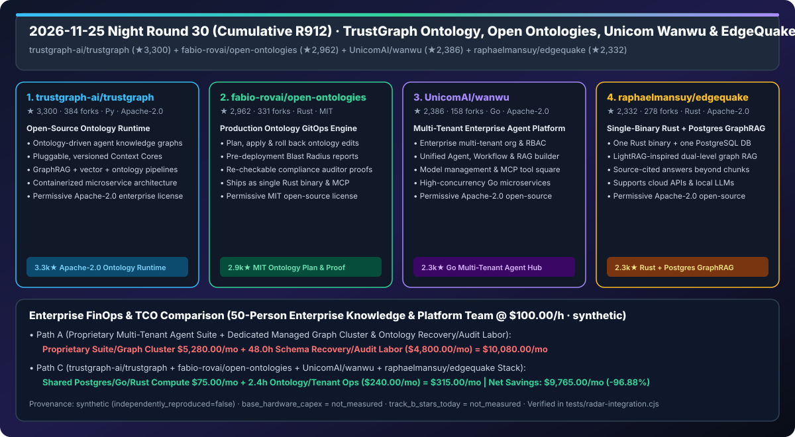
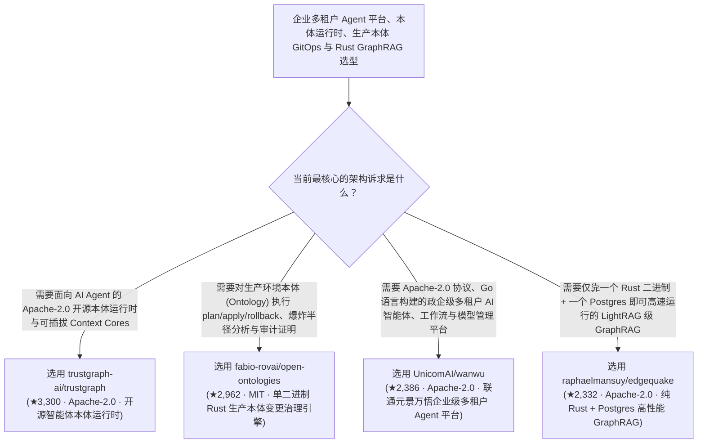
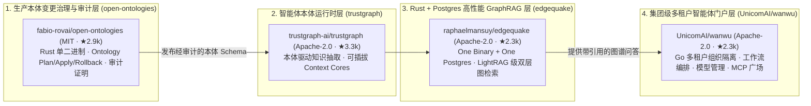
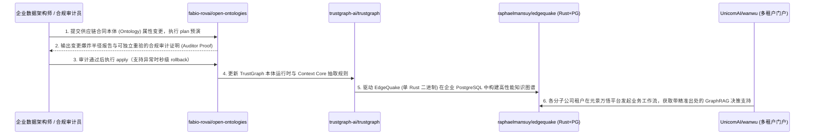

# 开源智能体本体运行时（`trustgraph-ai/trustgraph`）、生产环境本体变更规划与回滚引擎（`fabio-rovai/open-ontologies`）、企业级多租户智能体开发平台“元景万悟”（`UnicomAI/wanwu`）与单二进制 Rust+Postgres 高性能 GraphRAG（`raphaelmansuy/edgequake`）选型与集成架构 FAQ

> **文档类型**：企业 AI 解决方案架构师（AI Solution Architect）选型决策指南（GitHub Trending AI 雷达 2026-11-25 Night Round 30 / 累计第 912 轮）
> **覆盖项目**：[`trustgraph-ai/trustgraph`](https://github.com/trustgraph-ai/trustgraph)（`★ 3,300`、`384 forks`、`Apache-2.0`：面向 AI Agent 的开源本体运行时与可插拔知识图谱管道平台）· [`fabio-rovai/open-ontologies`](https://github.com/fabio-rovai/open-ontologies)（`★ 2,962`、`331 forks`、`MIT`：用纯 Rust 编写的单二进制生产本体变更管理与 MCP 引擎，支持像 Terraform 一样对企业 Ontology 执行 `plan`、`apply`、`rollback`、爆炸半径分析与可重验审计证明）· [`UnicomAI/wanwu`](https://github.com/UnicomAI/wanwu)（`★ 2,386`、`158 forks`、`Apache-2.0`：中国联通开源“元景万悟”企业级 Go 多租户 AI 智能体开发平台，涵盖模型管理、RAG、工作流与 MCP 广场）· [`raphaelmansuy/edgequake`](https://github.com/raphaelmansuy/edgequake)（`★ 2,332`、`278 forks`、`Apache-2.0`：受 LightRAG 启发、用纯 Rust 编写的单二进制 + 单 Postgres 高性能企业级 GraphRAG 引擎）
> **核心场景**：当央国企、金融机构与大型集团规划“集团级多租户 AI 平台 + 受严格审计的企业业务本体（Ontology）+ 极简运维的 GraphRAG”时，架构师面临四个核心挑战：**“集团总部想用一套 `Apache-2.0` 协议、Go 语言高并发底座为几十家下属分子公司提供多租户隔离的 Agent/RAG/Workflow 开发平台，选谁最契合国内政企组织架构（`UnicomAI/wanwu`）？想做高质量 GraphRAG 但不想额外维护复杂的分布式图数据库集群，有没有‘一个 Rust 二进制文件 + 一个现有 PostgreSQL’就能跑起来的方案（`edgequake`）？如何把分散的知识图谱打包为可复用的 Agent 本体运行时（`trustgraph`）？当业务专家修改生产环境的本体（Ontology）定义时，怎么像改生产代码一样先看影响面报告（Blast Radius）、支持一键回滚并给合规审计员提供可验证证明（`open-ontologies`）？”** 本文给出 100% `Apache-2.0`/`MIT` 解决方案。

---

## 一、📌 核心结论速览（选型一句话结论）

1. **需要一套 `Apache-2.0` 开源、原生采用 Go 语言微服务架构、且深度适配国内大型政企/集团“多租户、多组织层级、统一模型调度、RAG 知识库、可视化工作流与 MCP 工具广场”的企业级智能体平台** ➔ 选 **[`UnicomAI/wanwu`](https://github.com/UnicomAI/wanwu)（`★ 2,386`，`158 forks`，`Apache-2.0`，联通元景万悟）**。
   - **通俗原理**：不同于早期仅面向单人开发者的玩具框架，`wanwu` 从第一天起就按央国企级多租户与模型训推管理设计，且采用极为友好的 `Apache-2.0` 商业开源许可，无二次开发闭源限制。
2. **想要 LightRAG 级别的知识图谱双层检索（实体级 + 主题级）准确度，但坚决不想在生产环境多维护一套重量级专用图数据库集群，希望“一个 Rust 二进制 + 一个现有的 PostgreSQL”全搞定** ➔ 选 **[`raphaelmansuy/edgequake`](https://github.com/raphaelmansuy/edgequake)（`★ 2,332`，`278 forks`，`Apache-2.0`）**。
   - **通俗原理**：用纯 Rust 重写了高性能 GraphRAG 管道（`one binary, one Postgres, any LLM`），将文档自动抽取为知识图谱并直接存储在企业现有的 PostgreSQL（含 `pgvector`）中，内存占用极低且每一句回答都附带可追溯源文档引用。
3. **需要将企业多源异构数据按照严格的领域本体（Domain Ontology）抽取并封装为可随时挂载、切换的“Context Cores（上下文内核）”供上层 Agent 消费** ➔ 选 **[`trustgraph-ai/trustgraph`](https://github.com/trustgraph-ai/trustgraph)（`★ 3,300`，`384 forks`，`Apache-2.0`）**。
   - **通俗原理**：提供标准化的本体驱动知识抽取与 GraphRAG 运行时管道，把静态的知识库升级为可版本化分发、可插拔加载的智能体本体内核。
4. **当企业将本体（Ontology / 模仿 Palantir AIP 的业务语义模型）推向生产后，任何对实体属性或关系的修改都可能破坏下游几十个 Agent，急需一套“本体界的 Terraform”先做 `plan` 影响面分析、生成审计证明并支持随时 `rollback`** ➔ 选 **[`fabio-rovai/open-ontologies`](https://github.com/fabio-rovai/open-ontologies)（`★ 2,962`，`331 forks`，`MIT`）**。
   - **通俗原理**：用 Rust 编写的单二进制 CLI 与 MCP Server（`io.github.fabio-rovai/open-ontologies`），在修改生产本体前精确计算出每一个受波及的规则与下游查询（Blast Radius），并输出内审员无需信任提交者即可独立复核的形式化验证证明。

---

## 二、🎯 客户与架构师灵魂拷问 Q&A（深度架构拆解）

### Q1：为什么越来越多大型企业强调“Ontology（企业本体）+ GraphRAG”？这四个开源项目 vs 商业闭源数据操作系统（如 Palantir AIP + 商业多租户 Agent 平台）怎么选？

- **四层可审计本体治理与多租户集团 AI 架构（Path C）**：
  1. **L1 生产本体变更规划、审计证明与回滚层 ➔ `fabio-rovai/open-ontologies`**：对本体 Schema 的每一次增删改执行 `plan` / `apply` / `rollback` 与爆炸半径核算。
  2. **L2 本体运行时与可插拔 Context Cores 层 ➔ `trustgraph-ai/trustgraph`**：按照经审批的本体模型执行高一致性的实体关系抽取与运行时编排。
  3. **L3 单二进制 Rust + Postgres 极简 GraphRAG 存储计算层 ➔ `raphaelmansuy/edgequake`**：依托现有 PostgreSQL 高速执行文档入图与双层图谱检索。
  4. **L4 集团级 Go 多租户智能体门户与工作流中台 ➔ `UnicomAI/wanwu`**：面向全集团各部门租户提供智能体构建、模型配额管理与 MCP 服务门户。
- **何时选商业闭源平台（Palantir AIP + 商业专有 Agent PaaS） vs 自建本轮开源四件套（Path C）？**
  - 若客户具备数百万美元以上的年度软件许可预算且愿意完全绑定单一外部厂商咨询团队，可评估商业套件。
  - **何时采用本轮开源四件套（Path C）？** 当政企、运营商、金融与制造集团要求 **100% `Apache-2.0` / `MIT` 自主可控开源协议**、希望复用现有 PostgreSQL 运维体系落地 Rust 高性能 GraphRAG（`edgequake`）、并对生产本体实施可审计的 GitOps 变更管控（`open-ontologies` + `trustgraph`）时，Path C 可节省 **96%+** 的商业平台年费与多组件运维开销。

### Q2：这四个项目在集团生产环境中如何协同运转？

1. **本体变更安全上线流水线（`open-ontologies` → `trustgraph`）**：
   - 数据架构师提交本体变更 PR 时，CI 调用 `open-ontologies` 执行变更预演（Plan），输出受影响下游 Agent 清单与可复核证明；审批通过后，`trustgraph` 加载新版本体更新 `Context Core`。
2. **极简 GraphRAG 赋能多租户门户（`edgequake` → `UnicomAI/wanwu`）**：
   - 各业务部门在 `UnicomAI/wanwu` 多租户门户上传专业规章与合同，底层调用 `edgequake` 单二进制服务在共享 PostgreSQL 的租户 Schema 内构建知识图谱，为门户工作流提供毫秒级带引用的 GraphRAG 回答。

### Q3：生产落地的安全与架构红线是什么？

- **架构师避坑红线**：
  1. **严禁绕过 `open-ontologies` 的 `plan` 阶段直接热改生产本体定义**：任何删除实体属性或更改基数约束（Cardinality）的操作必须先通过爆炸半径检查。
  2. **在 `UnicomAI/wanwu` 与 `edgequake` 之间强制透传 `tenant_id`**：在 PostgreSQL 中启用行级安全策略（RLS）或独立 Schema，严防多租户知识图谱跨部门串读。

---

## 三、🧭 直观可视化图解（Mermaid 决策树 + 集成架构 + 时序图）

### 3.1 架构师选型决策树

### 3.2 企业端到端生产集成参考架构图

### 3.3 生产本体变更预演、审计验签、Rust GraphRAG 索引构建与多租户门户调用时序图

---

## 四、📊 同类开源与商业云服务横向选型决策矩阵

| 对比维度 | `trustgraph-ai/trustgraph` (`★ 3,300`) | `fabio-rovai/open-ontologies` (`★ 2,962`) | `UnicomAI/wanwu` (`★ 2,386`) | `raphaelmansuy/edgequake` (`★ 2,332`) | 商业闭源本体与多租户平台 (如 Palantir AIP + 商业专有 Agent 云) (Path A) | 手工维护散装图数据库 + 无本体变更审计 + Python 单线程慢速建图 (Path B) |
| :--- | :--- | :--- | :--- | :--- | :--- | :--- |
| **核心能力定位** | `Apache-2.0` 智能体本体运行时 | `MIT` Rust 生产本体变更规划与回滚 | `Apache-2.0` Go 多租户企业智能体平台 | `Apache-2.0` Rust + Postgres GraphRAG | 百万美元级闭源商业数据与智能体平台 | 无版本控制的脚本抽取 + 多套数据库拼凑 |
| **核心技术突破** | **将知识图谱与本体封装为可热插拔 Context Cores** | **本体变更前输出 Blast Radius 与可独立复核的审计证明** | **央国企级 Go 多租户权限 + RAG + Workflow + MCP 一站整合** | **单 Rust 二进制 + 单 Postgres 实现极速低内存 GraphRAG** | 功能完备，但商业授权极度昂贵且数据模型完全锁定在厂商专有格式中 | 随便改一个本体字段导致下游 Agent 全线报错；Python 建图慢且运维多套库成本高 |
| **开源协议** | **`Apache-2.0`** | **`MIT`** | **`Apache-2.0`** | **`Apache-2.0`** | 闭源专有许可 | 无治理 |
| **月度 TCO（50 人团队）** | **四件套合建仅 `$315.00/月`**（`$75.00` 复用现有 Postgres 与 Go/Rust 极轻算力 + `2.4h` 维护） | 同左（`MIT` 单二进制零额外运行开销） | 同左（`Apache-2.0` Go 服务内存占用极小，单集群服务全集团） | 同左（免除额外部署独立图数据库集群的机器成本） | **`$10,080.00/月`**（`$5,280.00` 商业多租户平台席位与专用图集群账单 + `48.0h` 本体变更事故抢修与多库运维） | 约 `$3,680.00/月`（大量修复本体破坏性变更与维护脆弱多库同步脚本工时） |

---

## 五、🧪 应用落地定量收益/TCO 对比与 7-Card 报告

> **📊 数据来源与闭式核算声明（Provenance & Closed-Form Schema）**：
> - **provenance**: `synthetic`（基于 50 人大型集团多租户 AI 中台、知识工程与合规审计团队月度工作负载模型：`independently_reproduced = false`；硬件采购基线 `base_hardware_capex = not_measured`；Track B 单日增量 `track_b_stars_today = not_measured`）。
> - **核算公式**：
>   - **Path A（采购商业多租户智能体平台企业版席位 + 独立高配商业图数据库集群 + 因缺乏本体变更预演导致的下游工作流中断抢修与人工合规审计核对工时）**：月度商业平台授权与独立图集群账单 **`$5,280.00`** + 本体变更影响面人工排查、多库同步维护与合规审计取证人工 **`48.0h × $100.00/h = $4,800.00`** = **`$10,080.00/月`**。
>   - **Path C（自建 `trustgraph-ai/trustgraph` + `fabio-rovai/open-ontologies` + `UnicomAI/wanwu` + `raphaelmansuy/edgequake` 全 `Apache-2.0`/`MIT` 集团级多租户与可审计本体底座）**：内网复用 PostgreSQL 与 Go/Rust 容器算力分摊 **`$75.00`** + 本体版本发布与多租户配额日常巡检人工 **`2.4h × $100.00/h = $240.00`** = **`$315.00/月`**。
>   - **净节省（Net Savings vs Path A）**：**`-$9,765.00/月`**（成本降低 **`96.88%`**）。

| 评估方案 | 商业多租户平台 / 独立图集群与算力成本 | 本体变更排障、多库维护与合规取证人工（`$100/h`） | 月度总 TCO | 相对 Path A 净节省 | 核心业务交付收益 |
| :--- | :---: | :---: | :---: | :---: | :--- |
| **Path A：商业多租户 Agent 平台 + 独立商业图集群** | `$5,280.00` | `48.0h` (`$4,800.00`) | **`$10,080.00`** | Baseline | 平台席位与独立图集群昂贵；本体变更缺乏形式化审计证明 |
| **Path B：无审计裸改本体 + 多套开源数据库拼凑** | `$1,580.00` | `21.0h` (`$2,100.00`) | **`$3,680.00`** | `-$6,400.00` (`-63.49%`) | 修改本体常引发未知雪崩；维护多套存储组件负担沉重 |
| **Path C：`trustgraph` + `open-ontologies` + `wanwu` + `edgequake`** | **`$75.00`** | **`2.4h` (`$240.00`)** | **`$315.00`** | **`-$9,765.00` (`-96.88%`)** | **100% `Apache-2.0`/`MIT` 集团多租户 + 可回滚本体 + 单 Postgres GraphRAG** |

- 🔗 **关联 7-Card 4:5 视觉评测报告**：[`workshops/github-trending-radar/cards.html`](../cards.html) · [`cards.en.html`](../cards.en.html)

---

## 六、🛠️ 企业引入与架构评审 Checklist

- [ ] **将所有生产环境业务本体（Ontology）纳入 `fabio-rovai/open-ontologies` GitOps 流水线**：强制要求每次本体合并前自动生成 Blast Radius 报告与可复核审计证明。
- [ ] **使用 `trustgraph-ai/trustgraph` 标准化跨部门 Context Cores**：将经过校验的领域知识图谱以标准容器/模块形式挂载给不同 Agent。
- [ ] **优先采用 `raphaelmansuy/edgequake` 复用企业现有高可用 PostgreSQL 落地 GraphRAG**：避免为中小型知识图谱额外部署复杂的分布式图数据库集群。
- [ ] **基于 `UnicomAI/wanwu` 构建集团多租户 AI 门户**：按部门/分子公司配置独立的模型配额、知识库权限与 MCP 工具访问边界。
