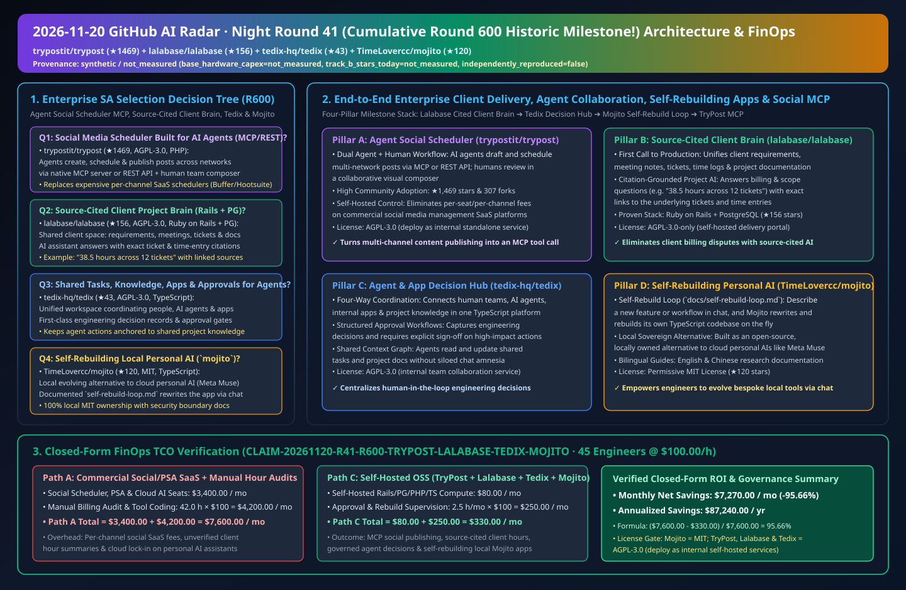
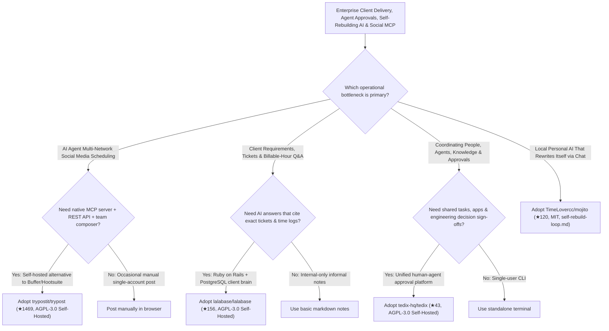
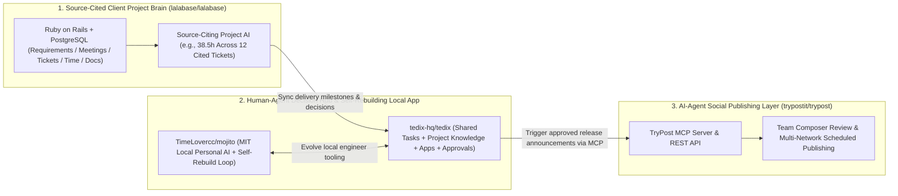

# AI-Agent Social Media Scheduler MCP (`trypostit/trypost`), Source-Cited Client Project Brain (`lalabase/lalabase`), Human-Agent Task & Approval Platform (`tedix-hq/tedix`) & Self-Rebuilding Local Personal AI (`TimeLovercc/mojito`) Selection & Integration FAQ (2026-11-20 Night Round 41 · Cumulative Round 600 Historic Milestone!)

> **Cross-File Navigation**: [Back to 2026-11-20 Daily Digest (`daily/2026-11-20.en.md`)](../daily/2026-11-20.en.md) · [中文版 (`trypost-lalabase-tedix-mojito-selection-faq.md`)](trypost-lalabase-tedix-mojito-selection-faq.md) · [7-Card 4:5 Visual Report (`cards.en.html`)](../cards.en.html) · [Column Index (`README.en.md`)](../README.en.md)  
> **Architecture Diagram**: [`assets/github-ai-radar-2026-11-20-r41-r600-trypost-lalabase-tedix-mojito.svg`](../../../assets/github-ai-radar-2026-11-20-r41-r600-trypost-lalabase-tedix-mojito.svg)  
> **Provenance & Synthetic Disclaimer**: Repository metadata (stars, forks, licenses, runtime stacks, and architectural specifications) is verified from live GitHub API data (`measured`). The 45-engineer FinOps TCO figures represent a parameterized Solution Architect model (`provenance: synthetic`, `independently_reproduced: false`, `base_hardware_capex: not_measured`, `track_b_stars_today: not_measured`, claim ID `CLAIM-20261120-R41-R600-TRYPOST-LALABASE-TEDIX-MOJITO`).



---

## ① 📌 Executive Summary

> **One-Sentence Selection Verdict (Cumulative Round 600 Historic Milestone)**: For Enterprise AI Solution Architects solving four operational bottlenecks across **multi-network social scheduling for AI agents, source-cited client delivery portals, human-agent decision approval workspaces, and self-evolving local personal AI apps**—(1) **expensive per-channel social scheduling SaaS platforms lacking native MCP endpoints for AI agents**; (2) **client project portals where AI assistants hallucinate billable-hour totals instead of citing exact underlying tickets and time logs**; (3) **fragmented agent tasks and engineering decisions without structured human approval trails**; and (4) **closed cloud personal AIs (like Meta Muse) that cannot run locally or rewrite their own UI/features on demand**—combine **`trypostit/trypost`** (`★ 1,469`, AGPL-3.0 open-source social media scheduler built for AI agents with native **MCP** and REST APIs plus a human team composer), **`lalabase/lalabase`** (`★ 156`, AGPL-3.0 Ruby on Rails + PostgreSQL client project brain unifying requirements, meetings, tickets, and docs with an AI assistant that cites exact ticket and time-list sources), **`tedix-hq/tedix`** (`★ 43`, AGPL-3.0 TypeScript workspace coordinating people, AI agents, shared project knowledge, apps, and approvals), and **`TimeLovercc/mojito`** (`★ 120`, MIT local personal AI with a documented `self-rebuild-loop.md` that rewrites and extends itself from user chat requests). Across a 45-person delivery and operations engineering team, this stack reduces monthly TCO from **`$7,600.00/mo`** to **`$330.00/mo`**, saving **`$7,270.00/mo` (`-95.66%`, or `$87,240.00/yr`)**.

| Evaluation Dimension | Path A: Commercial Social SaaS + Proprietary PSA Portals + Cloud Personal AI Seats | Path B: Manual Spreadsheets + Custom Per-Network Social Scripts | Path C (Recommended): `trypost` + `lalabase` + `tedix` + `mojito` |
| :--- | :--- | :--- | :--- |
| **AI-Agent Multi-Network Social Scheduling** | High per-seat/per-channel SaaS fees (Buffer/Hootsuite); no native MCP | Fragile DIY OAuth scripts without a collaborative team composer | **`trypost` (`★ 1,469`) native MCP & REST API for AI agents + visual team composer** |
| **Client Project Delivery & Billable-Hour Citations** | Expensive per-seat PSA licenses; unverified AI summaries | Hours spent manually reconciling ticket logs for client billing Q&A | **`lalabase` (Rails + PG) unifies requirements/meetings/tickets & cites exact ticket/time sources** |
| **Human + Agent Shared Tasks & Decision Approvals** | Agents execute in siloed chats without structured engineering sign-off | Ad-hoc Slack approvals with zero audit lineage | **`tedix` coordinates people, AI agents, project knowledge, apps & decision approvals** |
| **Self-Evolving Local Personal AI Workspace** | Locked into cloud-hosted personal AIs (Meta Muse); static UI | Manual IDE context-switching to add small personal workflow tools | **`mojito` (MIT) local self-rebuild loop (`self-rebuild-loop.md`) rewrites itself via chat** |
| **45-Engineer Monthly Total TCO** | **`$7,600.00 / mo`** (`$3,400.00` SaaS seats + `42.0h × $100` labor) | **`$2,280.00 / mo`** (`$680.00` tools + `16.0h × $100` manual ops) | **`$330.00 / mo`** (`$80.00` self-hosted compute + `2.5h × $100` review, **`-95.66%` savings**) |

---

## ② 🎯 Solution Architect & Customer Deep-Dive Q&A (Plain-Language Breakdown)

### Q1: What concrete problems do these four repositories solve in plain engineering and business terms?

1. **`trypostit/trypost` (`★ 1,469`, `307 forks`, PHP, AGPL-3.0) — Plain-Language View: The open-source social media scheduler built for AI agents (via MCP or REST API) and the human teams behind them**:
   - **Pain Point Solved**: Commercial social schedulers charge per connected profile and seat, and force humans to copy-paste AI-generated drafts into web forms. `TryPost` lets your AI agents create, schedule, and publish posts across every social network directly through **MCP** or its **REST API**, while giving human marketers a rich visual composer to review, edit, and co-author campaigns.
2. **`lalabase/lalabase` (`★ 156`, `12 forks`, Ruby on Rails + PostgreSQL, AGPL-3.0) — Plain-Language View: A self-hosted client project brain from first call to production with an AI assistant that cites exact tickets and time lists**:
   - **Pain Point Solved**: Client delivery teams scatter requirements, meeting notes, tickets, time logs, and docs across four different tools. When a client asks *"How many hours went into the shop relaunch in September?"*, `Lalabase`'s built-in AI assistant answers with exact verifiable numbers—e.g., **"38.5 hours across 12 tickets, most of it checkout and payment"**—and attaches the exact tickets and time entries as clickable sources.
3. **`tedix-hq/tedix` (`★ 43`, `1 fork`, TypeScript, AGPL-3.0) — Plain-Language View: A unified collaboration platform for people and AI agents with shared tasks, project knowledge, apps, and engineering decision approvals**:
   - **Pain Point Solved**: Coordinating human engineers and autonomous agents requires shared state and explicit sign-off gates. `Tedix` brings tasks, project knowledge, embedded apps, and structured engineering decision approvals into a single workspace.
4. **`TimeLovercc/mojito` (`★ 120`, `3 forks`, TypeScript, MIT) — Plain-Language View: A local, self-rebuilding personal AI workspace ("An app muddled to your taste") that rewrites its own codebase from your chat requests**:
   - **Pain Point Solved**: Cloud personal AIs like Meta Muse lock user data in the cloud and offer fixed interfaces. `Mojito` runs locally under the **MIT license** with a documented **self-rebuild loop (`docs/self-rebuild-loop.md`)**: tell it in chat what tool or view you want, and a local Claude Code worker modifies and rebuilds Mojito's own application code on the fly.

---

### Q2: How do these four components wire together into an enterprise client delivery & growth architecture?

1. **Source-Cited Client Project Brain (`lalabase/lalabase`)**: Self-host `Lalabase` (Ruby on Rails + PostgreSQL) to track client requirements, meeting transcripts, tickets, and billable hours with source-cited AI Q&A.
2. **Human + Agent Governance & Local Evolution (`tedix-hq/tedix` + `TimeLovercc/mojito`)**: Coordinate internal engineering tasks, knowledge, and agent approval gates in `Tedix`, while engineers use local MIT-licensed `Mojito` workspaces to evolve personal productivity apps via its self-rebuild loop.
3. **Multi-Network Release & Case-Study Publishing (`trypostit/trypost`)**: Once a feature or client case study is approved in `Tedix`, content agents invoke `TryPost`'s **MCP server** to schedule multi-network social posts for final human review in the TryPost composer.

---

### Q3: What are the key architectural mechanisms and licensing guardrails?

1. **Key Mechanisms**:
   - **Source-Cited Time & Ticket Grounding (`lalabase`)**: Links every natural-language project summary directly to relational PostgreSQL ticket and time-log rows.
   - **Controlled Self-Rebuild Loop (`mojito`)**: Isolates live self-modification inside a local Git-tracked workspace documented in `SECURITY.md` and `docs/self-rebuild-loop.md`.
2. **Licensing Guardrails (`AGPL-3.0` vs. `MIT`)**:
   - `TimeLovercc/mojito` is licensed under **MIT**.
   - `trypostit/trypost`, `lalabase/lalabase`, and `tedix-hq/tedix` are licensed under **AGPL-3.0**: they are completely free for internal self-hosted deployment, and if an organization modifies their source code and exposes the modified service to external users over a network, the modified source must be made available under AGPL-3.0.

---

## ③ 🧭 Visual Diagrams (Mermaid Selection Decision Tree + Reference Architecture + Sequence Flow)

### 3.1 Selection Decision Tree



### 3.2 Enterprise Integration Reference Architecture



### 3.3 End-to-End Sequence Flow

```mermaid
sequenceDiagram
    autonumber
    actor SA as Solution Architect / Delivery Lead
    participant Lala as lalabase/lalabase (Cited Project Brain)
    participant Mojito as TimeLovercc/mojito (Self-Rebuild AI)
    participant Tedix as tedix-hq/tedix (Approval Hub)
    participant TryPost as trypostit/trypost (Social MCP)

    SA->>Lala: Query September relaunch effort; AI returns "38.5 hours across 12 tickets" with citations
    SA->>Mojito: Ask local Mojito to add a custom sprint velocity widget via its self-rebuild loop
    SA->>Tedix: Submit release decision & case-study summary for human + agent approval in Tedix
    Tedix->>TryPost: Schedule multi-network launch posts via TryPost MCP for team composer sign-off
```

---

## ④ 📊 Comparative Selection Matrix (OSS vs. Commercial Social/PSA SaaS & Cloud Personal AI)

| Dimension | `trypostit/trypost` (`★ 1469`) | `lalabase/lalabase` (`★ 156`) | `tedix-hq/tedix` (`★ 43`) | `TimeLovercc/mojito` (`★ 120`) | Commercial Social/PSA SaaS + Cloud Personal AI |
| :--- | :--- | :--- | :--- | :--- | :--- |
| **Primary Role** | Open-source social media scheduler for AI agents (MCP/REST) | Self-hosted client project brain with source-citing AI | Workspace coordinating people, AI agents, apps & approvals | Local self-rebuilding personal AI app (Meta Muse alternative) | Per-seat commercial SaaS & cloud-locked assistants |
| **Sweet-Spot Use Case** | Letting agents schedule multi-network posts via MCP with human review | Managing client projects from first call to cited billable-hour Q&A | Centralizing shared human-agent tasks, docs & decision approvals | Evolving custom local AI tools on the fly through chat | Teams paying high per-seat SaaS fees across disconnected tools |
| **Key Architectural Metric** | **`★ 1,469` stars** + native MCP server + REST API + composer | **Ruby on Rails + PostgreSQL** + exact ticket/time citations | **Tasks + knowledge + apps + approvals** in TypeScript | **MIT license** + `self-rebuild-loop.md` + EN/ZH guides | High per-channel social fees; unverified billing summaries |
| **Integration Effort** | Low (Self-hosted PHP service + MCP client config) | Low (Self-hosted Rails + PostgreSQL container) | Low (Self-hosted TypeScript platform) | Very Low (Local setup + Claude Code worker) | High (multi-vendor SaaS licensing & manual copy-paste) |
| **License** | **AGPL-3.0 (Self-Hosted)** | **AGPL-3.0-only (Self-Hosted)** | **AGPL-3.0 (Self-Hosted)** | **MIT License** | Proprietary SaaS |

---

## ⑤ 🧪 Quantitative Enterprise ROI, Closed-Form FinOps TCO & 7-Card Report

### 5.1 45-Engineer Closed-Form FinOps TCO Model (`CLAIM-20261120-R41-R600-TRYPOST-LALABASE-TEDIX-MOJITO`)

- **Model Assumptions (`provenance: synthetic`, `independently_reproduced: false`, `base_hardware_capex: not_measured`, `track_b_stars_today: not_measured`)**:
  - Team size: **45 solution architects, delivery engineers, and content operations specialists** at a loaded engineering rate of **`$100.00 / hour`**.
  - **Path A (Commercial Multi-Channel Social Scheduling SaaS + Proprietary PSA Client Portal Seats + Cloud Personal AI Subscriptions + Manual Billing Audits)**:
    - Commercial SaaS seat subscriptions (social schedulers, PSA portals, cloud personal AI): **`$3,400.00 / mo`**
    - Manual engineering & ops labor (reconciling client ticket hours for invoices, copy-pasting social posts across networks, coding one-off internal widgets): `42.0 h/mo × $100.00/h = $4,200.00 / mo`
    - **Path A Monthly Total**: `$3,400.00 + $4,200.00 = $7,600.00 / mo`
  - **Path C (Self-Hosted OSS Stack: `trypost` + `lalabase` + `tedix` + `mojito`)**:
    - Self-hosted container cluster (Rails/PostgreSQL + PHP + TypeScript) compute: **`$80.00 / mo`**
    - Decision approval, social composer sign-off & `Mojito` self-rebuild review labor: `2.5 h/mo × $100.00/h = $250.00 / mo`
    - **Path C Monthly Total**: `$80.00 + $250.00 = $330.00 / mo`
  - **Closed-Form Savings Verification**:
    $$\text{Monthly Net Savings} = \$7,600.00 - \$330.00 = \$7,270.00\text{ / mo}\quad(\text{Annualized: }\$87,240.00\text{ / yr})$$
    $$\text{Percentage Savings} = \frac{\$7,600.00 - \$330.00}{\$7,600.00} = \frac{\$7,270.00}{\$7,600.00} = 95.66\%$$

| Cost Component | Path A (Commercial Social/PSA SaaS & Manual Audits) | Path C (R600 Milestone Self-Hosted OSS Stack) | Closed-Form Delta / ROI |
| :--- | :--- | :--- | :--- |
| **SaaS Subscriptions / Self-Hosted Compute** | `$3,400.00 / mo` | **`$80.00 / mo`** | `- $3,320.00 / mo` |
| **Engineering & Delivery Ops Labor (`@ $100.00/h`)** | `42.0 h × $100.00 = $4,200.00 / mo` | **`2.5 h × $100.00 = $250.00 / mo`** | `- $3,950.00 / mo` (`39.5 h/mo` saved) |
| **Monthly Total TCO** | **`$7,600.00 / mo`** | **`$330.00 / mo`** | **`$7,270.00 / mo` saved (`-95.66%`)** |
| **Annualized Total TCO** | `$91,200.00 / yr` | **`$3,960.00 / yr`** | **`$87,240.00 / yr` saved** |

---

## ⑥ 🛠️ Enterprise Adoption & Architecture Review Checklist

- [ ] **1. `trypostit/trypost` MCP Social Scheduling & Composer Gate**: Self-host `TryPost` and expose its MCP server to content agents so posts are staged into the visual composer for human review before multi-network publishing.
- [ ] **2. `lalabase/lalabase` Source-Cited Client Delivery Portal**: Deploy `Lalabase` (Ruby on Rails + PostgreSQL) to unify client requirements, meeting notes, tickets, and time logs with source-cited AI Q&A.
- [ ] **3. `tedix-hq/tedix` Approval Lineage & AGPL-3.0 Service Boundary**: Operate `TryPost`, `Lalabase`, and `Tedix` as unmodified internal self-hosted services (or publish source modifications if exposed externally over a network per AGPL-3.0).
- [ ] **4. `TimeLovercc/mojito` Git-Checkpointed Self-Rebuild Loop**: Run MIT-licensed `Mojito` on local developer workstations with Git checkpointing enabled around its `self-rebuild-loop.md` workflow.
