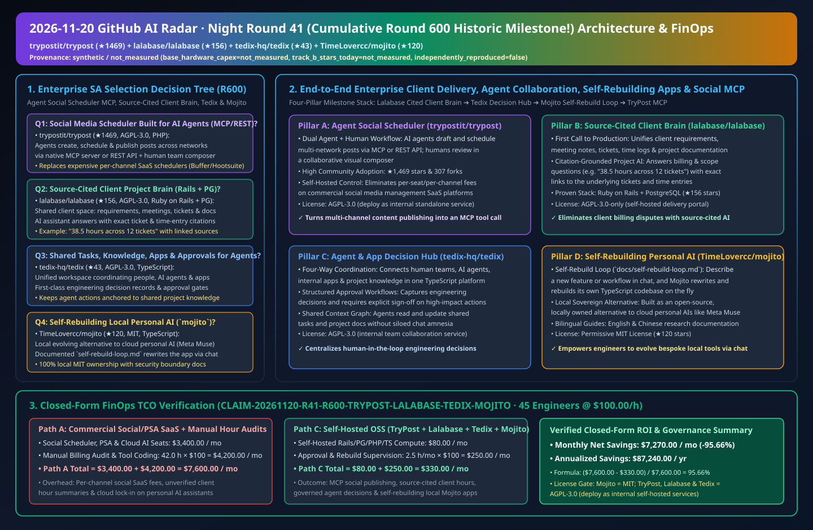
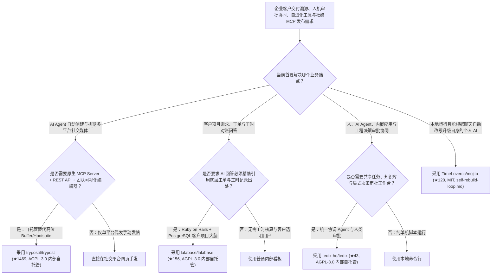
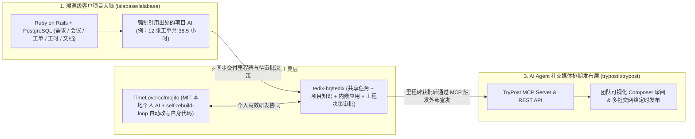
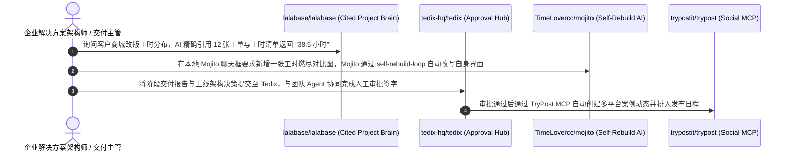

# 面向 AI Agent 的全平台社媒排期发布 MCP（`trypostit/trypost`）、带精确工单/工时引用的自托管客户项目大脑（`lalabase/lalabase`）、人机共管任务与审批平台（`tedix-hq/tedix`）与本地自重写演进个人 AI（`TimeLovercc/mojito`）架构选型与集成 FAQ（2026-11-20 Night Round 41 · 累计 Round 600 Historic Milestone!）

> **跨文件导航**：[返回 2026-11-20 当日全景日报 (`daily/2026-11-20.md`)](../daily/2026-11-20.md) · [English Version (`trypost-lalabase-tedix-mojito-selection-faq.en.md`)](trypost-lalabase-tedix-mojito-selection-faq.en.md) · [查看 7-Card 4:5 评测报告 (`cards.html`)](../cards.html) · [返回专栏主索引 (`README.md`)](../README.md)  
> **本轮架构大图**：[`assets/github-ai-radar-2026-11-20-r41-r600-trypost-lalabase-tedix-mojito.svg`](../../../assets/github-ai-radar-2026-11-20-r41-r600-trypost-lalabase-tedix-mojito.svg)  
> **数据溯源与口径声明（Provenance & Synthetic Disclaimer）**：本报告中实时采集的 GitHub 仓库元数据（Stars、Forks、License、技术栈与 README 架构规范）为 `measured`；针对 45 人企业客户交付、内容运营与研发协同团队的 FinOps TCO 测算参数属于架构师参数化测算模型（`provenance: synthetic`，`independently_reproduced: false`，`base_hardware_capex: not_measured`，`track_b_stars_today: not_measured`，审计契约号 `CLAIM-20261120-R41-R600-TRYPOST-LALABASE-TEDIX-MOJITO`）。

---

## ① 📌 核心结论速览（Executive Summary）

> **一句话选型结论（累计第 600 轮历史性里程碑专题）**：面向企业 AI 解决方案架构师（SA）在构建**客户项目全生命周期透明交付、人机协同审批工作台、个人本地自进化效率应用以及多渠道社交媒体自动化分发**时的四大痛点——① **商业社媒排期工具（如 Buffer / Hootsuite）按账号与席位高价收费，且缺乏原生 MCP Server 让 AI Agent 直接创建与排期全网帖子**；② **技术服务与咨询团队在回答客户“上个月某功能改版花了多少工时、分布在哪些工单”时，普通 AI 容易编造数字，缺乏精确到具体 Ticket 与工时记录的溯源引用（Source Citations）**；③ **团队内部的 AI Agent、业务小应用与人工审批流分散在不同系统，缺乏统一的工程决策留痕工作台**；④ **类似 Meta Muse 的云端个人 AI 无法在本地私有化运行，且不能根据用户一句话需求自动重写升级自身前端与功能**——建议将 **`trypostit/trypost`**（`★ 1,469`，自带原生 **MCP Server** 与 REST API 的开源 AI Agent 社交媒体排期发布平台）、**`lalabase/lalabase`**（`★ 156`，基于 Ruby on Rails + PostgreSQL 的自托管客户项目大脑，打通需求、会议、工单与文档，内置**强制引用工单与工时出处的 AI 助手**）、**`tedix-hq/tedix`**（`★ 43`，统一协调人员、AI Agent、共享知识、内嵌应用与工程审批的 TypeScript 协同平台）与 **`TimeLovercc/mojito`**（`★ 120`，MIT 协议的本地自进化个人 AI 应用，内置 `self-rebuild-loop.md` 自重写循环，通过对话驱动 Claude Code 实时改写应用自身）组合为**企业客户交付、人机审批与社媒触达四件套**。在 45 人企业交付与运营工程团队模型下，该组合可将月度总拥有成本（TCO）从 **`$7,600.00/月`** 降至 **`$330.00/月`**，净省 **`$7,270.00/月`（`-95.66%`，年省 `$87,240.00`）**。

| 评估维度 | 方案 A：商业多席位社媒排期 SaaS + 商业 PSA 客户门户 + 云端个人 AI 订阅 | 方案 B：手工维护飞书/Notion 表格 + 自写零散社媒发帖脚本 | 方案 C（推荐）：`trypost` + `lalabase` + `tedix` + `mojito` |
| :--- | :--- | :--- | :--- |
| **AI Agent 多平台社媒创建与排期发布** | 按绑定社交账号数与团队席位阶梯收费，无原生 MCP 接口 | 维护多平台 OAuth 与发帖队列极易失效，无人工可视化混排编辑器 | **`trypost`（`★ 1,469`）原生支持 MCP 与 REST API 供 Agent 排期发帖，兼备团队级可视化 Composer** |
| **客户项目工单、会议与工时溯源问答** | 商业 PSA 按人头昂贵收费，AI 摘要不附带底层工单与工时明细链接 | 每月底架构师耗费数小时手工汇总工时表向客户解释账单 | **`lalabase`（Rails + PG）打通需求/会议/工单/文档，AI 回答精确引用出处（如 `38.5h across 12 tickets`）** |
| **人机共享任务、内嵌应用与工程决策审批** | Agent 在独立黑盒跑任务，关键工程决策缺乏结构化人工审批留痕 | 靠群聊口头确认，事后无法追溯是谁批准了哪项 Agent 变更 | **`tedix` 将人员、AI Agent、项目知识、内嵌应用与决策审批（Approvals）收敛至同一工作台** |
| **个人与团队轻量工具的本地自进化能力** | 锁定在 Meta Muse 等闭源云端个人 AI，数据出境且无法修改底层界面 | 每次想加个小面板都要人工切回 IDE 拉分支、编译、重启 | **`mojito`（MIT）本地自重写循环（`self-rebuild-loop.md`），在聊天框提需求即可自我改写升级** |
| **45 人团队月度总成本（TCO）** | **`$7,600.00 / 月`**（`$3,400.00` 商业席位 + `42.0h × $100` 人工） | **`$2,280.00 / 月`**（`$680.00` 基础工具 + `16.0h × $100` 人工对账发帖） | **`$330.00 / 月`**（`$80.00` 自建容器算力 + `2.5h × $100` 审批，**净省 `95.66%`**） |

---

## ② 🎯 客户与架构师灵魂拷问 Q&A（通俗解构）

### Q1：这四个开源项目各自解决什么痛点？用大白话怎么向业务方和工程团队解释？

1. **`trypostit/trypost`（`★ 1,469`，`307 forks`，PHP，AGPL-3.0）——用大白话讲：它是斩获近 1,500 星的“专为 AI Agent 打造的开源全平台社交媒体排期与发布中心（Buffer/Hootsuite 的 MCP 原生开源替代品）”**：
   - **解决什么痛点**：企业市场部或技术布道团队每周要把产品更新同步发到 X/Twitter、LinkedIn、Threads、Mastodon 等多个社交网络。以前要么花高价买商业排期 SaaS，要么让 AI 生成文案后人工一条条复制粘贴。`TryPost` 天生把 AI Agent 当作第一公民：你的 Agent 可以直接通过内置 **MCP Server** 或 **REST API** 自动创建、排期和发布跨平台内容，同时人类运营团队依然拥有一个极其顺手的现代化可视化编辑器（Composer）随时审阅微调！
2. **`lalabase/lalabase`（`★ 156`，`12 forks`，Ruby on Rails + PostgreSQL，AGPL-3.0）——用大白话讲：它是“从第一次客户电话会议到最终上线交付、每一句 AI 回答都必须亮出工单和工时证据的自托管客户项目大脑”**：
   - **解决什么痛点**：给企业客户做定制研发或架构咨询时，客户最常问：“9 月份商城改版一共花了多少工时？都干了什么？”如果大模型胡乱报个数，客户当场就会质疑账单真实性。`Lalabase` 用稳健的 **Ruby on Rails + PostgreSQL** 把需求、会议纪要、工单（Tickets）、工时记录和文档放在同一个共享空间里；当被问及项目投入时，内置 AI 助手会给出类似 **“共 12 张工单耗时 38.5 小时，主要集中在结账与支付模块”** 的精准回答，并**直接附上这 12 张工单与工时清单的真实引用链接（Cites its sources）**！
3. **`tedix-hq/tedix`（`★ 43`，`1 fork`，TypeScript，AGPL-3.0）——用大白话讲：它是“把人类员工、AI Agent、项目知识库、内嵌小应用和关键审批钉在同一个桌面上的协同平台”**：
   - **解决什么痛点**：很多团队引入 AI Agent 后发现“人干人的、Agent 干 Agent 的”，Agent 做出的技术选型或变更缺乏像样的审批界面。`Tedix` 围绕**共享任务（Shared tasks）、项目知识（Project knowledge）、内嵌应用（Apps）与审批决策（Approvals）**四大支柱，让人类工程师与 AI Agent 在同一个上下文视图中共同推进工作并完成合规签字。
4. **`TimeLovercc/mojito`（`★ 120`，`3 forks`，TypeScript，MIT）——用大白话讲：它是 Meta Muse 等云端个人 AI 的“本地开源自进化替代品——你嫌它缺什么功能，直接在聊天框跟它说，它自己调用 Claude Code 把自己的源码改好重编给你用”**：
   - **解决什么痛点**：正如其标语 **"Mojito is an evolving app — it rewrites itself for you"**，传统软件功能是出厂写死的；而 `Mojito`（提供中英双语研究指南与安全边界文档 `SECURITY.md`）设计了一套闭环的**自重构循环（`docs/self-rebuild-loop.md`）**，运行在你自己的电脑上，按你的个人工作习惯边聊边长出新界面与新工具。

---

### Q2：这四个项目如何组合成企业咨询与产品交付团队的端到端架构？

1. **客户交付与工时证据溯源层（`lalabase/lalabase`）**：自托管 `Lalabase`（Rails + PostgreSQL）管理所有外部客户项目的需求、会议、工单与工时，向客户与项目经理提供 100% 附带工单出处引用的透明进度问答。
2. **内部人机协同与工程决策审批层（`tedix-hq/tedix` + `TimeLovercc/mojito`）**：内部研发与 AI Agent 在 `Tedix` 中共享项目知识并执行关键架构变更审批；每位架构师在本地运行 MIT 协议的 `Mojito`，通过自重写循环快速演化个人专属效率小工具。
3. **多渠道内容与案例自动化触达层（`trypostit/trypost`）**：项目里程碑达成后，营销 Agent 通过 `TryPost` 的 **MCP Server** 自动将脱敏技术案例生成多平台图文并排期进入发布队列，由品牌负责人通过 TryPost Composer 一键审阅群发。

---

### Q3：这套架构的核心机制亮点与生产环境开源许可证合规红线是什么？

1. **核心机制亮点**：
   - **`Lalabase` 的“强制证据绑定问答（Citation-Enforced Project QA）”**：每一项工时汇总与需求状态回答都直接绑定底层 PostgreSQL 工单与时间条目 ID，杜绝财务与交付对账幻觉。
   - **`Mojito` 的“受控自重写闭环（Self-Rebuild Loop）”**：将应用源码、热重载开发服务器与本地编码 Agent 结合，实现了真正意义上的“软件按用户口味实时生长（Muddled to your taste）”。
2. **上线前必须严守的许可证合规边界（AGPL-3.0 vs. MIT Gate）**：
   - **`Mojito` 为宽松 MIT 协议**，可任意修改、内嵌与商业分发；
   - **`trypost`、`lalabase` 与 `tedix` 均采用 `AGPL-3.0` 协议**：企业在**内部自托管部署（Internal Self-Hosted Deployment）**供团队使用完全免费合规；但如果企业修改了这三者的源码并作为对外公开访问的网络服务（SaaS）提供给外部客户，则必须按 AGPL-3.0 要求公开修改后的完整源码。因此建议将其作为标准内部未修改镜像自托管运行，并通过标准 MCP / REST API 与企业自有系统解耦通信。

---

## ③ 🧭 直观可视化图解（Mermaid 选型决策树 + 集成架构图 + 业务时序图）

### 3.1 选型决策树（Selection Decision Tree）

### 3.2 企业集成参考架构图（Enterprise Reference Architecture）

### 3.3 端到端业务流时序图（End-to-End Sequence Flow）

---

## ④ 📊 同类开源与商业云服务横向选型决策矩阵

| 对比维度 | `trypostit/trypost` (`★ 1469`) | `lalabase/lalabase` (`★ 156`) | `tedix-hq/tedix` (`★ 43`) | `TimeLovercc/mojito` (`★ 120`) | 商业社媒 SaaS + 商业 PSA + 闭源云个人 AI |
| :--- | :--- | :--- | :--- | :--- | :--- |
| **核心功能定位** | 专为 AI Agent 打造的开源社媒排期与发布平台（带 MCP） | 附带精确工单/工时出处引用的自托管客户项目大脑 | 协调人类、AI Agent、知识、应用与审批的协同工作台 | 能通过聊天自我改写演进的本地个人 AI（Meta Muse 替代品） | 按人头/按渠道收费的商业云套件 |
| **最佳适用场景** | 让 AI Agent 通过 MCP/REST 自动排期多平台社媒并由人工复核 | 软件定制/咨询团队统一管理客户需求、会议、工单与可追溯工时 | 需要明确记录工程决策与 Agent 行动审批的人机混合团队 | 希望拥有 100% 本地主权且界面功能可随时自我进化的开发者 | 不介意高昂席位费与数据锁定的非技术团队 |
| **关键性能/架构指标** | **`★ 1,469` 高星验证** + 原生 MCP Server + REST API + Composer | **Ruby on Rails + PostgreSQL** + 100% 强制引用工单与工时源 | **任务/知识/应用/审批四合一** TypeScript 架构 | **MIT 协议** + `self-rebuild-loop.md` 自重构闭环 + 中英双语指南 | 多平台账号席位费高；AI 报工时无据可查 |
| **集成与运维复杂度** | 低（标准 PHP 容器自托管 + MCP 挂载） | 低（标准 Rails + PostgreSQL 容器部署） | 低（TypeScript 服务自托管） | 极低（本地启动即可边聊边改写自身） | 高（跨多个 SaaS 平台采购与数据割裂） |
| **开源协议（License）** | **AGPL-3.0（内部自托管）** | **AGPL-3.0（内部自托管）** | **AGPL-3.0（内部自托管）** | **MIT License** | 商业专有协议 |

---

## ⑤ 🧪 应用落地定量收益 / 闭式 FinOps TCO 对比与 7-Card 报告

### 5.1 45 人企业交付、协同与内容运营团队闭式 FinOps TCO 模型（`CLAIM-20261120-R41-R600-TRYPOST-LALABASE-TEDIX-MOJITO`）

- **测算基准设定（`provenance: synthetic`，`independently_reproduced: false`，`base_hardware_capex: not_measured`，`track_b_stars_today: not_measured`）**：
  - 团队规模：**45 名解决方案架构师、研发工程师与内容运营专家**，综合人力工时成本 **`$100.00 / 小时`**。
  - **方案 A（商业多渠道社媒排期 SaaS + 商业 PSA 客户项目管理席位 + 云端个人 AI 订阅 + 人工核对客户工时账单与跨平台发帖）**：
    - 商业社媒排期、PSA 客户门户与云端个人 AI 席位订阅费：**`$3,400.00 / 月`**
    - 每月人工翻查工单核对客户账单工时、手工跨多平台复制发布社媒以及编写内部轻量小工具工时：`42.0 小时/月 × $100.00/小时 = $4,200.00 / 月`
    - **方案 A 月度总计**：`$3,400.00 + $4,200.00 = $7,600.00 / 月`
  - **方案 C（自托管开源组合：`trypost` + `lalabase` + `tedix` + `mojito`）**：
    - 自托管容器集群（Rails/PostgreSQL + PHP + TypeScript）算力费：**`$80.00 / 月`**
    - 工程决策审批、社媒终审与本地 `Mojito` 自重构复核人工工时：`2.5 小时/月 × $100.00/小时 = $250.00 / 月`
    - **方案 C 月度总计**：`$80.00 + $250.00 = $330.00 / 月`
  - **闭式净节省验算**：
    $$\text{Monthly Net Savings} = \$7,600.00 - \$330.00 = \$7,270.00\text{ / 月}\quad(\text{Annualized: }\$87,240.00\text{ / 年})$$
    $$\text{Percentage Savings} = \frac{\$7,600.00 - \$330.00}{\$7,600.00} = \frac{\$7,270.00}{\$7,600.00} = 95.66\%$$

| 成本分项 | 方案 A（商业多平台 SaaS 与人工工时对账） | 方案 C（本轮 R600 里程碑自托管四件套） | 闭式差额 / 收益 |
| :--- | :--- | :--- | :--- |
| **商业 SaaS 席位 / 自托管算力费** | `$3,400.00 / 月` | **`$80.00 / 月`** | `- $3,320.00 / 月` |
| **工程对账与运营人工成本（`@ $100.00/h`）** | `42.0 h × $100.00 = $4,200.00 / 月` | **`2.5 h × $100.00 = $250.00 / 月`** | `- $3,950.00 / 月`（节省 `39.5 h/月`） |
| **月度总拥有成本（Monthly Total TCO）** | **`$7,600.00 / 月`** | **`$330.00 / 月`** | **净省 `$7,270.00 / 月`（`-95.66%`）** |
| **年度总拥有成本（Annualized TCO）** | `$91,200.00 / 年` | **`$3,960.00 / 年`** | **年省 `$87,240.00 / 年`** |

---

## ⑥ 🛠️ 企业引入与架构评审 Checklist

- [ ] **1. `trypostit/trypost` MCP 社媒排期与人工终审门禁**：在内网部署 `TryPost` 并将其 MCP Server 挂载至内容营销 Agent，规定 Agent 自动创建的帖子默认进入 `Scheduled/Draft` 状态，经品牌负责人在 Composer 中确认后定时发出。
- [ ] **2. `lalabase/lalabase` 客户项目工单与工时强制引用验收**：部署 `Lalabase`（Rails + PostgreSQL）统一归档需求、会议与工单，验证内置 AI 回答客户工时疑问时 100% 附带底层工单与时间清单链接。
- [ ] **3. `tedix-hq/tedix` 人机决策审批留痕与 AGPL-3.0 边界管控**：将 `TryPost`、`Lalabase` 与 `Tedix` 作为内部自托管独立服务运行（通过标准 MCP / HTTP API 通信）；若对这三款 AGPL-3.0 项目的源码进行修改并对外部客户开放网络访问，须按协议公开对应修改源码。
- [ ] **4. `TimeLovercc/mojito` 本地自重构循环（`self-rebuild-loop`）安全沙盒**：在开发者本地工作站运行 MIT 协议的 `Mojito`，遵循其 `SECURITY.md` 规范将自重写操作限制在本地 Git 版本控制目录内，随时支持一键回滚。
