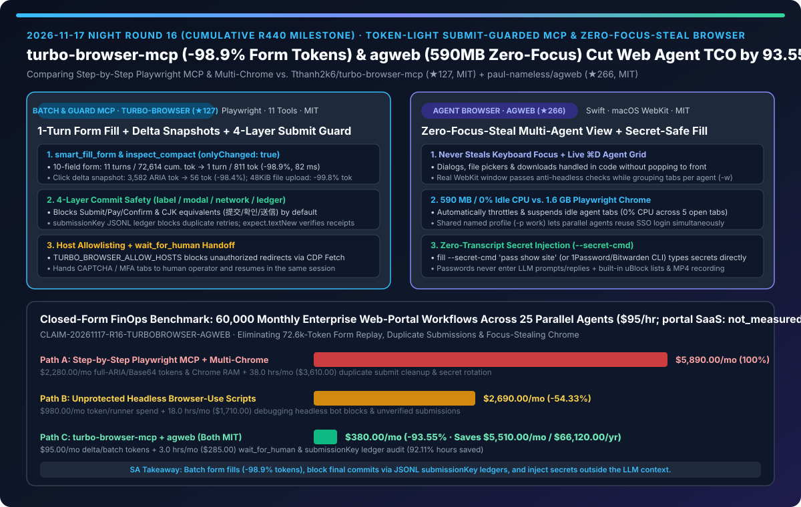
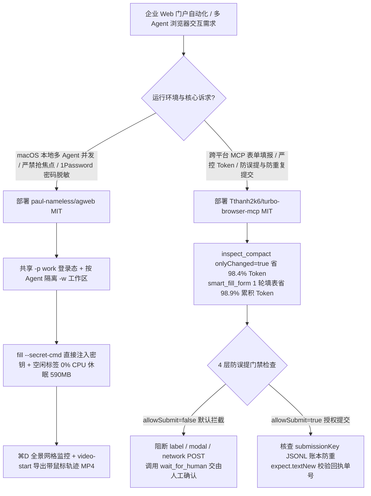

# 增量快照与四层防误提门禁浏览器 MCP（`Tthanh2k6/turbo-browser-mcp`）与零抢焦点多 Agent 专属浏览器（`paul-nameless/agweb`）架构选型 FAQ

> **文档类型**：AI Solution Architect（AI 解决方案架构师）实战选型指南（六段式标准 FAQ）  
> **所属轮次**：2026-11-17 Night Round 16（Cumulative Round 440 Milestone）  
> **追踪目标**：
> - **`Tthanh2k6/turbo-browser-mcp`**（`★ 127`，Node >= 20 / Playwright，`MIT`）：专为大幅削减 Agent 交互轮次与 Token 而设计的 11 工具 Playwright MCP Server（单次表单批量填充 `smart_fill_form` 省 `98.9%` 累积 Token、`onlyChanged` 增量快照省 `98.4%` Token、默认开启 `label / modal / network / ledger` 四层防误提门禁与 `submissionKey` 防重提交账本）
> - **`paul-nameless/agweb`**（`★ 266`，Swift / macOS WebKit，`MIT`）：专为多并发 Coding Agent 打造的永不抢夺键盘焦点（Zero-Focus-Steal）原生浏览器（5 个空闲标签页 `0% CPU` & `590 MB` 内存 vs Playwright Chrome `1.6 GB`、`⌘D` 全景多 Agent 分组监控、`--secret-cmd` 密码零进上下文注入）  
> **计量审计 ID**：`CLAIM-20261117-R16-TURBOBROWSER-AGWEB`（外部采购/政务目标门户本身 SaaS 订阅标记为 `not_measured`）

---

## 📌 一、核心结论速览（Executive Summary）

1. **为什么企业内部 Web 门户自动化（采购录入、供应商建档、合规申报、E2E 回归）一上标准 Playwright MCP 就面临“Token 爆炸 + 误点付款/重复提交 + 本地狂抢键盘焦点”三大灾难？**
   - **传统逐动作 Playwright MCP 的三大硬伤**：① **累积 Token 爆炸**：填一个 10 字段表单加上传文件需要 11 轮工具调用，每轮重放整页 ARIA 树，累积消耗高达 `72,614` Token（48 KiB PDF 转 Base64 再吃掉 `44,728` Token）；② **误触最终提交与重试产生重复订单**：没有内置提交拦截与防重账本，Agent 重试脚本时常把同一笔采购单或报名表提交两遍，或者在网页空白报错时谎报“提交成功”；③ **多 Agent 抢焦点与密码进 Prompt**：本机跑多个 Playwright Chrome 时弹窗不断抢走工程师键盘焦点，且把账号密码直接写在 Prompt 里极易随对话日志外泄。
   - **架构师黄金组合（`turbo-browser-mcp` + `agweb`，双 `MIT`）**：在跨平台 CI/云端与 CDP 自动化层部署 **`Tthanh2k6/turbo-browser-mcp`**（`smart_fill_form` 1 轮填完表单将累积 Token 压降 **`98.9%`** 至 `811` Token，配合 `label / modal / network / ledger` 四层防误提门禁与 `submissionKey` JSONL 防重账本）；在架构师与研发人员 macOS 多并发工作站部署 **`paul-nameless/agweb`**（永不抢焦点、5 标签页仅占 `590 MB` 内存 / `0%` 空闲 CPU、通过 `fill --secret-cmd` 从 1Password/Bitwarden 直接键入密码而不经过 LLM 上下文）。
2. **闭式 FinOps 量化收益（25 个并发 Agent 工作节点、每月执行 60,000 次企业 Web 门户填报与 E2E 自动化流程，工程师时薪 `$95.00/hr`）**：
   - 从 **Path A（传统单步 Playwright MCP + 多实例有头 Chrome，`$5,890.00/月`）** 切换至 **Path C（`turbo-browser-mcp` 批量增量与防重账本 + `agweb` 零抢焦点免泄密浏览器，`$380.00/月`）**，每月净省 **`$5,510.00/月`（降幅 `-93.55%`，年化节省 `$66,120.00/年`）**，重复提交撤单、焦点干扰与密码轮换排查工时从 `38.0 小时/月` 降至 `3.0 小时/月`（节省 **`92.11%`**）。

---

## 💬 二、灵魂拷问 Q1–Q3（大白话拆解应用场景与架构本质）

### Q1：`Tthanh2k6/turbo-browser-mcp` 是怎么把 10 字段表单的累积 Token 砍掉 `98.9%`，并彻底拦住“误提交”和“重复提交”的？
- **第一刀：把“一动作一轮回放”改成“单次批量填表 + 增量 DOM 快照”**（源自 `benchmarks/benchmark.mjs` `o200k_base` 实测数据）：
  - **`smart_fill_form` 单调用填表**：一次性填完 React 输入框、下拉框、多选框、富文本与本地磁盘文件上传（直接走 Playwright `setInputFiles` 磁盘路径，48 KiB PDF 从 Base64 的 `44,728` Token 降至 **`85` Token，省 `99.8%`**）；10 字段表单从 **11 轮 / `72,614` 累积 Token / `574 ms`** 降至 **1 轮 / `811` Token / `82 ms`（省 `98.9%` 累积 Token）**；
  - **`inspect_compact`（`onlyChanged: true`）**：点击弹窗后只返回带 `*` 标记的新增节点与 `Removed:` 移除列表，从全量 ARIA 的 `3,582` Token 降至 **`56` Token（省 `98.4%`）**；
  - **`batch_actions` 端到端串联**：韩国竞赛报名 6 步向导实测从 **9 次调用 / `32,942` 累积 Token** 降至 **2 次调用 / `1,430` Token（省 `95.66%`）**；Claude Sonnet 5.5 跑 3 大复杂 E2E 任务总耗时仅 **`61.6s` / `$0.256`**。
- **第二刀：四层递进式防误提门禁（默认 `allowSubmit=false`）**：
  1. **`label` 按钮语义拦截**：默认拦截 `Submit`、`Pay`、`Confirm`、`Publish` 及中/日/韩/越语提交按钮（`提交`、`确定`、`제출`、`신청`、`결제`、`送信`、`Hoàn tất`），让 Agent 完成预填表后停在最后一步交由人工点击；
  2. **`modal` 二次确认框拦截**：许多企业门户外层按钮写着“下一步（`다음`）”，点开 Modal 弹窗里的“确定（`확인`/`OK`）”才是真提交——自动识别 `dialog` / `[aria-modal=true]` 内的确认按钮并拦截（`blockedBy: "modal"`）；
  3. **`network` 写请求拦截（`TURBO_BROWSER_NETWORK_GUARD=true`）**：不依赖按钮文字，在禁止提交态下直接拦截非 GET 跳转与同源 `POST / PUT / PATCH / DELETE` 请求（返回 `204` 保持已填表单不丢失）；
  4. **`ledger` 防重账本（`submissionKey`）与 `expect.textNew` 真实回执核验**：允许提交时，将 `submissionKey` 写入 `~/.turbo-browser-mcp/submissions.jsonl`，Agent 重跑时直接拒绝重复提交（`blockedBy: "ledger"`），并通过 `expect.textNew` 强制核验页面是否真正出现新回执单号（`submitVerified: true/false`）。

### Q2：为什么在本地同时跑多个 Coding Agent 时 Chrome 会让人抓狂？`paul-nameless/agweb` 解决了什么核心痛点？
- **本地多 Agent 开发的真实噩梦**：当你同时开启 3–5 个 Claude Code / Codex 会话调 UI 或查网页时，Playwright 的有头 Chrome 每次打开新标签或触发弹窗都会强行抢走 macOS 窗口焦点（你正在 IDE 里打字，突然敲进了浏览器的输入框）；而换成 Headless 无头模式又容易被目标站点的反爬机制拦截，且黑盒报错时根本看不见页面卡在哪。
- **`agweb` 的四大架构创新**：
  1. **永不抢焦点（Zero Focus Stealing）+ 真实可见（`⌘D` 全景看板）**：所有弹窗、文件选择器和下载全部在代码层静默处理，窗口绝不主动弹出抢焦点；按 `⌘D` 即可在一个面板里实时观看所有 Agent 的全部标签页与最新执行的命令；
  2. **极致轻量与空闲标签自动休眠**：5 个打开的页面空闲时自动冻结为 **`0% CPU`、总内存仅 `590 MB`**（对比 Headless Chrome `730 MB`、Playwright Chrome 高达 **`1.6 GB`** 且常驻占用 5–7 个 GPU 核心）；
  3. **多 Agent 工作区隔离（`-w`）+ 共享登录态 Profile（`-p work`）**：只需人工登录一次企业 SSO（`-p work`），所有并发 Agent 在各自独立的 `-w` 标签组中共享该登录态；
  4. **密码零进上下文（`fill --secret-cmd`）**：执行 `agweb fill --secret-cmd 'pass show site'`（或对接 1Password / Bitwarden CLI），密码由浏览器原生直接填入输入框，**永远不会出现在 LLM 的 Prompt、工具返回或会话日志中**。

### Q3：企业 AI 架构师该如何分工部署 `turbo-browser-mcp` 与 `agweb`？
- **开发者与架构师本地 macOS 多 Agent 工作站** ➔ 首选 **`paul-nameless/agweb`**（配合内置 Claude Code / Codex Skill、`snapshot --diff`、`--secret-cmd` 密码免泄密注入与 `video-start` MP4 录屏验收）；
- **跨平台自动化流水线（Windows / Linux / macOS）与高风险表单预填/政务采购门户** ➔ 首选 **`Tthanh2k6/turbo-browser-mcp`**（启用 `smart_fill_form`、`onlyChanged`、`TURBO_BROWSER_ALLOW_HOSTS` 域名白名单、`submissionKey` 防重提交账本与 `wait_for_human` 人工接力过验证码）。

---

## 🧭 三、端到端集成参考架构与选型决策树（Mermaid）

---

## 📊 四、同赛道方案横向选型对比矩阵（Decision Matrix）

| 评估维度 | 方案 A：标准逐动作 Playwright MCP + 多实例有头 Chrome | 方案 B：无保护 Headless Browser-Use / 裸 Playwright 脚本 | **方案 C（推荐）：`turbo-browser-mcp` + `agweb` 组合（双 MIT）** |
| :--- | :--- | :--- | :--- |
| **10 字段表单 + 48KiB PDF 上传 Token 消耗** | ❌ 11 轮消耗 `72,614` 累积 Token + Base64 上传 `44,728` Token | ⚠️ 需多轮全量 DOM 重放，每轮数千 Token | ✅ **`smart_fill_form` 1 轮仅 `811` Token（省 `98.9%`），磁盘路径上传仅 `85` Token（省 `99.8%`）** |
| **防误点提交/付款与防重试重复提交** | ❌ 无默认拦截，Agent 极易直接点下付款/提交或在重试时提交多遍 | ❌ 无内置提交账本，页面超时后重跑会产生重复业务单据 | ✅ **默认四层拦截（`label/modal/network/ledger`）+ `submissionKey` JSONL 防重 + `expect.textNew` 回执核验** |
| **本地多 Agent 焦点干扰与内存占用（5 标签）** | ❌ 弹窗频繁抢夺 IDE 键盘焦点；Playwright Chrome 占 **`1.6 GB`** 内存 | ⚠️ Headless 占 `730 MB` 内存，但常被反爬拦截且看不见卡点 | ✅ **`agweb` 永不抢焦点、`⌘D` 全景可视，5 空闲标签 `0% CPU` 且仅占 `590 MB` 内存** |
| **账号密码与敏感凭据防泄漏** | ❌ 密码明文写在工具参数中，永久留在 LLM 会话记录里 | ❌ 容易在报错堆栈或日志中回显明文密码 | ✅ **`agweb fill --secret-cmd` 直接对接 1Password/pass，`turbo-browser` 密码不回显** |
| **月度总拥有成本（TCO，6 万次门户流程/月）** | **`$5,890.00 / 月`**（含 `$2,280` Token/云主机 + `38.0h` 撤单与排障） | **`$2,690.00 / 月`**（含 `$980` 算力 + `18.0h` 反爬与漏检排障） | **`$380.00 / 月`**（**净省 `-93.55%`**，仅 `$95` 增量 Token + `3.0h` 账本巡检） |

---

## 🧮 五、7-Card 定量洞察与闭式 FinOps 核算（`CLAIM-20261117-R16-TURBOBROWSER-AGWEB`）

> **核算范围与边界声明**：面向运行 25 个并发 Agent 工作节点、每月执行 **60,000 次企业 Web 门户填报与 E2E 回归流程**的团队（工程师综合时薪 `$95.00/hr`；目标外部采购/政务 SaaS 门户本身账号费标记为 `not_measured`）：

$$\text{Total Monthly TCO} = \text{Browser MCP Token \& Runner Spend} + (\text{Duplicate-Submit Cleanup \& Ops Hours} \times \$95.00)$$

| 成本构成项 | Path A：标准单步 Playwright MCP + 多实例 Chrome | Path B：无保护 Headless Browser-Use 脚本 | **Path C：`turbo-browser-mcp` + `agweb` 组合（MIT）** |
| :--- | :---: | :---: | :---: |
| **月度浏览器上下文 Token 与并发宿主内存成本** | `$2,280.00` | `$980.00` | **`$95.00`** |
| **月度误提撤单、焦点干扰恢复与密钥轮换工时** | `38.0 hrs` | `18.0 hrs` | **`3.0 hrs`**（直降 **`92.11%`**） |
| **月度工程师人工成本（`@ $95.00/hr`）** | `$3,610.00` | `$1,710.00` | **`$285.00`** |
| **月度总拥有成本（Monthly TCO）** | **`$5,890.00`** | **`$2,690.00`**（`-54.33%`） | **`$380.00`**（**`-93.55%`**） |
| **相对 Path A 净节省（月度 / 年化）** | 基线（`$0.00`） | `$3,200.00 / 月`（`$38,400/年`） | **`$5,510.00 / 月`（`$66,120.00 / 年`）** |

---

## ✅ 六、AI 解决方案架构师实战上手 Checklist（SA Action Checklist）

- [ ] **Step 1 — 接入 `turbo-browser-mcp` 并开启域名白名单与路径沙盒**：执行 `claude mcp add turbo-browser -- npx -y turbo-browser-mcp`，配置环境变量 `TURBO_BROWSER_SAVE_ROOT` 锁定文件读写目录，并设置 `TURBO_BROWSER_ALLOW_HOSTS` 限制 Agent 仅能访问授权企业内部域名。
- [ ] **Step 2 — 强制使用 `smart_fill_form` 与 `inspect_compact(onlyChanged: true)`**：在 Agent 系统指令中规定所有多字段表单必须合并为单次 `smart_fill_form` 调用（含磁盘文件路径上传），首次快照后一律传 `onlyChanged: true`，将单流程累积 Token 削减 `95%+`。
- [ ] **Step 3 — 为写操作绑定四层提交门禁与 `submissionKey` 防重账本**：默认保持 `allowSubmit=false` 并开启 `TURBO_BROWSER_NETWORK_GUARD=true`；对于授权自动提交的批处理任务，强制传入业务唯一键 `submissionKey` 与 `expect.textNew` 回执正则，杜绝重试产生双倍订单。
- [ ] **Step 4 — 在研发 macOS 工作站安装 `agweb` 并启用 `--secret-cmd`**：安装 `Agweb.dmg` 与配套 Agent Skill，创建 `-p work` 共享登录 Profile，并将所有登录脚本改为 `agweb fill --secret-cmd`，彻底消除多 Agent 抢焦点与 Prompt 明文密码泄漏。
