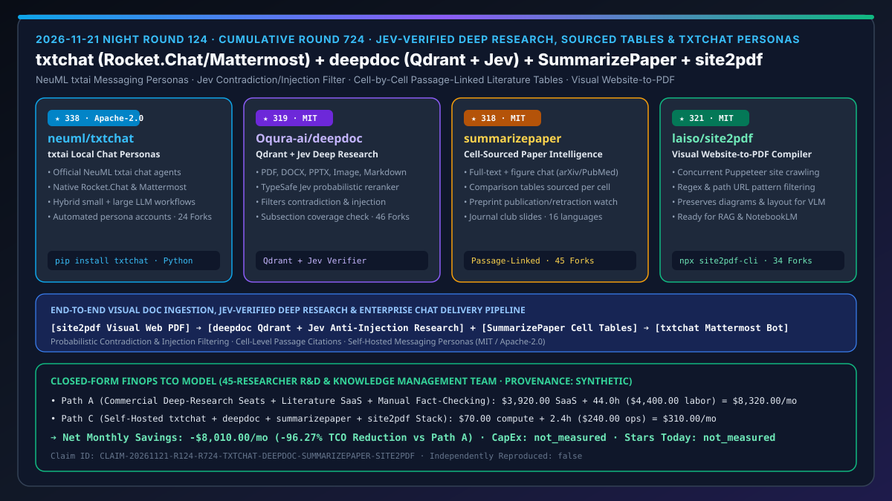
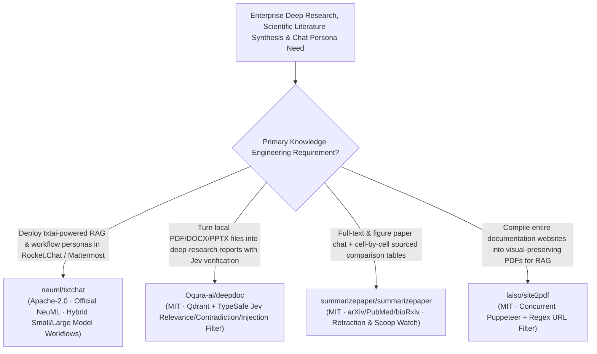
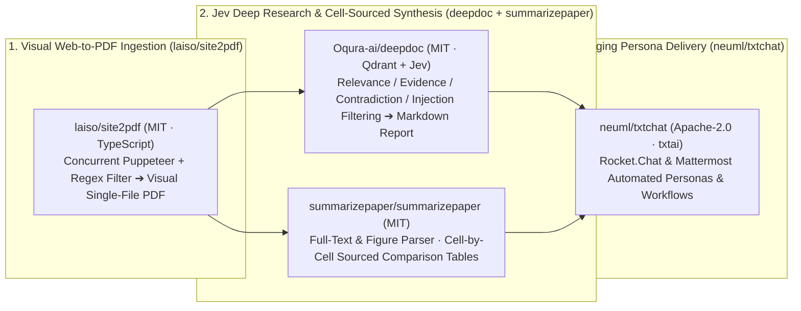

# Local Messaging Personas (`neuml/txtchat`), Jev-Verified Local Deep Research (`Oqura-ai/deepdoc`), Cell-Sourced Paper Comparison Suite (`summarizepaper/summarizepaper`) & Visual Website-to-PDF RAG Compiler (`laiso/site2pdf`) Selection & Architecture FAQ

> **Document Type**: Enterprise AI Solution Architect Selection & Integration Guide (GitHub Trending AI Radar — 2026-11-21 Night Round 124 / Cumulative Round 724)
> **Covered Repositories**: [`neuml/txtchat`](https://github.com/neuml/txtchat) (`★ 338`, `24 forks`, `Apache-2.0` — NeuML's `txtai`-powered local chat personas & RAG workflows for Rocket.Chat and Mattermost) · [`Oqura-ai/deepdoc`](https://github.com/Oqura-ai/deepdoc) (`★ 319`, `46 forks`, `MIT` — local deep-research engine using Qdrant + TypeSafe's `Jev` probabilistic model for relevance reranking, contradiction checks, prompt-injection filtering & section coverage validation) · [`summarizepaper/summarizepaper`](https://github.com/summarizepaper/summarizepaper) (`★ 318`, `45 forks`, `MIT` — full-text & figure research platform for arXiv/bioRxiv/medRxiv/PubMed with cell-by-cell passage-linked comparison tables, retraction/publication alerts & journal club slides) · [`laiso/site2pdf`](https://github.com/laiso/site2pdf) (`★ 321`, `34 forks`, `MIT` — concurrent Puppeteer crawler compiling entire documentation sites with preserved visuals into single PDFs for RAG & NotebookLM)
> **Core Scenario**: How enterprise R&D, technical strategy, and knowledge management teams build a high-trust private research pipeline: **compiling multi-page documentation websites with intact diagrams into single PDFs (`site2pdf`)**, **running local deep research over PDF/DOCX/PPTX corpora with `Jev` probabilistic contradiction and prompt-injection filtering (`deepdoc`)**, **generating cell-by-cell passage-sourced literature comparison matrices (`summarizepaper`)**, and **publishing interactive `txtai` personas into Rocket.Chat and Mattermost (`txtchat`)**.

---

## 1. 📌 Executive Summary (One-Line Selection Verdict)

1. **Need self-hosted AI personas inside Rocket.Chat or Mattermost powered by `txtai` semantic search and hybrid small/large model workflows** ➔ Choose **[`neuml/txtchat`](https://github.com/neuml/txtchat) (`★ 338`, `24 forks`, `Apache-2.0`)**.
   - **Plain-English Mechanism**: Built by NeuML (creators of `txtai`), `txtchat` binds an intelligent persona (a chat agent + a `txtai` embeddings/workflow pipeline) to an automated messaging account in **Rocket.Chat** or **Mattermost**, enabling teams to query local knowledge bases and trigger multi-model workflows directly from enterprise chat channels.
2. **Need a local Deep Research engine over private PDF, DOCX, PPTX, image, TXT, and Markdown files that uses a dedicated probabilistic verifier (`Jev`) to filter contradictions and document-embedded prompt injections before synthesis** ➔ Choose **[`Oqura-ai/deepdoc`](https://github.com/Oqura-ai/deepdoc) (`★ 319`, `46 forks`, `MIT`)**.
   - **Plain-English Mechanism**: Indexes local files with page/source metadata into **Qdrant**, generates an approvable report outline, and spawns one research agent per section. Crucially, it uses **TypeSafe's `Jev` probabilistic model** to score Qdrant chunks for **relevance, usable evidence, contradiction, and prompt-injection-like content**, and verifies whether collected evidence covers every required subsection before the generative LLM writes the report.
3. **Need an R&D literature workspace (`arXiv`, `bioRxiv`, `medRxiv`, `PubMed`, `Europe PMC`, `HAL`, `OSF`) that reads full text and figures, anchors every claim to its exact passage, builds cell-by-cell sourced comparison tables, and alerts on retractions or publications** ➔ Choose **[`summarizepaper/summarizepaper`](https://github.com/summarizepaper/summarizepaper) (`★ 318`, `45 forks`, `MIT`)**.
   - **Plain-English Mechanism**: Reads full-text papers (under CC BY / CC0 licenses) and figures across 16 languages, linking every answer and **every cell of its multi-paper comparison tables** directly to the supporting passage. Includes daily digests, scoop watch, preprint-to-journal publication/retraction tracking, and journal club slide generation.
4. **Need a fast CLI (`npx site2pdf-cli <url> [regex]`) that crawls an entire documentation website concurrently and compiles all pages—with images and visual formatting preserved—into a single PDF for multimodal RAG or NotebookLM** ➔ Choose **[`laiso/site2pdf`](https://github.com/laiso/site2pdf) (`★ 321`, `34 forks`, `MIT`)**.
   - **Plain-English Mechanism**: Uses concurrent Puppeteer rendering and regex URL filtering to capture multi-page documentation sites into a single portable `./out/<domain>.pdf` without stripping architecture diagrams or visual layouts.

---

## 2. 🎯 Architect & Customer Deep-Dive Q&A

### Q1: Why do naive Agentic RAG pipelines suffer from section omissions, cross-paper hallucinations, and indirect prompt injection—and how does this four-project stack solve them?

- **Three Structural Breakthroughs**:
  1. **Probabilistic Evidence & Injection Gating (`Oqura-ai/deepdoc`)**: Instead of letting a generative LLM blindly trust retrieved chunks, `deepdoc` uses **TypeSafe's `Jev` model** probabilities in Python to explicitly filter out prompt-injection-like chunks, flag contradictions, and verify subsection coverage before synthesis.
  2. **Cell-by-Cell Passage Grounding (`summarizepaper/summarizepaper`)**: Multi-document synthesis often conflates metrics across papers. `summarizepaper` enforces a **source passage link per table cell** and monitors preprints for formal publication or retraction.
  3. **Visual-Preserving Ingestion & Chat-Native Delivery (`laiso/site2pdf` + `neuml/txtchat`)**: `site2pdf` preserves visual diagrams when ingesting web documentation into PDFs, and `txtchat` exposes the resulting `txtai` knowledge index inside Rocket.Chat and Mattermost.
- **When to Choose Managed Cloud Services (Path B)**:
  - For organizations standardized on Microsoft 365 cloud storage without air-gapped requirements, **Microsoft 365 Copilot Researcher + Azure AI Search** provides turnkey cloud integration.

### Q2: How do we wire an end-to-end Enterprise Deep Research & Literature Intelligence architecture?

1. **Visual Web Documentation Compiler Layer (`laiso/site2pdf`)**:
   - Run `npx site2pdf-cli` with regex URL patterns to compile external/internal documentation sites into visual-preserving PDFs.
2. **Qdrant + `Jev` Probabilistic Deep Research Layer (`Oqura-ai/deepdoc`)**:
   - Ingest PDFs, DOCX, PPTX, and images into Qdrant; approve the planner's report outline; let section agents query Qdrant while `Jev` scores relevance, contradictions, injection risk, and subsection coverage.
3. **Full-Text Scientific & Preprint Intelligence Layer (`summarizepaper/summarizepaper`)**:
   - Parse arXiv/PubMed/bioRxiv papers and figures into cell-by-cell sourced comparison tables, literature reviews, and retraction watches.
4. **Enterprise Messaging Persona Delivery Layer (`neuml/txtchat`)**:
   - Expose the synthesized reports and `txtai` semantic workflows as interactive personas inside **Rocket.Chat** and **Mattermost**.

### Q3: What are the boundaries and operational requirements of this stack?

- **Key Strengths**:
  - **100% Permissive Open Source (`MIT` and `Apache-2.0`)**.
  - **Explicit Anti-Injection & Contradiction Scoring**: `deepdoc`'s `Jev` verifier prevents poisoned PDFs from hijacking deep-research reports.
- **Operational Boundaries**:
  - `laiso/site2pdf` requires Node.js `v22.12+` and headless Chromium system libraries (`libnss3`, `libgbm1`) when running in Linux containers.

---

## 3. 🧭 Visual Architecture & Decision Diagrams



### 3.1 Solution Architect Selection Decision Tree



### 3.2 End-to-End Enterprise Reference Architecture



### 3.3 Site2PDF Compilation, Qdrant + `Jev` Deep Research, Sourced Table Generation & Mattermost Delivery Sequence

```mermaid
sequenceDiagram
    participant Analyst as R&D / Strategy Architect
    participant S2P as laiso/site2pdf (Puppeteer CLI)
    participant DD as Oqura-ai/deepdoc (Qdrant + Jev)
    participant SP as summarizepaper (Sourced Tables)
    participant Chat as neuml/txtchat (Rocket.Chat / Mattermost)

    Analyst->>S2P: 1. Run npx site2pdf-cli with regex filter to compile vendor docs into a visual PDF
    S2P->>DD: 2. Index PDF/DOCX/PPTX chunks with page metadata into Qdrant & approve report outline
    DD->>DD: 3. Section agents retrieve chunks; Jev filters contradictions/injections & checks coverage
    Analyst->>SP: 4. Generate cell-by-cell passage-linked comparison table across arXiv/PubMed papers
    DD-->>Chat: 5. Sync verified Markdown report & comparison tables into txtai index
    Chat-->>Analyst: 6. Answer team queries inside Rocket.Chat / Mattermost via txtchat Persona
```

---

## 4. 📊 Peer Open-Source vs Commercial Cloud Selection Matrix

| Dimension | `neuml/txtchat` (`★ 338`) | `Oqura-ai/deepdoc` (`★ 319`) | `summarizepaper` (`★ 318`) | `laiso/site2pdf` (`★ 321`) | Commercial Deep-Research & Literature SaaS (Path A) | Cloud Office Built-In Search (Path B) |
| :--- | :--- | :--- | :--- | :--- | :--- | :--- |
| **Core Role** | Rocket.Chat & Mattermost `txtai` personas | Qdrant + `Jev` verified local deep research | Full-text paper chat & cell-sourced tables | Concurrent visual website-to-PDF compiler | Per-seat commercial deep research & literature SaaS | M365 Copilot / Google NotebookLM |
| **Architectural Edge** | **Official NeuML `txtai` personas for self-hosted enterprise IM** | **`Jev` probabilistic filtering of contradictions & prompt injections** | **Passage link per comparison cell + retraction alerts** | **Preserves diagrams & formatting across whole doc sites** | Uploads sensitive R&D docs to 3rd-party clouds; high per-seat fees | Cannot embed in self-hosted Mattermost or customize `Jev` thresholds |
| **License** | `Apache-2.0` | `MIT` | `MIT` | `MIT` | Proprietary SaaS | Proprietary Cloud PaaS |
| **Monthly TCO (45-Eng Team)** | **`$310.00/mo` combined** (`$70.00` compute + `2.4h` ops) | Included in `$310.00/mo` stack | Included in `$310.00/mo` stack | Included in `$310.00/mo` stack | **`$8,320.00/mo`** (`$3,920.00` SaaS + `44.0h` manual fact-checking) | `~$2,700.00/mo` (45 enterprise AI seats) |

---

## 5. 🧪 Quantitative ROI / FinOps TCO Model & 7-Card Report

> **📊 Provenance & Closed-Form Audit Declaration**:
> - **Provenance**: `synthetic` (45-researcher/engineer enterprise R&D & knowledge engineering workload model; `independently_reproduced = false`; `base_hardware_capex = not_measured`; `track_b_stars_today = not_measured`).
> - **Closed-Form Equations**:
>   - **Path A (Commercial Enterprise Deep-Research Seats + Commercial Scientific Literature SaaS + Web Crawling APIs + Manual Citation Verification & Table Compilation Labor)**: Monthly SaaS & crawler subscriptions **`$3,920.00`** + manual citation auditing & report synthesis labor **`44.0h × $100.00/h = $4,400.00`** = **`$8,320.00/mo`**.
>   - **Path C (Self-Hosted `neuml/txtchat` + `Oqura-ai/deepdoc` + `summarizepaper/summarizepaper` + `laiso/site2pdf`)**: Shared Qdrant & local model compute **`$70.00`** + corpus indexing & persona maintenance **`2.4h × $100.00/h = $240.00`** = **`$310.00/mo`**.
>   - **Net Savings vs Path A**: **`-$8,010.00/mo`** (**`96.27%`** cost reduction).

| Architecture Option | API / SaaS / Compute | R&D Verification & KM Labor (`$100/h`) | Total Monthly TCO | Net Savings vs Path A | Key Architectural Outcome |
| :--- | :---: | :---: | :---: | :---: | :--- |
| **Path A: Commercial Deep-Research SaaS + Manual Fact-Checking** | `$3,920.00` | `44.0h` (`$4,400.00`) | **`$8,320.00`** | Baseline | Confidential R&D docs leave premises; manual table audits |
| **Path B: Cloud Office AI Seats + Basic Vector Chunking** | `$1,500.00` | `12.0h` (`$1,200.00`) | **`$2,700.00`** | `-$5,620.00` (`-67.55%`) | Lacks `Jev` contradiction/injection filter & cell-sourced tables |
| **Path C: `txtchat` + `deepdoc` + `summarizepaper` + `site2pdf`** | **`$70.00`** | **`2.4h` (`$240.00`)** | **`$310.00`** | **`-$8,010.00` (`-96.27%`)** | **`Jev` 4-axis verification + cell-sourced tables + Mattermost bots** |

- 🔗 **7-Card 4:5 Visual Report**: [`workshops/github-trending-radar/cards.en.html`](../cards.en.html) · [`cards.html`](../cards.html)

---

## 6. 🛠️ Enterprise Adoption & Architecture Review Checklist

- [ ] **1. Compile Multi-Page Web Docs with `laiso/site2pdf`**: Use regex URL filtering (`npx site2pdf-cli`) to convert target documentation sites into visual-preserving single PDFs.
- [ ] **2. Gate Local Deep Research with `Oqura-ai/deepdoc` (`Qdrant + Jev`)**: Require outline approval and let `Jev` filter contradictions, irrelevant chunks, and prompt-injection patterns before report synthesis.
- [ ] **3. Build Cell-by-Cell Sourced Literature Tables with `summarizepaper`**: Parse full-text arXiv/PubMed/bioRxiv papers and figures with per-cell passage links and retraction alerts.
- [ ] **4. Publish `txtai` Knowledge Personas via `neuml/txtchat`**: Connect verified reports and `txtai` workflows to self-hosted Rocket.Chat or Mattermost channels.
