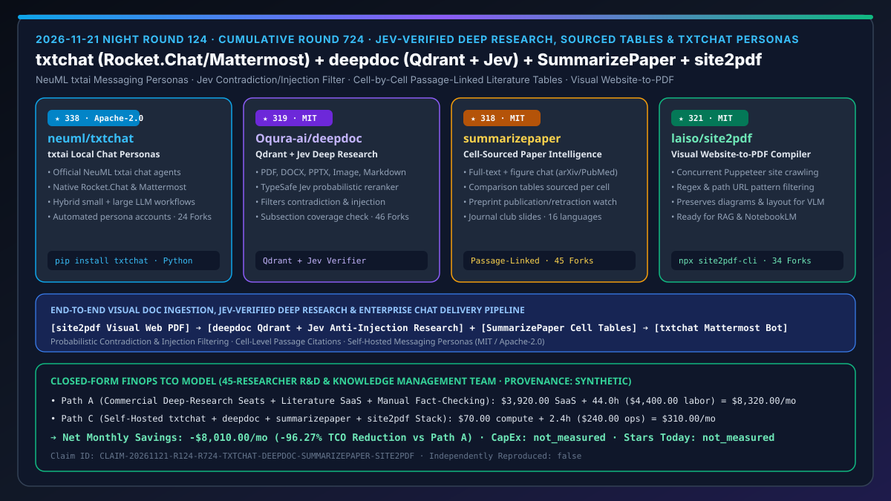
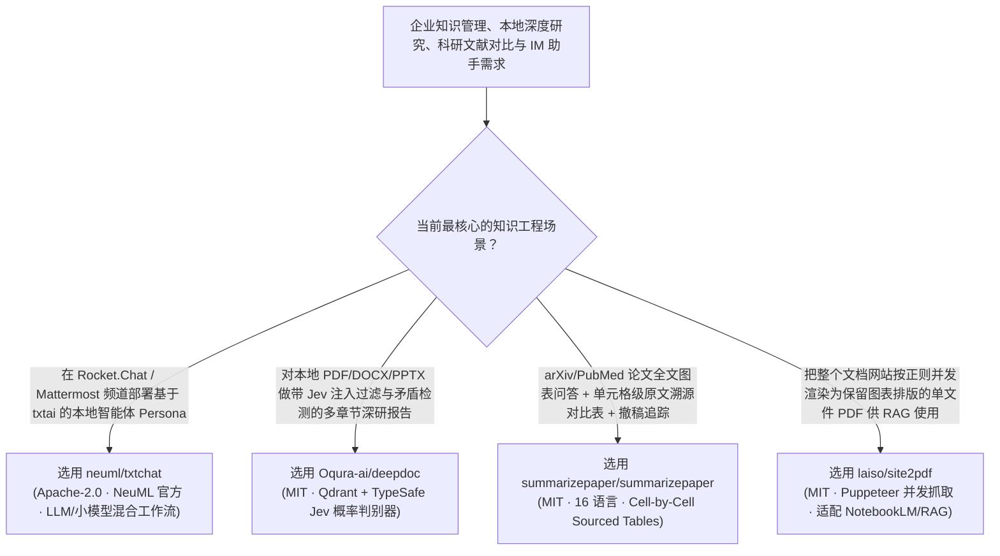
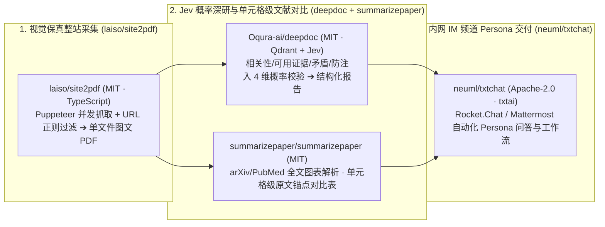
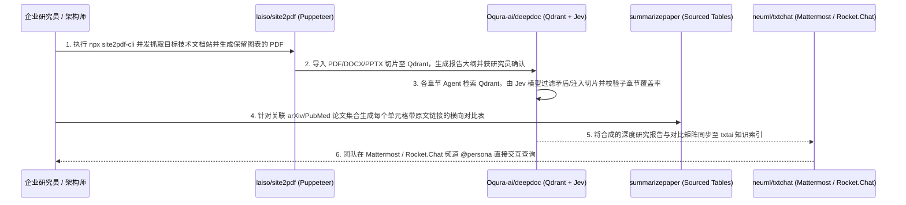

# Rocket.Chat/Mattermost 本地知识库助手（`neuml/txtchat`）、带 Jev 概率判别器的本地深度研究引擎（`Oqura-ai/deepdoc`）、单元格级溯源科研文献对比工作台（`summarizepaper/summarizepaper`）与多模态保真整站转 PDF 工具（`laiso/site2pdf`）选型与集成架构 FAQ

> **文档类型**：企业 AI 解决方案架构师（AI Solution Architect）选型决策指南（GitHub Trending AI 雷达 2026-11-21 Night Round 124 / 累计第 724 轮）
> **覆盖项目**：[`neuml/txtchat`](https://github.com/neuml/txtchat)（`★ 338`、`24 forks`、`Apache-2.0`，由 `txtai` 官方团队打造、原生对接 Rocket.Chat 与 Mattermost 的本地 RAG 与工作流聊天机器人Persona框架）· [`Oqura-ai/deepdoc`](https://github.com/Oqura-ai/deepdoc)（`★ 319`、`46 forks`、`MIT`，基于 Qdrant 与 TypeSafe `Jev` 概率模型执行相关性重排、矛盾检测、提示词注入过滤与章节证据覆盖度校验的本地深度研究工具）· [`summarizepaper/summarizepaper`](https://github.com/summarizepaper/summarizepaper)（`★ 318`、`45 forks`、`MIT`，支持 arXiv/bioRxiv/medRxiv/PubMed 全文及图表解析、每个单元格带原文段落链接的跨论文对比表与撤稿/发表追踪系统）· [`laiso/site2pdf`](https://github.com/laiso/site2pdf)（`★ 321`、`34 forks`、`MIT`，基于 Puppeteer 并发抓取整站文档并保留完整图表排版生成单文件 PDF 的多模态 RAG/NotebookLM 预处理工具）
> **核心场景**：当企业研发研究院、医药/金融投研团队与内部知识管理（KM）部门建设私有知识库与深度研究系统时，如何打通**“外部/内网文档站并发抓取保留图表转 PDF（`site2pdf`）”➔“本地多格式文档经 Qdrant + `Jev` 概率模型过滤注入与矛盾后生成深度研究报告（`deepdoc`）”➔“学术/专利文献库生成单元格级原文溯源对比表（`summarizepaper`）”➔“通过 `txtai` Persona 机器人发布到 Rocket.Chat / Mattermost 团队频道（`txtchat`）”**的全链路知识工程架构？

---

## 一、📌 核心结论速览（选型一句话结论）

1. **想在企业自建的 Rocket.Chat 或 Mattermost 即时通讯频道里直接挂载基于 `txtai` 语义索引与大小模型混合工作流的本地知识助手（Personas）** ➔ 选 **[`neuml/txtchat`](https://github.com/neuml/txtchat)（`★ 338`，`24 forks`，`Apache-2.0`）**。
   - **通俗原理**：由知名开源向量引擎 `txtai` 团队（NeuML）官方出品。它将“一个聊天 Agent + 一套 `txtai` 知识检索/工作流 YAML”封装为一个 **Persona（数字员工账号）**，原生接入 Rocket.Chat 与 Mattermost，让团队成员在群聊里 `@persona` 即可触发本地 RAG 检索与自动化任务。
2. **想对本地保密文件夹（PDF / DOCX / PPTX / 图片 / Markdown）做多章节深度研究（Deep Research），并用专门的概率判别模型过滤掉无关切片、前后矛盾证据与文档内藏的 Prompt Injection** ➔ 选 **[`Oqura-ai/deepdoc`](https://github.com/Oqura-ai/deepdoc)（`★ 319`，`46 forks`，`MIT`）**。
   - **通俗原理**：传统 Deep Research 完全依赖大模型自己判断检索结果好不好，既贵又容易被投毒。`deepdoc` 将本地文档切分存入 **Qdrant**，先生成可人工审批的报告大纲，再为每个小节启动独立 Research Agent，并引入 **TypeSafe `Jev` 概率模型**对 Qdrant 召回切片做四重显式概率校验：**相关性（Relevance）、可用证据（Usable Evidence）、前后矛盾（Contradiction）与类提示词注入内容（Prompt-Injection-like Content）**，确认证据覆盖全部子章节后再交给生成式大模型撰写终稿。
3. **想为研发或医药/AI 团队搭建一套能读懂 arXiv / bioRxiv / medRxiv / PubMed 论文全文与插图、生成“每个单元格都带原文段落锚点链接的跨论文对比矩阵”并自动追踪预印本正式发表/撤稿状态的科研情报系统** ➔ 选 **[`summarizepaper/summarizepaper`](https://github.com/summarizepaper/summarizepaper)（`★ 318`，`45 forks`，`MIT`）**。
   - **通俗原理**：支持 16 种语言的科研文献全生命周期平台。它在开放协议（CC BY / CC0）下直接解析论文全文与配图，确保每一句结论都锚定到原文具体段落；其最具杀伤力的功能是 **Collections 单元格级溯源对比表（Sourced Comparison Table）**、预印本转正/撤稿邮件提醒（Scoop Watch）以及一键生成组会幻灯片（Journal Club Slides）。
4. **想把几十页的在线技术文档站或竞品官网连同里面的架构图、表格一起并发抓取合并成一份高保真 PDF，直接喂给 `deepdoc`、Google NotebookLM 或多模态 RAG** ➔ 选 **[`laiso/site2pdf`](https://github.com/laiso/site2pdf)（`★ 321`，`34 forks`，`MIT`）**。
   - **通俗原理**：一行命令 `npx site2pdf-cli <main_url> [url_pattern]`，基于 Puppeteer 并发渲染匹配的同域或正则路径网页，完整保留页面中的架构图、代码高亮与排版视觉信息，输出单文件 `./out/<domain>.pdf`。

---

## 二、🎯 客户与架构师灵魂拷问 Q&A（深度架构拆解）

### Q1：为什么企业用普通向量库做“长报告撰写（Deep Research）”时经常出现章节漏写、引用幻觉或被恶意 PDF 注入劫持？`Oqura-ai/deepdoc` 的 `Jev` 机制是怎么解决的？

- **普通 Agentic RAG 的三大硬伤 vs `deepdoc` + `summarizepaper` 解法**：
  1. **用生成式大模型做 Rerank 与充分性判断成本高且不稳定**：`deepdoc` 不让昂贵的生成式 LLM 盲目重试，而是引入轻量的 **TypeSafe `Jev` 概率模型**，用确定性的 Python 概率阈值判断 Qdrant 召回块是否包含可用证据、是否存在跨文档矛盾、是否含有伪装成正文的 Prompt Injection，并检查子章节证据是否齐全（Coverage Check），不齐全才触发二次定向检索。
  2. **跨多篇长文档对比时容易张冠李戴**：`summarizepaper` 在做多篇论文横向对比表格时，强制要求**表格里的每一个单元格（Cell by Cell）都附带对应的原文段落溯源链接**，杜绝跨文档属性混淆。
  3. **纯文本爬虫丢失网页里的关键架构图与截图**：`laiso/site2pdf` 用并发无头浏览器把整站渲染为视觉保真的单文件 PDF，配合多模态解析器实现图文同构入库。
- **何时直接用云厂商托管方案（Path B）？**
  - 若企业资料全在 SharePoint / OneDrive 且无需本地离线部署，直接使用 **Microsoft 365 Copilot Researcher + Azure AI Search** 即可。

### Q2：典型企业级“整站视觉采集 (`site2pdf`) + Jev 概率深研 (`deepdoc`) + 单元格溯源文献台 (`summarizepaper`) + 内网群聊助手 (`txtchat`)”架构怎么搭？

1. **多模态网页与文档采集层（`laiso/site2pdf`）**：
   - 使用正则规则（如 `npx site2pdf-cli https://docs.vendor.com "/docs/v2/"`）并发抓取外部技术文档并保留视觉图表生成统一 PDF。
2. **Qdrant + `Jev` 概率验证深度研究层（`Oqura-ai/deepdoc`）**：
   - 将采集的 PDF、内部 DOCX、PPTX 与图片切分入库 Qdrant；人工确认报告大纲后，由各章节 Research Agent 配合 `Jev` 模型过滤注入与矛盾切片，合成高质量结构化 Markdown 研究报告。
3. **前沿文献全文本溯源与对比矩阵层（`summarizepaper/summarizepaper`）**：
   - 接入 arXiv / PubMed / bioRxiv 文献流，生成带原文段落锚点的多文献对比表（Sourced Comparison Tables）、每日简报与撤稿监控。
4. **企业内网即时通讯交付层（`neuml/txtchat`）**：
   - 将沉淀的报告与 `txtai` 索引挂载为 `txtchat` Persona，直接发布至企业内网 **Rocket.Chat** 或 **Mattermost** 频道供全员问答。

### Q3：这套架构的适用边界是什么？

- **核心优势**：
  - **100% 宽松开源协议（`MIT` 与 `Apache-2.0`）**，支持纯内网私有化部署，兼顾文档防注入（`Jev`）与单元格级强溯源。
- **适用边界**：
  - `laiso/site2pdf` 依赖 Puppeteer/Chromium 渲染，在 Linux 容器中部署需安装标准字体与无头浏览器依赖库（如 `libnss3`、`libgbm1`）。

---

## 三、🧭 直观可视化图解（Mermaid 决策树 + 集成架构 + 时序图）

### 3.1 架构师选型决策树

### 3.2 企业端到端生产集成参考架构图

### 3.3 整站转 PDF、Qdrant + `Jev` 概率核验深研、文献对比表生成与 Mattermost 推送时序图

---

## 四、📊 同类开源与商业云服务横向选型决策矩阵

| 对比维度 | `neuml/txtchat` (`★ 338`) | `Oqura-ai/deepdoc` (`★ 319`) | `summarizepaper` (`★ 318`) | `laiso/site2pdf` (`★ 321`) | 商业 Deep Research 席位 + 商业文献/爬虫 SaaS (Path A) | 云办公套件内置知识检索 (Path B) |
| :--- | :--- | :--- | :--- | :--- | :--- | :--- |
| **核心能力定位** | Rocket.Chat/Mattermost 本地 `txtai` 助手 | Qdrant + `Jev` 概率核验本地深度研究引擎 | 全文图表解析与单元格级溯源文献工作台 | 并发保留视觉排版的整站转 PDF 工具 | 按高价席位计费的商业深研与科研 SaaS | M365 Copilot / Google NotebookLM |
| **核心技术突破** | **NeuML 官方出品，将 `txtai` 索引无缝变为内网群聊 Persona** | **`Jev` 概率模型显式拦截矛盾证据与文档内 Prompt Injection** | **每个对比表单元格强制绑定原文段落链接 + 撤稿追踪** | **并发渲染保留完整架构图与排版，直通多模态 RAG** | 机密文档需上传外部云端；按席位 $30–$200/人/月极贵 | 难以定制 `Jev` 级防注入概率阈值或挂载自建 Mattermost |
| **开源协议** | `Apache-2.0` | `MIT` | `MIT` | `MIT` | 闭源商业 SaaS | 闭源云服务 |
| **月度 TCO（45 人团队）** | **组合仅 `$310.00/月`**（`$70.00` 本地向量/推理算力 + `2.4h` 运维） | 同左（Qdrant + 轻量 `Jev` 模型） | 同左（自托管 Web 工作台） | 同左（按需 CLI 执行零订阅费） | **`$8,320.00/月`**（`$3,920.00` 商业订阅 + `44.0h` 人工核对） | 约 `$2,700.00/月`（45 人商业办公 AI 席位） |

---

## 五、🧪 应用落地定量收益/TCO 对比与 7-Card 报告

> **📊 数据来源与闭式核算声明（Provenance & Closed-Form Schema）**：
> - **provenance**: `synthetic`（基于 45 人企业研究院、技术战略与知识管理团队工作负载模型：`independently_reproduced = false`；硬件采购基线 `base_hardware_capex = not_measured`；Track B 单日增量 `track_b_stars_today = not_measured`）。
> - **核算公式**：
>   - **Path A（商业高阶 Deep Research 席位订阅 + 商业科研文献分析 SaaS + 商业网页抓取 API + 研究员手工核查跨文档幻觉、手工整理对比表与手工拼接网页 PDF）**：月度 SaaS 与 API 费用 **`$3,920.00`** + 人工核对溯源与文档清洗 **`44.0h × $100.00/h = $4,400.00`** = **`$8,320.00/月`**。
>   - **Path C（自建 `neuml/txtchat` + `Oqura-ai/deepdoc` + `summarizepaper/summarizepaper` + `laiso/site2pdf` 开源深度研究体系）**：内网 Qdrant 与轻量模型容器算力 **`$70.00`** + 知识库同步与 Persona 维护 **`2.4h × $100.00/h = $240.00`** = **`$310.00/月`**。
>   - **净节省（Net Savings vs Path A）**：**`-$8,010.00/月`**（成本降低 **`96.27%`**）。

| 评估方案 | API / SaaS / 算力成本 | 文献核验与知识工程人工（`$100/h`） | 月度总 TCO | 相对 Path A 净节省 | 关键架构交付指标 |
| :--- | :---: | :---: | :---: | :---: | :--- |
| **Path A：商业深研席位 + 商业文献 SaaS + 手工溯源核查** | `$3,920.00` | `44.0h` (`$4,400.00`) | **`$8,320.00`** | Baseline | 保密文档外发受限；跨论文对比需人工逐格核查出处 |
| **Path B：基础办公云助手 + 简单 LangChain 切片检索** | `$1,500.00` | `12.0h` (`$1,200.00`) | **`$2,700.00`** | `-$5,620.00` (`-67.55%`) | 缺少 `Jev` 矛盾/防注入判别器与单元格级原文溯源表 |
| **Path C：`txtchat` + `deepdoc` + `summarizepaper` + `site2pdf`** | **`$70.00`** | **`2.4h` (`$240.00`)** | **`$310.00`** | **`-$8,010.00` (`-96.27%`)** | **`Jev` 4 维概率深研 + 单元格级溯源表 + IM Persona 直达** |

- 🔗 **关联 7-Card 4:5 视觉评测报告**：[`workshops/github-trending-radar/cards.html`](../cards.html) · [`cards.en.html`](../cards.en.html)

---

## 六、🛠️ 企业引入与架构评审 Checklist

- [ ] **1. 使用 `laiso/site2pdf` 标准化外部文档站视觉归档**：通过 URL 正则过滤将目标技术文档站并发渲染为保留完整架构图的单文件 PDF。
- [ ] **2. 部署 `Oqura-ai/deepdoc`（Qdrant + `Jev`）生成防投毒深度研究报告**：开启大纲人工确认环节，并利用 `Jev` 概率模型过滤矛盾切片与文档内嵌 Prompt Injection。
- [ ] **3. 引入 `summarizepaper/summarizepaper` 建设单元格级溯源文献台**：针对 arXiv/PubMed 论文集自动生成带原文段落链接的横向对比矩阵与预印本转正/撤稿告警。
- [ ] **4. 在 Rocket.Chat / Mattermost 挂载 `neuml/txtchat` Persona**：将验证后的研究报告与知识索引接入内网群聊频道，实现团队级即席问答。
