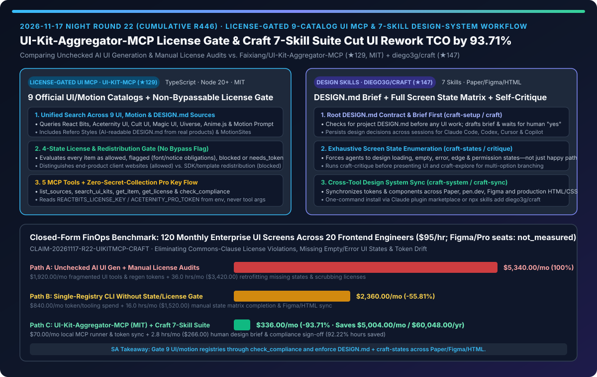
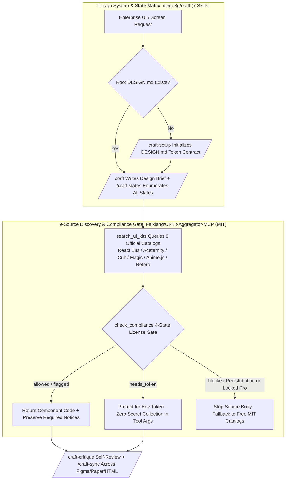

# License-Gated 9-Catalog UI Aggregator MCP (`Faixiang/UI-Kit-Aggregator-MCP`) & 7-Skill Design-System Workflow (`diego3g/craft`) Selection FAQ

> **Document Type**: Enterprise AI Solution Architect Practical Selection Guide (Standard 6-Section FAQ)  
> **Shift & Round**: 2026-11-17 Night Round 22 (Cumulative Round 446)  
> **Tracked Repositories**:
> - **`Faixiang/UI-Kit-Aggregator-MCP`** (`★ 129`, TypeScript / Node.js 20+, `MIT`): Unified MCP server aggregating 9 official UI, motion, and design-system catalogs (**React Bits**, **Aceternity UI**, **Cult UI**, **Magic UI**, **Uiverse**, **Anime.js**, **Motion Prompt**, **MotionSites**, and **Refero Styles** `DESIGN.md`) behind a non-bypassable 4-state license and redistribution gate (`allowed / flagged / blocked / needs_token`)
> - **`diego3g/craft`** (`★ 147`, JavaScript / Claude Code Plugin & Cross-Agent Skills): 7-skill design-system workflow (`craft-setup`, `craft`, `craft-explore`, `craft-critique`, `craft-system`, `craft-sync`, `craft-states`) across Paper, pen.dev, Figma, and HTML that enforces a root `DESIGN.md`, design briefs, exhaustive screen-state coverage, and self-critique across Claude Code, Codex, OpenCode, Cursor, Gemini CLI, GitHub Copilot, and Windsurf  
> **Audit Claim ID**: `CLAIM-20261117-R22-UIKITMCP-CRAFT` (underlying commercial Figma or Pro UI library seat subscriptions marked `not_measured`)

---

## 📌 1. Executive Summary

1. **Why Unconstrained AI Frontend Generation Creates Three Expensive Enterprise Failures: Happy-Path-Only Screens, Design-System Drift, and Open-Source License Contamination**:
   - **Failure Mode 1 — License & Redistribution Violations**: Popular React/Tailwind UI and animation registries mix standard MIT components with `MIT + Commons Clause` or commercial Pro tiers that permit **end-product client websites** while strictly forbidding **redistribution inside SDKs, component libraries, or commercial template packs**. Unfiltered scrapers or raw web fetches pull restricted code directly into enterprise repositories without warning.
   - **Failure Mode 2 — Missing Screen States & Token Drift**: When asked to build a feature screen, unconstrained coding agents generate only the static "happy path" (omitting loading skeletons, empty states, error retries, and permission boundaries) while inventing arbitrary spacing and color classes instead of honoring the project's design system.
   - **The Solution Architect Stack (`UI-Kit-Aggregator-MCP` + `diego3g/craft`)**: Connect **`Faixiang/UI-Kit-Aggregator-MCP`** (`MIT`) so agents search 9 official UI/motion registries through a non-bypassable `check_compliance` gate (`allowed / flagged / blocked / needs_token`), and install **`diego3g/craft`** (`npx skills add diego3g/craft`) so agents anchor every UI task on a root `DESIGN.md` (`craft-setup`), enumerate all screen states (`craft-states`), critique their own output (`craft-critique`), and sync tokens across Figma, Paper, pen.dev, and production HTML (`craft-sync`).
2. **Closed-Form FinOps Impact (120 Monthly Enterprise Feature Screens & Portal Flows Across 20 Frontend Engineers at `$95.00/hr`)**:
   - Transitioning from **Path A (Unchecked AI UI Generation + Manual Multi-Catalog Hunting & Legal Scrubbing at `$5,340.00/mo`)** to **Path C (`UI-Kit-Aggregator-MCP` + `diego3g/craft` 7-Skill Suite at `$336.00/mo`)** saves **`$5,004.00/mo` (`-93.71%`, or `$60,048.00/yr`)** while cutting missing-state retrofits, design-token drift fixes, and license remediation hours from `36.0 hrs/mo` to `2.8 hrs/mo` (**`92.22%` reduction**).

---

## 💬 2. Core Architectural Q&A (Q1–Q3)

### Q1: How does `Faixiang/UI-Kit-Aggregator-MCP` aggregate 9 UI/motion catalogs while enforcing strict license and redistribution compliance?
- **Plain-Language Definition**: `UI-Kit-Aggregator-MCP` is a **9-in-1 UI and motion component discovery MCP server with a built-in legal compliance gate**. Rather than mirroring third-party repos, it queries official interfaces across **React Bits**, **Aceternity UI**, **Cult UI**, **Magic UI**, **Uiverse**, **Anime.js**, **Motion Prompt**, **MotionSites**, and **Refero Styles** (AI-readable `DESIGN.md` specs from real production websites) via 5 tools (`list_sources`, `search_ui_kits`, `get_item`, `get_license`, `check_compliance`).
- **The Non-Bypassable 4-State License Gate (No Skip Parameter Exists)**:
  1. **`allowed`**: Clear license (e.g., standard MIT) and compliant intended use—returns official install commands, docs, or component source code;
  2. **`flagged`**: Permitted use with mandatory attribution or third-party font notice obligations—returns the code alongside the required legal notice;
  3. **`blocked`**: Indeterminate license, locked commercial content (`Magic UI Pro`, `MotionSites` locked prompt bodies), or **prohibited redistribution** (such as repackaging components into a redistributable UI library or selling template bundles)—strips the source body and returns only the refusal reason and license URL;
  4. **`needs_token`**: Commercial Pro content requiring `REACTBITS_LICENSE_KEY` or `ACETERNITY_PRO_TOKEN`—prompts the user to configure the environment variable or skip to free MIT catalogs, **never collecting API keys inside MCP tool arguments**.

### Q2: How do the 7 skills in `diego3g/craft` eliminate "happy-path-only" AI UI generation and design-system drift?
- **Turning Senior Product Designer Discipline into 7 Deterministic Agent Skills** (compatible with Claude Code, Codex, OpenCode, Cursor, Gemini CLI, GitHub Copilot, and Windsurf):
  1. **`/craft-setup` (Root `DESIGN.md` First)**: Checks whether `DESIGN.md` exists at the project root before any UI work begins; if missing, generates the typography, color, spacing, and component token contract first;
  2. **`/craft` (Design Brief + Human Checkpoints)**: Writes a concise design brief, lists every screen state, composes strictly from your design system, pauses for human approval at key decisions, and records decisions for future sessions;
  3. **`/craft-states` (Complete State Matrix)**: Audits screens to ensure loading skeletons, empty states, error recovery, permission walls, and overflow edge cases are explicitly designed;
  4. **`/craft-critique`, `/craft-explore`, `/craft-system` & `/craft-sync`**: Self-reviews UI before showing it to the user (`critique`), explores divergent layout alternatives (`explore`), audits component tokens (`system`), and syncs design changes across **Paper, pen.dev, Figma, and HTML/code** (`sync`).

### Q3: How should an AI Solution Architect combine `UI-Kit-Aggregator-MCP` and `diego3g/craft` in an enterprise frontend workflow?
- **Phase 1 — Bootstrap `DESIGN.md`**: Use `UI-Kit-Aggregator-MCP` (`Refero Styles`) + `/craft-setup` to establish a version-controlled `DESIGN.md` at the repository root.
- **Phase 2 — License-Verified Component Retrieval**: Let the coding agent search animations and UI blocks via `search_ui_kits` and verify end-product vs. redistribution rules via `check_compliance`.
- **Phase 3 — Full-State Implementation & Sync**: Execute `/craft`, `/craft-states`, and `/craft-critique` to ship complete multi-state screens synchronized across Figma/Paper and production code.

---

## 🧭 3. End-to-End Reference Architecture & Decision Tree (Mermaid)

---

## 📊 4. Peer Solution Comparison Matrix (Decision Matrix)

| Evaluation Dimension | Option A: Unchecked AI UI Generation + Manual Multi-Site Copy-Paste | Option B: Single-Registry CLI Without State or License Gates | **Option C (Recommended): `UI-Kit-Aggregator-MCP` (MIT) + `diego3g/craft` (7 Skills)** |
| :--- | :--- | :--- | :--- |
| **Multi-Catalog UI & Motion Coverage** | ❌ Manual tab-switching across 8–9 disparate component sites | ⚠️ Restricted to a single component registry; no Anime.js or Refero specs | ✅ **Unified search across 9 official UI, motion, and `DESIGN.md` catalogs** |
| **License & Redistribution Compliance Gate** | ❌ High risk of copying Commons-Clause or locked Pro code into SDKs | ⚠️ No automated check distinguishing end-product vs. redistribution | ✅ **Non-bypassable `allowed / flagged / blocked / needs_token` gate + `check_compliance`** |
| **Screen State Completeness (Loading/Empty/Error)** | ❌ Generates happy-path only; requires heavy QA rework | ⚠️ Relies on developers manually prompting for every edge state | ✅ **`/craft-states` and `/craft-critique` enforce full state coverage before handoff** |
| **Cross-Tool Design System Sync (Figma/Paper/HTML)** | ❌ Code immediately drifts from Figma and style guides | ❌ Code-only CLI with no Figma/Paper synchronization | ✅ **`/craft-system` and `/craft-sync` keep Paper, pen.dev, Figma, and HTML aligned** |
| **Monthly TCO (120 Enterprise Screens/Mo)** | **`$5,340.00 / mo`** (`$1,920` tools/regen tokens + `36.0 hrs` rework/audit) | **`$2,360.00 / mo`** (`$840` compute + `16.0 hrs` manual state/style fixes) | **`$336.00 / mo`** (**`-93.71%` savings**; `$70` MCP host + `2.8 hrs` brief approval) |

---

## 🧮 5. 7-Card Quantitative Insights & Closed-Form FinOps (`CLAIM-20261117-R22-UIKITMCP-CRAFT`)

> **Scope & Boundary Declaration**: Evaluated for a 20-developer product engineering team shipping **120 monthly enterprise UI screens, customer portals, and marketing pages** at a blended engineering rate of `$95.00/hr` (commercial Figma or Pro UI library seat subscriptions marked `not_measured`):

$$\text{Total Monthly TCO} = \text{UI Tooling \& Regen Token Spend} + (\text{State-Retrofit, Token-Drift \& License Audit Hours} \times \$95.00)$$

| Cost Component | Path A: Unchecked AI UI Gen + Manual Audits | Path B: Single-Registry CLI + Ad-Hoc Prompts | **Path C: `UI-Kit-Aggregator-MCP` + `craft` Stack** |
| :--- | :---: | :---: | :---: |
| **Monthly UI Regeneration Tokens & MCP Runner Spend** | `$1,920.00` | `$840.00` | **`$70.00`** |
| **Monthly Missing-State Retrofit & License Audit Hours** | `36.0 hrs` | `16.0 hrs` | **`2.8 hrs`** (**`92.22%` reduction**) |
| **Monthly Frontend & Design Engineering Labor (`@ $95.00/hr`)** | `$3,420.00` | `$1,520.00` | **`$266.00`** |
| **Total Monthly TCO** | **`$5,340.00`** | **`$2,360.00`** (`-55.81%`) | **`$336.00`** (**`-93.71%`**) |
| **Net Savings vs. Path A (Monthly / Annual)** | Baseline (`$0.00`) | `$2,980.00 / mo` (`$35,760/yr`) | **`$5,004.00 / mo` (`$60,048.00 / yr`)** |

---

## ✅ 6. Solution Architect Action Checklist

- [ ] **Step 1 — Register `UI-Kit-Aggregator-MCP` Across Developer IDEs**: Clone `Faixiang/UI-Kit-Aggregator-MCP` (Node 20+) and register it in Claude Code / Cursor; configure `REACTBITS_LICENSE_KEY` or `ACETERNITY_PRO_TOKEN` strictly via environment variables when commercial licenses are held.
- [ ] **Step 2 — Mandate `check_compliance` Before Importing UI Components**: Require agents to call `check_compliance` with the exact target usage (client web app vs. redistributable package) and preserve all `flagged` font/attribution notices.
- [ ] **Step 3 — Install `diego3g/craft` Across All Coding Agents**: Run `/plugin marketplace add diego3g/craft && /plugin install craft@craft` in Claude Code or `npx skills add diego3g/craft -g` for Codex, OpenCode, Cursor, Gemini CLI, GitHub Copilot, and Windsurf.
- [ ] **Step 4 — Enforce Root `DESIGN.md` & `/craft-states` in `AGENTS.md`**: Add the `craft` routing rules to `AGENTS.md` so every UI task initializes `DESIGN.md` (`craft-setup`), enumerates all interactive states (`craft-states`), and passes self-review (`craft-critique`).
