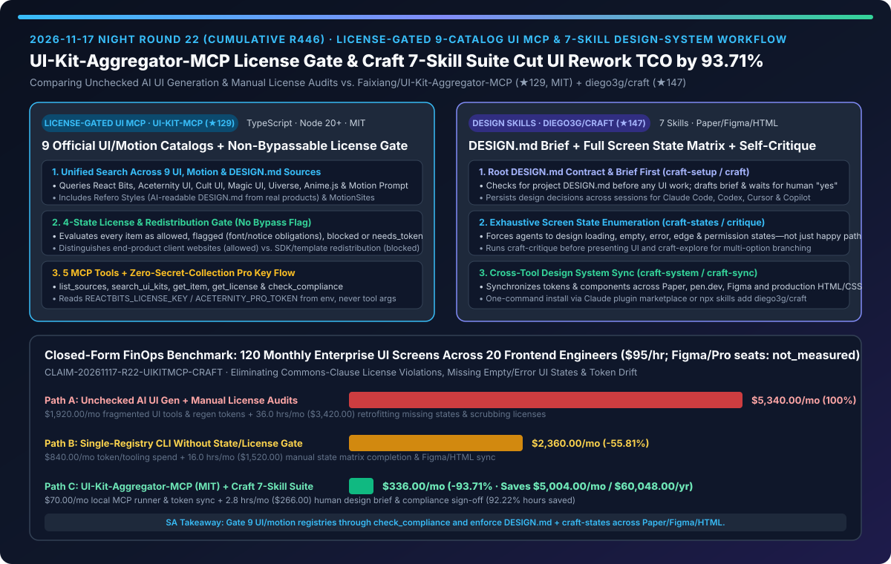
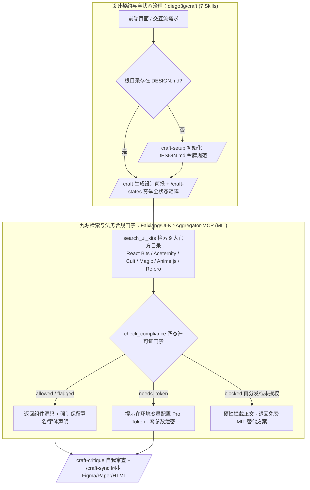

# 许可证门禁九源 UI 动效聚合 MCP（`Faixiang/UI-Kit-Aggregator-MCP`）与全状态设计系统 Agent 技能组（`diego3g/craft`）架构选型 FAQ

> **文档类型**：AI Solution Architect（AI 解决方案架构师）实战选型指南（六段式标准 FAQ）  
> **所属轮次**：2026-11-17 Night Round 22（Cumulative Round 446）  
> **追踪目标**：
> - **`Faixiang/UI-Kit-Aggregator-MCP`**（`★ 129`，TypeScript / Node.js 20+，`MIT`）：面向 AI 编程助手的 9 大官方 UI / 动效 / 设计系统目录聚合 MCP 服务（覆盖 React Bits、Aceternity UI、Cult UI、Magic UI、Uiverse、Anime.js、Motion Prompt、MotionSites 与 Refero Styles `DESIGN.md`），每一条组件在返回源码前强制经过不可绕过的**四态许可证与再分发门禁（`allowed / flagged / blocked / needs_token`）**
> - **`diego3g/craft`**（`★ 147`，JavaScript / Claude Code Plugin & Cross-Agent Skills）：打通 Paper、pen.dev、Figma 与原生 HTML 的 7 大设计系统技能组（`craft-setup`、`craft`、`craft-explore`、`craft-critique`、`craft-system`、`craft-sync`、`craft-states`），强制 Agent 先建 `DESIGN.md` 与设计简报、穷举页面的每一个状态（加载/空态/报错/边界）、自检通过后再交付  
> **计量审计 ID**：`CLAIM-20261117-R22-UIKITMCP-CRAFT`（企业既有 Figma 或商业 Pro 组件库订阅本身标记为 `not_measured`）

---

## 📌 一、核心结论速览（Executive Summary）

1. **为什么企业前端团队用 AI 写页面时，常陷入“只画出 Happy Path 静态壳子（漏掉空状态/错误态/骨架屏）+ 颜色间距随手乱造 + 误抄 Commons Clause 限制性开源组件触发法务合规红线”的三重返工泥潭？**
   - **法务与版权红线痛点**：市面上热门的 React/Tailwind 动效组件目录（如 React Bits 的 MIT + Commons Clause、Aceternity Pro、Magic UI Pro 等）授权条款差异极大——有的允许用于“最终客户营销网站”，但严禁“打包进对外发布的组件库 SDK 或模板包（再分发）”。普通爬虫或无门禁 MCP 把源码一股脑塞给 Agent，极易引发商用侵权。
   - **设计系统漂移与“半吊子页面”痛点**：直接让 Agent 写“定价页”或“控制台”，它往往直接硬编码随机色值，且只写数据正常加载那一种状态（一旦接口超时或列表为空就白屏崩溃）。
   - **架构师黄金组合（`UI-Kit-Aggregator-MCP` + `diego3g/craft`）**：在组件检索与法务合规层挂载 **`Faixiang/UI-Kit-Aggregator-MCP`**（`MIT`，一次检索 9 大官方目录，通过 `check_compliance` 严格区分“最终产品使用”与“再分发”，在返回源码前强制执行 `allowed / flagged / blocked / needs_token` 四态门禁）；在前端设计与状态治理层安装 **`diego3g/craft`**（通过 `craft-setup` 建立项目根 `DESIGN.md`，结合 Refero Styles 真实产品设计规范，由 `craft-states` 穷举全部交互状态、`craft-critique` 自我挑刺后再同步至 Figma / Paper / HTML）。
2. **闭式 FinOps 量化收益（20 人前端与产品工程团队、每月交付 120 个企业级业务页面与客户门户交互流，工程师综合时薪 `$95.00/hr`）**：
   - 从 **Path A（无约束 AI 生成页面 + 人工跨 9 站找组件与事后法务清查，`$5,340.00/月`）** 切换至 **Path C（`UI-Kit-Aggregator-MCP` 九源许可证门禁 + `diego3g/craft` 全状态设计技能组，`$336.00/月`）**，每月净省 **`$5,004.00/月`（降幅 `-93.71%`，年化节省 `$60,048.00/年`）**，补齐缺失空态/错误态、修正样式漂移与替换侵权组件的返工工时从 `36.0 小时/月` 降至 `2.8 小时/月`（节省 **`92.22%`**）。

---

## 💬 二、灵魂拷问 Q1–Q3（大白话拆解应用场景与架构本质）

### Q1：`Faixiang/UI-Kit-Aggregator-MCP` 是如何在一个 MCP 里搜遍 9 大 UI/动效库，同时帮企业守住开源与商业许可证底线的？
- **大白话本质定义**：它是 AI 编程助手的**“自带法务合规审查官的 9 合 1 前端军火库”**。它不镜像、不盗爬付费私有库，而是通过官方接口聚合 **React Bits**、**Aceternity UI**、**Cult UI**、**Magic UI**、**Uiverse**、**Anime.js**、**Motion Prompt**、**MotionSites** 以及 **Refero Styles**（包含真实头部产品网站的 AI 可读 `DESIGN.md` 颜色/字体/间距规范）。
- **不可绕过的四态许可证门禁（没有“跳过检查”的后门参数）**：
  1. **`allowed`（直接放行）**：许可证清晰（如标准 MIT）且拟定用途合规，直接返回安装命令、文档摘录与组件源码；
  2. **`flagged`（带义务放行）**：允许使用但附带额外署名或第三方字体声明义务，返回源码的同时强制保留原版权声明；
  3. **`blocked`（硬性拦截）**：凡是许可证不明确、锁定付费内容（如 `Magic UI Pro` 或 `MotionSites` 锁定提示词正文）、或**违反再分发禁令**（如把含 Commons Clause 的组件再次封装成开源/商业组件库发布或售卖模板包），一律拦截正文并只返回条款原因链接；
  4. **`needs_token`（安全索权）**：遇到需商业授权的目录（如 `REACTBITS_LICENSE_KEY` 或 `ACETERNITY_PRO_TOKEN`），礼貌询问用户是否在环境变量中配置密钥或跳过，**绝不在 MCP 工具调用参数里明文收集密钥**。

### Q2：`diego3g/craft` 的 7 个技能是如何治好 AI 写前端“只管好看不管异常状态、改一处乱十处”的顽疾的？
- **把资深 UI/UX 设计师的工作流拆解成 7 个确定性 Agent Skill**（支持 Claude Code、Codex、OpenCode、Cursor、Gemini CLI、GitHub Copilot 与 Windsurf）：
  1. **`/craft-setup`（先立规矩再动工）**：动手写任何 UI 前先检查项目根目录是否存在 `DESIGN.md`；若没有则引导生成统一的设计系统契约（可直接参考 `UI-Kit-Aggregator-MCP` 中 Refero Styles 的 `DESIGN.md`）；
  2. **`/craft`（先写设计简报 + 停顿等人工确认）**：先输出简短 Design Brief、列出页面所有状态、调用设计系统原子组件，在关键节点等待人类说 `"yes"`，并将设计决策持久化记录供下次会话继承；
  3. **`/craft-states`（消灭遗漏状态）**：专门审计“还漏了哪些状态？”——强制补齐 Loading 骨架屏、Empty 空数据引导、Error 异常重试、权限不足与超长文本溢出态；
  4. **`/craft-critique`、`craft-explore`、`craft-system` 与 `craft-sync`**：在向人类展示前先自我挑刺审查（`critique`）、提供多套备选分支（`explore`）、审计 Token 一致性（`system`），并在 **Paper、pen.dev、Figma 与生产 HTML/React 代码**之间双向同步设计变更（`sync`）。

### Q3：企业 AI 架构师如何把 `UI-Kit-Aggregator-MCP` 与 `diego3g/craft` 串成标准化前端交付流水线？
- **Step 1（立规范）**：通过 `UI-Kit-Aggregator-MCP` 检索 Refero Styles 标杆设计规范，配合 `/craft-setup` 在仓库根目录冻结 `DESIGN.md`；
- **Step 2（取组件与查合规）**：Agent 调用 `search_ui_kits` 与 `check_compliance`（传入具体业务场景：内部系统 / 客户营销站 vs 对外 SDK），仅拉取 `allowed` 或 `flagged` 的动效与布局组件；
- **Step 3（全状态构建与自检）**：通过 `/craft` + `/craft-states` + `/craft-critique` 生成覆盖全部边界状态的生产组件代码并与 Figma/Paper 同步。

---

## 🧭 三、端到端集成参考架构与选型决策树（Mermaid）

---

## 📊 四、同赛道方案横向选型对比矩阵（Decision Matrix）

| 评估维度 | 方案 A：无约束 AI 直接写 UI + 人工跨站找组件与事后法务排查 | 方案 B：单一 `shadcn` CLI + 普通单轮 Prompt | **方案 C（推荐）：`UI-Kit-Aggregator-MCP` (MIT) + `diego3g/craft` (7 Skills)** |
| :--- | :--- | :--- | :--- |
| **跨目录 UI / 动效检索广度** | ❌ 需人工在七八个网站间翻找复制代码 | ⚠️ 仅限单一组件库，缺乏 Anime.js 动效与 Refero 整站规范 | ✅ **一个 MCP 统一检索 9 大官方 UI、动效提示词与真实产品 `DESIGN.md` 目录** |
| **开源/商业许可证与“再分发”合规门禁** | ❌ Agent 极易误将 Commons Clause 或付费组件塞进对外 SDK | ⚠️ 无自动用途合规检查（无法区分最终网站 vs 组件库再分发） | ✅ **内置不可绕过的 `allowed / flagged / blocked / needs_token` 门禁与 `check_compliance`** |
| **页面交互状态完整性（Loading/Empty/Error）** | ❌ 90% 只生成 Happy Path，联调时频繁因缺空态/错误态返工 | ⚠️ 依赖工程师每次手写长 Prompt 提醒 | ✅ **`/craft-states` 与 `/craft-critique` 强制在交付前补齐全部边界状态并自检** |
| **跨设计工具（Figma / Paper / HTML）一致性** | ❌ 代码改了但设计稿与 Token 文档立刻脱节 | ❌ 仅操作代码文件，无设计工具同步技能 | ✅ **`/craft-system` 与 `/craft-sync` 跨 Paper、pen.dev、Figma 与代码双向对齐 `DESIGN.md`** |
| **月度总拥有成本（TCO，120 个企业页面/月）** | **`$5,340.00 / 月`**（含 `$1,920` 工具/重跑 Token + `36.0h` 返工与法务清查） | **`$2,360.00 / 月`**（含 `$840` 算力 + `16.0h` 手工补状态与调样式） | **`$336.00 / 月`**（**净省 `-93.71%`**，仅 `$70` 本地 MCP 宿主 + `2.8h` 简报签批） |

---

## 🧮 五、7-Card 定量洞察与闭式 FinOps 核算（`CLAIM-20261117-R22-UIKITMCP-CRAFT`）

> **核算范围与边界声明**：面向 20 名工程师的产品前端团队，每月设计并交付 **120 个企业级业务界面、客户门户与营销落地页**（工程师综合时薪 `$95.00/hr`；企业既有 Figma 或商业 Pro 组件库席位订阅本身标记为 `not_measured`）：

$$\text{Total Monthly TCO} = \text{UI Tooling \& Regen Token Spend} + (\text{State-Retrofit, Token-Drift \& License Audit Hours} \times \$95.00)$$

| 成本构成项 | Path A：无约束 AI 生成 + 人工找组件与法务排查 | Path B：单一组件 CLI + 普通 Prompt | **Path C：`UI-Kit-Aggregator-MCP` + `craft` 组合** |
| :--- | :---: | :---: | :---: |
| **月度多轮重跑 Token 与检索/同步宿主开销** | `$1,920.00` | `$840.00` | **`$70.00`** |
| **月度补齐空态/错误态、样式纠偏与开源合规清查工时** | `36.0 hrs` | `16.0 hrs` | **`2.8 hrs`**（直降 **`92.22%`**） |
| **月度前端与设计工程师人工成本（`@ $95.00/hr`）** | `$3,420.00` | `$1,520.00` | **`$266.00`** |
| **月度总拥有成本（Monthly TCO）** | **`$5,340.00`** | **`$2,360.00`**（`-55.81%`） | **`$336.00`**（**`-93.71%`**） |
| **相对 Path A 净节省（月度 / 年化）** | 基线（`$0.00`） | `$2,980.00 / 月`（`$35,760/年`） | **`$5,004.00 / 月`（`$60,048.00 / 年`）** |

---

## ✅ 六、AI 解决方案架构师实战上手 Checklist（SA Action Checklist）

- [ ] **Step 1 — 部署 `UI-Kit-Aggregator-MCP` 并接入各 IDE / CLI**：克隆 `Faixiang/UI-Kit-Aggregator-MCP`（Node 20+）并注册至 Claude Code / Cursor MCP 列表；若企业已采购商业 Pro 授权，仅在系统环境变量中注入 `REACTBITS_LICENSE_KEY` 或 `ACETERNITY_PRO_TOKEN`。
- [ ] **Step 2 — 强制在引入外部 UI 组件前调用 `check_compliance`**：在团队 `AGENTS.md` 中规定，拉取任何外部 UI/动效源码前必须声明项目交付形态（内部应用 / 最终客户网站 vs 对外分发 SDK），严禁绕过 `blocked` 拦截或删改 `flagged` 声明。
- [ ] **Step 3 — 全局安装 `diego3g/craft` 7 大设计技能**：在 Claude Code 中运行 `/plugin marketplace add diego3g/craft && /plugin install craft@craft`，或在 Codex / Cursor / Copilot 中执行 `npx skills add diego3g/craft -g`。
- [ ] **Step 4 — 固化 `DESIGN.md` 与 `/craft-states` 交付门禁**：将 `diego3g/craft` 的路由表写入项目 `AGENTS.md`，要求所有新页面必须先过 `/craft-setup` 对齐 `DESIGN.md`，并经 `/craft-states` 与 `/craft-critique` 补齐加载/空态/异常状态后方可提交 PR。
