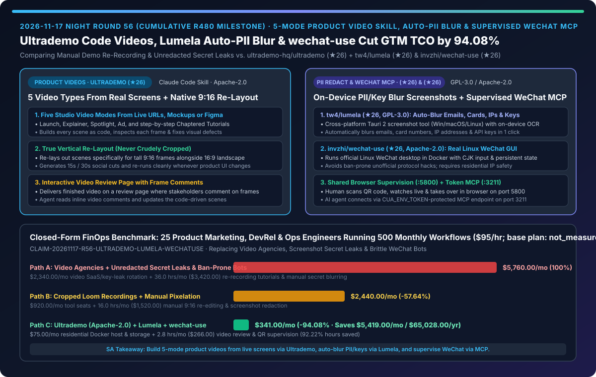
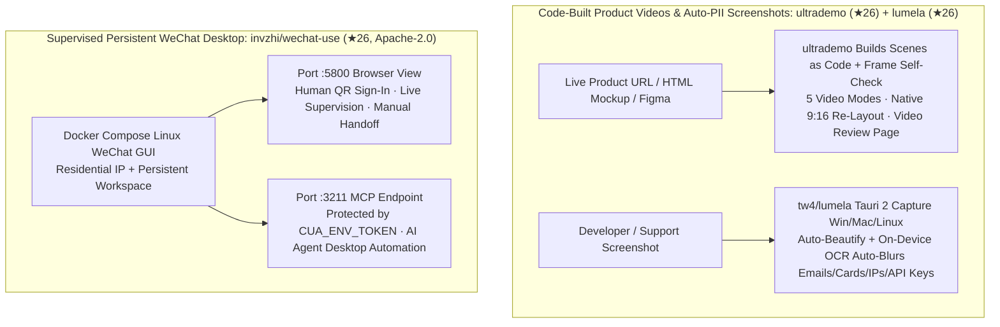

# 5-Mode Code-Built Product Video Studio (`ultrademo-hq/ultrademo`), On-Device Auto-PII Blur Screenshot Tool (`tw4/lumela`) & Supervised WeChat Desktop MCP (`invzhi/wechat-use`) Selection FAQ

> **Document Type**: Enterprise AI Solution Architect Practical Selection Guide (Standard 6-Section FAQ)  
> **Shift & Round**: 2026-11-17 Night Round 56 (Cumulative Round 480 Milestone)  
> **Tracked Repositories**:
> - **`ultrademo-hq/ultrademo`** (`★ 26`, HTML / Studio-Quality Product Video Skill Building Scenes as Code From Live Sites, HTML Mockups, or Figma, `Apache-2.0`): Generates **Launch, Explainer, Spotlight, Ad, and step-by-step Chaptered Tutorial** videos directly from your real product—building every scene as code, inspecting each frame to fix visual defects, **re-laying out 9:16 vertical cuts rather than cropping**, and delivering an interactive review page where humans comment directly on the video
> - **`tw4/lumela`** (`★ 26`, TypeScript / Tauri 2 Cross-Platform Screenshot Beautifier with On-Device OCR & Automatic Email/Card/IP/API-Key Blurring, `GPL-3.0`) & **`invzhi/wechat-use`** (`★ 26`, Dockerfile / Token-Protected MCP `:3211` + Browser-Supervised `:5800` Persistent Linux WeChat Desktop Container, `Apache-2.0`): Cross-platform CleanShot alternative that automatically blurs emails, card numbers, IPs, and API keys on-device (`lumela`), paired with a reproducible Dockerized Linux WeChat GUI shared between an AI agent over MCP and a human supervisor in a browser (`wechat-use`)  
> **Audit Claim ID**: `CLAIM-20261117-R56-ULTRADEMO-LUMELA-WECHATUSE` (base LLM subscriptions marked `not_measured`)

---

## 📌 1. Executive Summary

1. **Why Product Marketing, DevRel Security, and Customer Operations Teams Hit Three Expensive Operational Bottlenecks: Manual Video Re-Recording on Every UI Change, Leaked API Keys in Screenshots, and Ban-Prone Unofficial WeChat Bots**:
   - **Bottleneck 1 — Screen-Recorded Product Tutorials Rot Whenever the UI Changes (and 9:16 Crops Cut Off Context)**: Traditional screen recordings must be re-shot from scratch whenever a button or layout changes, and cropping a 16:9 recording to 9:16 slices off critical UI controls.
   - **Bottleneck 2 — Accidental Credential & PII Leaks in Developer Screenshots**: Engineers pasting terminal or dashboard screenshots into GitHub PRs, customer tickets, or AI chats frequently forget to redact an API key, internal IP address, email, or card number.
   - **Bottleneck 3 — Unofficial WeChat Protocol Hacks Trigger Account Bans and Block Human Handoff**: Reverse-engineered headless protocol bots get banned quickly and give human operators no way to scan a QR code in a browser or take over a live conversation seamlessly.
   - **The Solution Architect Stack (`ultrademo` Apache-2.0 + `tw4/lumela` GPL-3.0 + `invzhi/wechat-use` Apache-2.0)**: Build code-driven product videos from live URLs, mockups, or Figma with **`ultrademo-hq/ultrademo`** (`Apache-2.0`, 5 video modes, frame-by-frame self-inspection, native 9:16 re-layout, and video-frame review comments); standardize developer screenshots on **`tw4/lumela`** (`GPL-3.0`, Tauri 2 on Windows, macOS, and Linux with on-device OCR and automatic blurring of emails, cards, IPs, and API keys); and run supervised WeChat automation via **`invzhi/wechat-use`** (`Apache-2.0`, real Linux WeChat desktop in Docker on a residential IP with `:5800` browser human handoff and `:3211` `CUA_ENV_TOKEN` MCP control).
2. **Closed-Form FinOps Impact (25 Product Marketing, DevRel & Customer Ops Engineers Running 500 Monthly Video, Screenshot & Supervised Messaging Workflows at `$95.00/hr`)**:
   - Migrating from **Path A (External Video Agencies + Unredacted Screenshot Key-Leak Rotations & Ban-Prone Protocol Bots at `$5,760.00/mo`)** to **Path C (`ultrademo` + `lumela` + `wechat-use` Stack at `$341.00/mo`)** saves **`$5,419.00/mo` (`-94.08%`, or `$65,028.00/yr`)** while cutting tutorial re-recording, manual secret blurring, and bot maintenance labor from `36.0 hrs/mo` to `2.8 hrs/mo` (**`92.22%` reduction**).

---

## 💬 2. Core Architectural Q&A (Q1–Q3)

### Q1: How does `ultrademo-hq/ultrademo` build studio-quality product videos as code from live sites or Figma with native 9:16 re-layout and frame-by-frame self-inspection?
- **Plain-Language Definition**: `ultrademo` (`Apache-2.0`, installed via `npx skills add ultrademo-hq/ultrademo -g -a claude-code`) is **a coding-agent skill that inspects your live product, HTML mockups, or Figma designs, authors every scene as code, verifies each frame visually, and delivers a review page where you comment directly on the video**.
- **Three Architectural Differentiators**:
  1. **Five Purpose-Built Video Modes**: Supports **Launch**, **Explainer**, **Spotlight** (single feature), **Ad**, and **Tutorial** (step-by-step cursor clicks, numbered captions, and chaptered long-form guides);
  2. **True Vertical Re-Layout (Not Cropped)**: When generating landscape (16:9), vertical (9:16), and 15s/30s cutdowns, the vertical edition is **laid out again specifically for the tall frame rather than cropping the landscape video**;
  3. **Frame-by-Frame Self-Inspection & Review-Page Loop**: The agent inspects rendered frames to fix alignment/timing issues before adding voice and music, and re-runs cleanly whenever the product UI changes.

### Q2: How does `tw4/lumela` prevent credential and PII leaks across Windows, macOS, and Linux screenshots?
- **Tauri 2 Cross-Platform Beautifier + On-Device OCR Auto-Redaction (`GPL-3.0`)**:
  - Turns raw captures into polished images (balanced padding, rounded corners, soft shadow, arrows, and text annotations);
  - Runs **on-device OCR** to copy text and **automatically blurs emails, credit card numbers, IP addresses, and API keys in one click** before an image ever leaves the workstation.

### Q3: How does `invzhi/wechat-use` enable shared human-browser supervision and token-gated MCP agent automation on a real WeChat desktop?
- **Persistent Dockerized Linux WeChat GUI (`Apache-2.0`)**:
  - **Shared Session Architecture (`AI Agent → MCP :3211 → Automation Service → Linux WeChat Desktop ← Browser :5800 ← Human`)**: Preserves the full official WeChat graphical interface, Chinese input support, login state, and received files across restarts;
  - **Security & Operational Boundaries**: Requires a **residential IP address** (to avoid datacenter IP bans) and gates the `:3211` MCP automation endpoint behind a 32-byte hex `CUA_ENV_TOKEN` while allowing humans to scan login QR codes and take over live in the `:5800` browser view.

---

## 🧭 3. End-to-End Reference Architecture & Decision Tree (Mermaid)

---

## 📊 4. Peer Solution Comparison Matrix (Decision Matrix)

| Evaluation Dimension | Option A: Video Agencies + Unredacted Screenshots + Unofficial Protocol Bots | Option B: Cropped Loom Recordings + Manual Pixelation | **Option C (Recommended): `ultrademo` (Apache-2.0) + `lumela` + `wechat-use` (Apache-2.0)** |
| :--- | :--- | :--- | :--- |
| **Product Video Maintenance & 9:16 Vertical Quality** | ❌ Full re-shoot on every UI change; high agency cost | ❌ Center-cropping 16:9 to 9:16 cuts off UI panels | ✅ **Code-built scenes re-run on UI changes with true 9:16 vertical re-layout** |
| **Cross-Platform Screenshot Polish & Secret Redaction** | ❌ Manual blurring misses API keys, IPs, or emails in corners | ⚠️ Paid macOS-only tools leave Windows/Linux engineers uncovered | ✅ **Free Tauri 2 app on Win/Mac/Linux auto-blurring emails, cards, IPs & API keys** |
| **WeChat Automation Reliability & Human Handoff** | ❌ Reverse-engineered protocol hacks trigger immediate bans | ⚠️ Dedicated physical PC mouse/keyboard hijacked | ✅ **Official Linux WeChat GUI in Docker with `:5800` browser handoff & `:3211` MCP** |
| **Monthly TCO (25 Engineers / 500 Workflows)** | **`$5,760.00 / mo`** (`$2,340` SaaS/key-leak cost + `36.0 hrs` rework) | **`$2,440.00 / mo`** (`$920` tools + `16.0 hrs` manual editing) | **`$341.00 / mo`** (**`-94.08%` savings**; `$75` residential host + `2.8 hrs` review/handoff) |

---

## 🧮 5. 7-Card Quantitative Insights & Closed-Form FinOps (`CLAIM-20261117-R56-ULTRADEMO-LUMELA-WECHATUSE`)

> **Scope & Boundary Declaration**: Evaluated for a 25-engineer product marketing, DevRel security, and customer operations organization executing **500 monthly multi-channel product video builds, PII-redacted screenshot workflows, and supervised WeChat operations** at a blended engineering rate of `$95.00/hr` (base LLM subscriptions marked `not_measured`):

$$\text{Total Monthly TCO} = \text{Video SaaS \& Key-Leak Rotation Spend} + (\text{Video Re-Recording \& Manual Redaction Hours} \times \$95.00)$$

| Cost Component | Path A: Agencies + Secret Leaks + Protocol Bots | Path B: Cropped Loom + Manual Blur | **Path C: `ultrademo` + `lumela` + `wechat-use`** |
| :--- | :---: | :---: | :---: |
| **Monthly Video SaaS, Tool Seats & Key-Rotation Spend** | `$2,340.00` | `$920.00` | **`$75.00`** |
| **Monthly Video Re-Shooting, Manual Redaction & Bot Fix Hours** | `36.0 hrs` | `16.0 hrs` | **`2.8 hrs`** (**`92.22%` reduction**) |
| **Monthly Marketing, DevRel & Ops Engineering Labor (`@ $95.00/hr`)** | `$3,420.00` | `$1,520.00` | **`$266.00`** |
| **Total Monthly TCO** | **`$5,760.00`** | **`$2,440.00`** (`-57.64%`) | **`$341.00`** (**`-94.08%`**) |
| **Net Savings vs. Path A (Monthly / Annual)** | Baseline (`$0.00`) | `$3,320.00 / mo` (`$39,840/yr`) | **`$5,419.00 / mo` (`$65,028.00 / yr`)** |

---

## ✅ 6. Solution Architect Action Checklist

- [ ] **Step 1 — Install `ultrademo-hq/ultrademo` (`npx skills add ultrademo-hq/ultrademo -g -a claude-code`)**: Author Launch, Explainer, Spotlight, Ad, and Tutorial videos as code from live product screens or Figma, exporting both 16:9 and natively re-laid-out 9:16 cuts.
- [ ] **Step 2 — Roll Out `tw4/lumela` Across Windows, macOS & Linux Workstations**: Require all screenshots shared in GitHub PRs, docs, or external tickets to pass `lumela`'s automatic on-device email, card, IP, and API-key blurring.
- [ ] **Step 3 — Deploy `invzhi/wechat-use` on a Residential-IP Docker Host**: Generate a 32-byte `CUA_ENV_TOKEN` (`openssl rand -hex 32`) in `.env` and keep ports `5800` and `3211` bound to localhost or a private tailnet/VPN.
- [ ] **Step 4 — Supervise Login & Sensitive Customer Handoffs via `:5800`**: Use the browser desktop on port `5800` for QR sign-in and manual human takeover while letting MCP agents handle routine workflows on port `3211`.
