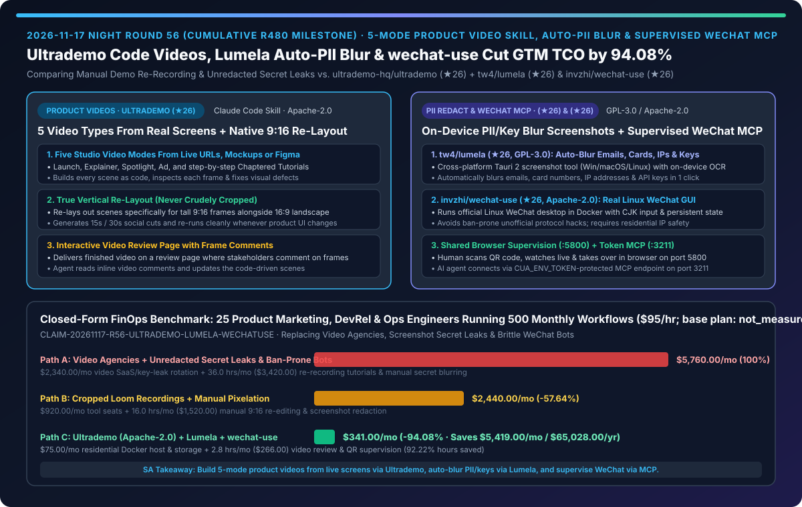
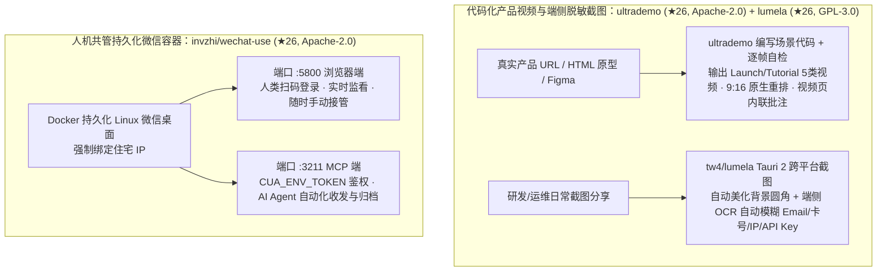

# 真实产品界面转五模态宣传片技能（`ultrademo-hq/ultrademo`）与端侧自动打码密钥/隐私截图器及人机共管微信桌面容器（`tw4/lumela` & `invzhi/wechat-use`）架构选型 FAQ

> **文档类型**：AI Solution Architect（AI 解决方案架构师）实战选型指南（六段式标准 FAQ）  
> **所属轮次**：2026-11-17 Night Round 56（Cumulative Round 480 Milestone）  
> **追踪目标**：
> - **`ultrademo-hq/ultrademo`**（`★ 26`，HTML / 直接从真实在线产品、HTML 原型或 Figma 生成五类演播室级视频的 Coding Agent 技能，`Apache-2.0`）：支持 **Launch（发布片）、Explainer（解说片）、Spotlight（单功能特写）、Ad（广告片）与 Tutorial（带点击光标与步骤编号的分章节教程）** 五大模式，将每一幕写为代码、逐帧自检修复、交付可直接在视频画面上批注的审阅页，且竖屏 9:16 版本**针对竖画幅重新排版而非粗暴裁切**
> - **`tw4/lumela`**（`★ 26`，TypeScript / Tauri 2 跨平台 CleanShot 级截图美化与端侧 OCR 自动模糊邮箱/银行卡/IP/API Key 工具，`GPL-3.0`）& **`invzhi/wechat-use`**（`★ 26`，Dockerfile / 浏览器 `:5800` 人工扫码接管 + `:3211` `CUA_ENV_TOKEN` 鉴权 MCP 操控的持久化 Linux 微信桌面容器，`Apache-2.0`）：一键自动识别并打码截图中的 API Key、IP、卡号与邮箱的 **`lumela`**，配合放弃高封号风险非官方协议、改用真实 Linux 微信 GUI 并支持人类与 Agent 共享同一桌面会话的 **`wechat-use`**  
> **计量审计 ID**：`CLAIM-20261117-R56-ULTRADEMO-LUMELA-WECHATUSE`（底层大模型基础订阅标记为 `not_measured`）

---

## 📌 一、核心结论速览（Executive Summary）

1. **为什么企业产品技术营销（PMM/DevRel）、安全合规与私域客户运营团队在日常协同中，常被“产品界面每改一次就要重新录屏剪辑全套教程视频、且把 16:9 横屏硬裁成 9:16 竖屏导致两边字幕全被切掉”、“工程师随手截一张终端或后台图贴进 GitHub PR / 文档就不小心泄露了生产 API Key 与内网 IP”、以及“用逆向非官方协议跑微信机器人动辄触发风控封号且遇到复杂客户问题人工无法无缝接管”三大痛点困扰？**
   - **痛点一：传统录屏剪辑无法随产品 UI 迭代自动重编译，且横转竖靠粗暴裁切**：人工用 Loom 或 Premiere 录制的教程一旦按钮改版就全部作废；把横屏视频直接居中裁剪成 9:16 竖屏更会切掉关键界面。
   - **痛点二：截图脱敏靠人眼手涂极易漏掉 API Key 与隐私信息（PII）**：在编写技术文档、提交 Issue 或把报错截图喂给外部 AI 时，人工画马赛克经常漏掉角落里的 Token、邮箱、IP 或卡号。
   - **痛点三：非官方微信协议外挂的高封号率与“人机割裂”**：基于逆向 Web/iPad 协议的自动化工具不仅极易被封号，而且当 AI 遇到需要扫码登录或高客单人工介入时，人类操作员看不到实时桌面也无法立即接手。
   - **架构师黄金组合（`ultrademo` Apache-2.0 + `tw4/lumela` GPL-3.0 + `invzhi/wechat-use` Apache-2.0）**：在产品发布与教程视频层部署 **`ultrademo-hq/ultrademo`**（`npx skills add ultrademo-hq/ultrademo -g -a claude-code`，直连真实网页/HTML Mock/Figma 用代码构建五大类视频、逐帧自检、原生重排 9:16 竖屏并提供视频内联批注页）；在全员研发与文档截图工具层标配 **`tw4/lumela`**（跨 Windows/macOS/Linux 的 Tauri 2 轻量应用，端侧 OCR 自动模糊邮箱、银行卡号、IP 与 API Key）；在私域与客户协同层部署 **`invzhi/wechat-use`**（基于住宅 IP 运行官方 Linux 微信桌面 Docker 容器，人类通过 `:5800` 浏览器扫码监督与随时接管，Agent 通过 `:3211` `CUA_ENV_TOKEN` 鉴权 MCP 安全操作）。
2. **闭式 FinOps 量化收益（25 名产品技术营销、DevRel 安全与私域运营工程师，每月执行 500 次多渠道产品视频生成、脱敏技术文档截图与微信人机协同工作流，综合时薪 `$95.00/hr`）**：
   - 从 **Path A（外包视频制作/商业软件订阅 + 截图泄密应急轮换密钥与协议号封禁损失，`$5,760.00/月`）** 切换至 **Path C（`ultrademo` 代码化产品视频 + `lumela` 端侧自动脱敏 + `wechat-use` 人机共管容器，`$341.00/月`）**，每月净省 **`$5,419.00/月`（降幅 `-94.08%`，年化节省 `$65,028.00/年`）**，UI 改版重录视频、手工涂抹敏感信息与维护脆弱机器人脚本工时从 `36.0 小时/月` 降至 `2.8 小时/月`（节省 **`92.22%`**）。

---

## 💬 二、灵魂拷问 Q1–Q3（大白话拆解应用场景与架构本质）

### Q1：`ultrademo-hq/ultrademo` 是如何从真实产品页面或 Figma 直接用代码生成“横竖双画幅原生重排、可直接在视频画面上提意见”的 5 类大片的？
- **大白话本质定义**：`ultrademo`（`Apache-2.0`，支持 Claude Code 等 Coding Agent）是**“把你真实的产品网页、未上线 HTML 原型或 Figma 稿变成代码驱动的五类演播室视频、且产品一改版重跑一次就自动更新成片的 AI 制片技能”**。
- **三大核心工程能力**：
  1. **五大专业视频类型全覆盖**：支持 **Launch（新品发布）**、**Explainer（产品解说）**、**Spotlight（单特性聚光灯）**、**Ad（转化广告）** 与 **Tutorial（每步带光标点击与编号字幕的分章节长教程）**；
  2. **竖屏 9:16 原生重新排版（Re-Laid Out, Never Cropped）**：同时输出横屏（16:9）与竖屏（9:16）及 15 秒/30 秒社交短切版时，竖屏版会针对修长画幅**重新编排界面元素布局**，绝不是把横屏画面粗暴居中裁掉两边；
  3. **逐帧自检 + 视频审阅页内联批注闭环**：Agent 把每一幕写成代码后自己逐帧看画面修瑕疵，配好语音和音乐后生成专属视频审阅页——你可以直接在视频时间轴画面上写修改意见，Agent 读完直接改代码重出！

### Q2：`tw4/lumela` 如何把 macOS 独占的付费 CleanShot 体验带到全平台，并自动防住“截图泄露 API Key”安全事故？
- **Tauri 2 跨平台极速架构 + 端侧 OCR 自动敏感信息脱敏（`GPL-3.0`，支持 Windows / macOS / Linux 8 国语言）**：
  - 一键把原始粗糙截图美化为带协调背景、均匀留白、圆角与柔和阴影的专业分享图，支持箭头与文字标注；
  - **100% 本地端侧 OCR 与一键自动打码**：不仅能直接从截图复制文字，还会**自动识别并模糊处理画面中的电子邮箱、银行卡号、IP 地址与 API Key**，从源头消灭研发人员截图贴 PR/Issue 导致的密钥泄露。

### Q3：`invzhi/wechat-use` 为什么坚持在 Docker 里跑真实 Linux 微信桌面并采用“`:5800` 浏览器人类监督 + `:3211` Token MCP”双通道架构？
- **三大工程与合规权衡（`Apache-2.0`）**：
  1. **真实官方 GUI 替代高危逆向协议**：在 Docker 容器内完整打包官方 Linux 微信桌面与中文字体/输入法，并持久化保存登录态与接收文件；
  2. **人机共享同一桌面会话（Human-in-the-Loop Handoff）**：人类在浏览器打开 `http://localhost:5800` 即可扫码登录、实时看着 Agent 操作，并在遇到敏感客户或异常时随时夺回鼠标键盘接管；
  3. **私钥 Token 保护的 MCP 端点（`:3211`）+ 住宅 IP 铁律**：Agent 通过 `openssl rand -hex 32` 生成的 `CUA_ENV_TOKEN` 连接 `:3211` MCP 接口自动化操作，且文档明确警示**必须在住宅 IP（Residential IP）环境下运行**以防机房 IP 触发风控。

---

## 🧭 三、端到端集成参考架构与选型决策树（Mermaid）

---

## 📊 四、同赛道方案横向选型对比矩阵（Decision Matrix）

| 评估维度 | 方案 A：手工录屏剪辑 + 手涂马赛克 + 逆向协议微信外挂 | 方案 B：Loom 录屏居中裁竖屏 + 付费 macOS 独占截图软件 | **方案 C（推荐）：`ultrademo` (Apache-2.0) + `lumela` + `wechat-use` (Apache-2.0)** |
| :--- | :--- | :--- | :--- |
| **产品 UI 改版后的视频更新与 9:16 竖屏质量** | ❌ 按钮一改全片重录；手工剪辑横竖两版耗时数天 | ❌ 16:9 粗暴居中裁成 9:16 导致两侧界面被切掉 | ✅ **代码驱动场景一键重跑、逐帧自检、9:16 针对竖画幅原生重新排版** |
| **跨平台截图美化与 API Key / IP 防泄露** | ❌ 手工画框涂抹经常漏掉角落里的 API Key 或内网 IP | ⚠️ CleanShot 仅限 macOS 且按席位付费 | ✅ **`lumela` 跨 Win/Mac/Linux 免费开源，端侧 OCR 自动模糊邮箱/卡号/IP/API Key** |
| **微信自动化稳定性与人类扫码/接管协同** | ❌ 逆向协议接口极易被封号，且人类无法看画面接管 | ⚠️ 本地 PC 挂机占用物理电脑鼠标键盘 | ✅ **容器化真实 Linux 微信桌面，`:5800` 浏览器扫码监督接管 + `:3211` Token MCP** |
| **月度总拥有成本（TCO，25 人 / 500 次工作流）** | **`$5,760.00 / 月`**（含 `$2,340` 外包/泄密轮换费 + `36.0h` 重录/打码） | **`$2,440.00 / 月`**（含 `$920` 软件订阅 + `16.0h` 手工裁切） | **`$341.00 / 月`**（**净省 `-94.08%`**，仅 `$75` 住宅容器托管与 `2.8h` 视频批注/扫码监看） |

---

## 🧮 五、7-Card 定量洞察与闭式 FinOps 核算（`CLAIM-20261117-R56-ULTRADEMO-LUMELA-WECHATUSE`）

> **核算范围与边界声明**：面向 25 名产品技术营销、DevRel 安全与客户运营工程师团队，每月执行 **500 次多渠道产品视频制作、脱敏技术截图发布与微信人机协同工作流**（综合时薪 `$95.00/hr`；底层大模型基础订阅标记为 `not_measured`）：

$$\text{Total Monthly TCO} = \text{Video SaaS \& Key-Leak Rotation Spend} + (\text{Video Re-Recording \& Manual Redaction Hours} \times \$95.00)$$

| 成本构成项 | Path A：外包视频 + 截图泄密 + 逆向协议 | Path B：Loom 裁切 + 手工打码 | **Path C：`ultrademo` + `lumela` + `wechat-use`** |
| :--- | :---: | :---: | :---: |
| **月度外部视频制作、截图工具订阅与密钥轮换损耗** | `$2,340.00` | `$920.00` | **`$75.00`** |
| **月度 UI 改版重录视频、手工涂马赛克与修脚本工时** | `36.0 hrs` | `16.0 hrs` | **`2.8 hrs`**（直降 **`92.22%`**） |
| **月度营销、DevRel 与运营工程师人工成本（`@ $95.00/hr`）** | `$3,420.00` | `$1,520.00` | **`$266.00`** |
| **月度总拥有成本（Monthly TCO）** | **`$5,760.00`** | **`$2,440.00`**（`-57.64%`） | **`$341.00`**（**`-94.08%`**） |
| **相对 Path A 净节省（月度 / 年化）** | 基线（`$0.00`） | `$3,320.00 / 月`（`$39,840/年`） | **`$5,419.00 / 月`（`$65,028.00 / 年`）** |

---

## ✅ 六、AI 解决方案架构师实战上手 Checklist（SA Action Checklist）

- [ ] **Step 1 — 全局安装 `ultrademo-hq/ultrademo`（`npx skills add ultrademo-hq/ultrademo -g -a claude-code`）**：将产品发布片、功能特写与分步教程全部纳入代码化生成管线，利用视频审阅页内联批注迭代并同时导出 16:9 与原生重排 9:16 版本。
- [ ] **Step 2 — 在全员 Windows / macOS / Linux 开发机部署 `tw4/lumela`**：将截图快捷键绑定至 `lumela`，强制所有贴入 GitHub PR、外部工单与 AI 聊天框的截图开启邮箱、银行卡、IP 与 API Key 自动模糊。
- [ ] **Step 3 — 在住宅 IP 宿主机上通过 Docker Compose 部署 `invzhi/wechat-use`**：使用 `openssl rand -hex 32` 生成高强度 `CUA_ENV_TOKEN` 保护 `:3211` MCP 端口，严禁在数据中心机房 IP 裸跑或把端口暴露至公网。
- [ ] **Step 4 — 建立“浏览器 `:5800` 人工扫码与异常接管”标准SOP**：由人工操作员在浏览器完成首次扫码登录并监看关键客户交互，实现安全可控的人机共驾。
