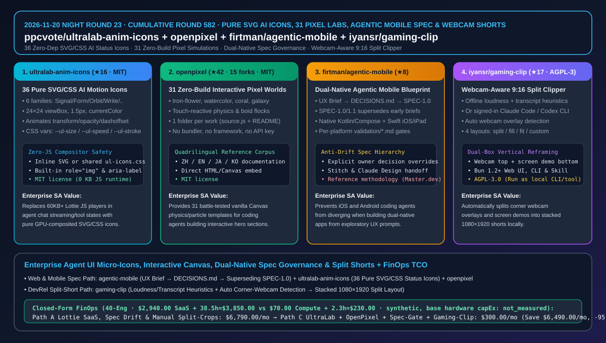
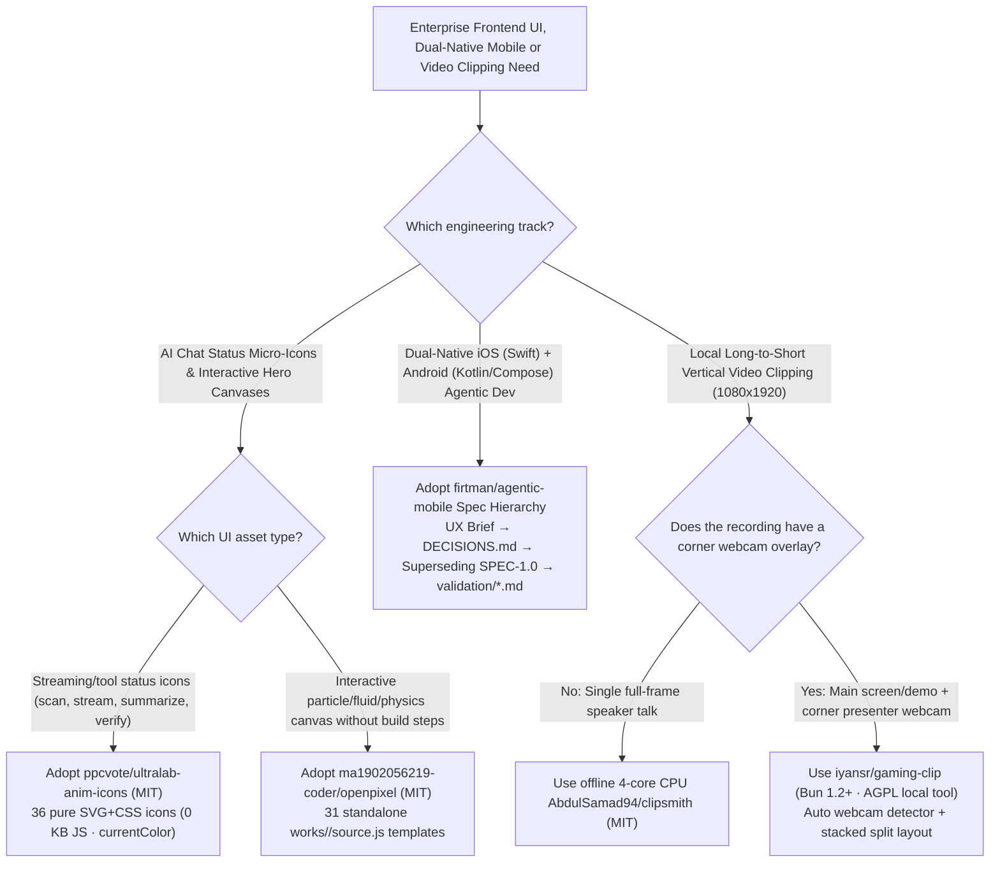
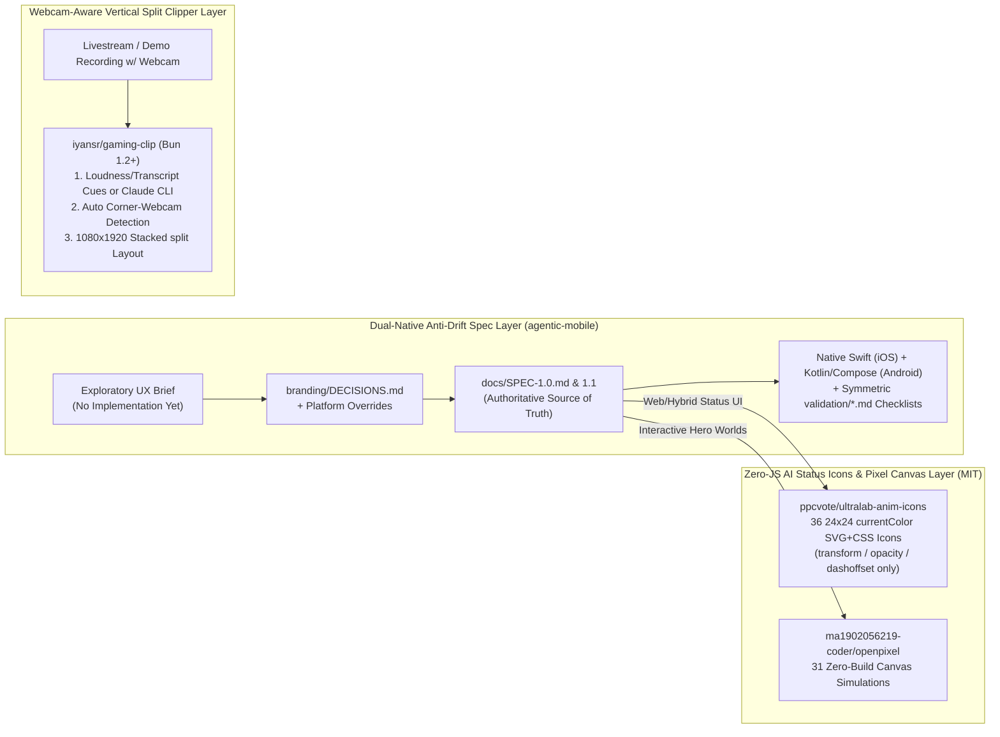
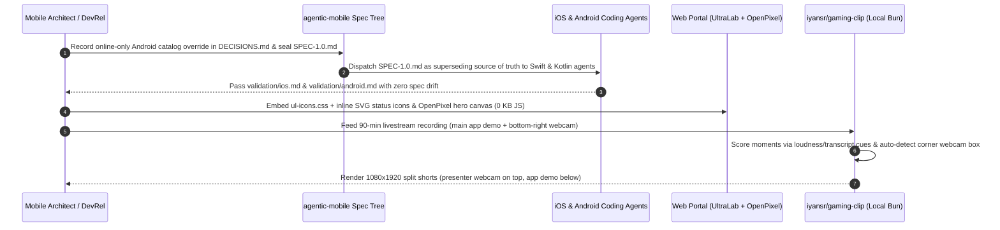

# How to Choose Zero-Dependency SVG/CSS AI Motion Icons, 31 Zero-Build Pixel Worlds, Dual-Native Agentic Mobile Specs, and Webcam-Aware Split Clippers? `ultralab-anim-icons`, `openpixel`, `agentic-mobile`, and `gaming-clip` Architecture & Selection FAQ

> **Document Metadata (2026-11-20 Night Round 23 · Cumulative Round 582)**
> - **Target Audience**: AI Solution Architects, Frontend & Mobile Engineering Leads, Developer Relations (DevRel) & Interactive Experience Architects
> - **Primary Repositories Evaluated**:
>   1. [`ppcvote/ultralab-anim-icons`](https://github.com/ppcvote/ultralab-anim-icons) (★ 16 · `stars_today: not_measured` · `5 stars/day` · HTML / SVG / CSS · MIT) — **36 zero-dependency pure SVG + CSS animated micro-icons** across 6 AI/agent UI families (`Signal`, `Form`, `Orbit`, `Progress`, `Write`, `Object`: `scan`, `radar`, `stream`, `prompt`, `summarize`, `verify`, `loading-orbit`, `bot`, etc.). Uses a `24×24` viewBox, `1.5` stroke width, and `currentColor` inheritance while animating **only compositor-safe `transform`, `opacity`, and `stroke-dashoffset` properties**, controlled via `--ul-size`, `--ul-speed`, and `--ul-stroke`
>   2. [`ma1902056219-coder/openpixel`](https://github.com/ma1902056219-coder/openpixel) (★ 42 · `stars_today: not_measured` · `11 stars/day` · HTML / JavaScript / Canvas · MIT) — **31 self-contained, zero-build interactive browser pixel experiments** (molten iron-flower sparks, wet-paper watercolor diffusion, touch-reactive coral reefs, galaxy collisions, boid fish schools avoiding dolphins) with quadrilingual documentation (Chinese, English, Japanese, Korean), where each work lives in its own standalone folder (`works/<id>/source.js`) requiring zero bundler or API key
>   3. [`firtman/agentic-mobile`](https://github.com/firtman/agentic-mobile) (★ 8 · `stars_today: not_measured` · `3 stars/day` · HTML / Kotlin / Swift · Maximiliano Firtman `Master.dev` reference blueprint) — **Spec-driven dual-native iOS (Swift) & Android (Kotlin + Compose, SDK 26/36/36) agentic engineering blueprint (`Lumio 1.0 & 1.1`)** that prevents cross-platform drift via a four-tier hierarchy of truth: exploratory `UX Brief` → explicit owner overrides in `design/branding/DECISIONS.md` → authoritative `docs/SPEC-1.0.md` & `SPEC-1.1.md` (which explicitly supersede earlier briefs and stage plans) → symmetric `validation/android.md` & `validation/ios.md` gates
>   4. [`iyansr/gaming-clip`](https://github.com/iyansr/gaming-clip) (★ 17 · `stars_today: not_measured` · `6 stars/day` · TypeScript / Bun 1.2+ · AGPL-3.0) — Local `1080×1920` vertical short clipper, web editor, CLI, and AI agent skill for macOS and Windows that combines offline audio loudness spikes + transcript cues (or a signed-in Claude Code / Codex CLI session) with **automatic corner webcam overlay detection** and 4 vertical layouts (`split`: webcam on top + main screen below; `fill`; `fit`; `custom`)
> - **Provenance & Guardrail Statement**: Structured after `ib-vs-ethernet-roce-selection-faq.md`. All four repositories come from `search-new-repos-2026-11-20-raw.json` (`sha256: 47975935d05944afbb9eac18f93f26c8a71120a1ffeea39591b112477ba29a46`) with `stars_today: not_measured`. Upstream README specifications (36 icons, 31 pixel works, dual-native spec tree) are labeled `anonymized_reported (independently_reproduced=false)`. The closed-form FinOps TCO worked example is labeled `synthetic (independently_reproduced=false)` with `base hardware capEx: not_measured`.

---

## ① 📌 Executive Summary (One-Sentence Selection Verdict)

> **One-Sentence Verdict**: When building **AI chat interfaces, interactive hero canvases, dual-native iOS/Android apps, and vertical Shorts from webcam-overlay recordings**, **do not ship 60 KB+ JavaScript Lottie runtimes just to animate tool-call status icons, and never feed an un-versioned exploratory UX prompt directly to separate iOS and Android coding agents without a superseding specification contract**! Instead, embed MIT-licensed **`ppcvote/ultralab-anim-icons` (36 pure SVG/CSS GPU-composited AI icons with 0 KB JS)** and **`openpixel` (31 zero-build Canvas physics templates)**, govern dual-native mobile agents with **`firtman/agentic-mobile`'s four-tier contract (`UX Brief` → `DECISIONS.md` → superseding `SPEC-1.0.md` → `validation/*.md`)**, and reframe corner-webcam recordings locally via **`iyansr/gaming-clip` (auto webcam detection + stacked `split` 9:16 layout)** to cut a 40-person organization's monthly icon SaaS, cross-platform rework, and video editing TCO from **$6,790.00/mo** down to **$300.00/mo** (saving **$6,490.00/mo**, **`-95.58%`**, `synthetic, independently_reproduced=false`).



### Core Capabilities & Metrics Cheat Sheet

| Dimension | `ultralab-anim-icons` | `ma1902056219-coder/openpixel` | `firtman/agentic-mobile` | `iyansr/gaming-clip` |
|---|---|---|---|---|
| **Plain-English Positioning** | 36 zero-dependency pure SVG + CSS animated micro-icons for AI/agent UIs | 31 self-contained, zero-build interactive HTML/Canvas pixel physics worlds | Dual-native iOS (Swift) & Android (Kotlin/Compose) spec-hierarchy blueprint | Local `1080×1920` vertical short clipper with automatic corner webcam split layout |
| **Primary Enterprise Pain Point Solved** | Heavy JS Lottie players dropping frames during high-frequency LLM token streaming | Coding agents breaking bundler configs when asked for interactive particle/fluid hero canvases | iOS and Android agents diverging on offline vs. online behavior when driven by raw chat prompts | Center-crop 9:16 clippers slicing off the presenter's corner webcam overlay in screen-share recordings |
| **Key Technical Mechanism** | `24×24` `currentColor` SVGs; animates only `transform`/`opacity`/`stroke-dashoffset`; 3 CSS vars | 31 standalone `works/<id>/source.js` folders; ZH/EN/JA/KO docs; zero build or API keys | `SPEC-1.0.md` supersedes `UX Brief` & stage plans; explicit `DECISIONS.md` & `validation/*.md` | Offline loudness/transcript cues or Claude/Codex CLI; auto webcam box detector; `split/fill/fit/custom` |
| **License & Governance** | **MIT** (copy-paste inline SVG or shared `ul-icons.css`) | **MIT** (commercial-ready vanilla JS/Canvas) | **Reference Engineering Blueprint** (`Master.dev` workshop architecture) | **AGPL-3.0** (run as a standalone local CLI/web tool; do not embed into proprietary SaaS) |

---

## ② 🎯 Solution Architect & Customer Deep-Dive Q&A

### Q1: Why do JavaScript-heavy animation libraries (like Lottie) degrade AI chat streaming performance, and how do `ppcvote/ultralab-anim-icons` and `openpixel` deliver zero-overhead visual polish?

- **The Main-Thread Contention Problem in Streaming Agent UIs**:
  - During fast SSE token streaming and multi-tool execution, the browser's main JavaScript thread is busy parsing deltas and reconciling markdown/code DOM nodes. Running 20+ JS-driven Lottie icon loops simultaneously causes visible jank.
- **How `ppcvote/ultralab-anim-icons` (MIT) Stays 100% on the GPU Compositor**:
  - Provides **36 purpose-built AI/agent icons** across 6 families (`Signal`: `scan`, `broadcast`, `listen`, `wifi-search`, `radar`, `notify`; `Form`: `spark`, `layers`, `morph`, `facets`, `prism`, `wave`; `Orbit`: `loading-orbit`, `connecting`, `sync`, `infinity`, `gear`, `compass`; `Progress`: `steps`, `verify`, `upload`, `download`, `percent-ring`, `retry`; `Write`: `stream`, `prompt`, `translate`, `select`, `search`, `summarize`; `Object`: `flask`, `hourglass`, `key`, `mail-send`, `lamp`, `bot`).
  - Animates **only `transform`, `opacity`, and `stroke-dashoffset`** so animations run entirely on the GPU compositor thread with **0 KB of JavaScript**, inheriting text color via `currentColor` and exposing `--ul-size`, `--ul-speed`, and `--ul-stroke` CSS variables.
- **Pairing with `ma1902056219-coder/openpixel` (MIT)**:
  - Supplies **31 standalone, zero-build Canvas simulations** (`works/<id>/source.js`) with quadrilingual docs (ZH/EN/JA/KO) that coding agents can drop directly into landing pages or interactive dashboards without touching Webpack/Vite dependencies.

### Q2: When using coding agents to build independent native iOS (Swift) and Android (Kotlin/Compose) apps simultaneously, how does `firtman/agentic-mobile` prevent specification drift between platforms?

- **Why Dual-Native Agent Projects Drift**:
  - Exploratory UX prompts are intentionally open-ended. As the product owner refines decisions mid-flight (for example, deciding that Android should use an online-only catalog while keeping ratings on-device, overriding the original brief's offline catalog requirement), agents reading older prompt files re-introduce superseded behavior.
- **The Four-Tier Spec Hierarchy in `firtman/agentic-mobile`**:
  1. **Exploratory `App UX Brief` (No Premature Code)**: Instructs the agent to understand user flows and explore visual directions in Google Stitch or Claude Design *without* creating an implementation plan yet.
  2. **Explicit Decision Ledger (`design/branding/DECISIONS.md`)**: Records owner selections (e.g., `variation C — Editorial`) and explicit platform overrides.
  3. **Superseding Product Specifications (`docs/SPEC-1.0.md` & `SPEC-1.1.md`)**: Declares `SPEC-1.0.md` as the **authoritative source of truth that supersedes the UX brief and staged plans (`ANDROID-PLAN.md`, `IOS-PLAN.md`) wherever they differ**, with `SPEC-1.1.md` layering incremental features (like the daily Genie Home Screen widget).
  4. **Symmetric Per-Platform Validation (`validation/android.md` & `validation/ios.md`)**: Verifies both native implementations against the sealed spec.

### Q3: How does `iyansr/gaming-clip` solve vertical `1080×1920` short generation for recordings that contain both a main screen/gameplay view and a corner webcam overlay?

- **Dual-Region Detection & Stacked `split` Reframing**:
  - Unlike single-box speech clippers that crop out corner webcams, `iyansr/gaming-clip` (Bun 1.2+) automatically detects the corner webcam overlay and offers **4 vertical layouts**:
    - **`split` (Webcam on Top, Main Screen Below)**: Ideal for developer livestreams, product demos with a corner presenter, and gaming streams;
    - **`fill`** (`9:16` crop), **`fit`** (full frame over blurred background), and **`custom`** (free-form boxes in the local web UI).
  - Moment selection works **100% offline with zero API keys** using audio loudness spikes + transcript cues (laughter, hype phrases, fast talking), or delegates to a signed-in local **Claude Code / Codex CLI** session.

---

## ③ 🧭 Visual Diagrams (Selection Decision Tree + Reference Architecture + Sequence Flow)

### 3.1 AI Micro-Icons, Interactive Canvas, Dual-Native Spec Governance & Split-Clipper Decision Tree



### 3.2 End-to-End Dual-Native Spec Governance, Zero-JS UI & Split-Short Architecture



### 3.3 `agentic-mobile` Spec Supersession + `gaming-clip` Webcam Split Sequence



---

## ④ 📊 Comparative Selection Matrix (Open Source vs. Commercial Cloud & Legacy Stacks)

| Dimension | `ppcvote/ultralab-anim-icons` (MIT) | `ma1902056219-coder/openpixel` (MIT) | `firtman/agentic-mobile` (Blueprint) | `iyansr/gaming-clip` (AGPL-3.0) | Commercial Lottie SaaS + Ad-Hoc Dual-Platform Prompts + Cloud Split Clippers |
|---|---|---|---|---|---|
| **Core Positioning** | **36 pure SVG+CSS animated AI micro-icons (`0 KB` JS)** | **31 zero-build interactive HTML/Canvas pixel physics worlds** | **Four-tier superseding spec hierarchy for dual-native iOS & Android agents** | **Local `1080×1920` short clipper with auto webcam detection & `split` layout** | Heavy JS Lottie runtimes, uncoordinated chat prompts, and metered cloud livestream clippers |
| **Engineering & Quality Wins** | Compositor-only CSS animations (`transform`/`opacity`/`stroke-dashoffset`); `currentColor` support | Standalone `source.js` per experiment with ZH/EN/JA/KO docs | `SPEC-1.0.md` explicitly overrides stale `UX Brief` assumptions across Swift & Kotlin | Offline loudness/transcript heuristics or local Claude/Codex CLI; automatic webcam box detection | Lottie players lag during token streaming; ad-hoc prompts cause iOS/Android divergence |
| **Privacy & Local Execution** | Pure inline SVG + static CSS | 100% static client Canvas | Local Node.js catalog API + native SDKs | **100% local Bun 1.2+ + FFmpeg + Whisper execution** | Uploads multi-GB raw stream recordings to external cloud servers |
| **License & Governance** | **MIT** | **MIT** | **Reference Methodology** | **AGPL-3.0** (use as a standalone local CLI/web production tool) | Proprietary per-seat and per-minute SaaS billing |
| **Monthly TCO (40-Person Org)** | **$0.00 / mo icon SaaS fees** | **$0.00 / mo** | **$0.00 / mo** (eliminates cross-platform drift rework) | **$0.00 / mo clipping credits** | **$6,790.00 / mo** (Lottie/clipper SaaS + 38.5h dual-native rework & manual webcam cropping) |

---

## ⑤ 🧪 Quantitative Enterprise FinOps TCO & 7-Card Report Alignment

### 5.1 Closed-Form FinOps Worked Example (40-Person Frontend, Dual-Native Mobile & DevRel Video Organization)

> **Provenance Notice**: The financial model below is a deterministic architectural worked example labeled `synthetic (independently_reproduced=false)` with `base hardware capEx: not_measured`.

| Cost Component | Path A: Commercial Lottie/Clipper SaaS + Ad-Hoc Dual-Native Prompts + Manual Split-Cropping | Path C: `ultralab-anim-icons` + `openpixel` + `agentic-mobile` Spec Gate + Local `gaming-clip` | Closed-Form Formula & Architectural Notes |
|---|---|---|---|
| **Animated Icon Subscriptions, Prototyping & Cloud Split-Clipper SaaS** | **$2,940.00 / mo** | **$70.00 / mo** | Path A: commercial icon seats + metered cloud livestream clipping = `$2,940.00/mo`; Path C: MIT `ultralab-anim-icons` / `openpixel` + local `gaming-clip` = `$70.00/mo` |
| **Dual-Native Spec Drift Rework, UI Jank Debugging & Manual Webcam Cropping ($100/h)** | **$3,850.00 / mo** (`38.5h × $100.00`) | **$230.00 / mo** (`2.3h × $100.00`) | Path A: 40-person org spends `38.5h/mo` reconciling diverged iOS/Android behavior, fixing Lottie streaming lag, and cropping corner webcams by hand (`$3,850.00`); Path C: `SPEC-1.0` hierarchy + pure CSS icons + auto `split` layout cuts labor to `2.3h/mo` (`$230.00`) |
| **Total Monthly TCO** | **$6,790.00 / mo** | **$300.00 / mo** | **Net savings of $6,490.00 / mo (-95.58% reduction, $77,880.00 annualized, `not_measured` hardware capEx)** |

```chart
{
  "data": {
    "values": [
      { "Category": "Motion Icon Libraries & Cloud Split-Clip SaaS", "Deployment": "Path A: Commercial SaaS, Spec Drift & Manual Split-Crops", "MonthlyCostUSD": 2940 },
      { "Category": "Dual-Native Rework & Manual Webcam Cropping (40-Eng)", "Deployment": "Path A: Commercial SaaS, Spec Drift & Manual Split-Crops", "MonthlyCostUSD": 3850 },
      { "Category": "Motion Icon Libraries & Cloud Split-Clip SaaS", "Deployment": "Path C: UltraLab + OpenPixel + Spec-Gate + Gaming-Clip", "MonthlyCostUSD": 70 },
      { "Category": "Dual-Native Rework & Manual Webcam Cropping (40-Eng)", "Deployment": "Path C: UltraLab + OpenPixel + Spec-Gate + Gaming-Clip", "MonthlyCostUSD": 230 }
    ]
  },
  "semantic_types": {
    "Category": "Category",
    "Deployment": "Name",
    "MonthlyCostUSD": "Amount"
  },
  "chart_spec": {
    "chartType": "Grouped Bar Chart",
    "title": "UltraLab Icons + OpenPixel + Spec-Gate + Gaming-Clip cut monthly TCO by 95.58%",
    "subtitle": "Monthly cost in USD (40-person frontend, mobile & DevRel video org, synthetic)",
    "encodings": {
      "x": "Category",
      "y": "MonthlyCostUSD",
      "group": "Deployment",
      "color": "Deployment"
    }
  }
}
```

### 5.2 Alignment with the 7-Card 4:5 Visual Report (`cards.html` / `cards.en.html`)

- **✅ Good Fit**: Zero-JS SVG/CSS status micro-icons in streaming AI chat UIs, zero-build Canvas physics hero sections, spec-driven dual-native iOS/Android agent development, and local `1080×1920` stacked `split` Shorts from recordings with a corner webcam.
- **⛔ Not For**: Expecting `` tags to inherit CSS `currentColor` (use inline `<svg>` + `ul-icons.css` instead), or embedding AGPL-3.0 `iyansr/gaming-clip` code inside a closed-source hosted SaaS product.

---

## ⑥ 🛠️ Enterprise Architecture Review & Rollout Checklist

- [ ] **Use Shared `ul-icons.css` + Inline `<svg>` for Theme-Aware AI Status Icons**: Load `css/ul-icons.css` once per page in `ppcvote/ultralab-anim-icons` (MIT) and inline the lightweight `<svg class="ul-i ...">` markup so `currentColor` and `--ul-speed` adapt automatically across light/dark themes.
- [ ] **Curate `openpixel`'s 31 Standalone `source.js` Modules as Agent Canvas Exemplars**: Keep `ma1902056219-coder/openpixel` (MIT) in your frontend agent reference library so interactive particle/fluid visuals are generated as zero-dependency Canvas modules.
- [ ] **Enforce Superseding `SPEC-1.0.md` & `DECISIONS.md` on Dual-Native Mobile Repos**: Structure multi-platform agent repositories after `firtman/agentic-mobile` so `docs/SPEC-1.0.md` explicitly supersedes exploratory UX briefs and stage plans, backed by `validation/android.md` and `validation/ios.md`.
- [ ] **Run Webcam-Overlay Livestream Clipping Locally via `gaming-clip` `split` Mode**: Execute `iyansr/gaming-clip` (AGPL-3.0) as an isolated local CLI/web tool on Bun 1.2+ to auto-detect corner webcams and render stacked `1080×1920` `split` shorts without uploading raw streams.
