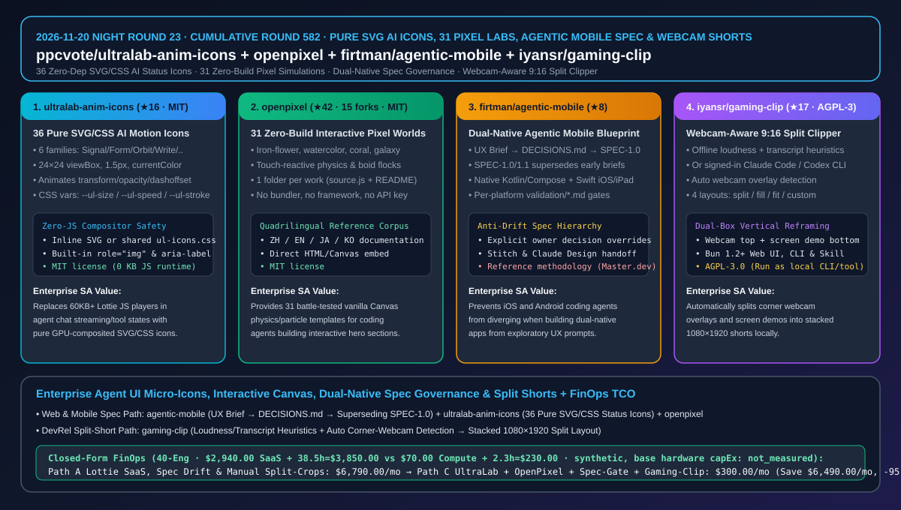
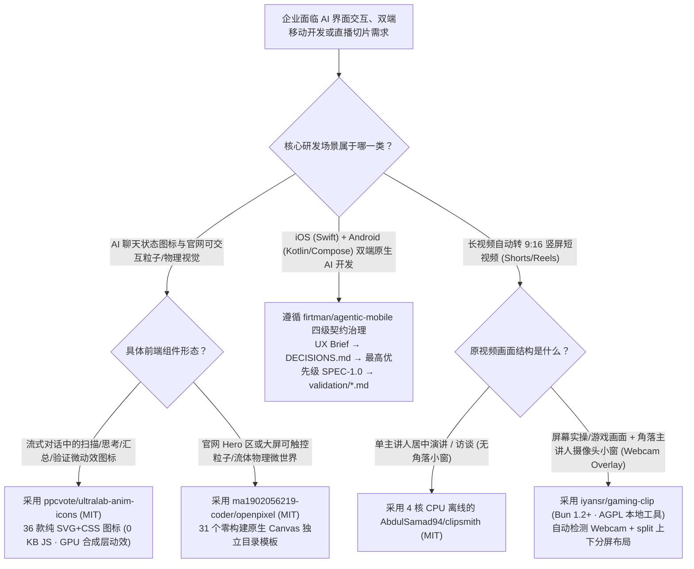
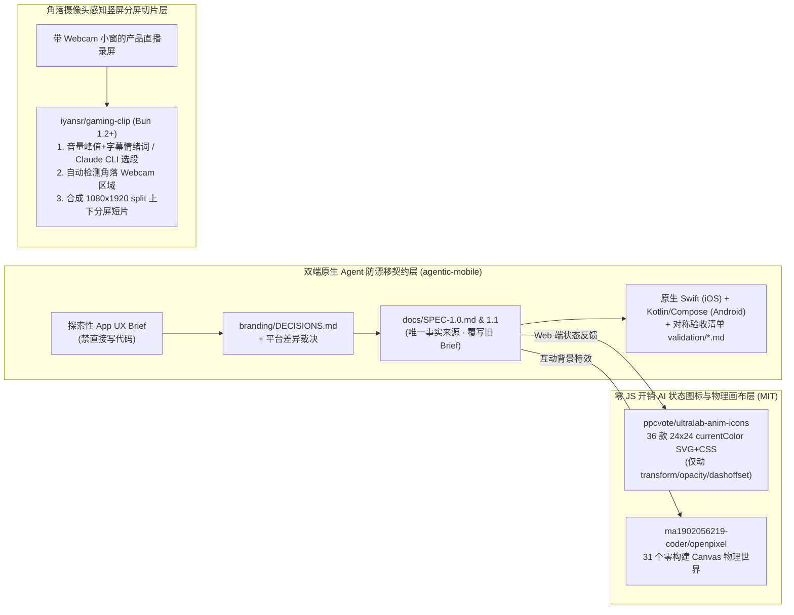
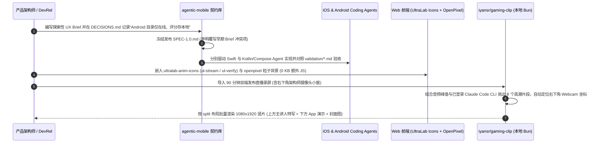

# 纯 SVG/CSS 零依赖 AI 状态动效图标、31 款零构建交互像素实验、双端原生移动应用契约治理与摄像头分屏竖版切片怎么选？`ultralab-anim-icons`、`openpixel`、`agentic-mobile` 与 `gaming-clip` 架构与选型 FAQ

> **文档元数据（2026-11-20 夜间第 23 轮 · 累计第 582 轮 / Round 582）**
> - **适用读者**：AI Solution Architect（解决方案架构师）、AI 应用前端与移动端技术负责人、开发者关系（DevRel）与互动营销工程负责人
> - **本轮核心对比项目**：
>   1. [`ppcvote/ultralab-anim-icons`](https://github.com/ppcvote/ultralab-anim-icons)（★ 16 · `stars_today: not_measured` · `5 stars/day` · HTML / SVG / CSS · MIT）——专为 AI 对话与 Agent 状态反馈设计的 **36 款纯 SVG + CSS 零依赖微动效图标库**（涵盖 `Signal`、`Form`、`Orbit`、`Progress`、`Write`、`Object` 6 大分类，如 `stream`、`prompt`、`summarize`、`verify`、`loading-orbit`、`radar`、`bot`），采用 `24×24` viewBox、`1.5px` 线宽与 `currentColor` 继承文字颜色，**严格仅对 GPU 合成层友好的 `transform`、`opacity` 与 `stroke-dashoffset` 做动画**，通过 `--ul-size`、`--ul-speed`、`--ul-stroke` 三个 CSS 变量即可全局控速控粗细
>   2. [`ma1902056219-coder/openpixel`](https://github.com/ma1902056219-coder/openpixel)（★ 42 · `stars_today: not_measured` · `11 stars/day` · HTML / JavaScript / Canvas · MIT）——收录 **31 个可运行、可交互、可拆解的纯浏览器像素物理与粒子世界**（如打铁花、水彩湿纸晕染、触碰依次收起的珊瑚礁、星系相撞、躲避海豚的鱼群等），每件作品独立成目录（仅含 `source.js` + 四语说明文档，无打包器、无框架依赖、无需 AI API Key）
>   3. [`firtman/agentic-mobile`](https://github.com/firtman/agentic-mobile)（★ 8 · `stars_today: not_measured` · `3 stars/day` · HTML / Kotlin / Swift · Maximiliano Firtman `Master.dev` 移动 Agent 工程范本）——展示如何用 AI 同步开发独立原生 **Android（Kotlin + Compose, SDK 26/36/36）与 iOS/iPadOS（Swift）** 双端应用而不发生需求漂移的规范工程（`Lumio 1.0 & 1.1`），确立了**“探索性 `UX Brief` → 品牌与架构裁决记录 `DECISIONS.md` → 具有最高法律效力的 `SPEC-1.0.md`（显式覆盖早期 Brief 与分阶段计划）→ 双端独立验收清单 `validation/*.md`”**的四级防漂移契约树
>   4. [`iyansr/gaming-clip`](https://github.com/iyansr/gaming-clip)（★ 17 · `stars_today: not_measured` · `6 stars/day` · TypeScript / Bun 1.2+ · AGPL-3.0）——面向“角落带真人摄像头小窗（Webcam Overlay）的录屏/直播长视频”的本地 `1080×1920` 竖屏切片工作台与 Agent Skill，支持离线音量峰值+台词情绪词启发式筛选（或直接复用本机已登录的 Claude Code / Codex CLI），**自动检测画面角落的主讲人摄像头区域**，并提供 **`split`（上方主讲人摄像头 + 下方屏幕实操/游戏画面上下分屏）**、`fill`、`fit` 与 `custom` 四种竖屏重排布局
> - **口径与溯源声明**：本篇遵循 `ib-vs-ethernet-roce-selection-faq.md` 通俗问答与选型对比规范。四款项目均来自 `search-new-repos-2026-11-20-raw.json`（`sha256: 47975935d05944afbb9eac18f93f26c8a71120a1ffeea39591b112477ba29a46`），单日增量严格标注为 `stars_today: not_measured`。项目 README 自报的 36 款图标、31 件像素实验与双端规范结构标注为 `anonymized_reported (independently_reproduced=false)`；架构师 TCO 闭式算例标注为 `synthetic (independently_reproduced=false)`，硬件购置折旧 `base hardware capEx: not_measured`。

---

## ① 📌 核心结论速览（选型一句话结论）

> **一句话选型结论**：在建设**企业 AI 对话前端微交互、官网互动粒子视觉、iOS/Android 双端原生 Agent 开发流程与带真人小窗的技术直播切片管线**时，**切勿为了几十个“正在思考/正在汇总/雷达扫描”小图标去引入几十 KB 的 Lottie JS 播放器，也切勿把同一份模糊的口语 UX 提示词直接丢给两个窗口分别生成 iOS 和 Android 代码（必导致两端离线缓存策略与状态机彻底分叉）**！最佳实践是：AI 状态图标直接内嵌 MIT 的 **`ppcvote/ultralab-anim-icons`（36 款纯 SVG+CSS GPU 合成层动效，0 KB JS 开销）**，互动背景参考 MIT 的 **`openpixel`（31 个零构建原生 Canvas 物理模板）**，双端移动开发遵循 **`firtman/agentic-mobile` 的“四级覆盖式契约（`UX Brief` → `DECISIONS.md` → 最高优先级 `SPEC-1.0.md` → `validation/*.md`）”**，带小窗的长录屏转竖屏采用 **`iyansr/gaming-clip`（自动识别角落摄像头并切为上人像、下演示的 `split` 上下分屏布局）**，可将 40 人产研与营销团队月度动效库订阅、双端返工与手工裁切总成本（TCO）从 **$6,790.00/月** 压降至 **$300.00/月**（净省 **$6,490.00/月**，降幅 **-95.58%**，`synthetic, independently_reproduced=false`）。



### 核心指标与能力速查表

| 评估维度 | `ultralab-anim-icons` | `ma1902056219-coder/openpixel` | `firtman/agentic-mobile` | `iyansr/gaming-clip` |
|---|---|---|---|---|
| **一句话通俗定位** | 36 款专为 AI 状态设计的零依赖纯 SVG + CSS 微动效图标库 | 31 个零构建、单目录自包含的浏览器 Canvas 像素物理与交互实验 | 防双端分叉的 iOS (Swift) + Android (Kotlin/Compose) 规范驱动 Agent 开发蓝图 | 自动检测角落摄像头并重排为“上人像+下屏幕”竖屏短片的本地切片器 |
| **解决的核心业务痛点** | AI 聊天界面每个流式步骤都挂 Lottie JSON 导致低端机掉帧与包体积膨胀 | 让 AI 从零写复杂粒子/流体互动背景容易写崩构建配置或卡死主线程 | 同一个 UX 提示词让 AI 分别写 iOS 和 Android，两端在离线行为与细节上各写各的 | 普通竖屏切片工具把横屏居中一刀切，导致角落里的主讲人摄像头小窗被切掉 |
| **关键技术参数与机制** | 6 大类 36 图标；`currentColor`；仅动 `transform/opacity/stroke-dashoffset`；3 个 CSS 变量 | 31 个独立 `works/<name>/source.js`；中英日韩四语文档；零打包器零外部依赖 | `SPEC-1.0.md` 显式覆盖早期 `UX Brief`；`DECISIONS.md` 记录架构覆盖（如 Android 仅在线目录） | 离线音量/情绪词或直连已登录 Claude/Codex CLI；自动框选 Webcam；`split/fill/fit/custom` 四布局 |
| **开源协议与合规状态** | **MIT**（可直接复制内联 SVG 或引 `ul-icons.css`） | **MIT**（代码可直接移植进企业官网与数据大屏） | **教学参考方法论**（仓库未挂标准开源协议，借鉴其四级文档治理结构） | **AGPL-3.0**（作为本地独立 Bun CLI / Web 工具运行，切勿静态嵌入闭源产品） |

---

## ② 🎯 客户与架构师灵魂拷问 Q&A（直击业务落地痛点）

### Q1：在企业 AI Copilot / Agent 聊天界面里，展示“正在联网检索（`radar`/`wifi-search`）、正在流式输出（`stream`）、正在执行多步计划（`steps`）、正在总结（`summarize`）”时，为什么 `ppcvote/ultralab-anim-icons` + `openpixel` 比引入 Lottie 或 Three.js 重型库更适合生产环境？

- **AI 流式界面引入重型动效库的隐形性能税**：
  - 当一个长会话里有 30 个 Tool Call 折叠卡片同时在跑状态动画时，基于 JS 逐帧操作 DOM 的 Lottie 播放器会与 React/Vue 的流式 Markdown 渲染争抢主线程（Main Thread），导致打字机输出一卡一顿。
- **`ppcvote/ultralab-anim-icons`（MIT）的三项极致轻量准则**：
  1. **100% 跑在浏览器 GPU 合成线程（Compositor-Only Properties）**：全库 36 个 AI 专属图标（涵盖 `Signal`、`Form`、`Orbit`、`Progress`、`Write`、`Object` 六大语义族）统一采用 `24×24` viewBox 与 `1.5px` 线宽，**严格只对 `transform`、`opacity` 和 `stroke-dashoffset` 三个属性做 CSS 动画**——即使主线程正在高负载解析大段 JSON，图标动画依然 60fps 丝滑运转！
  2. **文字颜色自动继承（`currentColor`）与 CSS 变量控速**：无需为深色/浅色主题或成功/警告状态准备多套图标文件，直接改父元素 CSS `color: #5EEAD4` 即可变色；通过 `--ul-size`、`--ul-speed`、`--ul-stroke` 随时调节速度与笔触，且内置 `role="img"` 与 `aria-label` 无障碍读屏属性。
  3. **搭配 `ma1902056219-coder/openpixel`（MIT）构建零构建互动视觉**：当企业官网或展厅大屏需要“打铁花粒子飞溅、水彩在湿纸上自然晕染、鱼群躲避海豚”等可触控互动背景时，`openpixel` 提供了 **31 个完全独立的原生 HTML/Canvas 物理实验目录（`works/<id>/source.js`）**，无需 Webpack/Vite 构建即可直接作为 Coding Agent 的高质量 Few-Shot 物理特效模板。

### Q2：企业用 Claude Code / Cursor 同时开发 iOS（Swift）和 Android（Kotlin + Jetpack Compose）双端原生 App 时，为什么只写一份 Prompt 会导致两端行为严重不一致？Maximiliano Firtman 的 `firtman/agentic-mobile` 给出了什么“防分叉契约体系”？

- **双端原生 Agentic Development 的最大陷阱——“提示词演进漂移（Prompt Evolution Drift）”**：
  - 项目第一天写了份 `UX Brief`（比如“要求目录数据缓存到本地支持离线浏览”），让 Agent 先写了 iOS 端；第三天产品经理在调 Android 端时决定“Android 端目录只走在线 API，仅把用户评分留在本地”，如果只改了分阶段计划 `ANDROID-PLAN.md` 而不明确文档优先级，下一个接手修 Bug 的 Agent 读到最初的 `UX Brief` 就会把刚写好的在线逻辑又改回离线缓存！
- **`firtman/agentic-mobile` 的四级文档主权阶梯（Hierarchy of Truth）**：
  1. **第一层：零实现预设的探索性 `App UX Brief`**：在 Prompt 开头显式声明 *“Treat the following as a description of what the app offers; do not create an implementation plan or start building yet”*，先在 Google Stitch 或 Claude Design 中对齐视觉与交互流。
  2. **第二层：架构与品牌裁决账本（`design/branding/DECISIONS.md`）**：把人类架构师做出的拍板决定（如选定 `Variation C — Editorial` 风格、Android 端 `SDK 26/36/36` 在线目录覆盖原 Brief 的离线要求）单独建档立据。
  3. **第三层：具备最高覆写权的封闭版本规范（`docs/SPEC-1.0.md` & `SPEC-1.1.md`）**：明确规定 **`SPEC-1.0.md` 是应用行为的唯一事实来源（Source of Truth），凡与早期 `UX Brief` 或分阶段计划（`ANDROID-PLAN.md` / `IOS-PLAN.md`）冲突之处，一律以 `SPEC` 为准**！当迭代新特性（如 1.1 新增桌面小组件 Genie Widget）时，增量发布 `SPEC-1.1.md`。
  4. **第四层：双端对称验收清单（`validation/android.md` & `validation/ios.md`）**：为每个平台配备独立的端到端验收 Checklist，确保两端在各自原生 SDK 下交付完全一致的业务契约。

### Q3：很多技术直播、产品 Webinar 或游戏解说视频的右下角都有一个主讲人摄像头小窗（Webcam Overlay），为什么普通 9:16 竖屏切片工具切出来的效果惨不忍睹？`iyansr/gaming-clip` 是怎么解决的？

- **单框居中裁切对“屏幕演示 + 角落人像”视频的破坏**：
  - 当原视频是 `1920×1080` 横屏（中间是代码/产品界面或游戏画面，角落是主讲人摄像头小窗）时，上一轮介绍的纯单框裁切工具要么只裁了中间屏幕（丢掉了主讲人表情），要么把摄像头切得只剩半张脸。
- **`iyansr/gaming-clip`（AGPL-3.0）的“双框检测 + 四种竖屏重排布局”**：
  1. **离线启发式 + 已登录 Agent CLI 双模选片**：既可以完全不花一分钱、零账号用内置启发式算法（**音频音量爆发峰值 + 字幕中的欢呼/笑声/高语速关键词**）离线挑出高光时刻，也可以直接调用你电脑上已经登录好的 **Claude Code 或 Codex CLI** 智能挑选 1–60 条切片。
  2. **自动识别角落 Webcam 并合成 `split` 上下分屏竖片**：自动探测原视频中摄像头小窗的坐标框，在导出 `1080×1920` 竖屏时提供四种专业布局：
     - **`split`（上下分屏，最适合技术直播/Webinar/游戏解说）**：将抠出的主讲人摄像头画面放在竖屏上半部分，将核心操作/游戏画面放在下半部分！
     - **`fill`**（全屏 `9:16` 裁切）、**`fit`**（高斯模糊背景居中容纳整帧横屏）与 **`custom`**（在本地 Web 编辑器中自由拖拽多框位置），并自动烧录动态字幕与生成封面缩略图。

---

## ③ 🧭 直观可视化图解（选型决策树 + 企业集成架构 + 业务流时序图）

### 3.1 企业 AI 前端微动效、双端移动契约与直播分屏切片选型决策树



### 3.2 企业双端移动规范治理、零依赖 AI 动效前端与直播分屏切片集成架构



### 3.3 `agentic-mobile` 四级规范演进与 `gaming-clip` 自动摄像头分屏切片时序图



---

## ④ 📊 同类开源与商业云服务横向选型决策矩阵

| 对比维度 | `ppcvote/ultralab-anim-icons` (MIT) | `ma1902056219-coder/openpixel` (MIT) | `firtman/agentic-mobile` (方法论蓝图) | `iyansr/gaming-clip` (AGPL-3.0) | 商业 Lottie 订阅 + 无契约双端 Prompt + 云端分屏剪辑 SaaS |
|---|---|---|---|---|---|
| **核心能力定位** | **36 款纯 SVG+CSS 零依赖 AI 状态微动效图标库** | **31 个单文件夹零构建浏览器 Canvas 像素物理与粒子世界** | **含 `SPEC` 最高覆写权的双端原生 iOS/Android Agent 开发规范** | **自动检测角落摄像头并合成 `split` 上下分屏的本地竖屏切片工具** | 付费 Lottie 图标库 + 重型运行时、口头 Prompt 双端开发、按分钟计费云端直播切片 |
| **核心工程优势** | 0 KB JS，仅动 GPU 合成层属性，`currentColor` 自动跟随文字变色 | 每个实验仅一个 `source.js`，中英日韩四语注释，直接拿来改参数即用 | 明确规定 `SPEC-1.0.md` 覆写早期 `UX Brief`，彻底消除双端状态机分叉 | 免 API Key 离线音频/字幕启发式或直连本机 Claude/Codex CLI；自动抠小窗做上下分屏 | 几十个 Lottie 动画同时跑卡顿流式输出；双端 Agent 各自脑补离线逻辑；云切片按分钟收费 |
| **隐私与本地执行** | 纯内联 SVG 或单文件静态 CSS，零外部请求 | 纯静态 HTML/Canvas，零联网、零 API Key | 本地 Node.js 目录服务 + 本地双端工程 | **100% 本地 Bun 1.2+ + FFmpeg + Whisper 执行，直播原片零上云** | 需将数 GB 的原始直播录像上传至外部云剪辑服务器 |
| **开源协议与治理要点** | **MIT** | **MIT** | **参考工程规范**（直接学习其四级文档目录架构） | **AGPL-3.0**（作为本地独立 CLI/Web 工具生产视频完全合规，切勿将源码并入闭源商业软件） | 商业闭源按席位/流量计费 |
| **40 人团队月度 TCO** | **$0.00/月 图标库订阅费** | **$0.00/月** | **$0.00/月**（大幅减少双端对齐返工） | **$0.00/月 切片积分费** | **$6,790.00/月**（商业动效/切片 SaaS 席位 + 38.5h 双端逻辑对齐与手动抠摄像头分屏） |

---

## ⑤ 🧪 应用落地定量收益/TCO 对比与 7-Card 报告映射

### 5.1 架构师闭式 TCO 算例（40 人 AI 前端、iOS/Android 双端研发与 DevRel 视频运营团队月度成本）

> **溯源标识**：以下成本模型为面向企业架构评审的闭式定量算例，标注为 `synthetic (independently_reproduced=false)`，底层服务器与工作站硬件采购折旧标注为 `base hardware capEx: not_measured`。

| 成本构成项 | 方案 A：商业动效图标库 + 无契约双端开发返工 + 云端直播分屏切片 SaaS | 方案 C：`ultralab-anim-icons` + `openpixel` + `agentic-mobile` 契约 + 本地 `gaming-clip` | 计算公式与架构说明 |
|---|---|---|---|
| **商业动效库席位、原型工具与云端分屏视频切片 SaaS** | **$2,940.00 / 月** | **$70.00 / 月** | 方案 A：商业动效图标团队席位 + 直播分屏切片 SaaS 额度 = `$2,940.00/月`；方案 C：MIT `ultralab-anim-icons` / `openpixel` + 本地 `gaming-clip` 仅耗少量可选 LLM 选片 Token = `$70.00/月` |
| **iOS/Android 双端需求漂移对齐、流式 UI 卡顿排障与手动抠小窗分屏（$100/h）** | **$3,850.00 / 月**（`38.5h × $100.00`） | **$230.00 / 月**（`2.3h × $100.00`） | 方案 A：40 人团队每月耗费 `38.5 小时` 修复 iOS 与 Android 因早期 Brief 冲突造成的行为分叉、排查 Lottie 卡顿及手动在剪辑软件里切上下分屏（`$3,850.00`）；方案 C：`SPEC-1.0` 最高覆写契约 + 纯 CSS 图标 + 自动 Webcam 分屏将人工降至 `2.3 小时`（`$230.00`） |
| **月度总拥有成本（Monthly TCO）** | **$6,790.00 / 月** | **$300.00 / 月** | **月度净节省 $6,490.00 / 月（成本降低 -95.58%，年化节省 $77,880.00，`not_measured` 硬件折旧）** |

```chart
{
  "data": {
    "values": [
      { "Category": "Motion Icon Libraries & Cloud Split-Clip SaaS", "Deployment": "Path A: Commercial SaaS, Spec Drift & Manual Split-Crops", "MonthlyCostUSD": 2940 },
      { "Category": "Dual-Native Rework & Manual Webcam Cropping (40-Eng)", "Deployment": "Path A: Commercial SaaS, Spec Drift & Manual Split-Crops", "MonthlyCostUSD": 3850 },
      { "Category": "Motion Icon Libraries & Cloud Split-Clip SaaS", "Deployment": "Path C: UltraLab + OpenPixel + Spec-Gate + Gaming-Clip", "MonthlyCostUSD": 70 },
      { "Category": "Dual-Native Rework & Manual Webcam Cropping (40-Eng)", "Deployment": "Path C: UltraLab + OpenPixel + Spec-Gate + Gaming-Clip", "MonthlyCostUSD": 230 }
    ]
  },
  "semantic_types": {
    "Category": "Category",
    "Deployment": "Name",
    "MonthlyCostUSD": "Amount"
  },
  "chart_spec": {
    "chartType": "Grouped Bar Chart",
    "title": "UltraLab Icons + OpenPixel + Spec-Gate + Gaming-Clip cut monthly TCO by 95.58%",
    "subtitle": "Monthly cost in USD (40-person frontend, mobile & DevRel video org, synthetic)",
    "encodings": {
      "x": "Category",
      "y": "MonthlyCostUSD",
      "group": "Deployment",
      "color": "Deployment"
    }
  }
}
```

### 5.2 与本轮 7-Card 4:5 视觉报告（`cards.html` / `cards.en.html`）的联动

- **适用场景（✅ Good Fit）**：AI 聊天与 Agent 控制台的高帧率零 JS 依赖 SVG 状态微图标、官网与展厅零构建 Canvas 物理互动组件、iOS/Android 双端原生 Agent 开发的四级契约防漂移治理、以及带角落摄像头的技术直播/游戏录屏自动转 `1080×1920` 上下分屏短视频。
- **不适用场景（⛔ Not For）**：通过 `` 标签引入 `ultralab-anim-icons` 却期望它自动继承父元素文字颜色（`` 隔离了外部 CSS `currentColor`，变色必须用内联 `<svg>` 或 `ul-icons.css` class 方式）、或将 AGPL-3.0 协议的 `gaming-clip` 源码直接嵌入闭源 SaaS 对外提供服务。

---

## ⑥ 🛠️ 企业引入与架构评审 Checklist（可直接复制进架构评审单）

- [ ] **AI 聊天界面统一采用内联 `<svg>` + `ul-icons.css` 注入状态动效**：在引入 MIT 协议的 `ppcvote/ultralab-anim-icons` 时，使用方式 2（全局引一次 `css/ul-icons.css` + 精简 `<svg class="ul-i ul-...">`）以兼顾极小 DOM 体积与 `currentColor` 主题换色，并保留 `role="img"` 与 `aria-label` 无障碍标签。
- [ ] **互动视觉组件库沉淀 `openpixel` 单目录零构建规范**：将 `ma1902056219-coder/openpixel`（MIT）中的 31 个独立实验目录纳入内部前端 Agent 的 Few-Shot 参考库，规定所有营销页背景特效必须封装为无第三方依赖的单文件 Canvas 模块。
- [ ] **双端/多端 Agent 开发强制立项 `DECISIONS.md` 与最高优先级 `SPEC-X.Y.md`**：参照 `firtman/agentic-mobile` 建立仓库文档宪法——在 `README.md` 顶层显式声明 `docs/SPEC-1.0.md` 具有高于早期 `UX Brief` 与阶段计划的覆写权，任何平台特定妥协（如在线/离线策略差异）必须写入 `DECISIONS.md` 与 `validation/*.md`。
- [ ] **带摄像头小窗的技术录屏走本地 `gaming-clip` `split` 分屏管线**：针对角落含主讲人摄像头的 Webinar 与实操录屏，在本地工作站通过 Bun 1.2+ 运行 `iyansr/gaming-clip`（利用自动 Webcam 检测生成上人像、下屏幕的 `split` 竖屏布局），并通过独立 CLI 进程方式使用以严格遵守 AGPL-3.0 边界。
