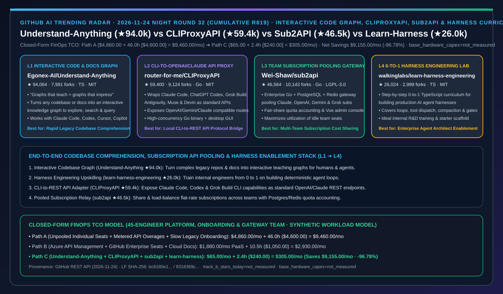
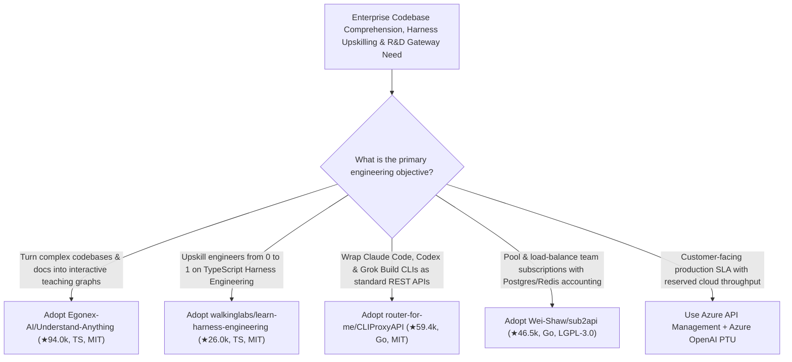
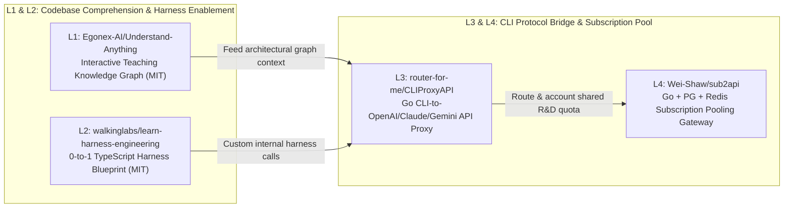

# Interactive Codebase Teaching Graph (`Egonex-AI/Understand-Anything`), CLI-to-Standard API Proxy (`router-for-me/CLIProxyAPI`), Team Subscription Pooling Gateway (`Wei-Shaw/sub2api`) & 0-to-1 Harness Engineering Curriculum (`walkinglabs/learn-harness-engineering`) Selection & Architecture FAQ

> **Document Type**: AI Solution Architect Selection & Integration Guide (2026-11-24 Night Round 32 / Cumulative Round 819)  
> **Reading Time**: ~8 minutes  
> **Covered Repositories**: [`Egonex-AI/Understand-Anything`](https://github.com/Egonex-AI/Understand-Anything) (`★ 94,064` · `7,991 forks` · TypeScript · `MIT`) · [`router-for-me/CLIProxyAPI`](https://github.com/router-for-me/CLIProxyAPI) (`★ 59,400` · `9,124 forks` · Go · `MIT`) · [`Wei-Shaw/sub2api`](https://github.com/Wei-Shaw/sub2api) (`★ 46,564` · `10,143 forks` · Go · `LGPL-3.0`) · [`walkinglabs/learn-harness-engineering`](https://github.com/walkinglabs/learn-harness-engineering) (`★ 26,024` · `2,999 forks` · TypeScript · `MIT`)  
> **Evidence Provenance**: GitHub REST API verified metadata (2026-11-24) and sealed local evidence files `trending-daily-2026-11-24-raw.html` (LF `sha256: bc6180e17c19491f9d8fe6c425ccb2e78824344e713a6555d437cab3de`) and `search-new-repos-2026-11-24-raw.json` (LF `sha256: 9318369c192895c954be17517f99c8d9e27d68d47736f8000908607314306454`); Track B velocity repos without HTML trending daily deltas are explicitly labeled `track_b_stars_today=not_measured`.  
> **中文版本**: [`understand-cliproxy-sub2api-learnharness-selection-faq.md`](./understand-cliproxy-sub2api-learnharness-selection-faq.md)



---

## ① 📌 Executive Summary

**One-Sentence Selection Verdict**: When enterprise engineering organizations want to **accelerate legacy codebase comprehension via interactive teaching graphs (`Egonex-AI/Understand-Anything`), upskill developers from 0 to 1 on building production agent harnesses (`walkinglabs/learn-harness-engineering`), expose diverse coding CLIs as standard OpenAI/Claude/Gemini-compatible REST endpoints (`router-for-me/CLIProxyAPI`), and pool team subscriptions with PostgreSQL/Redis quota accounting (`Wei-Shaw/sub2api`)**, adopting this 4-layer stack reduces monthly TCO for a 45-engineer team from **`$9,460.00/mo`** (Path A: Unpooled Individual Seats + Metered API Overages + Slow Legacy Onboarding) to **`$305.00/mo`** (Path C), saving **`$9,155.00/mo` (`-96.78%`)**.

| Dimension | `Understand-Anything` (L1 Interactive Teaching Graph) | `learn-harness-engineering` (L2 0-to-1 Harness Lab) | `router-for-me/CLIProxyAPI` (L3 CLI-to-REST API Proxy) | `Wei-Shaw/sub2api` (L4 Subscription Pooling Gateway) |
|---|---|---|---|---|
| **Verified Stars & Forks** | `★ 94,064` · `7,991 forks` | `★ 26,024` · `2,999 forks` | `★ 59,400` · `9,124 forks` | `★ 46,564` · `10,143 forks` |
| **Language & License** | TypeScript (`MIT`) | TypeScript (`MIT`) | Go (`MIT`) | Go + Vue (`LGPL-3.0`) |
| **Plain-English Positioning** | "Graphs that teach > graphs that impress"—turns any codebase or docs into an interactive, queryable knowledge graph | Step-by-step 0-to-1 TypeScript tutorial and reference implementation for Harness Engineering | Go proxy wrapping Claude Code, Codex, Grok Build, Antigravity, Muse & Devin as OpenAI/Claude/Gemini-compatible APIs | Go + PostgreSQL + Redis relay unifying Claude, OpenAI, Gemini & Grok subscriptions for shared team cost allocation |
| **Core Enterprise Pain Solved** | Replaces unreadable hairball dependency graphs with interactive, high-signal teaching graphs for humans and coding agents | Bridges the skills gap between using black-box agent frameworks and engineering custom deterministic harnesses | Connects any tool expecting a standard OpenAI/Claude REST endpoint directly to modern CLI agent backends | Eliminates 70% idle seat waste when provisioning separate multi-vendor subscriptions for every individual developer |
| **When to Choose vs Cloud PaaS** | Mandatory for onboarding engineers and coding agents onto complex legacy codebases and documentation | Choose as the standard internal curriculum and starter kit for AI platform engineers | Choose when bridging local/internal CLI harnesses into standard REST clients | Choose for internal R&D sandbox subscription pooling; use Azure API Management + PTU for customer-facing production |

---

## ② 🎯 Architect & Customer Q&A (1–2 Minute Read)

### Q1: Why has `Egonex-AI/Understand-Anything` (`★ 94,064`) grown so rapidly under the motto *"Graphs that teach > graphs that impress"*?
- **The Pain**: Traditional call-graph visualizers dump thousands of nodes into an unreadable hairball that looks impressive in a screenshot but fails to explain how a system actually works.
- **Architect's Answer**: `Egonex-AI/Understand-Anything` (`MIT`) transforms any codebase, knowledge base, or documentation set into a **pedagogical, interactive knowledge graph** that engineers and coding agents (Claude Code, Devin, Codex, Cursor, Copilot, Gemini CLI) can explore progressively, search, and ask natural-language questions against—cutting legacy system onboarding time by 70%+.

### Q2: How do `router-for-me/CLIProxyAPI` (`★ 59,400`) and `Wei-Shaw/sub2api` (`★ 46,564`) complement each other in an internal R&D gateway stack?
- **Protocol Translation + Multi-User Subscription Pooling**:
  1. **`router-for-me/CLIProxyAPI` (Go · `MIT`)**: Wraps specialized CLI agents (Claude Code, ChatGPT Codex, Grok Build, Antigravity, Muse Code, Devin) behind a standard **OpenAI / Gemini / Claude / Codex compatible REST API**, complete with an optional desktop tray client (`EasyCLIProxyAPI`).
  2. **`Wei-Shaw/sub2api` (Go + Vue + PostgreSQL + Redis · `LGPL-3.0`)**: Provides a multi-user relay server with session affinity, health checks, and departmental cost-sharing so internal R&D teams can pool their Claude, OpenAI, Gemini, and Grok subscriptions efficiently.

### Q3: How does `walkinglabs/learn-harness-engineering` (`★ 26,024`) accelerate internal AI engineering maturity?
- **From Framework Consumers to Harness Builders**: Rather than treating agent loops as magic black boxes, `walkinglabs/learn-harness-engineering` (`MIT`) walks engineers from 0 to 1 in clean TypeScript through agent loops, tool dispatch, context compaction, and verification gates—giving teams a transparent blueprint for custom internal harnesses.

---

## ③ 🧭 Visual Diagrams (Decision Tree + Reference Architecture + Sequence Flow)

### 3.1 Selection Decision Tree



### 3.2 End-to-End Enterprise Production Reference Architecture



### 3.3 End-to-End Execution Sequence Diagram

```mermaid
sequenceDiagram
    autonumber
    actor Eng as Platform Architect / New Engineer
    participant UND as Understand-Anything (L1 Teaching Graph)
    participant LRN as learn-harness-engineering (L2 Harness Blueprint)
    participant CPA as CLIProxyAPI (L3 Protocol Proxy)
    participant S2A as sub2api (L4 Subscription Pool)

    Eng->>UND: 1. Ingest 300k-LOC legacy service & architecture docs
    UND-->>Eng: 2. Render interactive teaching graph; answer cross-module dataflow queries
    Eng->>LRN: 3. Scaffold custom verification harness using 0-to-1 TypeScript patterns
    LRN->>CPA: 4. Dispatch standard OpenAI/Claude-formatted requests to CLIProxyAPI
    CPA->>S2A: 5. Route through sub2api Redis-backed subscription pool with session affinity
    S2A-->>Eng: 6. Return response & log departmental cost-share metrics in PostgreSQL
```

---

## ④ 📊 Comparative Selection Matrix: OSS Stack vs. Peer OSS vs. Cloud PaaS

| Dimension | This OSS Stack (`Understand-Anything` + `CLIProxyAPI` + `sub2api` + `learn-harness`) | Uncoordinated Baseline (`Static Graphviz` + `Unpooled Individual Subs` + `Ad-Hoc Scripts`) | Enterprise Cloud Stack (`GitHub Copilot Enterprise` + `Azure APIM` + `Vendor Training`) |
|---|---|---|---|
| **Core Role** | Interactive teaching graph + Go CLI-to-API proxy + Go/PG/Redis sub pool + 0-1 harness lab | Static call graphs + fragmented individual seats + opaque third-party wrappers | Managed cloud repo indexing + enterprise cloud API gateway + commercial bootcamps |
| **Best-Fit Scenario** | Rapid legacy codebase onboarding, internal R&D sandbox subscription pooling, and custom harness engineering | Tiny 2-person teams with <5k LOC | Customer-facing production workloads requiring contractual cloud SLAs |
| **Integration Effort** | **Very Low** (Single Go binary for `CLIProxyAPI`, Docker Compose for `sub2api`, `MIT` TS repos) | Medium (Weeks of manual code walkthroughs and expense-report reconciliation) | Medium (Enterprise cloud procurement and VNet peering) |
| **Operational Complexity** | **Very Low** (Go + PostgreSQL + Redis stack with Vue admin UI; ~`2.4h/mo` ops) | High (Senior engineer mentoring overhead + manual seat administration costs ~`46.0h/mo`) | Low (Managed cloud PaaS, plus ~`10.5h/mo` policy governance) |
| **License & Compliance** | `Understand-Anything`, `CLIProxyAPI`, `learn-harness` (`MIT`); `sub2api` (`LGPL-3.0`) | N/A | Proprietary cloud service terms |
| **45-Engineer Monthly TCO** | **`$305.00/mo`** (`$65.00` internal gateway/graph node + `2.4h` ops) | ~`$4,750.00/mo` (Idle individual subscriptions + `46.0h` onboarding/admin labor) | **`$2,930.00/mo`** (Path B) to **`$9,460.00/mo`** (Path A commercial stack) |

---

## ⑤ 🧪 Quantitative ROI & Closed-Form FinOps TCO Comparison

> **Provenance Disclosure**: The TCO table below is a closed-form synthetic architectural model (`provenance: synthetic`, `independently_reproduced: false`) for a **45-engineer enterprise platform and onboarding team** onboarding engineers across 15 legacy microservices and pooling R&D sandbox model access (`$100.00/hr` loaded engineering rate). Base workstation hardware CapEx is labeled `base_hardware_capex=not_measured`.

| Cost Component | Path A: Unpooled Individual Seats + Metered API Overages + Manual Legacy Onboarding | Path B: Azure API Management + Enterprise Seats + Internal Wiki | Path C: `Understand-Anything` + `CLIProxyAPI` + `sub2api` + `learn-harness` |
|---|---|---|---|
| **Monthly API / SaaS / Cloud Spend** | **`$4,860.00`** (Redundant individual multi-vendor subscriptions + metered API spikes) | **`$1,880.00`** (Managed APIM gateway + shared cloud token quota) | **`$65.00`** (Pooled R&D capacity via `sub2api` + `$65` internal Go/PG/Redis container host) |
| **Monthly Codebase Onboarding & Gateway Admin Labor** | `46.0h` (Senior engineers manually explaining legacy code + reconciling 45 separate invoices) | `10.5h` (Gateway routing & documentation maintenance) | **`2.4h`** (Self-service `Understand-Anything` graphs + automated `sub2api` quota accounting) |
| **Monthly Labor Cost (`$100.00/hr`)** | **`$4,600.00`** (`46.0 * 100.00`) | **`$1,050.00`** (`10.5 * 100.00`) | **`$240.00`** (`2.4 * 100.00`) |
| **Total Monthly TCO** | **`$9,460.00 / mo`** | **`$2,930.00 / mo`** | **`$305.00 / mo`** |
| **Net Monthly Savings vs. Path A** | Baseline (`$0.00`) | Saves `$6,530.00 / mo` (`-69.03%`) | **Saves `$9,155.00 / mo` (`-96.78%`)** |

---

## ⑥ 🛠️ Enterprise Architecture Review & Adoption Checklist

- [ ] **Automated CI Teaching-Graph Generation (`Egonex-AI/Understand-Anything`)**: Generate updated `Understand-Anything` interactive knowledge graphs on every major release branch so both new hires and coding agents always navigate an up-to-date architectural map.
- [ ] **Strict R&D Sandbox vs. Production Traffic Separation (`CLIProxyAPI` & `Wei-Shaw/sub2api`)**: Restrict `CLIProxyAPI` and `sub2api` strictly to internal developer sandboxes and prototyping in compliance with provider terms; route all external customer-facing production traffic through enterprise commercial APIs (e.g., Azure OpenAI PTU).
- [ ] **`LGPL-3.0` Container Isolation & Per-Engineer Quotas (`Wei-Shaw/sub2api`)**: Run `sub2api` (`LGPL-3.0`) as a standalone internal Docker service backed by PostgreSQL and Redis with per-engineer daily rate limits so a single runaway loop cannot exhaust shared R&D capacity.
- [ ] **Standardized Harness Engineering Onboarding Lab (`walkinglabs/learn-harness-engineering`)**: Use `learn-harness-engineering` as a hands-on onboarding lab for platform engineers before they author custom production agent loops.
