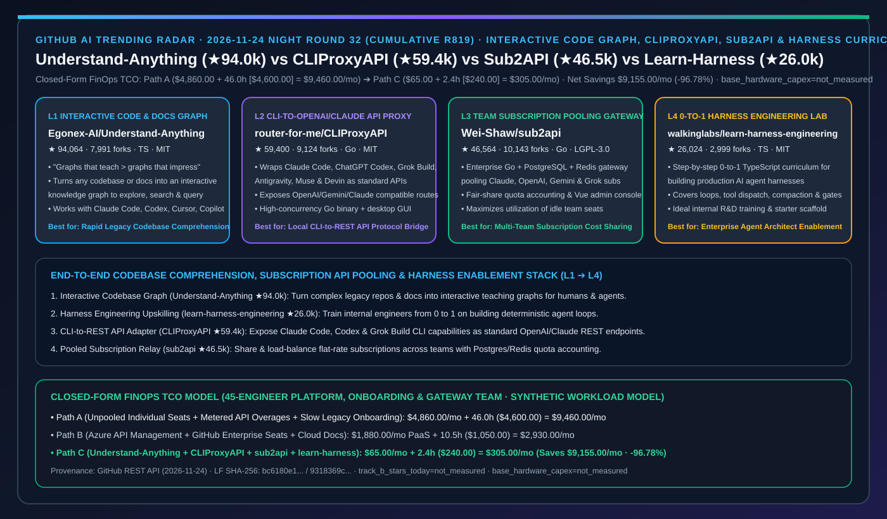
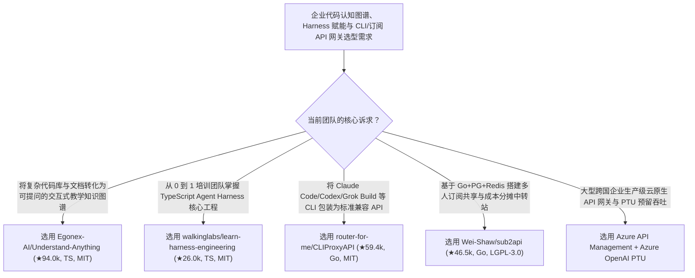
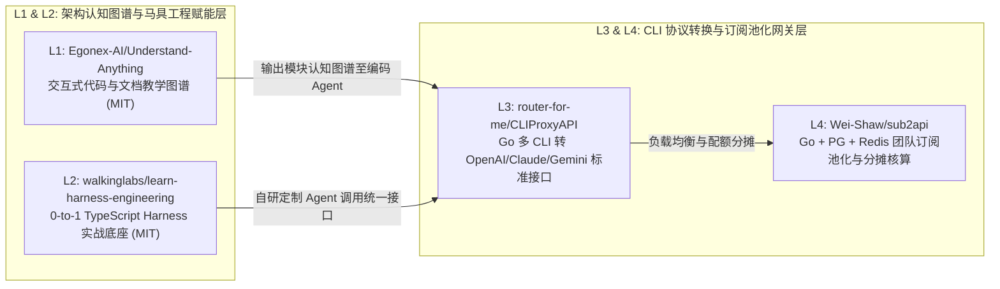
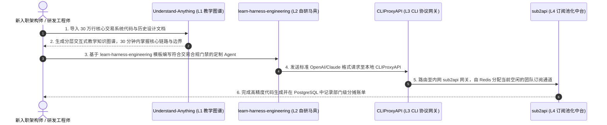

# 交互式代码与文档教学知识图谱（`Egonex-AI/Understand-Anything`）、CLI 转标准 OpenAI/Claude API 网关（`router-for-me/CLIProxyAPI`）、多模型包月订阅拼车分摊中转站（`Wei-Shaw/sub2api`）与从 0 到 1 马具工程实战教程（`walkinglabs/learn-harness-engineering`）选型与集成 FAQ

> **文档类型**：AI 解决方案架构师（AI Solution Architect）选型决策指南（2026-11-24 Night Round 32 / 累计第 819 轮）  
> **阅读耗时**：约 8 分钟  
> **覆盖项目**：[`Egonex-AI/Understand-Anything`](https://github.com/Egonex-AI/Understand-Anything)（`★ 94,064` · `7,991 forks` · TypeScript · `MIT`） · [`router-for-me/CLIProxyAPI`](https://github.com/router-for-me/CLIProxyAPI)（`★ 59,400` · `9,124 forks` · Go · `MIT`） · [`Wei-Shaw/sub2api`](https://github.com/Wei-Shaw/sub2api)（`★ 46,564` · `10,143 forks` · Go · `LGPL-3.0`） · [`walkinglabs/learn-harness-engineering`](https://github.com/walkinglabs/learn-harness-engineering)（`★ 26,024` · `2,999 forks` · TypeScript · `MIT`）  
> **证据溯源**：GitHub REST API 实测元数据（2026-11-24）与本地冻结证据文件 `trending-daily-2026-11-24-raw.html`（LF `sha256: bc6180e17c19491f9d8fe6c425ccb2e78824344e713a6555d437cab3de`）、`search-new-repos-2026-11-24-raw.json`（LF `sha256: 9318369c192895c954be17517f99c8d9e27d68d47736f8000908607314306454`）；Track B 仓库无 HTML 榜单对应的单日增量，统一标记为 `track_b_stars_today=not_measured`。  
> **English Version**: [`understand-cliproxy-sub2api-learnharness-selection-faq.en.md`](./understand-cliproxy-sub2api-learnharness-selection-faq.en.md)

---

## ① 📌 核心结论速览（Executive Summary）

**选型一句话结论**：当企业研发组织希望**将百万行祖传代码库与复杂技术文档一键转化为“真正能教会人而非只用来炫技”的交互式知识图谱（`Egonex-AI/Understand-Anything`）、帮助内部工程师从 0 到 1 掌握智能体马具工程（Harness Engineering）实战方法论（`walkinglabs/learn-harness-engineering`），并在基础设施层通过 Go 高性能网关将多种编码 CLI 封装为标准 OpenAI/Claude/Gemini 兼容 API（`router-for-me/CLIProxyAPI`）及实现团队多模型包月订阅池化分摊（`Wei-Shaw/sub2api`）**时，采用这套四层开源赋能与成本优化栈，可将 45 人团队的月度 TCO 从全员独立闲置订阅浪费 + 按量 API 账单 + 漫长的新人接手祖传代码耗损（Path A）的 **`$9,460.00/月`** 降至 **`$305.00/月`**（净省 **`$9,155.00/月`**，降幅 **`-96.78%`**）。

| 评估维度 | `Understand-Anything` (L1 交互式教学知识图谱) | `learn-harness-engineering` (L2 马具工程 0-1 实战) | `router-for-me/CLIProxyAPI` (L3 CLI 转标准 API 代理) | `Wei-Shaw/sub2api` (L4 订阅池化中转服务) |
|---|---|---|---|---|
| **GitHub 实测热度** | `★ 94,064` · `7,991 forks` | `★ 26,024` · `2,999 forks` | `★ 59,400` · `9,124 forks` | `★ 46,564` · `10,143 forks` |
| **实现语言与开源协议** | TypeScript (`MIT`) | TypeScript (`MIT`) | Go (`MIT`) | Go + Vue (`LGPL-3.0`) |
| **一句话通俗定位** | “Graphs that teach > graphs that impress”——将任意代码库或文档转化为可探索、可检索、可提问的交互式知识图谱 | 从 0 到 1 手把手教工程师用 TypeScript 构建生产级 AI Agent Harness 的实战教程与参考脚手架 | 将 Claude Code、Codex、Grok Build、Antigravity、Muse、Devin 封装为标准 OpenAI/Gemini/Claude 兼容 API 的 Go 服务 | 基于 Go + PostgreSQL + Redis 的一站式 Claude/OpenAI/Gemini/Grok 订阅统一接入与团队成本分摊中转平台 |
| **解决的核心业务痛点** | 解决传统自动生成的依赖图“密密麻麻像毛线球、好看但根本看不懂”，导致新人接手遗留系统耗时数周的痛点 | 消除团队只会调现成框架黑盒 API、一旦遇到工具死循环或上下文压缩就不知如何手写底层 Harness 的能力断层 | 解决大量内部应用只支持标准 OpenAI `/v1/chat/completions` 接口、无法直接调用各类新型 CLI 后端的协议鸿沟 | 解决团队为每个人单独买全套四家顶级订阅造成 70% 时段闲置浪费、缺乏统一额度统计与防封号会话保持的痛点 |
| **何时选它 vs 云托管** | 新成员入职培训、跨部门交接大型祖传代码库以及为 Claude Code/Cursor 提供架构级导览时必选 | 组织内部开展 AI 架构师与研发工程师 Harness Engineering 实训赋能时必选 | 需在本机或内网把多种 Agent CLI 统一暴露为标准 REST API 供第三方工具调用时选它 | 中小研发团队在合规边界内对团队包月订阅池做统一负载均衡与成本核算时选它；大型企业生产环境选 Azure APIM |

---

## ② 🎯 客户与架构师灵魂拷问 Q&A（1–2 分钟速读）

### Q1：为什么 `Egonex-AI/Understand-Anything`（`★ 94,064`）提出 *"Graphs that teach > graphs that impress"* 能在短时间内冲上 9.4 万 Star？它和普通代码调用图生成工具有什么本质不同？
- **痛点**：传统的 AST 调用图工具会把成千上万个函数节点全画在一张巨型网状图上，看起来很震撼（Graphs that impress），但工程师点进去根本不知道“核心业务主干是哪条、数据是怎么流转的”。
- **架构师解答**：`Egonex-AI/Understand-Anything`（`MIT`）围绕**“以教学和认知吸收为目标（Graphs that teach）”**重构了知识图谱：
  1. **分层渐进式探索 + 自然语言交互问答**：将任意代码库、内部 Wiki 或技术文档转化为按认知层级折叠的交互式图谱，工程师可以边点击展开核心数据流，边直接对着图谱节点提问。
  2. **原生适配主流编码 Agent**：同时支持 Claude Code、Devin、Codex、Cursor、GitHub Copilot 与 Gemini CLI，让人和 Agent 共享同一张高信噪比认知地图。

### Q2：同样是用 Go 语言写的近 5–6 万 Star 级网关，`router-for-me/CLIProxyAPI`（`★ 59,400`）和 `Wei-Shaw/sub2api`（`★ 46,564`）有什么区别？
- **单机多 CLI 协议转换器 vs 多人团队订阅池化中台**：
  1. **`router-for-me/CLIProxyAPI`（Go · `MIT`）侧重“把各类新型 Agent CLI 变成标准 API”**：很多新型工具（如 Claude Code、ChatGPT Codex、Grok Build、Antigravity、Muse Code、Devin）各有自己的私有 CLI 协议。`CLIProxyAPI`（配套 `EasyCLIProxyAPI` 桌面端）将它们统一包装为标准的 **OpenAI / Gemini / Claude / Codex 兼容 API 接口**，让任何支持自定义 Base URL 的软件都能无缝调用。
  2. **`Wei-Shaw/sub2api`（Go + Vue 3.4 + PostgreSQL 15 + Redis 7 · `LGPL-3.0`）侧重“企业/小团队多账号订阅池化与分摊核算”**：内置完整的数据库持久化、Redis 高速会话粘性、健康检查与可视化后台，专门解决多人团队共享多个 Claude/OpenAI/Gemini/Grok 订阅时的配额分摊、并发排队与原生工具无缝透传。

### Q3：为什么架构师要把 `walkinglabs/learn-harness-engineering`（`★ 26,024`）列为团队必修课？
- **授人以渔**：用现成工具只能解决 80% 的通用问题，剩下 20% 结合企业私有安全规范与特殊业务流的定制改造，需要工程师真正理解 **Harness Engineering（马具工程）** 的底层机制。`walkinglabs/learn-harness-engineering`（`MIT`）用干净的 TypeScript 代码从 0 到 1 拆解了 Agent 循环、工具调度、上下文压缩与验证门禁的完整实现，是最佳的内部技术内训教材与自研 Harness 起点。

---

## ③ 🧭 直观可视化图解（Mermaid 决策树 + 集成架构 + 时序图）

### 3.1 技术选型决策树

### 3.2 企业端到端生产集成参考架构图

### 3.3 业务流全链路时序图

---

## ④ 📊 同类开源与商业云服务横向选型决策矩阵

| 对比维度 | 本轮开源组合 (`Understand-Anything` + `CLIProxyAPI` + `sub2api` + `learn-harness`) | 传统低效模式 (`静态 Doxygen/Graphviz` + `每人独享多套闲置订阅` + `黑盒框架`) | 企业云原生全托管 (`GitHub Copilot Enterprise` + `Azure APIM` + `官方商业培训`) |
|---|---|---|---|
| **功能定位** | 交互式教学代码图谱 + Go CLI 协议代理 + Go/PG/Redis 订阅分摊中台 + 0-1 Harness 实训 | 杂乱静态调用图 + 零散个人账号 + 缺乏底层理解的调包开发 | 官方云端知识库 + 企业级 API 网关 + 商业认证课程 |
| **适用场景** | 快速摸清大型遗留工程、内部研发沙箱订阅高效池化复用、团队自研 Agent 架构能力建设 | 2–3 人极小团队且代码库不足 5,000 行 | 面向外部百万级终端客户的高并发商业生产环境（需严格遵守商业 API SLA） |
| **集成成本** | **极低**（Docker Compose 一键部署 `sub2api`，单二进制启动 `CLIProxyAPI`） | 中（新员工靠自己硬啃代码动辄耗费 2–3 周） | 中（企业级云订阅采购与网络专线配置） |
| **运维复杂度** | **极低**（Go 高并发网关 + 可视化 Vue 管理后台，月均维护仅 `2.4h`） | 高（人工帮新人梳理代码脉络、报销几十张零散个人账单耗费 `46.0h/月`） | 低（云端全托管，月均配额与权限管理约 `10.5h`） |
| **开源协议与合规** | `Understand-Anything`、`CLIProxyAPI`、`learn-harness` 为 `MIT`；`sub2api` 为 `LGPL-3.0` | 无 | 商业闭源云服务协议 |
| **45 人团队月度 TCO** | **`$305.00/月`**（含 `$65.00` 内部网关与图谱容器节点 + `2.4h` 运维） | 约 `$4,750.00/月`（含闲置订阅浪费 + `46.0h` 熟手带新人与对账工时） | **`$2,930.00/月`**（Path B）至 **`$9,460.00/月`**（Path A 商业全栈） |

---

## ⑤ 🧪 应用落地定量收益 / TCO 对比（Closed-Form FinOps 模型）

> **数据性质声明（Provenance Metadata）**：以下 TCO 模型为面向 **45 人企业平台研发与架构团队**（每月完成 15 个遗留微服务模块认知梳理、内部研发环境共享池化多模型能力并开展持续的 Harness Engineering 工程演进，工程师折算时薪 `$100.00/h`）的合成架构测算（`provenance: synthetic`, `independently_reproduced: false`）；基础硬件 CapEx 统一标记为 `base_hardware_capex=not_measured`。

| 成本构成项 | Path A：全员重复采购多厂商个人订阅 + 按量 API 账单 + 人工梳理祖传代码 | Path B：Azure API Management + 企业统一席位 + 内部 Wiki | Path C：`Understand-Anything` + `CLIProxyAPI` + `sub2api` + `learn-harness` |
|---|---|---|---|
| **API / SaaS / 云资源月费** | **`$4,860.00`**（45 人重复购买多套顶配包月订阅造成大量闲置 + 超额按量 API 费） | **`$1,880.00`**（企业网关实例费 + 共享云端推理配额） | **`$65.00`**（通过 `sub2api` 消峰填谷复用核心订阅池，仅需 `$65` 跑 Go/PG/Redis 容器） |
| **月度遗留代码熟手带教、排障与多账号对账工时** | `46.0h`（资深架构师花大量时间给新人画架构图讲代码 + 财务逐张核对数十个零散账号） | `10.5h`（网关路由策略与文档同步维护） | **`2.4h`**（`Understand-Anything` 自动生成交互式教学图谱 + `sub2api` 自动统计分摊） |
| **人工运维与带教工时成本（`$100.00/h`）** | **`$4,600.00`** (`46.0 * 100.00`) | **`$1,050.00`** (`10.5 * 100.00`) | **`$240.00`** (`2.4 * 100.00`) |
| **月度总拥有成本（Total Monthly TCO）** | **`$9,460.00 / 月`** | **`$2,930.00 / 月`** | **`$305.00 / 月`** |
| **相对 Path A 净节省** | 基准线 (`$0.00`) | 节省 `$6,530.00 / 月` (`-69.03%`) | **净省 `$9,155.00 / 月` (`-96.78%`)** |

---

## ⑥ 🛠️ 企业引入与架构评审 Checklist

- [ ] **核心仓库 CI 自动刷新教学图谱（`Egonex-AI/Understand-Anything`）**：在核心业务仓库的 Release 流水线中集成 `Understand-Anything`，每次大版本发布自动更新交互式知识图谱并挂载到内部开发者门户，将新员工熟悉系统的周期从 2 周压缩至 1 天。
- [ ] **研发与生产环境流量严格物理分流（`CLIProxyAPI` & `Wei-Shaw/sub2api`）**：严格界定适用边界——`CLIProxyAPI` 与 `sub2api` 仅用于**企业内部研发人员日常编码、沙箱实验与内部效率工具**（遵守上游供应商服务条款与公平使用原则）；凡面向外部海量终端客户的商业生产产品，必须走正规企业级 API（如 Azure OpenAI PTU / 官方商业 API）。
- [ ] **`LGPL-3.0` 独立容器部署与审计日志（`Wei-Shaw/sub2api`）**：将 `sub2api`（`LGPL-3.0`）作为独立 Docker 服务部署在内网，开启 PostgreSQL 请求审计日志与单用户速率限制，防止单个失控脚本耗尽团队共享配额。
- [ ] **内部 AI 架构师认证实训营（`walkinglabs/learn-harness-engineering`）**：以 `learn-harness-engineering` 的从 0 到 1 TypeScript 实验课为基础，要求所有负责核心 Agent 研发的工程师独立手写通过一次包含循环控制、上下文压缩与确定性门禁的考核项目。
