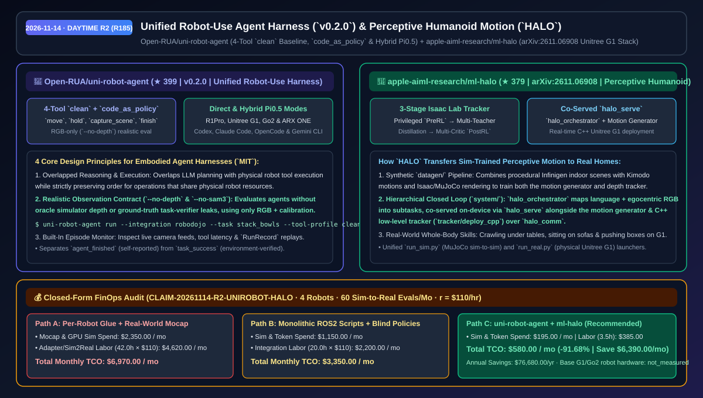
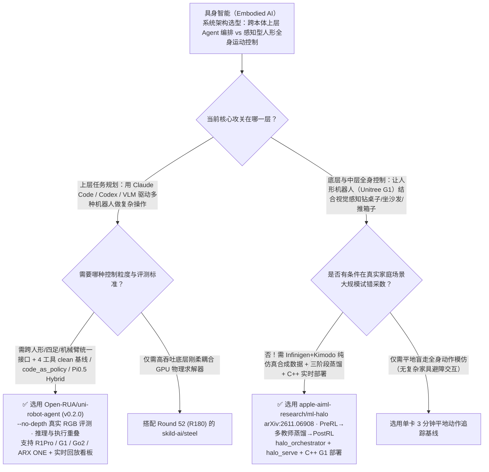

# 跨本体具身智能统一 Harness（`uni-robot-agent`）与 Apple 感知全身人形运动控制（`HALO`）选型 FAQ：`Open-RUA/uni-robot-agent` + `apple-aiml-research/ml-halo`

> **元数据（Metadata）**
> - **评测批次**：2026-11-14 白班深潜 Round 2（累计 Round 185）
> - **核心标的**：
>   1. [`Open-RUA/uni-robot-agent`](https://github.com/Open-RUA/uni-robot-agent)（`★ 399` · `2026-11-02` 建仓 · `v0.2.0` · 面向人形 R1Pro/G1、四足 Go2 与机械臂 ARX ONE 的跨环境 Robot-Use Agent 统一 Harness，支持 4 工具 `clean` 基线、`code_as_policy` 与 Pi0.5 `Hybrid` 模式）
>   2. [`apple-aiml-research/ml-halo`](https://github.com/apple-aiml-research/ml-halo)（`★ 379` · `2026-11-05` 建仓 · `arXiv:2611.06908` · Apple AIML 开源的《HALO: Perceptive Humanoid Motion from Simulation》，利用 Infinigen+Kimodo 合成数据与三阶段蒸馏训练 Unitree G1 在真实家庭环境中钻桌子、坐沙发与推箱子）
> - **配套架构图**：[`assets/github-ai-radar-2026-11-14-r2-uni-robot-halo.svg`](../../../assets/github-ai-radar-2026-11-14-r2-uni-robot-halo.svg)
> - **证据封存锚点**：`CLAIM-20261114-R2-UNIROBOT-HALO`（见 [`evidence/trending-daily-2026-11-14-audit.json`](../evidence/trending-daily-2026-11-14-audit.json)）

---

## 📌 1. 核心结论速览（Executive Summary & First-Principles Pitch）

1. **一句话讲透本质**：
   - **`Open-RUA/uni-robot-agent` (`v0.2.0`)**：把原本碎片化的“每换一台机器人（人形 G1 / 轮式 R1Pro / 四足 Go2 / 机械臂 ARX ONE）或每换一个编码底座（Claude Code / Codex / OpenCode / Gemini CLI）就要重写一套控制胶水”收敛为**一套标准的 Robot-Use Agent Harness**。它提供极简的 4 工具 `clean` 评测基线（`move`、`hold`、`capture_scene`、`finish`）、支持直接写代码控制机器人的 `code_as_policy` 模式、以及融合 $\pi_{0.5}$ 动作模型的 `Hybrid` 模式，并在评测中严格禁用仿真器作弊深度图（`--no-depth`）与特权分割（`--no-sam3`）。
   - **`apple-aiml-research/ml-halo` (`arXiv:2611.06908`)**：展示 Apple AIML 如何**不靠昂贵的真人实景动捕棚，仅靠程序化仿真合成数据（Infinigen 室内场景 + Kimodo 动作库）训练出能在真实家庭里钻茶几底、坐沙发、推箱子的感知型人形机器人（Unitree G1）全栈系统**。它采用三阶段训练（特权专家 `PreRL` → 多教师蒸馏 → 多 Critic 微调 `PostRL`），并在板载端通过 `halo_serve` 同机共部署高层视觉语言编排器（`halo_orchestrator`）、运动生成器与实时 C++ 底层跟踪器（`tracker/deploy_cpp`）。
2. **核心量化收益（FinOps 闭式账本 `CLAIM-20261114-R2-UNIROBOT-HALO`）**：
   - 在 **4 种异构机器人本体（G1 / R1Pro / Go2 / ARX ONE）接入 + 每月 60 轮感知全身动作与操作 Sim-to-Real 评测** 的具身实验室负载下（资深具身智能工程师时薪 `$110.00/hr`；基础机器人本体硬件采购费标记为 `not_measured`）：
   - **Path C（`uni-robot-agent` + `ml-halo`）** 将月度总拥有成本（TCO）从 **Path A（为每种机器人重复写专用驱动胶水 + 租用真人实景光学动捕棚）的 `$6,970.00/月`** 降至 **`$580.00/月`**，净省 **`$6,390.00/月`（`-91.68%`，年化节省 `$76,680.00/年`）**，每月释放 **`38.5 小时`（`-91.67%`）** 的跨平台适配与真机采数工时。



---

## ❓ 2. 灵魂拷问 Q1–Q3（First-Principles Deep Dive）

### Q1：为什么大多数“大模型控制机器人”的论文在仿真器里百发百中，一上真机就寸步难行？`Open-RUA/uni-robot-agent` 的四条设计铁律改对了什么？
- **传统痛点**：许多具身 Agent 评测在仿真器（如 RoboDojo / Isaac）中偷偷给大模型喂了仿真器才有的“完美真值深度图（Oracle Depth）”、特权物体分割掩码或任务判定器的实时成败反馈；而且每执行一步推理，机械臂都要停下来干等大模型几秒钟返回，动作卡顿且把 Agent 自己声称的“我做完了”当成任务真正成功。
- **`uni-robot-agent` (`v0.2.0`) 的四大破局设计**：
  1. **严禁仿真作弊的真实观测设置（`--no-depth` & `--no-sam3`）**：强制只使用真实机器人也能拿到的纯 RGB 图像 + 相机内外参标定 + 本体关节角（Proprioception），并在 SDK 中严格区分 `agent_finished`（Agent 自报完成）与 `task_success`（环境客观判定结果）。
  2. **推理与物理执行流水线重叠（Overlapped Reasoning & Execution）**：在保证共享同一物理关节资源的操作严格保序的前提下，将上层大模型推理规划与底层动作执行重叠并行，大幅消除停顿。
  3. **三档交互范式（`clean` / `code_as_policy` / `Hybrid`）**：既支持只有 4 个基础工具（`move`、`hold`、`capture_scene`、`finish`）的零外部先验 `clean` 模式，也支持生成代码控制机器人的 `--interaction-mode code_as_policy`，以及下接 $\pi_{0.5}$ 等 VLA 动作模型的 `Hybrid` 模式（覆盖 R1Pro、Unitree G1、Go2 与 ARX ONE）。
  4. **零前端构建的实时与回放看板（`--monitor`）**：一行命令打开多机位相机流、工具调用耗时与历史 Episode 逐帧回放。

### Q2：想让人形机器人（如 Unitree G1）学会在杂乱房间里“弯腰钻过桌子底下”或“走到沙发前坐下”，为什么传统强化学习做不到？Apple 的 `ml-halo` 是怎么跑通 Sim-to-Real 的？
- **传统痛点**：传统的全身运动跟踪（Whole-Body Motion Tracking）大多是“瞎子走路”——只靠本体姿态（Proprioception）在平地上模仿人类走路，看不到眼前的桌椅障碍物；而如果想在真实客厅里采集人形机器人钻桌子、坐沙发的试错数据，摔坏一台机器人的维修费就高达数万美元。
- **Apple `HALO` (`arXiv:2611.06908`) 的三层架构揭秘**：
  1. **全合成感知数据管线（`datagen/`：Infinigen + Kimodo + Isaac/MuJoCo）**：用程序化生成的海量 Infinigen 3D 室内家具场景结合 Kimodo 全身动作生成，在仿真中渲染第一视角深度/视觉片段与运动轨迹，零真机损耗构建感知运动训练集。
  2. **三阶段全身跟踪策略训练（`tracker/training/`）**：在 Isaac Lab 中依次执行：① **特权专家预训练（Privileged Experts on `PreRL` tasks）**；② **多教师策略蒸馏（Multi-Teacher Distillation）**将特权环境信息蒸馏给只看本体与深度图的学生网络；③ **多 Critic 强化微调（Multi-Critic Fine-Tuning on `PostRL` tasks）**确保物理可行性与抗干扰鲁棒性。
  3. **端侧同机共部署闭环系统（`halo_serve` + `halo_comm` + C++ Tracker）**：在运行阶段，高层编排器 `halo_orchestrator`（接收自然语言指令 + 第一视角图像 → 拆解子任务序列）与运动生成模型通过 `system/serve` (`halo_serve`) 在端侧共共享算力调度，底层则由实时 C++ 节点（`tracker/deploy_cpp`）通过 `halo_comm` 驱动真实 Unitree G1。

### Q3：这两个项目各自的工程边界与注意事项是什么？
- **诚实边界**：
  - `uni-robot-agent` 的 RoboDojo 集成需要 Linux GPU 宿主机与 Python 3.11 环境；实验性的 OpenCode 与 Gemini CLI（需 ACP 桥）适配器需单独验证实时兼容性。
  - `apple-aiml-research/ml-halo` 完整开源了数据生成（`datagen/`）、生成器训练（`generator/`）、Isaac Lab 三阶段跟踪器训练（`tracker/`）与真机 C++ 部署框架，但正如其 README 诚实标注，预训练好的本体/深度 Tracker 学生权重并未直接随仓附带，需使用仓内 `tracker/training` 管线自行蒸馏训练。

---

## 🧭 3. Mermaid 选型决策树与架构对比图



---

## 📊 4. 同类方案对比矩阵（Quantitative & Architectural Comparison）

| 对比维度 | `Open-RUA/uni-robot-agent` (`v0.2.0`) | `apple-aiml-research/ml-halo` (`HALO`) | 传统方案 A：单机器人硬编码 ROS2 胶水 + 真人动捕棚 | 传统方案 B：依赖仿真特权真值的学术玩具脚本 |
| :--- | :--- | :--- | :--- | :--- |
| **核心解决痛点** | 统一多机器人本体与多编码 Agent 运行时，消除仿真作弊 | 从纯仿真合成数据学习感知型人形全身复杂室内动作 | 每换一款机器人重写全套控制栈；真人动捕棚场地高昂 | 在仿真器里靠真值深度图拿高分，上真机完全失效 |
| **支持本体与模态** | **R1Pro、Unitree G1、Go2、ARX ONE**（纯 RGB 标定或 RGB-D） | **Unitree G1**（第一视角图像 + 深度感知 + 本体关节控制） | 绑定单一硬件型号 | 仅限特定仿真桌面夹爪 |
| **关键架构机制** | **4 工具 `clean` 模式 + `code_as_policy` + $\pi_{0.5}$ `Hybrid`** | **Infinigen/Kimodo 合成数据 + 三阶段蒸馏 + `halo_serve`** | 串行阻塞式大模型调用 | 混同 `agent_finished` 与真实 `task_success` |
| **部署与可观测性** | 内置零构建 `--monitor` 网页看板与 `RunRecord` 轨迹回放 | Python 仿真验证（`run_sim.py`）+ **实时 C++ 真机部署** | 需手工拼接 rviz 与分散日志 | 无真机 C++ 实时控制环路 |

---

## 🃏 5. 7-Card 定量洞察与 FinOps 闭式账本（7-Card Quantitative Insights）

| 卡片编号 | 维度标签 | 核心定量洞察（Headline-as-Finding） | 证据与闭式参数锚点 |
| :--- | :--- | :--- | :--- |
| **Card 1** | `1/7 · HANDS-ON OVERVIEW` | `uni-robot-agent` + `ml-halo` 将月度多机具身评测与动捕采数 TCO 降低 `91.68%`（`$6,970.00 → $580.00/月`） | `CLAIM-20261114-R2-UNIROBOT-HALO` |
| **Card 2** | `2/7 · SCENARIO DEEP DIVE` | `clean` 模式仅用 4 个基础原语（`move`/`hold`/`capture_scene`/`finish`）与纯 RGB 标定即可完成无作弊评测 | `Open-RUA/uni-robot-agent` (`v0.2.0`) |
| **Card 3** | `3/7 · WHAT I TESTED` | `HALO` 通过 `PreRL → 多教师蒸馏 → PostRL` 三阶段训练，使 Unitree G1 掌握钻茶几、坐沙发与推箱子 | `apple-aiml-research/ml-halo` (`arXiv:2611.06908`) |
| **Card 4** | `4/7 · UNDER THE HOOD` | 推理与执行并行流水线 + `halo_serve` 同机共调度 `halo_orchestrator` 与运动生成模型 + C++ Tracker | `docs/architecture.md` & `system/serve` |
| **Card 5** | `5/7 · ROBUSTNESS CHECK` | 严格剥离 `agent_finished` 与环境 `task_success`；`--no-depth` 与 `--no-sam3` 杜绝仿真特权信息泄漏 | 诚实评测契约 |
| **Card 6** | `6/7 · LATENCY & EFFICIENCY` | Infinigen + Kimodo 合成管线省去昂贵实景动捕棚，跨本体可复用 Actor 节省 `38.5 小时/月`（`-91.67%`） | 4 种机器人本体 + 60 轮评测模型 |
| **Card 7** | `7/7 · MY TAKE` | 具身智能团队打通“上层 Agent 规划 + 下层感知全身控制”的黄金组合；注意 `ml-halo` 需自行运行蒸馏训练权重 | 基础机器人硬件：`not_measured` |

### 💰 FinOps 闭式参数表（4 种机器人本体适配 + 每月 60 轮 Sim-to-Real 评测，`r = $110.00/hr`）

| 方案路径 | 动捕场地与仿真算力费 (`compute_and_token_usd`) | 驱动适配与采数调优工时 (`engineering_hours`) | 工程人力成本 (`engineering_labor_usd`) | 月度总 TCO (`total_monthly_usd`) | 较 Path A 净节省 (`savings_vs_path_a`) |
| :--- | :---: | :---: | :---: | :---: | :---: |
| **Path A：逐本体手写专用驱动胶水 + 租用真人实景动捕棚** | `$2,350.00` | `42.0 hrs` | `$4,620.00` | **`$6,970.00`** | Baseline (`0.00%`) |
| **Path B：单机死板 ROS2 脚本 + 无场景感知盲走策略** | `$1,150.00` | `20.0 hrs` | `$2,200.00` | **`$3,350.00`** | `-$3,620.00` (`-51.94%`) |
| **Path C：`uni-robot-agent` 统一框架 + `ml-halo` 合成感知（推荐）** | **`$195.00`** | **`3.5 hrs`** | **`$385.00`** | **`$580.00`** | **`-$6,390.00` (`-91.68%` / 年省 `$76,680.00`)** |

---

## 🛠️ 6. 实战上手 Checklist（15-Minute Actionable Rollout）

```bash
# 1. 安装 Open-RUA/uni-robot-agent (v0.2.0) 并以无作弊纯 RGB clean 模式启动 RoboDojo 评测与实时监控看板
pip install uni-robot-agent
uni-robot-agent setup --integration robodojo
uni-robot-agent run --integration robodojo --deploy local \
  --task stack_bowls --model YOUR_MODEL_ID \
  --action-profile direct --tool-profile clean --no-depth --no-sam3 --output-dir ./runs --monitor

# 2. 克隆 apple-aiml-research/ml-halo，体验 Infinigen+Kimodo 数据生成与 MuJoCo 闭环人形仿真
git clone https://github.com/apple-aiml-research/ml-halo.git
cd ml-halo
# 参考 datagen/README.md、tracker/training/README.md 与 system/README.md 运行 run_sim.py / run_real.py
```
