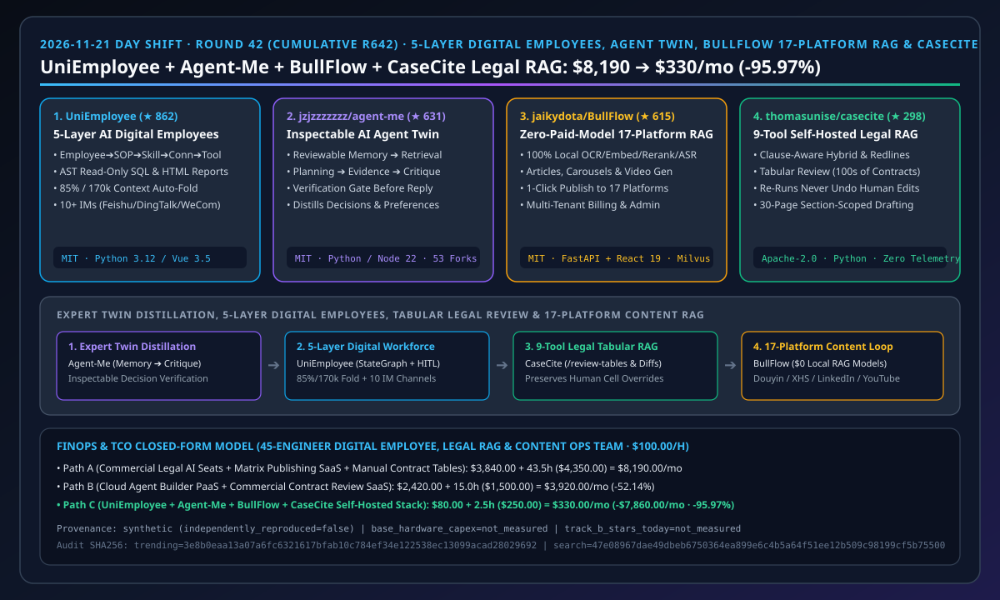
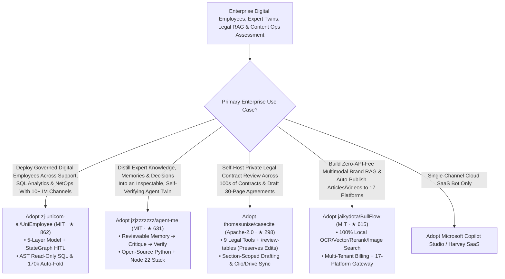
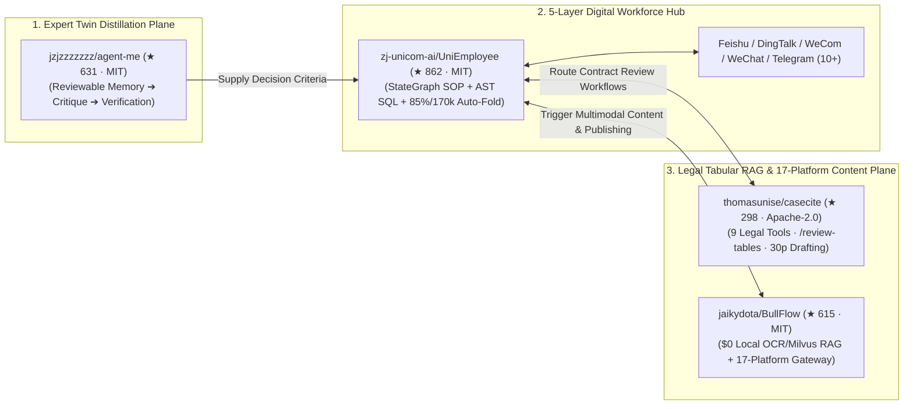
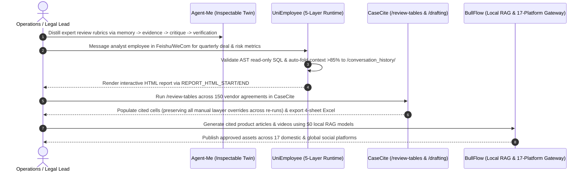

# 5-Layer Enterprise Digital Employee Platform (`zj-unicom-ai/UniEmployee`), Inspectable AI Agent Twin (`jzjzzzzzzz/agent-me`), Zero-Paid-Model 17-Platform Content RAG (`jaikydota/BullFlow`) & 9-Tool Self-Hosted Legal RAG (`thomasunise/casecite`) Selection FAQ

> **Document Metadata (2026-11-21 Day Shift Round 42 · Cumulative Round 642 Deep-Dive)**  
> - **Target Audience**: Enterprise AI Solution Architects, Digital Workforce & Legal Ops Leads, and Growth Marketing / Knowledge Engineering Directors  
> - **Evaluated Repositories**:  
>   1. [`zj-unicom-ai/UniEmployee`](https://github.com/zj-unicom-ai/UniEmployee) (`★ 862` · `32 forks` · Python 3.12+ / Vue 3.5+ · MIT · **UniEmployee**: Enterprise digital employee builder and runtime orchestrating `Employee ➔ Workflow/SOP ➔ Skill ➔ Connector ➔ Tool` with AST read-only SQL validation, `REPORT_HTML` dashboards, `85%` window / `170k`-token auto-compaction to `/conversation_history/{thread_id}.md`, OpenSandbox isolation, and 10+ IM channels)  
>   2. [`jzjzzzzzzz/agent-me`](https://github.com/jzjzzzzzzz/agent-me) (`★ 631` · `53 forks` · Python / Node 22+ · MIT · **Agent-Me**: Open-source, inspectable architecture distilling personal/expert knowledge, memories, preferences, and decisions into an **AI Agent Twin** via `reviewable memory ➔ retrieval ➔ planning ➔ evidence ➔ critique ➔ verification ➔ response`)  
>   3. [`jaikydota/BullFlow`](https://github.com/jaikydota/BullFlow) (`★ 615` · `39 forks` · TypeScript / FastAPI / React 19 · MIT · **BullFlow (`推量牛`)**: Commercial-grade multi-tenant enterprise RAG solution running **100% local open-source RAG models** [OCR, semantic chunking, vectorization, reranking, text-to-image search, ASR at `$0` API cost] and publishing articles/carousels/videos across **17 domestic & global social platforms**)  
>   4. [`thomasunise/casecite`](https://github.com/thomasunise/casecite) (`★ 298` · `29 forks` · Python · Apache-2.0 · **CaseCite**: Zero-telemetry self-hosted legal RAG platform offering **9 tools behind one login**, including clause-aware hybrid research, 2–4 contract redline diffs, **tabular review across hundreds of contracts where re-runs never undo human edits**, and 30-page section-scoped drafting)  
> - **Sealed Evidence Chain**: `workshops/github-trending-radar/evidence/search-new-repos-2026-11-21-raw.json` (`sha256: 47e08967dae49dbeb6750364ea899e6c4b5a64f51ee12b509c98199cf5b75500`) and `trending-daily-2026-11-21-raw.html` (`sha256: 3e8b0eaa13a07a6fc6321617bfab10c784ef34e122538ec13099acad28029692`)  
> - **Architecture Visual**: [`assets/github-ai-radar-2026-11-21-r42-r642-uniemployee-agentme-bullflow-casecite.svg`](../../../assets/github-ai-radar-2026-11-21-r42-r642-uniemployee-agentme-bullflow-casecite.svg) · [中文版 (`uniemployee-agent-me-bullflow-casecite-selection-faq.md`)](uniemployee-agent-me-bullflow-casecite-selection-faq.md)

---

## ① 📌 Executive Summary (One-Sentence Selection Verdict)

> **Solution Architect's Verdict**:  
> Scaling enterprise AI from ad-hoc chat assistants to **role-based digital employees, expert decision twins, bulk legal contract review, and omnichannel content pipelines** hits four operational barriers: **(1) prompt-only digital employees skip SOP steps, blow past 170k-token context limits, or run unsafe SQL, (2) senior architects' decision criteria remain trapped in unverified chat histories, (3) re-running AI contract extraction wipes out hours of manual lawyer cell overrides, and (4) cloud embedding/OCR API bills and manual 17-platform social publishing bottleneck marketing teams**.  
> - **For a 5-layer enterprise digital employee platform (`Employee ➔ Workflow/SOP ➔ Skill ➔ Connector ➔ Tool`) with AST read-only SQL, `85%`/`170k`-token auto-folding, OpenSandbox routing, and 10+ IM channels** ➔ Choose **`zj-unicom-ai/UniEmployee`** (MIT, `★ 862`);  
> - **To distill expert knowledge, memories, and decisions into an inspectable AI Agent Twin with an explicit `evidence ➔ critique ➔ verification` pipeline** ➔ Choose **`jzjzzzzzzz/agent-me`** (MIT, `★ 631`);  
> - **For a zero-telemetry self-hosted legal RAG suite with 9 tools—including `/review-tables` across hundreds of contracts (where re-runs never overwrite reviewer overrides) and 30-page section-scoped drafting** ➔ Choose **`thomasunise/casecite`** (Apache-2.0, `★ 298`);  
> - **For a multi-tenant enterprise RAG & content engine running 100% local open-source OCR/embedding/reranking/text-to-image/ASR models (`$0` API cost) with 1-click publishing to 17 platforms** ➔ Choose **`jaikydota/BullFlow`** (MIT, `★ 615`).  
> Together, this stack reduces monthly legal/marketing SaaS seat bills, embedding API fees, and manual contract/publishing labor TCO for a 45-engineer team from **$8,190.00/mo** to **$330.00/mo (-$7,860.00/mo, -95.97%)**.

---

## ② 🎯 Solution Architect & Customer Deep-Dive Q&A

### Q1: How do `zj-unicom-ai/UniEmployee` (`★ 862`) and `jzjzzzzzzz/agent-me` (`★ 631`) turn fragile prompts into governed 5-layer digital employees and inspectable expert twins?
- **`zj-unicom-ai/UniEmployee` (5-Layer Enterprise Digital Employee Runtime)**:
  1. **5-Layer Capability Architecture (`Employee ➔ Workflow/SOP ➔ Skill ➔ Connector ➔ Tool`)**: Stores `SKILL.md` procedures in a database catalog for on-demand lookup and enforces multi-step business SOPs via **StateGraph state machines** with HITL approval interrupts.
  2. **Lossless `85%` Window / `170k`-Token Summarization & AST SQL Guardrails**: Automatically slims old tool arguments and folds history at `85%` of the model context window (or `170k` tokens) while saving the full transcript to `/conversation_history/{thread_id}.md`. The `/app/analyst` workbench enforces **AST-level read-only SQL validation**, table allowlists, row caps, and renders interactive HTML dashboards via `REPORT_HTML_START/END`.
- **`jzjzzzzzzz/agent-me` (`★ 631` · Inspectable AI Agent Twin)**:
  - Replaces black-box chat (`user ➔ prompt ➔ model ➔ answer`) with a 7-stage inspectable pipeline: **`reviewable memory ➔ retrieval ➔ planning ➔ evidence ➔ critique ➔ verification ➔ response`**.

### Q2: How does `thomasunise/casecite` (`★ 298`) protect lawyer overrides during bulk contract review and handle 30-page agreement drafting without context degradation?
- **`thomasunise/casecite` (9-Tool Zero-Telemetry Self-Hosted Legal RAG)**:
  1. **Non-Destructive Tabular Review (`/review-tables`)**: Extracts structured columns across hundreds of contracts with highlighted passage citations; **re-running a template never undoes a human reviewer's cell override, approval, or note**, and exports a 4-sheet Excel workbook (`Results`, `Citations`, `Review`, `Summary`).
  2. **Section-Scoped Long-Document Drafting (`/drafting`)**: For 30-page agreements, users review a section plan first; each section is then drafted in its own dedicated context window against the full reference documents before whole-document reconciliation.
  3. **Matter Isolation & CourtListener Integration**: Scopes Research, Contracts, and Drafting to active `/matters`, syncs with Clio/Filevine/Drive/Box/OneDrive, and verifies quotes against CourtListener opinions.

### Q3: How does `jaikydota/BullFlow` (`★ 615`) eliminate paid RAG API costs while automating omnichannel content distribution across 17 platforms?
- **`jaikydota/BullFlow` (100% Local-Model Enterprise RAG + 17-Platform Publishing Gateway)**:
  - Runs document PaddleOCR, semantic sentence splitting, Milvus vectorization, reranking, text-to-image retrieval, and ASR entirely on **local open-source models (`$0` per-call token cost, zero data egress)**.
  - Ships three complete production systems (user frontend, admin console, and publishing gateway) with built-in multi-tenancy, billing, and 1-click distribution to **17 platforms** (11 domestic including Douyin/Xiaohongshu/WeChat + 6 global including LinkedIn/YouTube).

---

## ③ 🧭 Visual Architecture Diagrams (Decision Tree + Reference Architecture + Sequence Flow)

### 3.1 Solution Architect Selection Decision Tree (Mermaid Flowchart)

### 3.2 Expert Twin Distillation, 5-Layer Digital Employees, Tabular Legal Review & 17-Platform Content RAG Architecture (Mermaid Architecture)

### 3.3 Expert Twin Verification, AST SQL Analytics, Bulk Contract Tabular Review & 17-Platform Publishing Sequence (Mermaid Sequence Diagram)

---

## ④ 📊 Horizontal Selection Matrix (Open-Source Quartet vs. Commercial Suites)

| Dimension | `zj-unicom-ai/UniEmployee` (`★ 862`) | `jzjzzzzzzz/agent-me` (`★ 631`) | `jaikydota/BullFlow` (`★ 615`) | `thomasunise/casecite` (`★ 298`) | Commercial Legal AI & Social Matrix SaaS |
| :--- | :--- | :--- | :--- | :--- | :--- |
| **Primary Role** | 5-layer enterprise digital employee builder & runtime | Inspectable personal/expert AI Agent Twin | `$0`-API-cost local RAG & 17-platform content suite | 9-tool self-hosted legal RAG & contract tabular review | High-cost per-seat vertical SaaS |
| **Best-Fit Scenario** | Deploying governed support, analyst (`xiaoshu`) & NetOps employees across 10+ IMs | Capturing senior experts' memory, decision rules & critique loops | Generating brand-grounded articles/videos & publishing to 17 platforms | Law firms & legal teams reviewing 100s of contracts & drafting 30p agreements | Cloud-tolerant teams with large per-seat SaaS budgets |
| **Key Differentiator** | **5-layer model + AST read-only SQL + `85%/170k` lossless fold + OpenSandbox** | **7-stage `reviewable memory ➔ critique ➔ verification` pipeline** | **100% local OCR/embed/rerank/image-search + 17-platform gateway + billing** | **`/review-tables` never overwrites human edits + 30p section-scoped drafting** | `$100–$300+/seat/mo` legal SaaS; cloud RAG charges per embedding/OCR call |
| **Integration & Ops Effort** | Low (Docker Compose + Vue 3.5 catalog UI + MCP) | Low (Python 3.11+ & Node 22+ Docker Compose) | Low (ships user app, admin console & publishing gateway) | Low (Docker + Caddy self-hosted with Clio/Filevine/Drive sync) | High (multi-vendor SaaS contracts & manual copy-pasting) |
| **License** | MIT | MIT | MIT | Apache-2.0 | Proprietary |
| **45-Eng Monthly TCO** | **Combined `$330.00/mo`** (`$80` shared container/local-model host + `2.5h` ops) | Included (open MIT expert twin platform) | Included (`$0` embedding/OCR/rerank API fees at any corpus size) | Included (zero-telemetry BYOK legal workbench) | **`$3,920.00 – $8,190.00/mo`** |

---

## ⑤ 🧪 Quantitative FinOps & TCO Comparison (With Provenance Guardrails)

> **Provenance & Guardrails Declaration**:  
> - `provenance`: `"synthetic"` (`independently_reproduced: false`, closed-form FinOps model for a 45-engineer digital employee, legal contract review, and content operations team at `$100.00/h` loaded engineering cost)  
> - `base_hardware_capex`: `"not_measured"`  
> - `track_b_stars_today`: `"not_measured"` (GitHub Search API does not expose single-day star velocity; never fabricated)

| Cost Component (45-Engineer Team / Month) | Path A: Commercial Legal AI Seats + Matrix Publishing SaaS + Manual Contract Tables | Path B: Cloud Agent Builder PaaS + Commercial Contract Review SaaS | Path C: `UniEmployee` + `Agent-Me` + `BullFlow` + `CaseCite` Stack |
| :--- | :--- | :--- | :--- |
| **Legal/Marketing SaaS Seats & Cloud Embedding/OCR Bills** | `$3,840.00 / mo` | `$2,420.00 / mo` | **`$80.00 / mo`** (shared self-hosted container & local RAG model node) |
| **Manual Contract Table Extraction, 17-Platform Posting & Context Fixes** | `43.5 hours / mo` | `15.0 hours / mo` | **`2.5 hours / mo`** (non-destructive tabular re-runs + 170k fold + 1-click publish) |
| **Engineering & Legal/Ops Labor Cost (`$100.00/h`)** | `$4,350.00 / mo` | `$1,500.00 / mo` | **`$250.00 / mo`** |
| **Total Monthly TCO** | **`$8,190.00 / mo`** | **`$3,920.00 / mo`** | **`$330.00 / mo`** |
| **Net Monthly Savings vs. Path A** | Baseline (`0.00%`) | `-$4,270.00 / mo` (`-52.14%`) | **`-$7,860.00 / mo` (`-95.97%`)** |

---

## ⑥ 🛠️ Enterprise Adoption & Architecture Review Checklist

- [ ] **Codify Role SOPs in StateGraph & Enable AST Read-Only SQL (`zj-unicom-ai/UniEmployee`)**: Author role skills in `SKILL.md`, gate high-risk actions with HITL StateGraph interrupts, enforce AST read-only SQL in `/app/analyst`, and rely on `85%`/`170k`-token auto-folding with `/conversation_history/{thread_id}.md` persistence.
- [ ] **Distill Senior Architect Decision Criteria via 7-Stage Twins (`jzjzzzzzzz/agent-me`)**: Route institutional knowledge through `reviewable memory ➔ retrieval ➔ planning ➔ evidence ➔ critique ➔ verification` before automated execution.
- [ ] **Deploy Zero-Telemetry `/review-tables` & Section-Scoped `/drafting` (`thomasunise/casecite`)**: Use `/review-tables` for bulk contract audits (preserving human cell overrides across re-runs) and `/drafting` for 30-page agreements while verifying all outputs against primary legal authority.
- [ ] **Run Zero-API-Cost Local Multimodal RAG & 17-Platform Publishing (`jaikydota/BullFlow`)**: Host PaddleOCR, Milvus, and text-to-image models locally to eliminate embedding/OCR API bills and govern 17-platform publishing through the built-in admin console.
