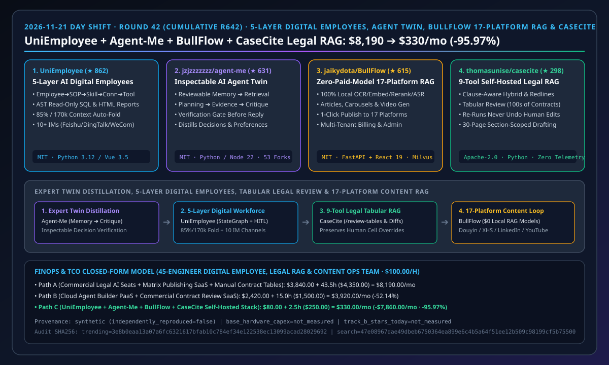
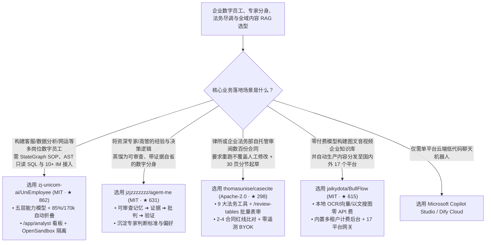
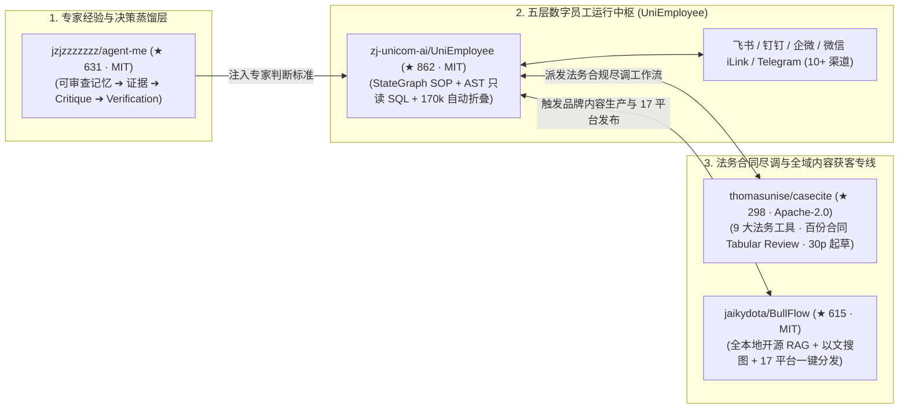
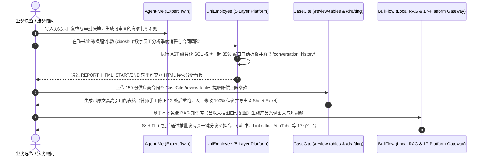

# 五层企业数字员工构建与运行平台（`zj-unicom-ai/UniEmployee`）、可审查个人决策数字分身（`jzjzzzzzzz/agent-me`）、零付费模型 17 平台内容生产与分发 RAG（`jaikydota/BullFlow`）与九合一自托管法务合同表格审查平台（`thomasunise/casecite`）选型 FAQ

> **文档元数据（2026-11-21 白班 Day Round 42 · 累计第 642 轮深潜专题）**  
> - **面向对象**：企业 AI 解决方案架构师（AI Solution Architect）、企业数字化转型与法务合规负责人、增长营销与知识工程总监  
> - **本轮核心评估对象**：  
>   1. [`zj-unicom-ai/UniEmployee`](https://github.com/zj-unicom-ai/UniEmployee)（`★ 862` · `32 forks` · Python 3.12+ / Vue 3.5+ · MIT · **UniEmployee 企业数字员工平台**：通过 **`Employee ➔ Workflow/SOP ➔ Skill ➔ Connector ➔ Tool` 五层能力模型**编排客服、销售、数据分析[`/app/analyst` AST 只读 SQL 校验 + `REPORT_HTML` 看板]、HR 与网运数字员工，内置 **85% 窗口 / 17 万 Token 自动摘要折叠**、OpenSandbox 隔离与飞书/钉钉/企微/微信 iLink 等 10+ 渠道接入）  
>   2. [`jzjzzzzzzz/agent-me`](https://github.com/jzjzzzzzzz/agent-me)（`★ 631` · `53 forks` · Python / Node 22+ · MIT · **Agent-Me**：将专家知识、记忆、偏好与历史决策蒸馏为开源可审查的 **AI Agent Twin（数字分身）**，执行 `reviewable memory ➔ retrieval ➔ planning ➔ evidence ➔ critique ➔ verification ➔ response` 七步验证管线）  
>   3. [`jaikydota/BullFlow`](https://github.com/jaikydota/BullFlow)（`★ 615` · `39 forks` · TypeScript / FastAPI / React 19 · MIT · **推量牛 BullFlow**：自带用户端、运营后台与分发网关的商用级多租户企业 RAG 方案——**全链路 OCR/分句/向量化/重排/以文搜图/ASR 100% 采用本地开源模型（`$0` 调用费）**，并一键分发图文/视频至国内外 **17 个主流社媒平台**）  
>   4. [`thomasunise/casecite`](https://github.com/thomasunise/casecite)（`★ 298` · `29 forks` · Python · Apache-2.0 · **CaseCite 私有化法务 RAG 平台**：零遥测自托管，单次登录集成 **9 大法务工具**，含条款感知混合检索、2–4 份合同逐条对比红线导出、**数百份合同并发 Tabular Review 表格抽取[重跑绝不覆盖人工批注与修正]**及 30 页长协议分章节起草合并）  
> - **关联检索证据链**：`workshops/github-trending-radar/evidence/search-new-repos-2026-11-21-raw.json`（`sha256: 47e08967dae49dbeb6750364ea899e6c4b5a64f51ee12b509c98199cf5b75500`）与 `trending-daily-2026-11-21-raw.html`（`sha256: 3e8b0eaa13a07a6fc6321617bfab10c784ef34e122538ec13099acad28029692`）  
> - **高清架构图**：[`assets/github-ai-radar-2026-11-21-r42-r642-uniemployee-agentme-bullflow-casecite.svg`](../../../assets/github-ai-radar-2026-11-21-r42-r642-uniemployee-agentme-bullflow-casecite.svg) · [English Version (`uniemployee-agent-me-bullflow-casecite-selection-faq.en.md`)](uniemployee-agent-me-bullflow-casecite-selection-faq.en.md)

---

## ① 📌 核心结论速览（选型一句话结论）

> **架构师一句话选型结论**：  
> 当企业把 AI 从“单点聊天小工具”升级为“**能独立上岗的数字员工、资深专家数字分身、法务百份合同尽调台与全域内容获客引擎**”时，最怕四个脱节：**（1）数字员工把 SOP 记在 Prompt 里，聊过十几轮就跳步或撑爆上下文，且查数据库没有 AST 只读门禁、（2）资深架构师或金牌销售离职后，其判断标准无法沉淀为可验证的数字分身、（3）法务用 AI 批量审 200 份合同时，一旦重跑模板就把律师刚手工核对修改过的单元格全冲掉了、（4）营销 RAG 建库每调一次商业 Embedding/OCR 都要交钱，写完还得人工登录十几个平台发帖**。  
> - **需要把岗位经验固化为 `Employee ➔ Workflow/SOP ➔ Skill ➔ Connector ➔ Tool` 五层能力模型，具备 AST 级只读 SQL、85%/17 万 Token 自动折叠归档与飞书/钉钉/企微 10+ 渠道接入的数字员工平台** ➔ 选 **`zj-unicom-ai/UniEmployee`**（MIT，`★ 862`）；  
> - **需要将核心专家的知识、记忆与历史决策蒸馏为带 `evidence ➔ critique ➔ verification` 闭环的可审查数字分身** ➔ 选 **`jzjzzzzzzz/agent-me`**（MIT，`★ 631`）；  
> - **需要在内网零遥测完成百份合同并发表格抽取（`/review-tables`，重跑绝不覆盖律师人工修改）、2–4 份合同逐条红线比对与 30 页长合同分节起草** ➔ 选 **`thomasunise/casecite`**（Apache-2.0，`★ 298`）；  
> - **需要全链路 100% 本地免费开源模型（PaddleOCR/分句/向量/重排/以文搜图/ASR 零 API 费）构建品牌知识库并一键分发图文/视频至国内外 17 个平台（内置多租户计费与后台）** ➔ 选 **`jaikydota/BullFlow`**（MIT，`★ 615`）。  
> 四者组合可将 45 人企业数字员工、法务合规与全域营销团队的商业法务 AI 席位、多平台矩阵 SaaS 与人工尽调总成本从 **$8,190.00/月** 降至 **$330.00/月（节省 $7,860.00/月，降幅 95.97%）**。

---

## ② 🎯 客户与架构师灵魂拷问 Q&A（业务痛点 · 架构集成 · 边界取舍）

### Q1：为什么大多数企业自建的“数字员工”跑不稳复杂业务流程？`zj-unicom-ai/UniEmployee`（`★ 862`）与 `jzjzzzzzzz/agent-me`（`★ 631`）是如何设计五层能力模型与专家记忆验证的？
- **`zj-unicom-ai/UniEmployee`（中国联通开源 · 五层数字员工构建与运行平台）的五大生产级机制**：
  1. **五层解耦能力模型（`Employee ➔ Workflow/SOP ➔ Skill ➔ Connector ➔ Tool`）**：技能以 `SKILL.md` 规程沉淀进 Store 供模型按需查阅（不凭记忆跳步）；关键流程用 **StateGraph 状态机**（含 HITL 人工审批中断点）固化；注意运行时以 catalog 库为准，修改 `backend/employees/*.yaml` 种子文件不会意外覆盖线上已调优的配置。
  2. **85% 窗口 / 17 万 Token 双阈值无损折叠**：基于 `SummarizationMiddleware`，消息增多时先对旧工具参数瘦身；达到模型窗口 85%（或无画像时 17 万 Token）自动将旧消息折叠为摘要，同时将**完整原始对话落盘至 `/conversation_history/{thread_id}.md`** 供随时回读，彻底告别长会话中断。
  3. **独立数据分析台（`xiaoshu` `/app/analyst`）与多沙箱隔离**：SQL 查询强制经过 **AST 级只读校验、表白名单、行数上限与服务端超时**，分析报告通过 `REPORT_HTML_START/END` 渲染为独立 HTML 看板；网络运维员工（`net-ops`）可按会话路由至 OpenSandbox 容器隔离执行。
- **`jzjzzzzzzz/agent-me`（`★ 631` · 可审查的个人/专家数字分身架构）**：
  - 将传统的 `prompt ➔ model ➔ answer` 升级为 **`reviewable memory ➔ retrieval ➔ planning ➔ evidence ➔ critique ➔ verification ➔ response`** 七阶段闭环，让核心专家的判断标准透明可查、可纠偏。

### Q2：法务和尽调团队最痛恨 AI 工具的一点是：“我刚核对并手动改对了表格里的 30 个合同条款，点击重跑后 AI 把我的心血全覆盖了！”`thomasunise/casecite`（`★ 298`）是怎么解决的？
- **`thomasunise/casecite`（零遥测私有化 9 合 1 法务 RAG 平台）的三大杀手级设计**：
  1. **保护人工成果的批量合同表格审查（`/review-tables`）**：支持一次性对数百份合同提取字段（每行一份合同，每个单元格绑定原文精确引用高亮）；律师可随时点击单元格修改值、批准或加批注标记——**后续无论重跑多少次，系统绝对不会覆盖律师已经手工修改或审批过的工作（a re-run never undoes a reviewer's work）**，并可一键导出包含 `Results`、`Citations`、`Review`、`Summary` 四张工作表的 Excel！
  2. **30 页长篇协议的分章节独立上下文起草（`/drafting`）**：先由人工审定章节大纲，随后**每个章节在各自独立的上下文窗口中对照完整参考文档起草**，最后执行全文一致性合龙（Reconciliation），后续局部修改也严格限定在受影响章节内。
  3. **案件工作区隔离（`/matters`）与引证负面处理扫描（`/tools`）**：支持从 Google Drive、OneDrive、Box、Dropbox、Filevine、Clio 同步案卷，并与 CourtListener 判例库联动核验引文真伪。

### Q3：企业做内容获客时，如何做到“建多大的多模态知识库都不花一分钱模型 API 费，且写完自动发到 17 个平台”？`jaikydota/BullFlow`（`★ 615`）怎么实现？
- **`jaikydota/BullFlow`（推量牛 · 商用级多租户企业 RAG 与 17 平台分发闭环）**：
  - **RAG 全链路 100% 本地开源模型（`$0` 调用费、数据不出内网）**：文档 PaddleOCR、语义分句、Milvus 向量化、重排、**以文搜图（图文混编自动配图）**、语音转录全部采用本地开源模型部署；
  - **三套系统齐全（用户端 + 运营后台 + 推量发网关）**：内置多租户、RBAC、计费、支付与审计，一键发布至国内 11 个（抖音、小红书、公众号等）+ 海外 6 个（LinkedIn、YouTube 等）共 **17 个主流社媒平台**并回流账号数据。

---

## ③ 🧭 直观可视化图解（选型决策树 + 企业集成架构 + 业务流时序图）

### 3.1 架构师选型决策树（Mermaid Flowchart）

### 3.2 企业“专家数字分身 + 五层数字员工中枢 + 法务表格尽调 + 17 平台内容分发”集成架构图（Mermaid Architecture）

### 3.3 专家分身核验、数字员工数据分析、百份合同表审与 17 平台分发时序图（Mermaid Sequence Diagram）

---

## ④ 📊 同类开源与商业云服务横向选型决策矩阵

| 评估维度 | `zj-unicom-ai/UniEmployee` (`★ 862`) | `jzjzzzzzzz/agent-me` (`★ 631`) | `jaikydota/BullFlow` (`★ 615`) | `thomasunise/casecite` (`★ 298`) | 商业法务 AI (Harvey 等) + 矩阵分发 SaaS |
| :--- | :--- | :--- | :--- | :--- | :--- |
| **核心定位** | 五层能力模型企业数字员工构建与运行平台 | 蒸馏知识、记忆与决策的开源可审查 AI 数字分身 | 零付费模型本地 RAG + 17 平台全域营销分发系统 | 零遥测自托管 9 合 1 法务合同审查与判例平台 | 按席位高价订阅的闭源垂直 SaaS |
| **最适用场景** | 客服、销售、SQL 数据分析、HR、网运等多岗位数字员工规模化上岗 | 沉淀核心架构师、产品负责人或业务专家的思维与验证闭环 | 企业品牌内容批量生成（图文/视频）并一键铺开 17 个国内外平台 | 律所与企业法务部批量合同尽调、红线对比与 30 页长协议起草 | 预算极充裕且允许合同/品牌数据上公有云的机构 |
| **关键差异化机制** | **五层模型 + AST 只读 SQL + `85%/170k` 落盘折叠 + 10+ IM 接入** | **`reviewable memory ➔ critique ➔ verification` 七步可审查架构** | **RAG 全链路本地开源模型 `$0` 调用费 + 以文搜图 + 内置多租户计费** | **`/review-tables` 重跑绝不覆盖人工修改 + 30 页分节起草 + 4-Sheet Excel** | 法务 AI 动辄每席位 `$100–$300+/月`；通用工具无批量表审防覆盖保护 |
| **集成与运维成本** | 低（Docker Compose + Vue 3.5 配置中心 + MCP 接入） | 低（Python 3.11+ & Node 22+ Docker Compose） | 低（内置用户端/运营后台/分发网关三套完整系统） | 低（Docker + Caddy 自托管，支持 Clio/Filevine/Drive 导入） | 高（多套商业 SaaS 采购与跨平台手工搬运） |
| **开源协议** | MIT | MIT | MIT | Apache-2.0 | 商业专有 |
| **45 人团队月均 TCO** | **组合方案 `$330.00/月`**（共享自托管容器与本地模型节点 `$80` + 运维 `2.5h`） | 同左（专家经验内部传承零外部席位费） | 同左（知识库再大也是 `$0` 向量化/OCR/重排 API 费） | 同左（自托管 BYOK 零法务 SaaS 溢价） | **`$3,920.00 ~ $8,190.00/月`** |

---

## ⑤ 🧪 应用落地定量收益 / FinOps TCO 对比（含数据血缘声明）

> **数据血缘与严谨性声明（Provenance & Guardrails）**：  
> - `provenance`: `"synthetic"`（`independently_reproduced: false`，基于 45 人企业数字员工运营、法务合规尽调与全域内容营销团队在 `$100.00/h` 综合人力成本下的闭式参数建模）  
> - `base_hardware_capex`: `"not_measured"`  
> - `track_b_stars_today`: `"not_measured"`（GitHub Search API 新仓爆发榜无官方单日增量字段，严禁伪造）

| 成本分项（45 人团队 / 月） | Path A：商业法务 AI 席位 + 多平台矩阵分发 SaaS + 人工拉表审合同与复制发帖 | Path B：云厂商低代码 Agent 平台 + 商业合同审查工具 | Path C：`UniEmployee` + `Agent-Me` + `BullFlow` + `CaseCite` 自托管栈 |
| :--- | :--- | :--- | :--- |
| **商业法务/营销 SaaS 席位费与外部 Embedding/OCR 账单** | `$3,840.00 / 月` | `$2,420.00 / 月` | **`$80.00 / 月`**（共享自托管容器与 BullFlow 本地免费 RAG 模型节点） |
| **手工核对百份合同表格、17 平台逐个发帖与长会话崩溃重跑工时** | `43.5 小时 / 月` | `15.0 小时 / 月` | **`2.5 小时 / 月`**（重跑保留人工批注 + 170k 自动折叠 + 17 平台一键分发） |
| **折算工程与法务/运营人力成本（`$100.00/h`）** | `$4,350.00 / 月` | `$1,500.00 / 月` | **`$250.00 / 月`** |
| **月度总拥有成本（Total Monthly TCO）** | **`$8,190.00 / 月`** | **`$3,920.00 / 月`** | **`$330.00 / 月`** |
| **相对 Path A 净节省额与降幅** | 基准线（`0.00%`） | `-$4,270.00 / 月`（`-52.14%`） | **`-$7,860.00 / 月`（`-95.97%`）** |

---

## ⑥ 🛠️ 企业引入与架构评审 Checklist

- [ ] **用五层能力模型与 AST 只读 SQL 规范数字员工上岗（`zj-unicom-ai/UniEmployee`）**：将岗位规程写入 `SKILL.md` 与 StateGraph 状态机（配置 HITL 审批中断点），为数据分析员工开启 AST 只读 SQL 白名单校验，并启用 `85%` 窗口 / `170k` Token 自动摘要折叠与 `/conversation_history/{thread_id}.md` 归档。
- [ ] **用七步验证管线沉淀核心专家数字分身（`jzjzzzzzzz/agent-me`）**：将资深架构师与业务专家的决策依据纳入 `reviewable memory ➔ evidence ➔ critique ➔ verification` 管线，定期审查记忆库条目。
- [ ] **在法务尽调中启用防覆盖批量表审与分章节长文起草（`thomasunise/casecite`）**：使用 `/review-tables` 并发审查大宗合同并导出 4-Sheet Excel；对 30 页以上复杂协议使用 `/drafting` 先审章节计划再分窗口起草合龙（注意其引证检查工具用于负向措辞扫描，不可替代律所正式 Shepard's/KeyCite 法律效力核查）。
- [ ] **用全本地开源模型搭建零 API 费多模态营销 RAG（`jaikydota/BullFlow`）**：内网部署 PaddleOCR、Milvus 与以文搜图模型，通过推量发网关统一管控 17 个国内外社媒账号的审批发布与数据回流。
