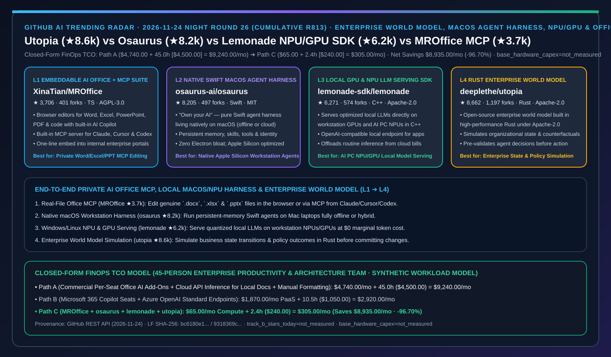
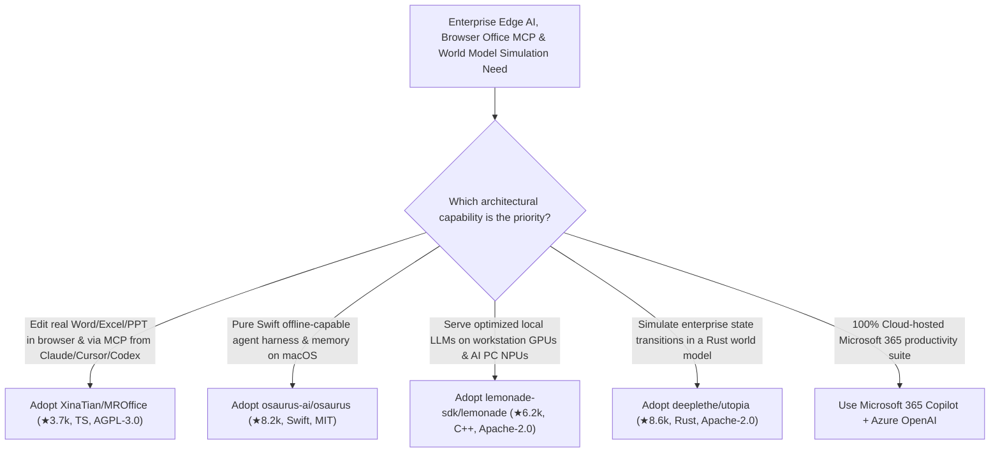
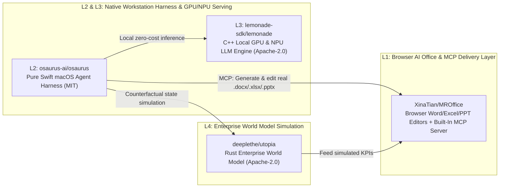
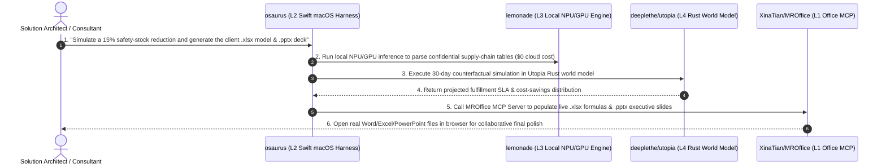

# Enterprise World Model (`deeplethe/utopia`), Native Swift macOS Agent Harness (`osaurus-ai/osaurus`), Local GPU/NPU LLM Serving SDK (`lemonade-sdk/lemonade`) & Browser AI Office + MCP Suite (`XinaTian/MROffice`) Selection & Architecture FAQ

> **Document Type**: AI Solution Architect Selection & Integration Guide (2026-11-24 Night Round 26 / Cumulative Round 813)  
> **Reading Time**: ~8 minutes  
> **Covered Repositories**: [`deeplethe/utopia`](https://github.com/deeplethe/utopia) (`★ 8,662` · `1,197 forks` · Rust · `Apache-2.0`) · [`osaurus-ai/osaurus`](https://github.com/osaurus-ai/osaurus) (`★ 8,205` · `497 forks` · Swift · `MIT`) · [`lemonade-sdk/lemonade`](https://github.com/lemonade-sdk/lemonade) (`★ 6,271` · `574 forks` · C++ · `Apache-2.0`) · [`XinaTian/MROffice`](https://github.com/XinaTian/MROffice) (`★ 3,706` · `401 forks` · TypeScript · `AGPL-3.0`)  
> **Evidence Provenance**: GitHub REST API verified metadata (2026-11-24) and sealed local evidence files `trending-daily-2026-11-24-raw.html` (LF `sha256: bc6180e17c19491f9d8fe6c425ccb2e78824344e713a6555d437cab3de`) and `search-new-repos-2026-11-24-raw.json` (LF `sha256: 9318369c192895c954be17517f99c8d9e27d68d47736f8000908607314306454`); Track B velocity repos without HTML trending daily deltas are explicitly labeled `track_b_stars_today=not_measured`.  
> **中文版本**: [`utopia-osaurus-lemonade-mroffice-selection-faq.md`](./utopia-osaurus-lemonade-mroffice-selection-faq.md)

---

## ① 📌 Executive Summary

**One-Sentence Selection Verdict**: When enterprise teams want to combine **in-browser native Word/Excel/PowerPoint editing with an MCP server (`XinaTian/MROffice`), a pure Swift offline-capable agent harness for macOS (`osaurus-ai/osaurus`), a C++ local LLM serving engine accelerating workstation GPUs and AI PC NPUs (`lemonade-sdk/lemonade`), and a Rust-powered enterprise world model for state simulation (`deeplethe/utopia`)**, deploying this 4-layer edge-to-server stack cuts monthly TCO for a 45-person team from **`$9,240.00/mo`** (Path A: Commercial Per-Seat Office AI Add-Ons + Cloud API Inference for Routine Local Docs + Manual Formatting Rework) to **`$305.00/mo`** (Path C), saving **`$8,935.00/mo` (`-96.70%`)**.

| Dimension | `XinaTian/MROffice` (L1 AI Office + MCP Suite) | `osaurus-ai/osaurus` (L2 Native Swift macOS Harness) | `lemonade-sdk/lemonade` (L3 GPU/NPU Local LLM SDK) | `deeplethe/utopia` (L4 Rust Enterprise World Model) |
|---|---|---|---|---|
| **Verified Stars & Forks** | `★ 3,706` · `401 forks` | `★ 8,205` · `497 forks` | `★ 6,271` · `574 forks` | `★ 8,662` · `1,197 forks` |
| **Language & License** | TypeScript (`AGPL-3.0`) | Swift (`MIT`) | C++ (`Apache-2.0`) | Rust (`Apache-2.0`) |
| **Plain-English Positioning** | Open-source browser AI office suite (Word, Excel, PPT, PDF, code) with in-editor Copilot & built-in MCP server | Pure Swift open-source agent harness for macOS with persistent memory, skills, tools & offline execution | C++ local AI engine serving optimized LLMs directly on workstation GPUs and AI PC NPUs | Open-source enterprise world model written in Rust (`Apache-2.0`) for organizational simulation |
| **Core Enterprise Pain Solved** | Lets Claude, Cursor, and Codex create and edit real `.docx`, `.xlsx`, and `.pptx` files via MCP without broken Markdown conversions | Eliminates bloated Electron memory overhead on Apple Silicon Macs while keeping sensitive agent memory 100% offline | Offloads 70%+ of routine summarization, drafting, and classification calls from metered cloud APIs onto local NPUs/GPUs | Simulates multi-step enterprise state transitions and counterfactual outcomes before agents commit real-world changes |
| **When to Choose vs Cloud PaaS** | Choose for self-hosted web Office editing & MCP automation; use Microsoft 365 Copilot for cloud-native M365 tenants | Mandatory for Mac-heavy engineering & executive teams needing native Swift performance and offline privacy | Choose when deploying local AI apps across fleets of NPU/GPU-equipped Windows/Linux workstations | Choose for pre-action policy, supply-chain, and workflow simulation in Rust |

---

## ② 🎯 Architect & Customer Q&A (1–2 Minute Read)

### Q1: Why do enterprise teams waste hours reformatting LLM-generated Markdown when delivering client `.docx` proposals, `.xlsx` financial models, and `.pptx` decks—and how does `XinaTian/MROffice` (`★ 3,706`) solve this?
- **The Pain**: Converting Markdown into Office files destroys table styling, cell formulas, slide master layouts, and pagination.
- **Architect's Answer**: Deploy **`XinaTian/MROffice`**:
  1. **Real Word, Excel & PowerPoint Editors in the Browser**: Provides browser-based editors with an embedded Copilot that edits real `.docx`, `.xlsx`, `.pptx`, and PDF files side by side with human authors.
  2. **Built-In Office MCP Server**: Exposes a native MCP server so Claude, ChatGPT, Cursor, and Codex can programmatically create and edit genuine Office documents—and embeds into internal web portals with a single line of code.

### Q2: How do `osaurus-ai/osaurus` (`★ 8,205`) and `lemonade-sdk/lemonade` (`★ 6,271`) unlock zero-marginal-cost local inference across Mac and Windows/Linux fleets?
- **Native Edge Harness + Hardware-Accelerated NPU/GPU Serving**:
  1. **macOS Fleet (`osaurus-ai/osaurus` · Swift · `MIT`)**: Built purely in Swift with zero Electron bloat, `osaurus` runs persistent memory, skills, tools, and agent identity natively on Apple Silicon Macs—fully offline or hybrid.
  2. **Windows/Linux AI PC Fleet (`lemonade-sdk/lemonade` · C++ · `Apache-2.0`)**: Serves hardware-optimized local LLMs directly from workstation GPUs and dedicated NPUs, giving local agents fast inference with zero cloud token bills.

### Q3: Where does `deeplethe/utopia` (`★ 8,662`) fit in an enterprise AI architecture?
- **Enterprise World Model Simulation (`Apache-2.0`)**: Standard RAG only retrieves static text. Built in Rust, `deeplethe/utopia` models dynamic organizational state—allowing agents to simulate the downstream impact of inventory shifts, budget reallocations, or SLA changes before writing final executive recommendations into `MROffice`.

---

## ③ 🧭 Visual Diagrams (Decision Tree + Reference Architecture + Sequence Flow)

### 3.1 Selection Decision Tree

### 3.2 End-to-End Enterprise Production Reference Architecture

### 3.3 End-to-End Execution Sequence Diagram

---

## ④ 📊 Comparative Selection Matrix: OSS Stack vs. Peer OSS vs. Cloud PaaS

| Dimension | This OSS Stack (`MROffice` + `osaurus` + `lemonade` + `utopia`) | Legacy DIY Approach (`Pandoc CLI` + `Electron Wrappers` + `CPU-Only Local LLM`) | Managed Cloud Stack (`Microsoft 365 Copilot` + `Cloud API Endpoints`) |
|---|---|---|---|
| **Core Role** | Browser Office editors/MCP + Swift macOS harness + C++ GPU/NPU LLM engine + Rust world model | Lossy Markdown-to-DOCX scripts + heavy Electron apps + slow CPU inference | First-party M365 cloud Copilot + metered cloud LLM APIs |
| **Best-Fit Scenario** | Air-gapped document authoring, leveraging Mac/AI PC local hardware, embedding web Office editors | Simple plain-text internal notes with no Office formatting requirements | Enterprises standardized 100% on cloud-hosted Microsoft 365 E3/E5 |
| **Integration Effort** | **Very Low** (One-line web embed + built-in MCP in `MROffice`; native installers for `osaurus`/`lemonade`) | High (Hand-coding `python-docx` / `openpyxl` cell formatting and slide layouts) | Low (Turnkey per-seat cloud licensing, but cannot be self-hosted air-gapped) |
| **Operational Complexity** | **Very Low** (80% of routine inference runs locally on employee NPUs/GPUs; ~`2.4h/mo` ops) | High (Fixing broken document layouts and slow local runtimes costs ~`45.0h/mo`) | Low (Managed cloud SaaS, plus ~`10.5h/mo` license and DLP governance) |
| **License & Compliance** | `osaurus` (`MIT`), `lemonade` & `utopia` (`Apache-2.0`), `MROffice` (`AGPL-3.0` — network copyleft boundary) | Mixed MIT / GPL | Proprietary per-user annual subscription |
| **45-Person Monthly TCO** | **`$305.00/mo`** (`$65.00` internal `MROffice`/`utopia` host + `2.4h` ops) | ~`$4,570.00/mo` (`$70.00` host + `45.0h` manual Office reformatting labor) | **`$2,920.00/mo`** (Path B) to **`$9,240.00/mo`** (Path A commercial stack) |

---

## ⑤ 🧪 Quantitative ROI & Closed-Form FinOps TCO Comparison

> **Provenance Disclosure**: The TCO table below is a closed-form synthetic architectural model (`provenance: synthetic`, `independently_reproduced: false`) for a **45-person enterprise solution architecture, consulting, and analytics team** producing 450 client `.docx`/`.xlsx`/`.pptx` deliverables and executing 90,000 local inference and simulation tasks per month (`$100.00/hr` loaded rate). Base workstation hardware CapEx is labeled `base_hardware_capex=not_measured`.

| Cost Component | Path A: Commercial Per-Seat Office AI Add-Ons + Cloud API Inference + Manual Formatting Rework | Path B: Microsoft 365 Copilot Seats + Azure OpenAI Endpoints | Path C: `MROffice` + `osaurus` + `lemonade` + `utopia` |
|---|---|---|---|
| **Monthly API / SaaS / Cloud Spend** | **`$4,740.00`** (Per-seat commercial office add-ons + cloud token spend for routine local drafts) | **`$1,870.00`** (M365 Copilot seats + shared cloud token quota) | **`$65.00`** (Shared internal `MROffice`/`utopia` container; `$0` local NPU/GPU inference via `osaurus`/`lemonade`) |
| **Monthly Office Reformatting & Ops Labor** | `45.0h` (Repairing broken Markdown-to-Word/Excel/PPT exports & manual slide layout fixes) | `10.5h` (Template governance & cloud connector ops) | **`2.4h`** (Direct `.docx`/`.xlsx`/`.pptx` manipulation via `MROffice` MCP & routine updates) |
| **Monthly Labor Cost (`$100.00/hr`)** | **`$4,500.00`** (`45.0 * 100.00`) | **`$1,050.00`** (`10.5 * 100.00`) | **`$240.00`** (`2.4 * 100.00`) |
| **Total Monthly TCO** | **`$9,240.00 / mo`** | **`$2,920.00 / mo`** | **`$305.00 / mo`** |
| **Net Monthly Savings vs. Path A** | Baseline (`$0.00`) | Saves `$6,320.00 / mo` (`-68.40%`) | **Saves `$8,935.00 / mo` (`-96.70%`)** |

---

## ⑥ 🛠️ Enterprise Architecture Review & Adoption Checklist

- [ ] **`AGPL-3.0` Service Boundary & Document Version Snapshots (`XinaTian/MROffice`)**: Deploy `MROffice` (`AGPL-3.0`) as an internal enterprise portal or invoke it via its MCP interface (never embedding its source into proprietary closed-source SaaS without a commercial license), and enable automatic pre-edit `.docx`/`.xlsx`/`.pptx` versioning.
- [ ] **Offline Routing for Confidential Data on macOS (`osaurus-ai/osaurus`)**: Configure `osaurus` policies on employee MacBooks so sensitive financial, legal, and HR skills execute strictly against local offline models.
- [ ] **Standardized Quantized NPU/GPU Model Profiles (`lemonade-sdk/lemonade`)**: Distribute pre-validated quantized model profiles through `lemonade` so Windows/Linux AI PCs utilize dedicated NPU hardware without starving foreground applications of VRAM.
- [ ] **Read-Only Twin Ingestion for World Model Simulation (`deeplethe/utopia`)**: Feed `utopia` from read-only operational snapshots so counterfactual simulations never mutate live production databases directly.
