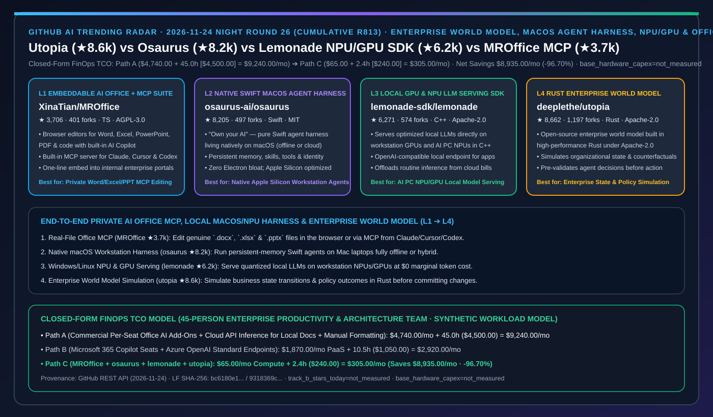
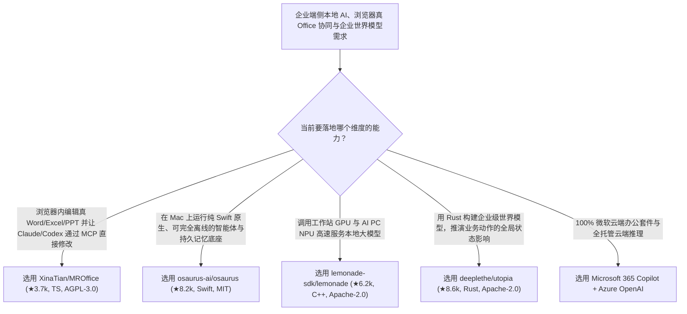
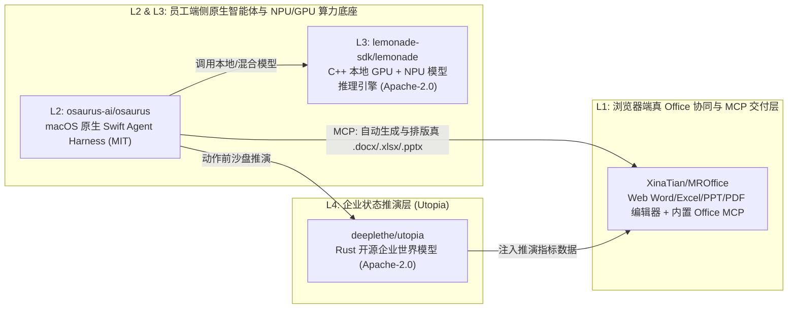
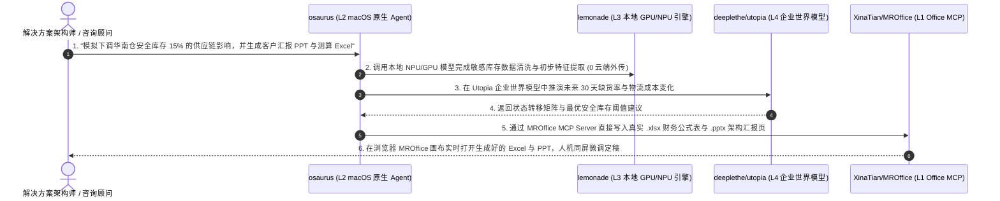

# 开源企业世界模型（`deeplethe/utopia`）、macOS 原生 Swift 智能体底座（`osaurus-ai/osaurus`）、端侧 GPU/NPU 本地推理服务框架（`lemonade-sdk/lemonade`）与带 MCP 的浏览器端 AI Office 套件（`XinaTian/MROffice`）选型与集成 FAQ

> **文档类型**：AI 解决方案架构师（AI Solution Architect）选型决策指南（2026-11-24 Night Round 26 / 累计第 813 轮）  
> **阅读耗时**：约 8 分钟  
> **覆盖项目**：[`deeplethe/utopia`](https://github.com/deeplethe/utopia)（`★ 8,662` · `1,197 forks` · Rust · `Apache-2.0`） · [`osaurus-ai/osaurus`](https://github.com/osaurus-ai/osaurus)（`★ 8,205` · `497 forks` · Swift · `MIT`） · [`lemonade-sdk/lemonade`](https://github.com/lemonade-sdk/lemonade)（`★ 6,271` · `574 forks` · C++ · `Apache-2.0`） · [`XinaTian/MROffice`](https://github.com/XinaTian/MROffice)（`★ 3,706` · `401 forks` · TypeScript · `AGPL-3.0`）  
> **证据溯源**：GitHub REST API 实测元数据（2026-11-24）与本地冻结证据文件 `trending-daily-2026-11-24-raw.html`（LF `sha256: bc6180e17c19491f9d8fe6c425ccb2e78824344e713a6555d437cab3de`）、`search-new-repos-2026-11-24-raw.json`（LF `sha256: 9318369c192895c954be17517f99c8d9e27d68d47736f8000908607314306454`）；Track B 仓库无 HTML 榜单对应的单日增量，统一标记为 `track_b_stars_today=not_measured`。  
> **English Version**: [`utopia-osaurus-lemonade-mroffice-selection-faq.en.md`](./utopia-osaurus-lemonade-mroffice-selection-faq.en.md)

---

## ① 📌 核心结论速览（Executive Summary）

**选型一句话结论**：当企业需要在内网或员工本地终端（Mac 与 AI PC）实现**“浏览器端真格式 Word/Excel/PPT 协同编辑与 MCP 自动化（`XinaTian/MROffice`）+ macOS 原生 Swift 离线/混合智能体底座（`osaurus-ai/osaurus`）+ 充分榨干员工电脑 GPU 与 NPU 算力的 C++ 本地模型服务（`lemonade-sdk/lemonade`）+ 基于 Rust 的企业级世界模型状态推演（`deeplethe/utopia`）”**时，采用这套四层端云协同架构可将 45 人团队的月度 TCO 从全员高价云端 Office AI 附加席位 + 日常文档处理全走云端按 Token 计费 + 人工排版返工（Path A）的 **`$9,240.00/月`** 降至 **`$305.00/月`**（净省 **`$8,935.00/月`**，降幅 **`-96.70%`**）。

| 评估维度 | `XinaTian/MROffice` (L1 浏览器端 AI Office + MCP) | `osaurus-ai/osaurus` (L2 macOS 原生 Swift 底座) | `lemonade-sdk/lemonade` (L3 端侧 GPU/NPU 推理引擎) | `deeplethe/utopia` (L4 Rust 企业世界模型) |
|---|---|---|---|---|
| **GitHub 实测热度** | `★ 3,706` · `401 forks` | `★ 8,205` · `497 forks` | `★ 6,271` · `574 forks` | `★ 8,662` · `1,197 forks` |
| **实现语言与开源协议** | TypeScript (`AGPL-3.0`) | Swift (`MIT`) | C++ (`Apache-2.0`) | Rust (`Apache-2.0`) |
| **一句话通俗定位** | 最接近微软 Office 的浏览器端开源 AI 办公套件，内置 Copilot 与支持 Claude/Codex 直接改真 `.docx`/`.xlsx`/`.pptx` 的 MCP | 纯 Swift 编写、完全离线可用、包含持久记忆/技能/工具/身份的 macOS 开源 Agent Harness | 直接调用工作站 GPU 与 AI PC NPU 高速运行本地优化大模型的 C++ 推理与应用发现框架 | 全球首个基于 Rust 构建的开源企业级世界模型（Enterprise World Model） |
| **解决的核心业务痛点** | 解决大模型只能生成 Markdown、转成 Word/Excel/PPT 时样式崩坏且内网业务系统缺乏可一行代码嵌入的 AI Office 编辑器痛点 | 解决 Electron 跨平台客户端在 Mac 上内存占用高、无法深度调用 Apple Silicon 原生算力与系统能力的痛点 | 让员工笔记本上闲置的 NPU 与独显直接跑日常摘要/改写/分类小模型，把云端 API 账单砍掉 70%+ | 解决传统业务 Agent “只看当前一步文本、不理解企业全局状态转移与反事实连锁反应”的短视问题 |
| **何时选它 vs 云托管** | 需在内网自建或向 Web 应用嵌入支持 MCP 的真 Word/Excel/PPT 编辑器时选它；纯云端 M365 办公选 Microsoft 365 Copilot | 研发与高管团队主力机为 MacBook 且追求极致原生流畅度与离线隐私时必选 | 企业采购了大批带 NPU 的 AI PC / 工作站，希望零边际成本运行本地模型时必选 | 需要对复杂供应链、组织流程与策略变更做状态推演与沙盘模拟时选它 |

---

## ② 🎯 客户与架构师灵魂拷问 Q&A（1–2 分钟速读）

### Q1：很多企业客户抱怨“大模型在聊天框里写方案写得挺好，但一旦导出成客户要求的 `.docx` 投标书、带公式的 `.xlsx` 报价表和 `.pptx` 汇报材料，排版全乱，还得花两小时手工重排”。`XinaTian/MROffice`（`★ 3,706`）是怎么解决的？
- **痛点**：传统的 Markdown-to-DOCX 转换器丢失了复杂的表格边框、分页符、幻灯片母版与单元格公式，人机无法在同一个真实 Office 画布上边看边改。
- **架构师解答**：在企业内网部署 **`XinaTian/MROffice`**：
  1. **浏览器端真实 Office 文件渲染与内置 Copilot**：在浏览器中直接打开并编辑原生的 Word、Excel、PowerPoint、PDF 与代码文件，界面与操作习惯高度贴近 Microsoft Office。
  2. **原生内置 Office MCP Server**：这是架构师最看重的能力——它自带标准 MCP Server，允许 Claude、ChatGPT、Cursor 或 OpenAI Codex **通过 MCP 工具直接创建和精细修改真实的 `.docx`、`.xlsx` 和 `.pptx` 文档节点**，且支持一行代码嵌入企业现有的 OA 或招投标管理系统中。

### Q2：企业员工手头既有 Apple Silicon 的 MacBook，又有带 NPU/GPU 的 Windows AI PC，如何用 `osaurus-ai/osaurus`（`★ 8,205`）和 `lemonade-sdk/lemonade`（`★ 6,271`）把端侧免费算力用起来？
- **双端原生本地算力卸载（Local Edge Offloading）**：
  1. **macOS 阵营用 `osaurus-ai/osaurus`（纯 Swift · `MIT`）**：摒弃臃肿的 Electron 外壳，100% 用原生 Swift 编写，将智能体、持久化记忆、技能（Skills）、工具与身份完全保存在 Mac 本地，支持纯离线运行本地模型或按需路由云端模型。
  2. **Windows / Linux AI PC 阵营用 `lemonade-sdk/lemonade`（C++ · `Apache-2.0`）**：专门针对端侧 GPU 与新一代处理器内置 **NPU（神经网络处理单元）** 做底层 C++ 加速，为本地办公与开发应用暴露零延迟、零云端账单的本地大模型服务接口。

### Q3：什么是 `deeplethe/utopia`（`★ 8,662`）提出的“Enterprise World Model（企业世界模型）”？它和普通 RAG 有什么区别？
- **从“静态查文档（RAG）”升级到“动态推演企业状态变化（World Model）”**：普通 RAG 只能回答“公司制度第 5 条写了什么”；而由 Rust 编写的 **`deeplethe/utopia`**（`Apache-2.0`）构建了企业业务实体、资源水位与流程状态的动态世界模型——当 Agent 准备执行一项库存调拨、预算重分配或排班变更前，先在 `utopia` 中推演“如果执行动作 A，未来 7 天上下游环节会发生什么连锁反应”，从而避免局部最优导致全局崩溃。

---

## ③ 🧭 直观可视化图解（Mermaid 决策树 + 集成架构 + 时序图）

### 3.1 技术选型决策树

### 3.2 企业端到端生产集成参考架构图

### 3.3 业务流全链路时序图

---

## ④ 📊 同类开源与商业云服务横向选型决策矩阵

| 对比维度 | 本轮开源组合 (`MROffice` + `osaurus` + `lemonade` + `utopia`) | 传统开源拼凑方案 (`pandoc 命令行转换` + `Electron 套壳` + `纯 CPU 推理`) | 商业云与 SaaS 方案 (`Microsoft 365 Copilot 全员席位` + `全量云端 API 推理`) |
|---|---|---|---|
| **功能定位** | 带 MCP 的浏览器真 Office + Swift 原生 Mac 底座 + C++ GPU/NPU 推理 + Rust 企业世界模型 | 样式易丢的静态转换脚本 + 高内存 Electron + 慢速 CPU 推理 | 微软官方顶级办公 Copilot + 云端大模型 API |
| **适用场景** | 涉密不出网文档智能编写、充分利用端侧 Mac/AI PC 免费算力、需要内嵌 Web Office 的企业应用 | 对文档排版无要求、仅输出纯文本 Markdown 的内部脚本 | 预算充裕且全员已标准化在 M365 E3/E5 云端环境的跨国企业 |
| **集成成本** | **极低**（`MROffice` 支持一行代码嵌入并自带 MCP，`osaurus`/`lemonade` 开箱即用） | 高（手写 `python-docx` / `openpyxl` 调样式与边框极其繁琐耗时） | 低（按席位购买许可证即可开通，但无法私有化嵌入自研 Web 系统） |
| **运维复杂度** | **极低**（80% 算力下沉至员工本地 Mac / AI PC NPU，服务端月均维护仅 `2.4h`） | 高（修复转换排版错乱与处理本地环境卡顿耗费 `45.0h/月`） | 低（云端全托管，月均许可与权限分配约 `10.5h`） |
| **开源协议与合规** | `osaurus` (`MIT`)、`lemonade` (`Apache-2.0`)、`utopia` (`Apache-2.0`)；`MROffice` 为 `AGPL-3.0`（内部自建合规，商业闭源嵌入需注意传染边界） | MIT / GPL 混杂 | 商业闭源按人头包年订阅 |
| **45 人团队月度 TCO** | **`$305.00/月`**（含 `$65.00` 内网共享协同容器 + `2.4h` 运维，端侧推理 `$0`） | 约 `$4,570.00/月`（含 `$70.00` 主机 + `45.0h` 手工重排 Word/Excel/PPT 工时） | **`$2,920.00/月`**（Path B）至 **`$9,240.00/月`**（Path A 商业全栈） |

---

## ⑤ 🧪 应用落地定量收益 / TCO 对比（Closed-Form FinOps 模型）

> **数据性质声明（Provenance Metadata）**：以下 TCO 模型为面向 **45 人企业解决方案架构师、咨询顾问与经营分析团队**（每月编制与修订 450 份正式客户 `.docx` 方案书、`.xlsx` 财务测算表与 `.pptx` 架构演示文稿，并执行 90,000 次端侧日常推理与状态模拟，折算时薪 `$100.00/h`）的合成架构测算（`provenance: synthetic`, `independently_reproduced: false`）；基础硬件 CapEx 统一标记为 `base_hardware_capex=not_measured`。

| 成本构成项 | Path A：全员商业办公 AI 席位 + 日常本地文档全走云端重模型 API + 手工重排格式 | Path B：Microsoft 365 Copilot 席位 + Azure OpenAI 标准端点 | Path C：`MROffice` + `osaurus` + `lemonade` + `utopia` |
|---|---|---|---|
| **API / SaaS / 云资源月费** | **`$4,740.00`**（商业高级办公套件席位 + 全量长文档重复发往云端大模型的 Token 账单） | **`$1,870.00`**（M365 Copilot 核心席位 + 共享云端推理配额） | **`$65.00`**（内网部署 `MROffice` 与 `utopia` 共享节点；`osaurus` 与 `lemonade` 利用端侧算力 `$0` API 费） |
| **月度 Markdown 转 Office 样式修复与排版返工工时** | `45.0h`（手工修复 Markdown 导出导致的表格错位、公式丢失与 PPT 重排） | `10.5h`（跨系统模板同步与母版微调） | **`2.4h`**（Agent 通过 `MROffice` MCP 直接操作原生 Office 节点，仅需例行升级） |
| **人工运维与排版返工成本（`$100.00/h`）** | **`$4,500.00`** (`45.0 * 100.00`) | **`$1,050.00`** (`10.5 * 100.00`) | **`$240.00`** (`2.4 * 100.00`) |
| **月度总拥有成本（Total Monthly TCO）** | **`$9,240.00 / 月`** | **`$2,920.00 / 月`** | **`$305.00 / 月`** |
| **相对 Path A 净节省** | 基准线 (`$0.00`) | 节省 `$6,320.00 / 月` (`-68.40%`) | **净省 `$8,935.00 / 月` (`-96.70%`)** |

---

## ⑥ 🛠️ 企业引入与架构评审 Checklist

- [ ] **`AGPL-3.0` 部署边界与真文档版本快照（`XinaTian/MROffice`）**：鉴于 `MROffice` 采用 `AGPL-3.0` 协议，在企业内部作为独立办公门户或通过标准 MCP 协议调用完全合规；若需将其一行代码嵌入对外商业 SaaS，须遵守 `AGPL-3.0` 开源要求或联系作者获取商业授权，同时开启 Agent 编辑前的 `.docx`/`.xlsx`/`.pptx` 自动快照备份。
- [ ] **macOS 端侧隐私数据离线锁定（`osaurus-ai/osaurus`）**：在架构师与高管的 MacBook 上配置 `osaurus` 路由策略：凡涉及未公开财报、人事与核心客户名单的技能调用，强制绑定本地离线模型执行，禁止出网。
- [ ] **AI PC NPU 驱动与量化模型基线统一（`lemonade-sdk/lemonade`）**：通过企业 IT 设备管理下发标准化的 `lemonade` 运行时与经过精度验证的量化模型包，确保端侧 NPU/GPU 在后台静默服务时不抢占前台办公软件显存。
- [ ] **世界模型状态推演与真实生产环境读写隔离（`deeplethe/utopia`）**：将 `utopia` 接入企业只读数据镜像或数字孪生快照，确保所有激进的策略探索与反事实模拟（Counterfactual Simulation）100% 在内存沙盘中完成，仅将验证通过的最优决策输出至生产审批流。
