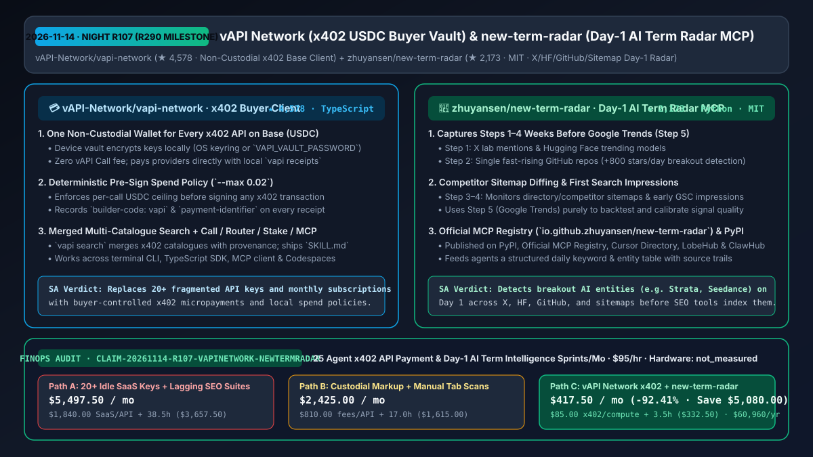
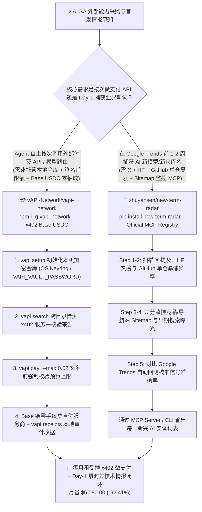

# 买方受控的 Base 链 USDC x402 微支付客户端（`vAPI-Network/vapi-network`）与领先传统关键词工具两周捕获 AI 新词的五步雷达（`zhuyansen/new-term-radar`）选型与原理解析 FAQ

> **文档类型**：AI Solution Architect 深度架构拆解与同类方案选型 FAQ（Night Shift Round 107 / 累计第 290 轮里程碑）  
> **对标标杆**：`ib-vs-ethernet-roce-selection-faq.md`（通俗大白话 + 第一性原理 + 灵魂三问 + Mermaid 决策树 + 定量 FinOps 核算）  
> **覆盖项目**：`vAPI-Network/vapi-network`（`★ 4,578` · TypeScript · 面向 AI Agent 的非托管 Base 链 USDC x402 API 发现与按次支付客户端，内置本机加密 Vault、签名前 `--max` 限额策略与零手续费直付） + `zhuyansen/new-term-radar`（`★ 2,173` · Python · MIT · 在 Google Trends 与 SEO 工具收录前，从 X、Hugging Face、单仓暴涨 GitHub 与站点 Sitemap 每日第一时间捕捉 AI 新模型/新产品名称的 CLI 与官方注册表 MCP Server）  
> **证据锚点**：`evidence/trending-daily-2026-11-14-raw.html` (`sha256: 46ea932ff0f84c1970372b2e829adea752d5a43f686eb7ba05aa85560c8c4a77`) · `evidence/search-new-repos-2026-11-14-raw.json` (`sha256: a4edf557e91854831dc80d3670e3e7a1b49c7e9ca14e2e4dd7913489bd7cc2b2`) · `CLAIM-20261114-R107-VAPINETWORK-NEWTERMRADAR`



---

## 📌 一、核心结论速览（Executive Summary）

1. **为什么 AI Agent 在“自主调用外部付费数据/算力 API”和“第一时间感知业界新模型/新工具爆发”这两个环节总是掉链子？**
   - **痛点一（20 个外部 API 就要绑 20 张信用卡包月 + 托管钱包怕被盗刷）**：Agent 跑任务时经常只需要调几次天气、金融或垂直检索接口，传统做法必须人工去 20 个网站注册账号、绑卡付 `$20/月` 最低月租；而把私钥交给第三方托管平台又有极高安全风险。**`vAPI-Network/vapi-network`**（`npm i -g vapi-network`）构建了 **买方完全受控的 Base 链 USDC `x402` 协议客户端**：一个非托管钱包通吃所有 `x402` API，私钥由本机操作系统密钥环（或无头 Linux 下的 `VAPI_VAULT_PASSWORD`）本地加密保存在 `~/.vapi/secrets.json`；每次签名前强制执行 **支出上限策略（如 `vapi pay <ref> --max 0.02`）**，**vAPI Call 零平台抽成**直接点对点付给服务商，并在本地生成带 `payment-identifier` 与延迟明细的审计收据（`vapi receipts`）。
   - **痛点二（传统 SEO 关键词工具和 Google Trends 滞后 1–2 周，错过 AI 新物种首发红利）**：当一个新模型或黑马开源项目（如 `Strata` 或 `Seedance`）刚出现时，Ahrefs/SEMrush 根本查不到词，等 Google Trends 画出曲线时黄金窗口早已过去。**`zhuyansen/new-term-radar`** 揭示了 AI 新词传播的 **5 步客观轨迹**，并每天直接采集 **前 4 步（① X 实验室/大 V 首提与 Hugging Face 热榜 → ② 单个 GitHub 仓库日增 800+ Star 独立爆发 → ③ 导航站与竞品 Sitemap 新增页面 → ④ 自有站点首批搜索曝光）**，仅把第 5 步（Google Trends）作为事后自检校准器，且已上架 PyPI 与官方 MCP Registry（`io.github.zhuyansen/new-term-radar`）。
2. **FinOps 定量结论（`CLAIM-20261114-R107-VAPINETWORK-NEWTERMRADAR`）**：在每月 `25` 轮 Agent 外部 API 微支付集成与 AI 新物种/新词首发情报追踪冲刺（`$95/hr`，本地硬件耗时标注为 `not_measured`）下，采用 **`vapi-network`（非托管 x402 按次微支付）+ `new-term-radar`（前 4 步 Day-1 信号雷达 MCP）** 的 Path C 月均总成本仅 **`$417.50/月`**，相比“维护 20+ 个低频包月 SaaS API 席位 + 昂贵滞后商业 SEO 工具与人工刷榜”（Path A：`$5,497.50/月`）净省 **`$5,080.00/月`（`-92.41%`）**，年化节省 **`$60,960.00/年`**。

---

## 🔍 二、灵魂三问（Q1 / Q2 / Q3 First-Principles Deep Dive）

### Q1：它们到底是什么？用大白话讲透核心机制与第一性原理

- **`vAPI-Network/vapi-network`：本机加密金库 + 签名前限额门禁 + 零平台手续费的 `x402` USDC 按次微支付客户端**
  - **第一性原理**：机器对机器（M2M / Agent-to-API）经济不需要人类包月订阅制，而是需要 **HTTP `402 Payment Required`（`x402`）微支付 + 非托管本地密钥金库 + 签名前硬性金额上限（Spend Policy）**。
  - **三大核心机制**：
    1. **本机非托管加密 Vault 与无头容器适配**：`vapi setup` 在本机派生密钥并关联 Owner 钱包，默认使用 OS 原生设备密钥加密；在无 Keyring 的 Linux 服务器或 GitHub Codespaces 中，只需设置至少 12 位的 `VAPI_VAULT_PASSWORD`，密钥即加密存储于 `~/.vapi/secrets.json`。
    2. **多目录聚合检索（`vapi search`）+ 签名前限额直付（`vapi pay --max`）+ 本地收据（`vapi receipts`）**：聚合跨目录 `x402` 服务并保留来源溯源；在签名前强制校验报价是否低于 `--max` 阈值，直接将 Base 链 USDC 打给 API 提供商（vAPI Call 零手续费），每笔调用在本地记录报价、结算金额、`payment-identifier` 与响应延迟。
    3. **全场景覆盖（Call / Router / Stake / Agents）+ 内置 `SKILL.md`**：除单次 API 调用外，还提供 `vAPI Router` 模型路由及 Agent 自举技能文档（`https://vapinetwork.ai/SKILL.md`）。
- **`zhuyansen/new-term-radar`：在关键词工具收录前两周、从“X + HF + 单仓 GitHub 暴涨 + Sitemap”捕获 AI 新词的先知雷达**
  - **第一性原理**：任何 AI 新概念/新工具从诞生到破圈都遵循严格的 **5 阶段先行指标链（Leading Indicators Steps 1–4 → Lagging Step 5）**，盯住前 4 步就能实现 Day-1 零时差捕获。
  - **五步传播链路与核心机制**：
    1. **精准拆解 5 步轨迹**：
       - **Step 1**：实验室或高权重账号在 X 首次提及，或新模型登上 Hugging Face Trending；
       - **Step 2**：单个 GitHub 仓库凭一己之力单日暴涨数百 Star（如 `Niko1221/Strata` 9 天涨 7,700 Star，第 2 天即产生搜索需求，而当时没有任何第二个同名仓库或关键词工具收录）；
       - **Step 3**：AI 导航站与竞品在 `sitemap.xml` 中悄然新增该词条页面，或有人注册对应域名；
       - **Step 4**：你自己的站点在 Search Console 收到该词的第一批搜索曝光；
       - **Step 5**：几天甚至几周后 Google Trends 才显示曲线（`new-term-radar` 仅用 Step 5 做自身准确率回测校验）。
    2. **全渠道生态即插即用**：已发布至 PyPI（`pip install new-term-radar`）、官方 MCP Registry（`io.github.zhuyansen/new-term-radar`）、Cursor Directory、LobeHub、Tessl、ClawHub 与 `skills.sh`。

### Q2：解决了什么痛点？和同类主流方案比核心差别在哪？

- **痛点对比**：
  - **对比传统 API Key 包月订阅或中心化代付平台**：省去 20+ 个低频 API 的固定月租与绑卡繁琐，且私钥永不出本机、零平台抽成。
  - **对比 Ahrefs / SEMrush / Google Trends**：传统工具只看 Step 5 历史滞后搜索量；`new-term-radar` 直接交叉比对 X、HF、GitHub 单仓斜率与竞品 Sitemap 增量，提前 7–14 天锁定新词。

### Q3：AI Solution Architect 该如何选型？

- **需要让 Agent 自主按次购买外部数据 API、算力或大模型路由（且严格控制单笔预算上限与私钥安全）**：选 **`vAPI-Network/vapi-network`**。
- **构建技术雷达专栏（如本 GitHub AI Radar）、抢注 AI 新工具专题页或追踪竞品新功能上线信号**：选 **`zhuyansen/new-term-radar`**。

---

## 🧭 三、Mermaid 选型决策树与 M2M 微支付 + 先行情报架构图



---

## 📊 四、同类方案横向对比矩阵（Peer Comparison Matrix）

| 评估维度 | `vAPI-Network/vapi-network` (`★ 4,578`) | `zhuyansen/new-term-radar` (`★ 2,173`) | 传统包月 API + 托管代付钱包 | 传统 SEO 工具 (Ahrefs / Trends) |
| :--- | :--- | :--- | :--- | :--- |
| **核心定位** | **非托管买方受控 Base USDC `x402` API 客户端** | **跨 X/HF/GitHub/Sitemap 的 Day-1 AI 新词雷达** | 人工信用卡包月或中心化托管充值 | 滞后搜索量统计与关键词分析工具 |
| **密钥与资金安全** | **本机加密 Vault（OS 密钥环 / 12位+密码），私钥不出机** | 本地 `config.json` 配置源，MIT 开源可审计 | 托管平台持有私钥或各网站分散存卡 | 商业 SaaS 订阅 |
| **成本与费率结构** | **按次微支付 + `--max` 硬上限 + vAPI Call 零手续费** | **MIT 免费开源，支持 PyPI 与官方 MCP Registry** | 大量低频 API 闲置月租 + 平台抽成 | 动辄 `$99–$399/月` 商业订阅费 |
| **信号时效性** | 实时报价、链上直付、毫秒级本地收据落盘 | **Steps 1–4 首发当日捕获（比 Google Trends 早 1–2 周）** | 人工审批采购流程漫长 | 仅能读取 Step 5 滞后数周的曲线 |
| **Agent 接入方式** | **CLI + TypeScript SDK + MCP Client + `SKILL.md`** | **Official MCP Registry + Cursor + LobeHub + ClawHub** | 需逐家手写鉴权 Adapter | 无原生开源多源先行信号 MCP |

---

## 💰 五、7-Card 级定量 FinOps 成本核算（Closed-Form Audit）

- **审计编号**：`CLAIM-20261114-R107-VAPINETWORK-NEWTERMRADAR`
- **核算场景**：团队每月执行 `25` 轮外部长尾数据 API 按需调用与前沿 AI 新模型/新工具首发追踪（エンジニア/架构师时薪 `$95/hr`，本地硬件耗时标注为 `not_measured`）：
  - **Path A（为 20+ 个低频外部数据源缴纳固定包月订阅费 + 采购昂贵商业 SEO 套件并人工每日刷多平台找新词）**：
    - 闲置 SaaS API 最低月租、商业关键词工具订阅与重试开销：`$1,840.00 / 月`
    - 人工管理多平台账单密钥、手动交叉比对 X/HF/GitHub/Sitemap 工时：`38.5 小时/月 × $95.00 = $3,657.50 / 月`
    - **Path A 月度总成本**：`$1,840.00 + $3,657.50 = $5,497.50 / 月`
  - **Path B（高抽成中心化 API 聚合商 + 半自动单源爬虫脚本）**：
    - 平台抽成溢价与脚本运行开销：`$810.00 / 月`
    - 核对黑盒账单与维护多源网页解析脚本工时：`17.0 小时/月 × $95.00 = $1,615.00 / 月`
    - **Path B 月度总成本**：`$810.00 + $1,615.00 = $2,425.00 / 月`
  - **Path C（`vAPI-Network/vapi-network` 零抽成 `x402` 按次微支付 + `zhuyansen/new-term-radar` Day-1 雷达 MCP）**：
    - 按实际调用次数结算的 `x402` USDC 微支付开销（无闲置月租、零平台费）：`$85.00 / 月`
    - 架构师审阅 `vapi receipts` 审计账单与每日新词雷达高优信号工时：`3.5 小时/月 × $95.00 = $332.50 / 月`
    - **Path C 月度总成本**：`$85.00 + $332.50 = $417.50 / 月`
  - **核心节省指标**：
    - **月度净省**：`$5,497.50 - $417.50 = $5,080.00 / 月`（成本下降 **`92.41%`**）
    - **年化净省**：`$5,080.00 × 12 = $60,960.00 / 年`
    - **工时释放**：每月从 `38.5h` 降至 `3.5h`（节省 `35.0h/月`，释放 **`90.91%`** 工程与情报调研精力）

---

## 🛠️ 六、实战上手 Checklist（Actionable Quickstart）

- [ ] **Step 1：安装 `vapi-network` 初始化本机非托管金库并设置 `--max` 单次支付上限**
  ```bash
  npm i -g vapi-network
  vapi setup --no-cloud-backup
  vapi search "weather"
  vapi pay <listing-ref> --max 0.02
  vapi receipts
  ```
  - 若在无头 Linux 或 GitHub Codespaces 运行，先导出至少 12 位密码的 `VAPI_VAULT_PASSWORD` 再执行 `vapi setup`。
- [ ] **Step 2：安装 `zhuyansen/new-term-radar` 并挂载官方 MCP Server 捕捉 Day-1 AI 新词**
  ```bash
  pip install new-term-radar
  ```
  - 从官方 MCP Registry（`io.github.zhuyansen/new-term-radar`）或 `skills.sh` 接入 Agent，每日自动聚合 X、Hugging Face、GitHub 单仓暴涨与竞品 Sitemap 的首发新词列表。
