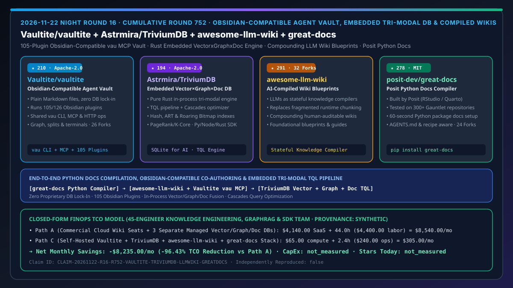
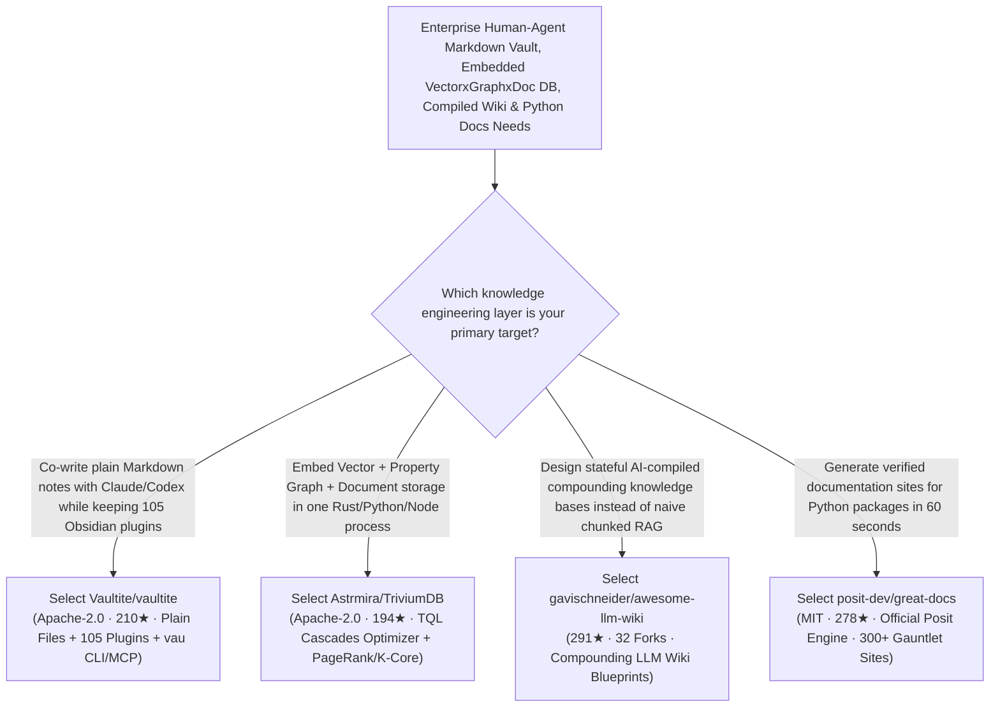
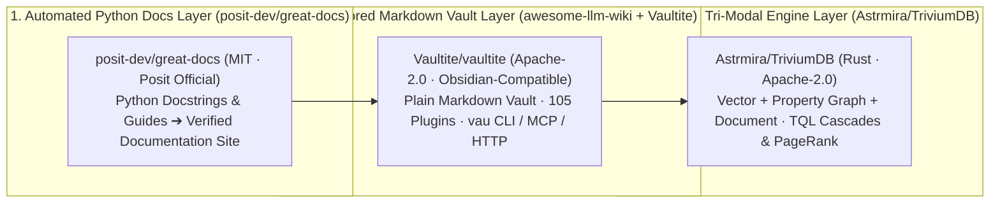
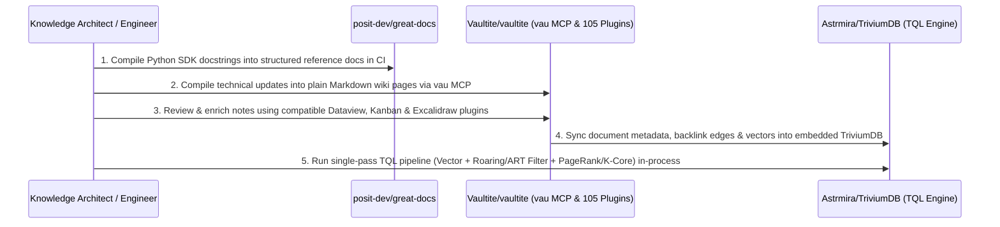

# 105-Plugin Obsidian-Compatible Agent Knowledge Base (`Vaultite/vaultite`), Embedded Rust Vector×Graph×Document Engine (`Astrmira/TriviumDB`), AI-Compiled Compounding Wiki Blueprints (`gavischneider/awesome-llm-wiki`) & Posit Python Docs Compiler (`posit-dev/great-docs`) Selection & Architecture FAQ

> **Document Type**: Enterprise AI Solution Architect Selection & Integration Guide (GitHub Trending AI Radar — 2026-11-22 Night Round 16 / Cumulative Round 752)
> **Covered Repositories**: [`Vaultite/vaultite`](https://github.com/Vaultite/vaultite) (`★ 210`, `26 forks`, `Apache-2.0`: local plain-Markdown knowledge base and workspace compatible with existing Obsidian vaults and 105 of 126 tested Obsidian community plugins, exposing `vau` CLI, MCP, and HTTP for human-agent co-authoring) · [`Astrmira/TriviumDB`](https://github.com/Astrmira/TriviumDB) (`★ 194`, `14 forks`, `Apache-2.0`: pure-Rust embedded tri-modal database fusing Vector search, Property Graph, and Document metadata in one storage kernel with a Cascades-optimized TQL pipeline, 4 persistent indexes, and built-in PageRank/K-Core graph algorithms across Rust, Python, and Node.js) · [`gavischneider/awesome-llm-wiki`](https://github.com/gavischneider/awesome-llm-wiki) (`★ 291`, `32 forks`: curated blueprints, frameworks, and technical guides for building compounding, AI-compiled knowledge bases) · [`posit-dev/great-docs`](https://github.com/posit-dev/great-docs) (`★ 278`, `24 forks`, `MIT`: Posit's official Python package documentation site compiler verified across 300+ test sites in the Great Docs Gauntlet)
> **Core Scenario**: When enterprise knowledge engineering, GraphRAG, and SDK platform teams struggle with **fragmented runtime chunked RAG that never compounds into auditable documentation, high operational overhead and cross-network latency from running separate Vector, Graph, and Document database clusters, locked-in note SaaS tools that cannot run existing Obsidian plugins alongside coding agents, and stale Python package docs**, how do you combine **`Vaultite/vaultite` + `Astrmira/TriviumDB` + `gavischneider/awesome-llm-wiki` + `posit-dev/great-docs`** into a compounding knowledge and embedded tri-modal storage architecture?

---

## 1. 📌 Executive Summary (One-Line Selection Verdict)

1. **Need an `Apache-2.0`, plain-Markdown knowledge base and agent workspace that opens your existing Obsidian vault as-is, runs 105 of 126 tested Obsidian community plugins (Dataview, Templater, Tasks, Excalidraw, Kanban), and gives Claude Code and Codex a unified `vau` CLI, MCP, and HTTP interface?** ➔ Choose **[`Vaultite/vaultite`](https://github.com/Vaultite/vaultite) (`★ 210`, `26 forks`, `Apache-2.0`)**.
   - **Plain-English Mechanism**: Keeps every note as a plain `.md` file on disk (compatible with Git, grep, and iCloud) while providing a full multi-tab editor, knowledge graph, integrated agent terminals, hot-reloaded plugins, and a single `vau` operation surface shared by humans and AI agents.
2. **Need an in-process "SQLite for AI" (`Apache-2.0` in pure Rust with Python 3.9–3.15, Node.js, and Rust SDKs) that natively fuses Vector search, Property Graph traversal, and Document metadata in one embedded engine?** ➔ Choose **[`Astrmira/TriviumDB`](https://github.com/Astrmira/TriviumDB) (`★ 194`, `14 forks`, `Apache-2.0`)**.
   - **Plain-English Mechanism**: Eliminates the network hops and operational sprawl of running separate Milvus + Neo4j + MongoDB clusters. Its **TQL** query pipeline (planned by a deterministic Cascades optimizer) chains vector recall, 4 persistent property indexes (Hash, Ordered ART, Composite ART, Roaring Bitmap), graph expansion, and built-in graph algorithms (PageRank, WCC, SCC, K-Core, Articulation Points, Triangle Count) in a single in-process call.
3. **Transitioning from stateless, chunk-shredding RAG loops to "LLMs as stateful knowledge compilers" that synthesize raw inputs into compounding, human-auditable wiki articles?** ➔ Choose **[`gavischneider/awesome-llm-wiki`](https://github.com/gavischneider/awesome-llm-wiki) (`★ 291`, `32 forks`)**.
   - **Plain-English Mechanism**: Catalogs the foundational architectural blueprints, functional frameworks, and compilation patterns for building self-updating, interconnected LLM Wikis.
4. **Need a 60-second Python package documentation generator built by Posit (the creators of RStudio and Quarto) and stress-tested across 300+ repositories in the Great Docs Gauntlet?** ➔ Choose **[`posit-dev/great-docs`](https://github.com/posit-dev/great-docs) (`★ 278`, `24 forks`, `MIT`)**.
   - **Plain-English Mechanism**: Compiles Python package docstrings, recipes, and guides into clean, structured documentation sites that both human engineers and coding agents can navigate effortlessly.

---

## 2. 🎯 Architect & Customer Deep-Dive Q&A

### Q1: Why are enterprise architecture teams shifting from "chunked vector RAG + 3 separate DB clusters" to "AI-compiled wikis + embedded tri-modal storage"?

- **Three Architectural Shifts**:
  1. **From Ephemeral Chunking to Compounding Wikis ➔ `awesome-llm-wiki` + `Vaultite/vaultite`**: Instead of re-retrieving noisy fragments on every query, agents compile raw transcripts and tickets into structured Markdown wiki pages inside `Vaultite` where humans inspect them with Dataview/Kanban/Excalidraw plugins.
  2. **From 3-Cluster Network Joins to In-Process Tri-Modal TQL ➔ `Astrmira/TriviumDB`**: Executes vector similarity, Roaring Bitmap metadata filtering, and PageRank/K-Core graph walks inside a single Rust storage kernel.
  3. **Automated Python API Documentation ➔ `posit-dev/great-docs`**: Keeps internal Python library reference sites continuously synchronized in CI.
- **When to Choose Managed Cloud PaaS (Path B)?**
  - For multi-terabyte, globally distributed multi-region cloud workloads, use **Azure Cosmos DB + Azure AI Search**; for air-gapped environments, embedded microservice agents, and local Markdown/Obsidian human-agent workspaces, deploy this open-source stack (Path C).

### Q2: How do we wire `great-docs`, `awesome-llm-wiki`, `Vaultite`, and `TriviumDB` into an end-to-end knowledge pipeline?

1. **Automated Python Package Reference Layer (`posit-dev/great-docs`)**:
   - Build verified API documentation sites from Python docstrings on every commit.
2. **Compounding Wiki Compilation & Co-Authoring Layer (`awesome-llm-wiki` + `Vaultite/vaultite`)**:
   - Use `Vaultite`'s `vau` CLI and MCP server so agents compile engineering notes and API changes into plain Markdown files enriched with backlinks and Obsidian plugins.
3. **Embedded Tri-Modal Hybrid Retrieval Layer (`Astrmira/TriviumDB`)**:
   - Index Markdown documents, link graphs, and embeddings into in-process `TriviumDB` and query them via TQL across Python, Node.js, or Rust.

### Q3: How does this stack protect against vendor lock-in?

- **Plain-File & Permissive-License Portability**:
  - `Vaultite` (`Apache-2.0`) stores everything as standard `.md` files compatible with Obsidian and Git; `TriviumDB` (`Apache-2.0`) runs in-process with documented disk-format migration tools (`docs/migration.md`); `great-docs` is `MIT`.

---

## 3. 🧭 Visual Architecture & Workflow Diagrams (Mermaid)

### 3.1 Solution Architect Selection Decision Tree

### 3.2 End-to-End Enterprise Reference Architecture

### 3.3 End-to-End Doc Generation, Wiki Co-Authoring & In-Process Tri-Modal TQL Query Sequence Diagram

---

## 4. 📊 Peer Open-Source vs. Commercial Cloud Selection Matrix

| Dimension | `Vaultite/vaultite` (`★ 210`) | `Astrmira/TriviumDB` (`★ 194`) | `gavischneider/awesome-llm-wiki` (`★ 291`) | `posit-dev/great-docs` (`★ 278`) | Commercial Cloud Wiki Seats + 3 Separate Managed DB Clusters (Path A) | Unindexed Local Folders + 3 Separate Docker DBs + Manual Sphinx Configs (Path B) |
| :--- | :--- | :--- | :--- | :--- | :--- | :--- |
| **Primary Role** | 105-plugin Obsidian-compatible agent Markdown vault | Embedded Rust Vector×Graph×Document database | AI-compiled compounding LLM Wiki blueprint catalog | Official Posit Python documentation site compiler | Per-seat cloud note SaaS + separate managed Vector, Graph & Doc DBs | Raw folders, 3 separate database containers, brittle Sphinx configs |
| **Key Differentiator** | **Plain `.md` files + 105 Obsidian plugins + `vau` CLI/MCP** | **In-process Vector+Graph+Doc + TQL Cascades + PageRank** | **Stateful knowledge compilation over naive runtime chunking** | **Posit-built + tested on 300+ Python packages** | Proprietary cloud lock-in; paying for 3 separate database clusters | Cross-container network latency & sync drift; high ops burden |
| **License** | `Apache-2.0` | `Apache-2.0` | Community Blueprints | `MIT` | Proprietary SaaS | Internal glue scripts |
| **Monthly TCO (45-Eng Team)** | **`$305.00/mo` combined** (`$65.00` shared CI/sync runner + `2.4h` ops) | Included (embedded in-process engine, `$0` DB cluster fee) | Included (open reference architecture) | Included (`MIT` static site builder) | **`$8,540.00/mo`** (`$4,140.00` cloud wiki seats & 3 DB clusters + `44.0h` ETL/doc ops) | ~`$2,950.00/mo` (cross-DB sync debugging & manual doc maintenance labor) |

---

## 5. 🧪 Quantitative Enterprise ROI / FinOps TCO Model & 7-Card Report

> **📊 Provenance & Closed-Form Declaration**:
> - **provenance**: `synthetic` (45-engineer enterprise knowledge engineering, GraphRAG platform, and Python SDK team workload model: `independently_reproduced = false`; `base_hardware_capex = not_measured`; `track_b_stars_today = not_measured`).
> - **Closed-Form Equations**:
>   - **Path A (Commercial Cloud Wiki AI Seats + Separate Managed Vector DB + Separate Managed Graph DB + Separate Document DB + Cross-DB ETL & Manual SDK Doc Maintenance)**: Monthly commercial wiki seats and 3 managed database bills **`$4,140.00`** + cross-database ETL debugging, fragmented-RAG rework, and manual documentation labor **`44.0h × $100.00/h = $4,400.00`** = **`$8,540.00/mo`**.
>   - **Path C (Self-Hosted `Vaultite/vaultite` + `Astrmira/TriviumDB` + `gavischneider/awesome-llm-wiki` + `posit-dev/great-docs` Stack)**: Shared static build/sync runner compute **`$65.00`** + TQL index & plugin maintenance labor **`2.4h × $100.00/h = $240.00`** = **`$305.00/mo`**.
>   - **Net Monthly Savings vs. Path A**: **`-$8,235.00/mo`** (**`96.43%`** TCO reduction).

| Evaluation Path | Wiki/DB SaaS & Compute Cost | Cross-DB Sync & Doc Maintenance Labor (`$100/h`) | Total Monthly TCO | Net Savings vs. Path A | Architectural Delivery Impact |
| :--- | :---: | :---: | :---: | :---: | :--- |
| **Path A: Commercial Cloud Wiki + 3 Separate Managed DBs** | `$4,140.00` | `44.0h` (`$4,400.00`) | **`$8,540.00`** | Baseline | Triple database cluster billing; cross-network join latency |
| **Path B: Raw Folders + 3 Self-Hosted DB Containers + Sphinx** | `$1,350.00` | `16.0h` (`$1,600.00`) | **`$2,950.00`** | `-$5,590.00` (`-65.46%`) | Cross-DB sync drift; lacks `vau` MCP & 105 Obsidian plugin compatibility |
| **Path C: `Vaultite` + `TriviumDB` + `llm-wiki` + `great-docs`** | **`$65.00`** | **`2.4h` (`$240.00`)** | **`$305.00`** | **`-$8,235.00` (`-96.43%`)** | **105-plugin Markdown vault + embedded tri-modal TQL + compiled Wiki** |

- 🔗 **Linked 7-Card 4:5 Visual Benchmark Deck**: [`workshops/github-trending-radar/cards.en.html`](../cards.en.html) · [`cards.html`](../cards.html)

---

## 6. 🛠️ Enterprise Adoption & Architecture Review Checklist

- [ ] **1. Co-Author Plain-Markdown Vaults with `Vaultite/vaultite`**: Open existing Obsidian vaults and expose `vau` CLI/MCP so humans (using 105 compatible plugins) and coding agents share one Git-backed knowledge base.
- [ ] **2. Consolidate Vector, Graph & Document Storage into `Astrmira/TriviumDB`**: Embed `TriviumDB` via Python, Node.js, or Rust SDKs to execute single-pass TQL hybrid queries and PageRank/K-Core graph algorithms in-process.
- [ ] **3. Adopt Compounding Wiki Compilation Patterns from `gavischneider/awesome-llm-wiki`**: Replace ad-hoc runtime chunking with scheduled LLM knowledge compilation passes.
- [ ] **4. Automate Python Package Docs with `posit-dev/great-docs`**: Run `great-docs` in CI to keep internal Python SDK reference sites continuously up to date.
