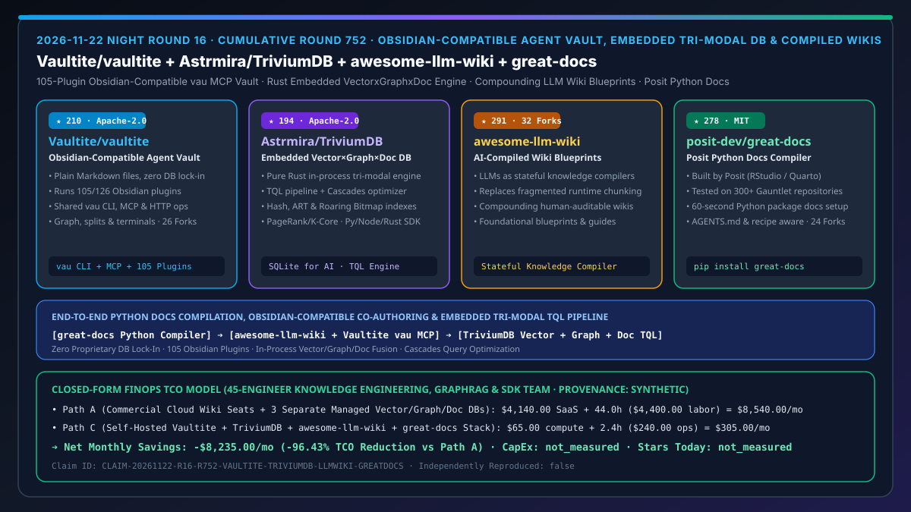
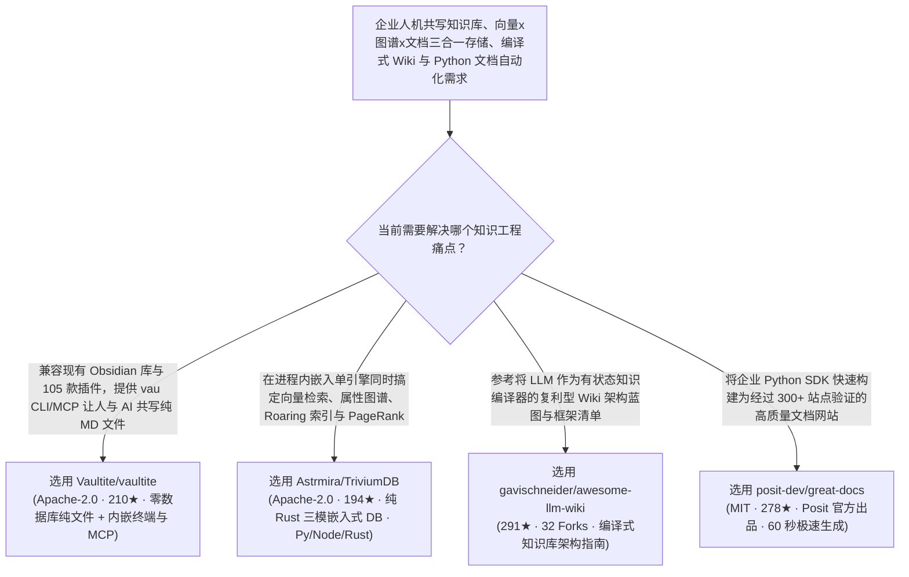
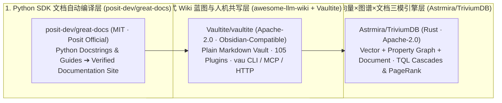
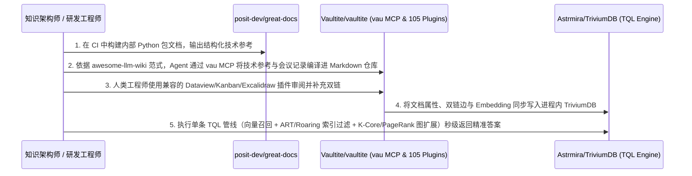

# 兼容 105 款 Obsidian 插件的人机共写知识库（`Vaultite/vaultite`）、Rust 向量×图谱×文档三合一嵌入式数据库（`Astrmira/TriviumDB`）、编译式复利知识库架构蓝图（`gavischneider/awesome-llm-wiki`）与 Posit 官方 Python 文档编译器（`posit-dev/great-docs`）选型与集成架构 FAQ

> **文档类型**：企业 AI 解决方案架构师（AI Solution Architect）选型决策指南（GitHub Trending AI 雷达 2026-11-22 Night Round 16 / 累计第 752 轮）
> **覆盖项目**：[`Vaultite/vaultite`](https://github.com/Vaultite/vaultite)（`★ 210`、`26 forks`、`Apache-2.0`，100% 纯 Markdown 存储、直接打开现有 Obsidian 仓库并兼容 105/126 款主流社区插件的开源第二大脑，提供 `vau` CLI、MCP 与 HTTP 供 Claude Code/Codex 与人类协同读写）· [`Astrmira/TriviumDB`](https://github.com/Astrmira/TriviumDB)（`★ 194`、`14 forks`、`Apache-2.0`，纯 Rust 编写的“AI 领域 SQLite”，将向量检索、属性图谱与文档元数据原生融合在单一嵌入式内核中，内置 TQL Cascades 优化器、4 类持久化索引与内嵌 PageRank/K-Core 图算法，支持 Rust/Python/Node.js）· [`gavischneider/awesome-llm-wiki`](https://github.com/gavischneider/awesome-llm-wiki)（`★ 291`、`32 forks`，把大模型当作“有状态知识编译器”而非临时聊天框的 AI 编译式复利知识库蓝图与框架目录）· [`posit-dev/great-docs`](https://github.com/posit-dev/great-docs)（`★ 278`、`24 forks`、`MIT`，Posit 官方出品、经 300+ 测试站点验证的 Python 包文档站点生成引擎）
> **核心场景**：当企业知识工程、RAG 平台与 SDK 研发团队面临**“传统切块向量 RAG 碎片化严重无法形成可复利演进的结构化 Wiki、同时跑 Milvus 向量库 + Neo4j 图数据库 + MongoDB 文档库运维成本太高且跨库 Join 极慢、团队现有的 Obsidian 笔记资产无法直接变成带终端的 Agent 协同工作台、以及内部 Python SDK 文档陈旧导致人类与编码 Agent 频繁调错接口”**四大痛点时，如何组合**`Vaultite/vaultite` + `Astrmira/TriviumDB` + `gavischneider/awesome-llm-wiki` + `posit-dev/great-docs`** 构建新一代“编译式知识库 + 三模嵌入式引擎”底座？

---

## 一、📌 核心结论速览（选型一句话结论）

1. **想找一款完全开源（`Apache-2.0`）、零私有数据库锁定的 Obsidian/Notion 替代品，既能原封不动打开你现有的 Obsidian 笔记库并直接跑通 Dataview、Templater、Tasks、Excalidraw、Kanban 等 105 款社区插件，又自带内嵌终端与 `vau` CLI / MCP / HTTP 接口让 Claude Code 与你同屏共写** ➔ 选 **[`Vaultite/vaultite`](https://github.com/Vaultite/vaultite)（`★ 210`，`26 forks`，`Apache-2.0`）**。
   - **通俗原理**：所有数据就是普通文件夹里的 `.md` 文件（随时可用 Git 或 iCloud 同步）。它不仅完整继承 Obsidian 的双链、属性与快捷键，还将所有人类 UI 操作与 Agent 操作收敛到同一套 `vau` CLI / MCP 原语上，真正实现“人机共编同一个 Markdown 知识库”。
2. **想在端侧、隔离内网（Air-Gapped）或微服务进程内直接嵌入一个“同时具备向量检索 + 属性图谱 + 文档数据库能力”的高性能单引擎，免去分别部署运维 Qdrant + Neo4j + MongoDB 三套独立集群** ➔ 选 **[`Astrmira/TriviumDB`](https://github.com/Astrmira/TriviumDB)（`★ 194`，`14 forks`，`Apache-2.0`）**。
   - **通俗原理**：定位为 **“AI 应用领域的 SQLite”**（提供 Rust、Python 3.9–3.15 与 Node.js 进程内 API）。通过 **TQL 混合查询管线**与确定性 Cascades 优化器，在单次查询内串联“向量召回 + 4 类属性索引（Hash / Ordered ART / Composite ART / Roaring Bitmap）过滤 + 图扩展与内嵌图算法（PageRank / WCC / SCC / K-Core）+ 重排”，彻底消除跨库网络往返开销。
3. **想升级企业知识管理范式——不再是在运行时对碎纸机式的切片做临时 RAG，而是让大模型在后台将散乱资料“预编译”为相互链接、持续复利生长的标准化 Wiki 页面** ➔ 选 **[`gavischneider/awesome-llm-wiki`](https://github.com/gavischneider/awesome-llm-wiki)（`★ 291`，`32 forks`）**。
   - **通俗原理**：系统汇总了“LLM 作为知识编译器（Stateful Knowledge Compiler）”的架构蓝图、功能框架与工程实践指南，指导架构师设计可由人类直观审阅、越用越厚的复利型知识库。
4. **想为企业内部或开源 Python 基础库一键生成既适合人类开发者精读、又方便编码 Agent 精准索引的高质量文档站点** ➔ 选 **[`posit-dev/great-docs`](https://github.com/posit-dev/great-docs)（`★ 278`，`24 forks`，`MIT`）**。
   - **通俗原理**：由打造了 RStudio、Shiny 与 Quarto 的 **Posit 官方团队**出品，并经过“Great Docs Gauntlet” 300+ 个真实 Python 项目的严苛构建测试，60 秒即可将 Python 包源码与注释转化为结构化文档网站。

---

## 二、🎯 客户与架构师灵魂拷问 Q&A（深度架构拆解）

### Q1：为什么“AI 编译式 Wiki + 三模嵌入式数据库”正在取代传统的“切块向量库 + 三套外部 DB 拼装”？

- **三大代际演进优势**：
  1. **从“运行时盲搜碎片”走向“预编译结构化 Wiki” ➔ `awesome-llm-wiki` + `Vaultite/vaultite`**：将会议记录、工单与代码变更预先编译为保存在 `Vaultite` 纯 Markdown 仓库中的结构化双链页面，人类可通过 Dataview/Kanban 插件直观审阅，Agent 可通过 `vau` MCP 秒级读取完整上下文。
  2. **从“三套数据库跨网拼装”走向“进程内三模融合” ➔ `Astrmira/TriviumDB`**：传统 Hybrid GraphRAG 需要先查向量库、再查文档库、再去图数据库跑多跳查询；`TriviumDB` 在单一 Rust 进程内用 TQL 算子一次性完成向量、Roaring Bitmap 属性过滤与 PageRank/K-Core 图遍历。
  3. **代码即权威文档 ➔ `posit-dev/great-docs`**：在 CI 中自动将 Python 核心库编译为标准文档站点，同步反哺给知识库。
- **何时直接用云厂商托管方案（Path B）？**
  - 若企业构建百亿级跨地域分布式多租户云端检索底座，优先使用 **Azure Cosmos DB (Vector + Gremlin + NoSQL) + Azure AI Search**；若在私有化内网、桌面端工作台或单机微服务内需要零运维成本的向量×图谱×文档三合一引擎与 Obsidian 兼容人机共写库，则采用本轮开源栈（Path C）。

### Q2：典型企业级“Python 文档编译 (`great-docs`) ➔ 编译式 Wiki 规范 (`awesome-llm-wiki`) ➔ 人机共写 Markdown 舱 (`Vaultite`) ➔ 三模嵌入式检索内核 (`TriviumDB`)”架构怎么搭？

1. **源码文档自动化编译层（`posit-dev/great-docs`）**：
   - 在 CI 流水线运行 `great-docs` 将内部 Python SDK 自动构建为标准化 API 参考文档。
2. **知识编译器与人机共写工作台层（`awesome-llm-wiki` + `Vaultite/vaultite`）**：
   - 按照 `awesome-llm-wiki` 蓝图，让编码 Agent 通过 `Vaultite` 的 `vau` CLI/MCP 将零散资料编译为标准双链 Markdown 笔记，团队成员直接在 `Vaultite` 中利用 105 款兼容 Obsidian 插件审阅与微调。
3. **进程内三模混合检索与图计算层（`Astrmira/TriviumDB`）**：
   - 将 `Vaultite` 中的 Markdown 块、双链图谱与属性标签同步嵌入进程内 `TriviumDB`，通过 Python/Node.js SDK 执行 TQL 向量 + 属性 + 图算法混合查询。

### Q3：这套架构的数据可移植性与锁定风险如何？

- **零锁定（Zero Vendor Lock-in）**：
  - `Vaultite` 底层 100% 是纯文本 Markdown 文件，随时可用原生 Obsidian、VS Code 或 `grep` 打开；`TriviumDB` 提供外部迁移工具（`docs/migration.md`）与 `Apache-2.0` 开源保障。

---

## 三、🧭 直观可视化图解（Mermaid 决策树 + 集成架构 + 时序图）

### 3.1 架构师选型决策树

### 3.2 企业端到端生产集成参考架构图

### 3.3 Python 文档生成、`Vaultite` 人机共写编译 Wiki 与 `TriviumDB` 三模混合检索时序图

---

## 四、📊 同类开源与商业云服务横向选型决策矩阵

| 对比维度 | `Vaultite/vaultite` (`★ 210`) | `Astrmira/TriviumDB` (`★ 194`) | `gavischneider/awesome-llm-wiki` (`★ 291`) | `posit-dev/great-docs` (`★ 278`) | 商业云笔记按人头订阅 + 独立托管向量/图/文档三集群 (Path A) | 零散本地 Markdown + 三套开源 DB 进程拼装 + 手写 Sphinx 配置 (Path B) |
| :--- | :--- | :--- | :--- | :--- | :--- | :--- |
| **核心能力定位** | 兼容 105 款 Obsidian 插件的人机共写库 | Rust 向量×图谱×文档嵌入式三模数据库 | 编译式复利 LLM Wiki 架构蓝图目录 | Posit 官方 Python 包文档站点编译器 | 按席位收费的商业云端协作笔记与三套独立云数据库服务 | 纯手工文件夹、同时维护三套数据库容器与繁琐文档脚手架 |
| **核心技术突破** | **零私有数据库纯 `.md` + 兼容 105 款 Obsidian 插件 + `vau` MCP** | **单内核融合 Vector/Graph/Doc + TQL 优化器 + 内嵌图算法** | **以有状态知识编译替代碎纸机式运行时切块 RAG** | **Posit 出品 + 300+ 真实包 Gauntlet 验证 + 60s 极速上手** | 商业云笔记闭源锁定；三套独立云数据库账单叠加极高 | 跨三套数据库网络拼接延迟高、事务不一致；Sphinx 配置复杂 |
| **开源协议** | `Apache-2.0` | `Apache-2.0` | 社区知识清单 | `MIT` | 闭源商业 SaaS | 内部零散脚本 |
| **月度 TCO（45 人团队）** | **组合仅 `$305.00/月`**（`$65.00` 共享构建与同步容器 + `2.4h` 维护） | 同左（进程内嵌入式零独立集群月费） | 同左（免费架构方法论） | 同左（MIT 静态站点生成） | **`$8,540.00/月`**（`$4,140.00` 商业笔记席位与三套云 DB + `44.0h` 跨库同步排障） | 约 `$2,950.00/月`（大量人工维护三套数据库同步胶水与修文档工时） |

---

## 五、🧪 应用落地定量收益/TCO 对比与 7-Card 报告

> **📊 数据来源与闭式核算声明（Provenance & Closed-Form Schema）**：
> - **provenance**: `synthetic`（基于 45 人企业知识工程、GraphRAG 平台与 Python 基础库研发团队月度工作负载模型：`independently_reproduced = false`；硬件采购基线 `base_hardware_capex = not_measured`；Track B 单日增量 `track_b_stars_today = not_measured`）。
> - **核算公式**：
>   - **Path A（采购全员商业云笔记与 AI 附加包席位 + 独立托管向量数据库 + 独立托管图数据库 + 独立文档数据库 + 工程师手工编写跨三库数据同步管道与维护内部 SDK 文档）**：月度商业笔记席位与三套托管数据库账单 **`$4,140.00`** + 跨三库 ETL 同步排障、碎片 RAG 幻觉修正与手工写文档人工 **`44.0h × $100.00/h = $4,400.00`** = **`$8,540.00/月`**。
>   - **Path C（自建 `Vaultite/vaultite` + `Astrmira/TriviumDB` + `gavischneider/awesome-llm-wiki` + `posit-dev/great-docs` 开源知识与三模引擎栈）**：共享静态文档与同步容器开销 **`$65.00`** + 插件与 TQL 索引维护人工 **`2.4h × $100.00/h = $240.00`** = **`$305.00/月`**。
>   - **净节省（Net Savings vs Path A）**：**`-$8,235.00/月`**（成本降低 **`96.43%`**）。

| 评估方案 | 笔记/三套云 DB 与算力成本 | 跨库同步与文档维护人工（`$100/h`） | 月度总 TCO | 相对 Path A 净节省 | 关键架构交付指标 |
| :--- | :---: | :---: | :---: | :---: | :--- |
| **Path A：商业云笔记席位 + 独立向量/图/文档三套云 DB** | `$4,140.00` | `44.0h` (`$4,400.00`) | **`$8,540.00`** | Baseline | 三套数据库月费叠加昂贵；跨网多次往返查询延迟高 |
| **Path B：普通文件夹 + 自建三套开源 DB 容器 + 手写文档** | `$1,350.00` | `16.0h` (`$1,600.00`) | **`$2,950.00`** | `-$5,590.00` (`-65.46%`) | 三套 DB 数据一致性难保；缺少 `vau` MCP 与 105 款 Obsidian 插件兼容 |
| **Path C：`Vaultite` + `TriviumDB` + `llm-wiki` + `great-docs`** | **`$65.00`** | **`2.4h` (`$240.00`)** | **`$305.00`** | **`-$8,235.00` (`-96.43%`)** | **105 插件人机共写 + 进程内三模 TQL + 编译式复利 Wiki** |

- 🔗 **关联 7-Card 4:5 视觉评测报告**：[`workshops/github-trending-radar/cards.html`](../cards.html) · [`cards.en.html`](../cards.en.html)

---

## 六、🛠️ 企业引入与架构评审 Checklist

- [ ] **1. 使用 `Vaultite/vaultite` 统一团队人机共写 Markdown 知识库**：直接挂载现有 Obsidian 仓库，开启 `vau` CLI/MCP 接口供 Claude Code 与 Codex 协同编写结构化笔记。
- [ ] **2. 引入 `Astrmira/TriviumDB` 替代繁重的“向量+图+文档”三库拼装**：通过 Python/Node.js/Rust SDK 在进程内使用 TQL 算子与内嵌图算法执行高性能混合检索。
- [ ] **3. 遵循 `gavischneider/awesome-llm-wiki` 落地编译式知识库范式**：建立后台定时知识编译流水线，将零散对话与工单沉淀为可人工审阅的双链 Wiki。
- [ ] **4. 在 Python 项目 CI 中集成 `posit-dev/great-docs`**：自动构建标准化 API 文档站点并同步至团队知识底座。
