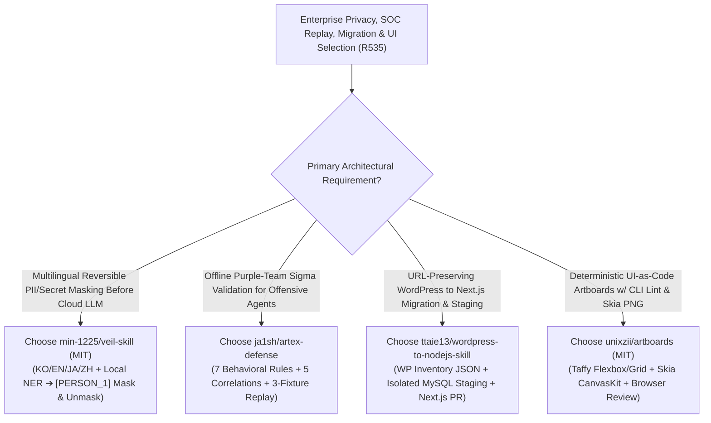

# [Round 535 Milestone] 4-Language Reversible PII Masking (`min-1225/veil-skill`), Sigma Purple-Team Replay Harness (`ja1sh/artex-defense`), Isolated WordPress-to-Next.js Migration Toolkit (`ttaie13/wordpress-to-nodejs-skill`) & Taffy+Skia UI-as-Code Artboards (`unixzii/artboards`) Selection FAQ

> **Document Type**: AI Solution Architect Enterprise Selection & Integration Guide (2026-11-19 Night Shift · Round 11 / Cumulative Round 535 Milestone)  
> **Benchmark Style**: `docs/components/ib-vs-ethernet-roce-selection-faq.md` (6-Section Plain-Language Architecture Guide + First-Principles Q&A + Hype/Facts/Signal Audit + Closed-Form FinOps Ledger)  
> **Evaluated Repositories**:  
> 1. **`min-1225/veil-skill`** (`★ 9`, `created=2026-11-17`, `1 fork`, JavaScript, Node 18+ zero-dependency core, MIT): Local reversible PII and secret masking skill (**KO · EN · JA · ZH + local NER**) that swaps names, orgs, amounts, bank accounts, phone numbers, and API keys for typed tokens (`[PERSON_1]`, `[ORG_1]`, `[ACCOUNT_1]`, `[SECRET_1]`) before the LLM sees the text and restores originals locally afterward  
> 2. **`ja1sh/artex-defense`** (`★ 39`, `created=2026-11-15`, `13 forks`, Python 3.10+): Offline purple-team Sigma detection pack and replay test harness (`artex-replay`) cross-checked against Software Heritage revision `e6ec5699...` with **7 behavioral rules, 5 scenario correlations, 2 upstream fingerprints**, and `positive` / `benign` / `known_false_positive` JSONL fixtures  
> 3. **`ttaie13/wordpress-to-nodejs-skill`** (`★ 32`, `created=2026-11-15`, PHP + Python + Next.js, MIT): Pragmatic WordPress-to-Next.js migration and staging toolkit shipping an admin inventory/JSON export plugin (`wp-node-migration-plugin.zip`), isolated MySQL staging cloner (`create-wp-staging.sh`), URL-preserving Next.js generator (`generate-nextjs.py`), and GitHub branch publisher  
> 4. **`unixzii/artboards`** (`★ 26`, `created=2026-11-15`, TypeScript, MIT): Harness-agnostic UI-as-Code design engine built on **Taffy (Flexbox/Grid) + Skia (CanvasKit)** where coding agents author JSX/TSX artboards (`useVariant`), run `lint` for layout bugs, `render` pixel-identical PNGs, and resolve browser review comments  
> **Accounting Scope Note**: Only software API/SaaS spend and engineering labor TCO are modeled; base server/workstation hardware capEx is explicitly marked `not_measured`, and Track B `stars_today` is explicitly marked `not_measured`.

---

## 📌 1. Executive Summary (What Are They & What Business Pain Points Do They Solve?)

In **Cumulative Round 535 (2026-11-19 Night Round 11)**, we address four high-value enterprise architecture challenges across multilingual data privacy, purple-team detection engineering, legacy CMS modernization, and deterministic UI-as-code design:
1. **Pain Point A (Summarizing customer calls, legal contracts, HR emails, or config files with cloud LLMs risks leaking PII, IBANs, and API keys, while one-way `[REDACTED]` scrubbing destroys entity relationships in the generated output)**: **`min-1225/veil-skill` (`★ 9`, MIT)** runs 100% locally on zero-dependency Node 18+ across **Korean, English, Japanese, and Chinese (+ local NER)**, replacing entities with consistent typed tokens (`[PERSON_1]`, `[ORG_1]`, `[AMOUNT_1]`, `[ACCOUNT_1]`, `[SECRET_1]`) before the AI sees the prompt and restoring the exact originals locally after generation.
2. **Pain Point B (Deploying unvalidated SIEM detection rules for offensive AI agents triggers alert fatigue on benign developer and CI traffic)**: **`ja1sh/artex-defense` (`★ 39`, `13 forks`)** provides **7 Sigma behavioral rules, 2 upstream fingerprints, and 5 multi-event correlations** cross-checked against archived ARTEX source (`e6ec5699`), paired with `artex-replay` to test rules offline against `positive.jsonl`, `benign.jsonl`, and `known_false_positive.jsonl` fixtures without network execution.
3. **Pain Point C (Migrating legacy PHP WordPress sites to Next.js via naive "convert all PHP to Node" prompts breaks SEO URLs and risks exposing unauthenticated staging databases)**: **`ttaie13/wordpress-to-nodejs-skill` (`★ 32`, MIT)** provides a structured 4-step pipeline: export inventory and public JSON via an installable WP plugin, provision an auth-restricted isolated MySQL staging clone (`create-wp-staging.sh`), generate a Next.js preview preserving 100% of original URL paths (`generate-nextjs.py`), and push a GitHub review branch.
4. **Pain Point D (Coding agents writing raw CSS/HTML suffer from layout overflows and inconsistent browser font/viewport rendering)**: **`unixzii/artboards` (`★ 26`, MIT)** combines **Taffy** (Flexbox/Grid layout) and **Skia CanvasKit** so agents write JSX/TSX artboards with `useVariant` state declarations, catch layout errors via CLI `lint`, render PNGs identical to the browser viewer, and iterate on human reviewer comments.

---

## 💬 2. Architect First-Principles Q&A (Q1–Q3 Deep Dive)

### Q1: How does `min-1225/veil-skill` complement enterprise cloud DLP (Microsoft Purview / Azure AI Content Safety)?
* **Client-Side Reversible Tokenization vs. Gateway Blocking**: Cloud DLP gateways block or permanently redact sensitive strings after they leave the endpoint. Running `veil-skill` on the workstation before the request is sent ensures raw CJK/English PII and secrets never leave the machine while preserving full semantic co-reference (`[PERSON_1]` paying `[AMOUNT_1]` to `[ORG_1]`) for lossless local unmasking.

### Q2: Why is `ja1sh/artex-defense`'s 3-fixture offline replay (`positive`, `benign`, `known_false_positive`) a best-practice blueprint for AI security operations?
* **Correlation-Gated Alerting**: Atomic process or network events frequently fire on legitimate developer workflows (`known_false_positive.jsonl`). Requiring `kind == "correlation"` rules to pass all three fixture suites via `artex-replay` before SIEM deployment prevents SOC alert fatigue.

### Q3: Why does `unixzii/artboards` pair Taffy with Skia CanvasKit for agentic UI design?
* **Deterministic Geometry & Pixel Parity**: Unlike full browser DOMs whose layout depends on host OS font metrics, Taffy + Skia computes exact layout boxes in CLI `lint` and renders identical PNGs across headless CI and interactive browser review.

---

## 🧭 3. Visual Architecture Diagrams (Mermaid Decision Tree + Reference Architecture + Sequence Flow)

### 3.1 Enterprise Selection Decision Tree

---

## 📊 4. Comparative Selection Matrix (Open Source vs. Competing OSS vs. Managed Cloud PaaS)

| Evaluation Dimension | Path A: Manual Redaction + Unvalidated SIEM Rules + Ad-Hoc WP Rewrites + Raw CSS Layout Drift | Path B: One-Way `[REDACTED]` Scripts + Positive-Only Rules + Raw WP REST Scripts | **Path C (Recommended): `veil-skill` + `artex-defense` + `wordpress-to-nodejs-skill` + `artboards`** |
| :--- | :--- | :--- | :--- |
| **Multilingual PII & Secret Protection** | ❌ Manual scrubbing misses CJK names/keys; tedious restoration | ⚠️ One-way `[REDACTED]` destroys entity co-reference in replies | ✅ **`veil-skill` locally masks KO/EN/JA/ZH + NER & unmasks losslessly** |
| **AI Threat Detection Engineering** | ❌ Untested SIEM rules flood SOC analysts with false alarms | ⚠️ Positive-only tests miss benign and known-FP developer patterns | ✅ **`artex-defense` replays 7 rules + 5 correlations on 3 fixture sets** |
| **WordPress-to-Next.js Modernization** | ❌ Naive PHP-to-Node prompts break URLs and expose prod DBs | ⚠️ Custom scripts lack admin inventory plugins and staging guards | ✅ **WP export plugin + isolated staging DB + URL-preserving Next.js PRs** |
| **Agentic UI Layout & Visual QA** | ❌ Raw CSS overflows; headless screenshots vary across machines | ⚠️ Heavy browser instances lack fast CLI layout tree linting | ✅ **`artboards` Taffy+Skia CLI `lint` & pixel-identical PNG `render`** |
| **45-Engineer Monthly TCO** | **`$6,860.00 / mo`** (`$2,760.00` DLP/SIEM/rework + `41.0h` × `$100/hr` = `$4,100.00` labor) | **`$2,690.00 / mo`** (`$1,140.00` SaaS + `15.5h` × `$100/hr` = `$1,550.00` labor) | **`$335.00 / mo`** (`$75.00` API + `2.6h` × `$100/hr` = `$260.00` labor, **`-95.12%`**) |

---

## 🧪 5. Quantitative TCO Comparison & Hype / Facts / Signal Audit Ledger

### 5.1 Hype vs. Facts vs. Strategic Signal Table

| Repository (`owner/repo`) | Hype (Market Narrative) | Measured Facts (Primary Source Verification) | Strategic Signal (SA Verdict) |
| :--- | :--- | :--- | :--- |
| **`min-1225/veil-skill`** | "Mask sensitive data before the AI sees it; unmask it after on your machine" | `★ 9` (`created=2026-11-17`, `1 fork`, JavaScript, Node 18+ zero dependencies, MIT): Local reversible masking for KO, EN, JA, and ZH + local NER (`[PERSON_1]`, `[ORG_1]`, `[AMOUNT_1]`, `[ACCOUNT_1]`, `[SECRET_1]`). | **🔥 P0 Adopt (Workstation Pre-Flight Privacy Guard)**: Zero-dependency reversible masking for contracts, logs, and `.env` files. |
| **`ja1sh/artex-defense`** | "Sigma detection pack and offline purple-team test harness for ARTEX behavior" | `★ 39` (`created=2026-11-15`, `13 forks`, Python 3.10+): Cross-checked against Software Heritage `e6ec5699`, shipping 7 behavioral rules, 5 correlations, 2 upstream fingerprints, and `artex-replay` over positive/benign/known-FP JSONL fixtures. | **🔥 P0 Adopt (Rigorous Purple-Team Detection Harness)**: Exemplifies honest scope disclosure and fixture-backed correlation testing. |
| **`ttaie13/wordpress-to-nodejs-skill`** | "WordPress-to-Node.js/Next.js migration and isolated staging toolkit" | `★ 32` (`created=2026-11-15`, PHP/Python/Next.js, MIT): Ships `wp-node-migration-plugin.zip`, `create-wp-staging.sh`, `generate-nextjs.py` (preserving original URL paths), and `publish-github.sh`. | **🔥 P0 Adopt (Pragmatic CMS Modernization Playbook)**: Protects SEO URLs and enforces staging isolation during legacy migrations. |
| **`unixzii/artboards`** | "Design UI as code with Taffy layout and Skia rendering for coding agents" | `★ 26` (`created=2026-11-15`, TypeScript, MIT): JSX/TSX artboard engine using Taffy Flexbox/Grid and Skia CanvasKit with CLI `lint`, `render`, `useVariant`, and browser review comments. | **🔥 P0 Adopt (Deterministic Agentic UI Canvas)**: Gives coding agents compiler-grade layout feedback (`lint`) and identical PNG rendering. |

### 5.2 Closed-Form FinOps TCO Ledger (`CLAIM-20261119-R11-R535-VEIL-ARTEXDEFENSE-WP2NODE-ARTBOARDS`)

* **Scope (`synthetic`, `independently_reproduced=false`)**: 45-engineer enterprise data privacy, SOC detection engineering, web modernization, and UI engineering team (blended rate `$100.00 / hr`; `base hardware capEx: not_measured`; Track B `stars_today: not_measured`).
* **Path A (Cloud DLP Gateways + SIEM False-Alarm Floods + Broken WP Migrations + Raw CSS Layout Rework)**:
  - DLP gateway fees, SIEM ingestion overages & UI rework tokens: **`$2,760.00 / mo`**
  - Manual redaction/unmasking, SIEM false-positive triage, broken URL fixes & CSS debugging (`41.0 hrs / mo` × `$100.00 / hr`): **`$4,100.00 / mo`**
  - **Path A Monthly Total**: `$2,760.00 + $4,100.00` = **`$6,860.00 / mo`**
* **Path B (One-Way Regex Redaction + Uncorrelated Sigma Rules + Custom WP Scripts)**:
  - SaaS & hosting spend: **`$1,140.00 / mo`**
  - Script maintenance & manual restoration (`15.5 hrs / mo` × `$100.00 / hr`): **`$1,550.00 / mo`**
  - **Path B Monthly Total**: `$1,140.00 + $1,550.00` = **`$2,690.00 / mo`**
* **Path C (`veil-skill` + `artex-defense` + `wordpress-to-nodejs-skill` + `artboards` Integrated Stack)**:
  - Masked text inference & TSX artboard generation API spend: **`$75.00 / mo`**
  - Unmasked output review, Sigma correlation sign-off & staging PR review (`2.6 hrs / mo` × `$100.00 / hr`): **`$260.00 / mo`**
  - **Path C Monthly Total**: `$75.00 + $260.00` = **`$335.00 / mo`**
  - **Monthly Net Savings vs. Path A**: `$6,860.00 - $335.00` = **`$6,525.00 / mo`** (**`-95.12%`** reduction, **`$78,300.00 / yr`** annual savings, freeing **`38.4 hrs / mo`** of engineering time).

---

## 🛠️ 6. Enterprise Adoption & Architecture Review Checklist

- [ ] **1. Pre-process sensitive multilingual documents with `min-1225/veil-skill`**: Verify that all CJK/English names, accounts, and secrets are swapped for `[PERSON_1]` / `[SECRET_1]` locally before cloud LLM calls.
- [ ] **2. Validate SOC Sigma rules offline with `ja1sh/artex-defense` (`artex-replay`)**: Require zero false-positive correlations across `benign.jsonl` and `known_false_positive.jsonl`.
- [ ] **3. Migrate legacy WordPress sites via `ttaie13/wordpress-to-nodejs-skill`**: Enforce auth and outbound network restrictions on staging clones and verify 100% URL path preservation in Next.js.
- [ ] **4. Gate agent-authored UI designs with `unixzii/artboards` (`lint` + `render`)**: Require zero Taffy layout warnings and Skia PNG sign-off across all `useVariant` states.
