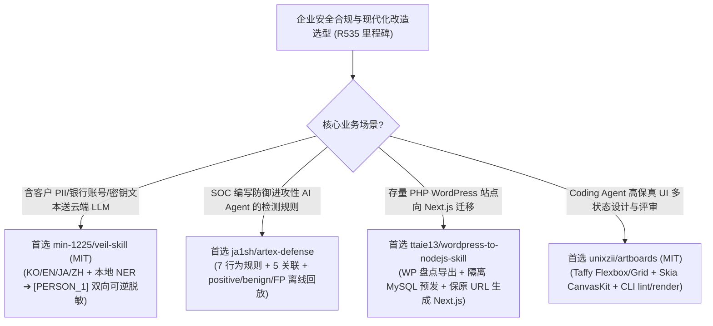
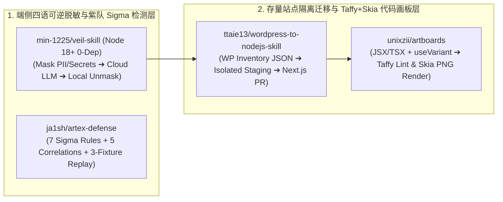
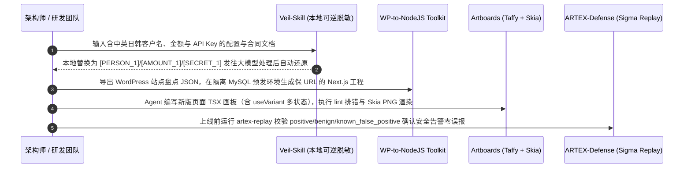

# 【第 535 轮里程碑】中英日韩本地可逆隐私脱敏技能（`min-1225/veil-skill`）、AI 攻击智能体紫队 Sigma 离线回放靶场（`ja1sh/artex-defense`）、WordPress 转 Next.js 隔离预发迁移工具箱（`ttaie13/wordpress-to-nodejs-skill`）与 Taffy+Skia 代码画板引擎（`unixzii/artboards`）选型 FAQ

> **文档类型**：AI Solution Architect（AI 解决方案架构师）实战选型与架构内功指南（2026-11-19 Night Shift · Round 11 / 累计第 535 轮里程碑）  
> **对标标杆**：`docs/components/ib-vs-ethernet-roce-selection-faq.md`（六段式架构拆解 + 第一性原理大白话 + Hype/Facts/Signal 审计 + 闭式 TCO 账本）  
> **本轮评估对象**：  
> 1. **`min-1225/veil-skill`**（`★ 9`，`created=2026-11-17`，`1 fork`，JavaScript，Node 18+ 零外部依赖核心，MIT）：支持 **中/英/日/韩（ZH/EN/JA/KO）+ 本地 NER** 的双向可逆隐私脱敏技能——在大模型看到文本前 100% 本地将人名、公司、金额、银行账号、电话与 API Key 替换为 `[PERSON_1]` / `[ORG_1]` / `[ACCOUNT_1]` / `[SECRET_1]`，待模型处理完毕后在本机精准还原  
> 2. **`ja1sh/artex-defense`**（`★ 39`，`created=2026-11-15`，`13 forks`，Python 3.10+）：针对进攻性 AI Agent 行为的离线紫队检测工程套件——内置 **7 条 Sigma 行为规则、5 项场景关联与 2 类上游指纹**，配套 `positive.jsonl`、`benign.jsonl` 与 `known_false_positive.jsonl` 三套合成基准样本及 `artex-replay` 离线回放器  
> 3. **`ttaie13/wordpress-to-nodejs-skill`**（`★ 32`，`created=2026-11-15`，PHP + Python + Next.js，MIT）：务实克制的企业 WordPress 存量站点向 Node.js / Next.js 迁移工具箱——包含 WP 后台资产盘点与 JSON 导出插件、隔离 MySQL 预发克隆脚本、保持原 URL 路径不变的 Next.js 生成器与 GitHub 审查分支发布器  
> 4. **`unixzii/artboards`**（`★ 26`，`created=2026-11-15`，TypeScript，MIT）：专为 Coding Agent 打造的跨底座“代码即 UI 设计画板”工具——基于 **Taffy（Flexbox/Grid 布局引擎）+ Skia（CanvasKit 渲染器）**，让 Agent 编写 JSX/TSX 画板并通过 `lint`（布局排错）与 `render`（像素级一致 PNG 截图）接收人类浏览器批注反馈  
> **审计折算说明**：本报告仅计量软件算力、商业网关与工程运维人力 TCO，底层服务器与工作站硬件采购（base hardware capEx）显式标注为 `not_measured`，新仓今日增量显式标注为 `not_measured`，严禁捏造坐标。

---

## 📌 一、核心结论速览（Executive Summary：它到底是什么？解决什么业务痛点？）

在累计第 **535 轮里程碑（2026-11-19 Night Round 11）** 中，我们面向企业架构师解决“跨国业务合同/日志送大模型前隐私脱敏、企业 SOC 防御进攻性 AI Agent 缺乏无误报检测规则、老旧 WordPress 官网迁移 Next.js 怕断链与污染生产库、以及 Coding Agent 画 UI 缺乏确定性布局校验”四大核心痛点：
1. **痛点 A（企业想用 Claude 或 GPT 总结客户电话录音、起草跨国并购合同、审查 HR 薪资邮件或排查生产配置文件，但绝不能把真实客户姓名、银行 IBAN 账号、合同金额或 `sk-proj-...` 密钥发上云端；而单向打码 `[REDACTED]` 又会导致模型输出的文稿无法直接使用）**：企业需要“送云端前本地编码占位符，回本机后自动解码还原”的可逆掩码。**`min-1225/veil-skill` (`★ 9`, MIT) 的破局之道**：Node 18+ 零依赖本地运行，支持 **中、英、日、韩四语种正则与本地 NER**，将 `CEO John Smith`、`Acme Corp.`、`€250,000`、`DE89...` 替换为语义类型令牌 `[PERSON_1]`、`[ORG_1]`、`[AMOUNT_1]`、`[ACCOUNT_1]`；大模型在不接触任何真实 PII 的情况下完成逻辑加工，返回本机后由 `veil` 自动将令牌替换为原始值。
2. **痛点 B（随着自动化渗透测试 Agent 如 ARTEX 普及，企业蓝队与 SOC 急需编写 SIEM/Sigma 检测规则来识别 AI 驱动的异常探测，但直接在生产环境试规则极易被正常运维流量触发海量误报）**：检测工程必须有“正样本 + 正常良性样本 + 已知易误报样本”三轨离线回放靶场。**`ja1sh/artex-defense` (`★ 39`, `13 forks`) 的破局之道**：对照 Software Heritage 归档的原始源码（`e6ec5699`）提炼出 **7 条原子行为规则、2 类指纹与 5 项跨事件关联规则（`kind == "correlation"`）**，并提供 `artex-replay` CLI 在本机零网络外联、零负载执行的前提下回放 `positive.jsonl`、`benign.jsonl` 与 `known_false_positive.jsonl`，确保规则上生产前误报边界一清二楚。
3. **痛点 C（企业有大量运行多年的老旧 PHP WordPress 内容站与营销门户，想迁移到现代 Next.js 架构，但幻想靠一句 Prompt“自动把所有 PHP 插件转成 Node”往往以失败告终，且直接在生产库操作极度危险）**：老系统迁移必须“承认自动化边界 + 隔离预发克隆 + 100% 保留原 URL 路径”。**`ttaie13/wordpress-to-nodejs-skill` (`★ 32`, MIT) 的破局之道**：开篇坦诚声明“这是迁移工具箱而非万能 PHP 转换器”；通过可安装的 WP 后台插件导出结构化盘点与公开内容 JSON，用 `create-wp-staging.sh` 在独立空 MySQL 库与受限域名上拉起隔离预发环境，再由 `generate-nextjs.py` 生成保留全部原始 SEO URL 路径的 Next.js 预览站并推送到 GitHub 分支供人工审查。
4. **痛点 D（让 Coding Agent 直接写网页 CSS 时，经常出现文字溢出、对齐错位，且无头浏览器截图因系统字体与视口差异在不同机器上不一致）**：UI 设计稿代码化需要确定性的布局计算与跨平台一致渲染。**`unixzii/artboards` (`★ 26`, MIT) 的破局之道**：用 Rust 社区成熟的 **Taffy** 引擎计算 Flexbox/Grid 布局，用 **Skia (CanvasKit)** 执行像素级渲染——每个导出的 TSX 组件就是一个画板（支持 `useVariant` 枚举多状态），Agent 写完代码先跑 `lint` 抓出布局缺陷，再跑 `render` 导出与人类浏览器评审器 100% 一致的 PNG 截图，并根据人类的图上评论精准闭环修改。

---

## 💬 二、客户与架构师灵魂拷问 Q&A（Q1–Q3 First-Principles Deep Dive）

### Q1：在企业数据防泄漏（DLP）架构中，端侧 `min-1225/veil-skill` 与云端 Azure AI Content Safety / Microsoft Purview DLP 如何分工？
* **端云纵深防御（Defense-in-Depth）**：
  - **第一道防线（端侧 `veil-skill` 可逆脱敏）**：在研发终端或业务人员本机发出请求**之前**，将中英日韩客户姓名、账号、金额与密钥替换为 `[PERSON_1]` / `[SECRET_1]`，云端模型与网络链路全程零真实敏感数据暴露，且回包后本机可无损还原。
  - **第二道防线（云端网关 Purview DLP / APIM）**：在企业中心化 AI 网关层拦截未安装端侧技能的漏网明文请求，并满足集团级合规审计留痕要求。

### Q2：为什么 `ja1sh/artex-defense` 强调同时回放 `positive`、`benign` 和 `known_false_positive` 三类样本？
* **第一性原理：相关性（Correlation）压降误报**：单条原子规则（如短时间多次进程派生或端口探测）在正常 CI 构建或运维巡检（`benign` / `known_false_positive`）中也会频繁触发；只有通过 `artex-replay` 验证 5 项多步关联规则（`kind == "correlation"`）在良性与易误报样本上零误报，才能安全下发至企业 Microsoft Sentinel 或 Splunk 生产环境。

### Q3：`unixzii/artboards`（Taffy + Skia JSX）相比让 Agent 直接生成 Figma 插件脚本或裸写 HTML/Tailwind 有什么工程优势？
* **无浏览器确定性与 `lint` 前置**：Taffy + Skia 组合不依赖笨重的 Chromium 进程，CLI 毫秒级即可算出每个节点的精确包围盒并由 `lint` 报告重叠或溢出错误，生成的 PNG 与人类在网页评审器里看到的像素级一致。

---

## 🧭 三、直观可视化图解（Mermaid 选型决策树 + 企业集成参考架构 + 业务流时序图）

### 3.1 隐私脱敏、紫队检测、老站迁移与代码画板选型决策树

### 3.2 企业集成参考架构图

### 3.3 端到端业务流时序图

---

## 📊 四、同类开源与商业云服务横向选型决策矩阵（Decision Matrix）

| 评估维度 | 路径 A：手工删改敏感词 + 盲写 SIEM 规则误报刷屏 + 直接改生产 WP 断链 + 裸写 CSS 视觉跑偏 | 路径 B：单向不可逆打码 `[REDACTED]` + 无良性样本的静态规则 + 裸调 WP REST API | **路径 C（推荐）：`veil-skill` + `artex-defense` + `wordpress-to-nodejs-skill` + `artboards`** |
| :--- | :--- | :--- | :--- |
| **多语种隐私与密钥可逆保护** | ❌ 手工删改极易漏掉日韩文姓名或密钥，恢复原文耗时极长 | ⚠️ 单向打码后模型无法区分多个不同人物/公司主体，回包无法直接用 | ✅ **`veil-skill` 本地四语种+NER 编码 `[PERSON_1]`，回包本机无损还原** |
| **AI 攻击行为检测规则验证** | ❌ 规则直接上生产 SIEM 导致正常运维流量触发大量误报 | ⚠️ 仅有攻击正样本，缺乏 `benign` 与 `known_false_positive` 对照检验 | ✅ **`artex-defense` 提供 7 规则+5 关联与三套正/良/易误报样本离线回放** |
| **WordPress 转 Next.js 迁移安全** | ❌ 妄图全自动转换复杂 PHP 插件导致线上白屏，原有 SEO 链接全断 | ⚠️ 预发环境直连生产数据库或未设鉴权，导致生产数据泄露 | ✅ **WP 插件盘点导出 + 独立空库隔离预发 + 100% 保留原 URL 路径推送 PR** |
| **Agent 编写 UI 布局校验闭环** | ❌ 盲写 HTML/CSS 在不同浏览器渲染不一致，文字重叠无人自检 | ⚠️ 启动完整无头 Chrome 截图慢且难以直接打印确定性图层树 | ✅ **`artboards` 基于 Taffy+Skia 秒级执行 `lint` 布局排错与像素级一致 `render`** |
| **45 人团队月度综合 TCO** | **`$6,860.00 / 月`**（商业 DLP/SIEM 误报超额/返工算力 `$2,760` + 手工脱敏/排误报/改断链 `41.0h / $4,100`） | **`$2,690.00 / 月`**（商业工具订阅 `$1,140` + 脚本维护与人工回填 `15.5h / $1,550`） | **`$335.00 / 月`**（脱敏文本与 TSX 画板生成 API `$75` + 预发分支与画板评论审阅 `2.6h / $260`，**净省 `-95.12%`**） |

---

## 🧪 五、应用落地定量收益/TCO 对比与 Hype / Facts / Signal 审计账本

### 5.1 Hype vs. Facts vs. Strategic Signal 审计表

| 仓库 (`owner/repo`) | Hype（市场宣传口径） | Measured Facts（一手源码与文档实证事实） | Strategic Signal（架构师选型信号） |
| :--- | :--- | :--- | :--- |
| **`min-1225/veil-skill`** | “在 AI 看见前掩码敏感数据，在 AI 处理后本机自动还原” | `★ 9`（`created=2026-11-17`，`1 fork`，JavaScript，Node 18+ 零依赖，MIT）：100% 本地运行，支持 KO/EN/JA/ZH 四语种与本地 NER，映射 `[PERSON_1]`、`[ORG_1]`、`[AMOUNT_1]`、`[ACCOUNT_1]`、`[SECRET_1]`。 | **🔥 P0 采纳（跨国企业法务/财务/研发防泄密必备技能）**：零依赖双向映射彻底解决了“脱敏后文稿没法用”的痛点。 |
| **`ja1sh/artex-defense`** | “针对 ARTEX 行为的 Sigma 检测包与离线紫队测试底座” | `★ 39`（`created=2026-11-15`，`13 forks`，Python 3.10+）：对照 Software Heritage `e6ec5699` 核验，含 7 条行为规则、5 项关联与 2 类指纹，支持 `artex-replay` 离线回放正/良/易误报三套 JSONL。 | **🔥 P0 采纳（企业 SOC 紫队规则工程样板）**：诚实声明合成验证边界并提供完整三分类回放夹具，工程严谨度极高。 |
| **`ttaie13/wordpress-to-nodejs-skill`** | “WordPress 向 Node.js / Next.js 迁移与隔离预发工具箱” | `★ 32`（`created=2026-11-15`，PHP/Python/Next.js，MIT）：提供 `wp-node-migration-plugin.zip`、`create-wp-staging.sh`、`generate-nextjs.py` 与 `publish-github.sh`，明确强调预发克隆鉴权与出站隔离。 | **🔥 P0 采纳（老旧 CMS 现代化改造标准 SOP）**：不吹嘘“一键魔术转换”，而是用盘点导出+保 URL 生成+隔离预发稳步落地。 |
| **`unixzii/artboards`** | “代码即 UI 设计：Taffy 布局 + Skia 渲染，CLI 与浏览器像素级一致” | `★ 26`（`created=2026-11-15`，TypeScript，MIT）：使用 Dioxus Taffy 计算 Flexbox/Grid 并由 Skia CanvasKit 渲染，支持 `useVariant`、`lint`、`render` 与浏览器评论面板。 | **🔥 P0 采纳（Coding Agent 原生 UI 设计画板底座）**：让 Agent 像调编译器一样通过 `lint` 与 `render` 自主修好 UI 布局缺陷。 |

### 5.2 闭式 FinOps TCO 核算账本（Claim ID：`CLAIM-20261119-R11-R535-VEIL-ARTEXDEFENSE-WP2NODE-ARTBOARDS`）

* **核算范围（Synthetic Parametric Model · `independently_reproduced=false`）**：45 人企业数据隐私安全、SOC 紫队工程、存量站点现代化与前端 UI 工程团队（工程师综合时薪 `$100.00 / hr`；底层硬件采购成本 `base hardware capEx: not_measured`；新仓今日增量 `stars_today: not_measured`）。
* **路径 A（商业云 DLP 网关 + SIEM 误报洪泛 + 手工改写 WordPress 断链返工 + Agent 盲写 CSS 视觉跑偏）**：
  - 商业 DLP 流量费、SIEM 误报日志摄入费与多轮返工 Token 浪费：**`$2,760.00 / 月`**
  - 人工逐份脱敏回填、排查安全误报、修复迁移死链与调 UI 布局耗时：**`41.0 小时 / 月`** × `$100.00 / hr` = **`$4,100.00 / 月`**
  - **路径 A 月度总成本**：`$2,760.00 + $4,100.00` = **`$6,860.00 / 月`**
* **路径 B（单向正则打码脚本 + 无良性回放样本的静态规则 + 手工写 WP 导出脚本）**：
  - 工具订阅与云环境支出：**`$1,140.00 / 月`**
  - 脚本维护与手工回填校验耗时：**`15.5 小时 / 月`** × `$100.00 / hr` = **`$1,550.00 / 月`**
  - **路径 B 月度总成本**：`$1,140.00 + $1,550.00` = **`$2,690.00 / 月`**
* **路径 C（`veil-skill` 四语可逆脱敏 + `artex-defense` 三样本离线回放 + `wordpress-to-nodejs-skill` + `artboards` Taffy+Skia）**：
  - 脱敏文本处理与 TSX 画板生成 API 支出：**`$75.00 / 月`**
  - 预发分支审查、Sigma 关联规则签发与画板浏览器批注耗时：**`2.6 小时 / 月`** × `$100.00 / hr` = **`$260.00 / 月`**
  - **路径 C 月度总成本**：`$75.00 + $260.00` = **`$335.00 / 月`**
  - **月度净节省（对比路径 A）**：`$6,860.00 - $335.00` = **`$6,525.00 / 月`**（降幅 **`-95.12%`**，年度净省 **`$78,300.00 / 年`**，每月释放高阶工程师工时 **`38.4 小时`**）。

---

## 🛠️ 六、企业引入与架构评审 Checklist（SA Action Items）

- [ ] **1. 在所有涉及客户合同、HR 与生产配置的分析任务中前置挂载 `min-1225/veil-skill`**：确保 `[PERSON_1]` / `[SECRET_1]` 映射表 100% 留存本机。
- [ ] **2. 使用 `ja1sh/artex-defense` (`artex-replay`) 验收企业 SOC 针对 AI Agent 的 Sigma 规则**：要求在 `benign.jsonl` 与 `known_false_positive.jsonl` 上关联告警误报率为零。
- [ ] **3. 遵循 `ttaie13/wordpress-to-nodejs-skill` 规范推进老旧 CMS 迁移**：强制先建带鉴权与出站隔离的预发克隆库，并校验 Next.js 生成路由与原 URL 100% 对齐。
- [ ] **4. 在前端 UI 交付流水线引入 `unixzii/artboards`**：要求 Coding Agent 提交 UI 组件前必须通过 `artboards lint` 零布局告警与 `useVariant` 全状态截图审查。
