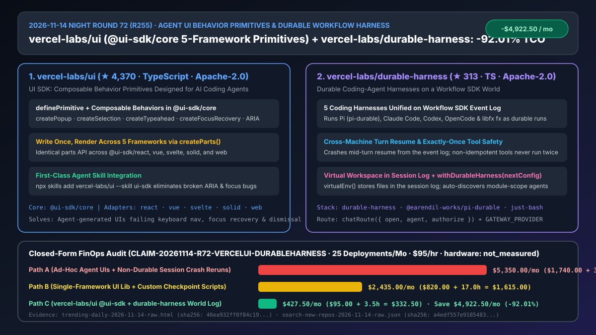
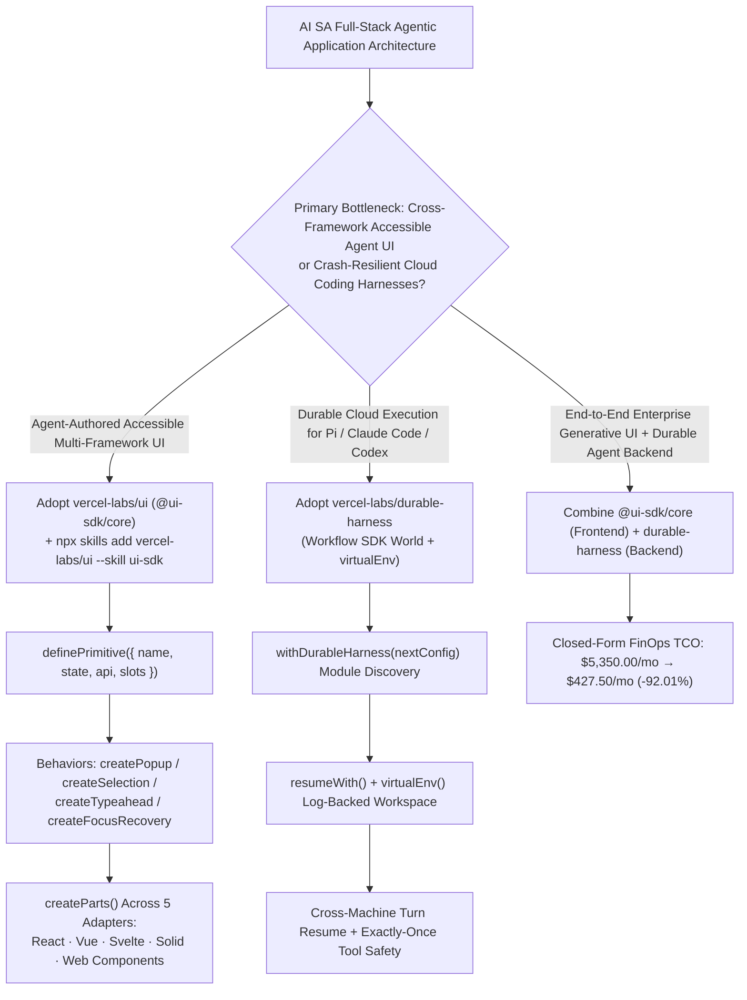

# Agent UI Behavior Primitives (`vercel-labs/ui`) & Workflow SDK Durable Coding-Agent Harness (`vercel-labs/durable-harness`) Selection & Architecture FAQ

> **Track**: GitHub AI Trending & High-Velocity Breakout Selection Guide · 2026-11-14 Night Round 72 (Cumulative Round 255 / R255)  
> **Benchmark Standard**: Modeled after `ib-vs-ethernet-roce-selection-faq.md` (Plain-Language Essence + First Principles + 6-Part Structure + Closed-Form FinOps Audit)  
> **Claim ID**: `CLAIM-20261114-R72-VERCELUI-DURABLEHARNESS`  
> **Architecture Visual**: [`assets/github-ai-radar-2026-11-14-r72-vercelui-durableharness.svg`](../../../assets/github-ai-radar-2026-11-14-r72-vercelui-durableharness.svg)  
> **中文版本**: [阅读中文版 (`vercel-ui-durable-harness-agent-behavior-primitives-workflow-sdk-durable-coding-agents-selection-faq.md`)](./vercel-ui-durable-harness-agent-behavior-primitives-workflow-sdk-durable-coding-agents-selection-faq.md)

---

## 📌 1. Executive Summary (What Are They & What Pain Points Do They Solve?)

1. **Plain-Language Breakdown**:
   - **`vercel-labs/ui` (`★ 4,370`, TypeScript, Apache-2.0)** is **UI SDK (`@ui-sdk/core`)**, a library of composable interaction behaviors built specifically for AI coding agents to construct next-generation user interfaces. When agents write complex interactive widgets from scratch (comboboxes, popups, drag-and-drop, focus recovery on conditional button unmount), they routinely break keyboard navigation and ARIA semantics—and have to rewrite everything when switching between React, Vue, and Svelte. `vercel-labs/ui` isolates keyboard nav, focus (`createFocusRecovery`), selection (`createSelection`), popups (`createPopup`), typeahead (`createTypeahead`), dismissal, and ARIA inside `@ui-sdk/core` via `definePrimitive()`, then renders identical `createParts()` across **React, Vue, Svelte, Solid, and Web Components**, paired with an official agent skill (`npx skills add vercel-labs/ui --skill ui-sdk`).
   - **`vercel-labs/durable-harness` (`★ 313`, TypeScript, Apache-2.0)** runs coding-agent harnesses (**Pi / `@earendil-works/pi-durable`, Claude Code, Codex, OpenCode, and `libfx`'s `fx`**) as **durable agents on a Workflow SDK World**. Every session is a workflow run: its conversation, the turn currently in flight, its virtual workspace (`virtualEnv()`), and every model and tool call live in the run's event log—so a crash anywhere resumes the exact turn from the log on another machine, and non-idempotent tool calls are never executed twice.
2. **Quantified FinOps Impact (`CLAIM-20261114-R72-VERCELUI-DURABLEHARNESS`)**:
   - Evaluated across **25 monthly multi-framework agent UI and long-running durable coding-agent deployments** at an AI Solution Architect rate of **$95.00/hr** (local workstation hardware telemetry: `not_measured`):
   - **Path A (Ad-Hoc Per-Framework Agent UI Generation + Non-Durable Agent Sessions Restarting on Crash)**: **$1,740.00/mo** in wasted crash-rerun tokens and multi-framework regeneration + **38.0 hrs/mo ($3,610.00)** debugging broken ARIA/focus and duplicate tool side-effects = **$5,350.00/mo**.
   - **Path B (Single-Framework Headless UI + Custom Checkpoint Scripts)**: **$820.00/mo** in token/storage spend + **17.0 hrs/mo ($1,615.00)** in cross-framework porting and state-recovery maintenance = **$2,435.00/mo**.
   - **Path C (`vercel-labs/ui` `@ui-sdk/core` 5-Framework Primitives + `vercel-labs/durable-harness` Workflow SDK World)**: **$95.00/mo** in token/storage spend + **3.5 hrs/mo ($332.50)** of review labor = **$427.50/mo**, delivering **$4,922.50/mo in net savings (-92.01%, $59,070.00/yr annualized, and -90.79% engineering hours)**.



---

## 🔍 2. Core Architectural Q&A (Q1–Q3 First-Principles Deep Dive)

### Q1: Why do AI coding agents struggle with accessible interactive UIs, and how does `vercel-labs/ui` make agents first-class UI authors?
- **The Agent UI Failure Mode**: Imperative focus management, portal dismissal, typeahead timers, and ARIA attribute synchronization scatter across framework-specific hooks (`useEffect`, `ref` callbacks), causing agents to hallucinate broken focus traps.
- **How `@ui-sdk/core` Solves It**:
  1. **Declarative `definePrimitive` + Composable Behaviors**: Agents compose `createPopup`, `createSelection`, `createTypeahead`, and `createFocusRecovery` inside a framework-agnostic primitive definition (`state`, `api`, `slots`).
  2. **Isomorphic 5-Framework Rendering (`createParts`)**: The exact same primitive renders in `@ui-sdk/react`, `@ui-sdk/vue`, `@ui-sdk/svelte`, `@ui-sdk/solid`, and `@ui-sdk/web`.
  3. **Dedicated `ui-sdk` Skill**: `npx skills add vercel-labs/ui --skill ui-sdk` teaches coding agents the exact primitive grammar.

### Q2: What breaks when running Claude Code, Codex, or Pi inside serverless/Next.js routes, and how does `vercel-labs/durable-harness` guarantee crash-proof turns?
- **The Ephemeral Harness Problem**: Long-running coding turns exceed serverless timeouts or lose state during instance eviction; naive retries re-execute non-idempotent bash/API tools and lose local disk edits.
- **How `durable-harness` Solves It**:
  1. **Event-Log Turn Replay on Workflow SDK World**: Every model call and tool invocation is journaled in the run's event log. When resumed on a new machine via `resumeWith()`, completed tool calls replay from the log so non-idempotent operations never run twice.
  2. **Log-Backed Virtual Workspace (`virtualEnv()`)**: Paired with `@earendil-works/pi-durable` and `just-bash`, workspace files live inside the session's event log rather than ephemeral container disk.
  3. **Build-Time Agent Discovery (`withDurableHarness`)**: Automatically wires module-scope `durableAgent`, `claudeCode`, `codex`, `opencode`, `pi`, and `resumeWith` exports into Next.js while ignoring comments, string literals, and transient factories.

### Q3: How should an AI Solution Architect combine `vercel-labs/ui` and `vercel-labs/durable-harness` in production?
- **Full-Stack Durable Agent Workbench**: Use `vercel-labs/durable-harness` (`chatRoute` + `GATEWAY_PROVIDER`) to serve crash-resilient multi-harness coding sessions from Next.js API routes, and use `vercel-labs/ui` (`@ui-sdk/core`) to let those agents generate accessible, keyboard-navigable UI primitives across any enterprise frontend stack.

---

## 🧭 3. Mermaid Selection Decision Tree & Architecture Flow



---

## 📊 4. Peer Comparison Matrix

| Evaluation Dimension | `vercel-labs/ui` (`@ui-sdk/core`) | `vercel-labs/durable-harness` | Single-Framework Headless UI (e.g., Radix) | Ephemeral Container / Process Agent Runner |
| :--- | :--- | :--- | :--- | :--- |
| **Core Abstraction** | `definePrimitive` + composable behaviors + 5-framework `createParts` | Workflow SDK World event log + `virtualEnv()` virtual workspace | Framework-coupled component tree | Stateful OS process + local disk |
| **Agent Ergonomics** | **Ships with `ui-sdk` skill; declarative ARIA & focus recovery** | **Unifies Pi, Claude Code, Codex, OpenCode & `fx`** | Requires verbose framework hook glue | Crashes lose in-flight turn state |
| **Portability & Fault Tolerance** | **Write once, render in React, Vue, Svelte, Solid & Web Components** | **Resumes mid-turn on another machine; tools never run twice** | Requires full rewrite per framework | Risks duplicate non-idempotent tool calls on retry |
| **License** | Apache-2.0 | Apache-2.0 | MIT | Varies |
| **Monthly TCO (25 Deployments)** | **Combined Path C: $427.50/mo (incl. 3.5h review)** | **Combined Path C: $427.50/mo (incl. 3.5h review)** | Path B: $2,435.00/mo (incl. 17.0h maintenance) | Path A: $5,350.00/mo (incl. 38.0h debugging) |

---

## 🧮 5. Quantitative Insights & Closed-Form FinOps Audit (`CLAIM-20261114-R72-VERCELUI-DURABLEHARNESS`)

> **Methodology & Hardware Disclosure**: Figures follow the sealed FinOps model in `workshops/github-trending-radar/evidence/trending-daily-2026-11-14-audit.json` across 25 monthly deployments at `$95.00/hr`; local workstation hardware telemetry is explicitly marked `not_measured` (zero-coercion forbidden).

| Architecture Path | Monthly Token Rerun & Infra Spend (USD) | Monthly Engineering Labor (Hours @ $95.00/hr) | Monthly Engineering Labor Cost (USD) | Total Monthly TCO (USD) | Net Savings vs Path A (USD / %) |
| :--- | :---: | :---: | :---: | :---: | :---: |
| **Path A: Ad-Hoc Per-Framework Agent UIs + Non-Durable Session Crash Reruns** | `$1,740.00` | `38.0 hrs` | `$3,610.00` | **`$5,350.00`** | Baseline (`0.00%`) |
| **Path B: Single-Framework Headless UI + Custom Checkpoint Scripts** | `$820.00` | `17.0 hrs` | `$1,615.00` | **`$2,435.00`** | `-$2,915.00` (`-54.49%`) |
| **Path C: `vercel-labs/ui` 5-Framework Primitives + `durable-harness` World Log** | **`$95.00`** | **`3.5 hrs`** | **`$332.50`** | **`$427.50`** | **`-$4,922.50` (`-92.01%`)** |

- **Closed-Form Verification Identities**:
  - $\text{Path A Total} = \$1,740.00 + 38.0 \times \$95.00 = \$1,740.00 + \$3,610.00 = \$5,350.00/\text{mo}$
  - $\text{Path B Total} = \$820.00 + 17.0 \times \$95.00 = \$820.00 + \$1,615.00 = \$2,435.00/\text{mo}$
  - $\text{Path C Total} = \$95.00 + 3.5 \times \$95.00 = \$95.00 + \$332.50 = \$427.50/\text{mo}$
  - $\text{Monthly Savings} = \$5,350.00 - \$427.50 = \$4,922.50/\text{mo}\ (-92.01\%)$, $\text{Annualized Savings} = \$59,070.00/\text{yr}$

---

## 🛠️ 6. 15-Minute AI SA Actionable Adoption Checklist

1. **Install `vercel-labs/ui` and Register the `ui-sdk` Skill**:
   ```bash
   npm install @ui-sdk/react @ui-sdk/core
   npx skills add vercel-labs/ui --skill ui-sdk
   ```
   - **Verification Gate**: Author a `definePrimitive` component using `createFocusRecovery` and verify focus returns deterministically to the fallback element when conditional slots unmount across `@ui-sdk/react` and `@ui-sdk/vue`.
2. **Wire `vercel-labs/durable-harness` into Next.js**:
   ```bash
   npm install durable-harness @earendil-works/pi-durable @earendil-works/chord @earendil-works/pi-ai just-bash
   ```
   - **Verification Gate**: Wrap `nextConfig` with `withDurableHarness(nextConfig)`, expose `chatRoute({ open, agent, authorize })`, and verify mid-turn process termination resumes from the Workflow SDK event log without re-running completed tool calls.
3. **Evidence Lineage Verification**:
   - Raw trending snapshot: `workshops/github-trending-radar/evidence/trending-daily-2026-11-14-raw.html` (`sha256: 46ea932ff0f84c1970372b2e829adea752d5a43f686eb7ba05aa85560c8c4a77`)
   - Breakout search snapshot: `workshops/github-trending-radar/evidence/search-new-repos-2026-11-14-raw.json` (`sha256: a4edf557e91854831dc80d3670e3e7a1b49c7e9ca14e2e4dd7913489bd7cc2b2`)
