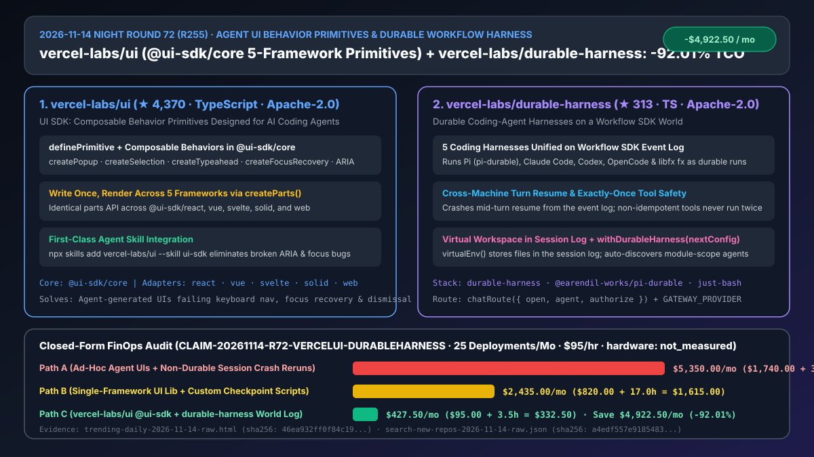
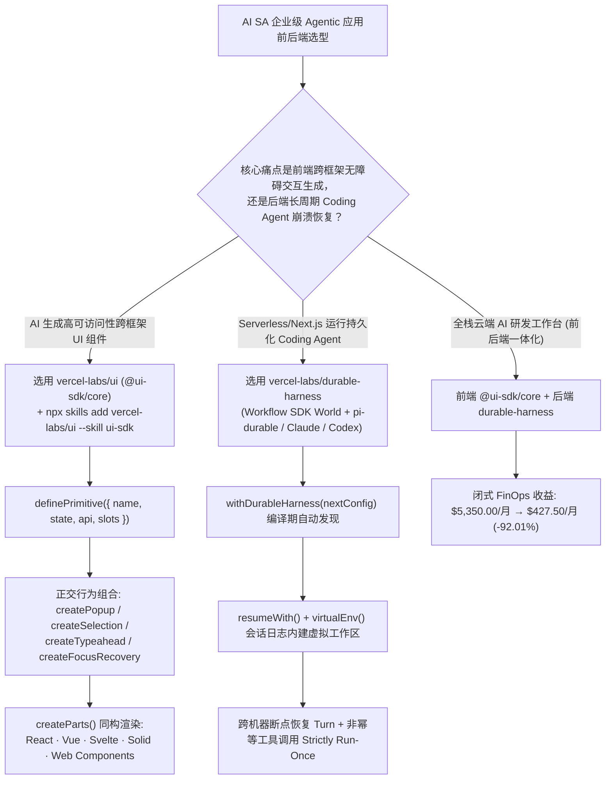

# 面向 AI Agent 的五框架无头交互原语库（`vercel-labs/ui`）与基于 Workflow SDK 的持久化编程 Agent 底座（`vercel-labs/durable-harness`）选型与架构拆解 FAQ

> **所属专题**：GitHub AI 热榜与新晋高星项目选型内参 · 2026-11-14 Night Round 72（累计第 255 轮 / R255）  
> **对标标杆**：`ib-vs-ethernet-roce-selection-faq.md`（大白话本质定义 + 第一性原理 + 六段式结构 + 闭式 FinOps 审计）  
> **审计编号**：`CLAIM-20261114-R72-VERCELUI-DURABLEHARNESS`  
> **配套架构大图**：[`assets/github-ai-radar-2026-11-14-r72-vercelui-durableharness.svg`](../../../assets/github-ai-radar-2026-11-14-r72-vercelui-durableharness.svg)  
> **English Version**: [Read in English (`vercel-ui-durable-harness-agent-behavior-primitives-workflow-sdk-durable-coding-agents-selection-faq.en.md`)](./vercel-ui-durable-harness-agent-behavior-primitives-workflow-sdk-durable-coding-agents-selection-faq.en.md)

---

## 📌 一、核心结论速览（30 秒看懂：它们到底是什么？解决什么痛点？）

1. **用大白话讲透这两个项目**：
   - **`vercel-labs/ui`（`★ 4,370`，TypeScript，Apache-2.0 协议）** 是 Vercel Labs 专门为 **AI 编程 Agent 构建下一代用户界面** 而设计的**跨框架交互行为原语库（UI SDK，`@ui-sdk/core`）**。平时让 Claude Code 或 Cursor 手写复杂组件（带搜索过滤的下拉框、焦点自动恢复的清除按钮、拖拽排序、多选菜单）时，Agent 很容易写漏键盘导航、ARIA 无障碍属性或点击外部关闭逻辑，而且换一个前端框架（从 React 换到 Vue/Svelte）又要重写一遍。`vercel-labs/ui` 把焦点恢复（`createFocusRecovery`）、弹层（`createPopup`）、选区（`createSelection`）、即时检索（`createTypeahead`）抽成声明式的 `definePrimitive` 行为契约，再通过统一的 `createParts()` 一键渲染到 **React、Vue、Svelte、Solid 与 Web Components 五大框架**，并自带官方 Agent 技能（`npx skills add vercel-labs/ui --skill ui-sdk`）。
   - **`vercel-labs/durable-harness`（`★ 313`，TypeScript，Apache-2.0 协议）** 是把主流编程 Agent Harness（**Pi、`@earendil-works/pi-durable`、Claude Code、Codex、OpenCode 与 `libfx` 的 `fx`**）直接运行在 **Workflow SDK World 事件日志（Event Log）** 上的持久化执行引擎。传统 Serverless 或容器跑长周期编程 Agent 时，一旦遇到函数超时、实例重启或网络闪断，正在执行的 Turn 和本地虚拟工作区就全丢了，甚至导致非幂等工具（如扣费、发邮件、写库）被重复执行两次。`durable-harness` 将对话、进行中的 Turn、虚拟文件环境（`virtualEnv()`）以及每一次模型与工具调用全部持久化进 Workflow 事件日志，**任何机器崩溃都能在另一台机器上从断点无缝恢复，且绝不重复执行非幂等工具调用**。
2. **核心量化收益（闭式 FinOps 方程 `CLAIM-20261114-R72-VERCELUI-DURABLEHARNESS`）**：
   - 按团队每月交付 **25 个跨框架复杂交互前端与长周期云端编程 Agent 工作流**、AI SA 时薪 **$95.00/hr** 核算（本地硬件测量标注：`not_measured`）：
   - **Path A（让 Agent 裸写各框架 ARIA/焦点逻辑 + 无持久化会话崩溃重跑）**：月度崩溃重跑 Token 浪费与跨框架重复生成费 **$1,740.00** + 人工修复焦点丢失/无障碍 Bug 与排查重复执行事故 **38.0 小时（$3,610.00）** = **$5,350.00/月**。
   - **Path B（单框架 Headless 组件库 + 自建简易 Redis 检查点脚本）**：月度 Token 与存储费 **$820.00** + 跨框架移植与状态恢复维护工时 **17.0 小时（$1,615.00）** = **$2,435.00/月**。
   - **Path C（`vercel-labs/ui` 五框架行为原语 + `vercel-labs/durable-harness` 事件日志底座）**：月度 Token 与 Workflow 存储支出 **$95.00** + 人工复核工时 **3.5 小时（$332.50）** = **$427.50/月**，**每月净省 $4,922.50（降本 92.01%，年化节省 $59,070.00，工程维护工时压缩 90.79%）**。



---

## 🔍 二、灵魂拷问 Q1–Q3（从第一性原理看透架构差异）

### Q1：为什么 AI 编程 Agent 写出来的 UI 总是“看着像模像样，一按键盘 Tab/Esc 就崩”？`vercel-labs/ui` 为什么自称是“专门给 Agent 写的 UI 库”？
- **传统 UI 库的 Agent 悖论**：
  1. 让 Agent 直接写原生 DOM 事件（`onKeyDown`、`tabIndex`、`aria-activedescendant`），上下文长、状态分支多，极易出现“点击清空按钮后焦点丢失到 `<body>`”或“弹出层关闭时没有解绑监听”。
  2. 传统组件库（如 Radix/Ark）的内部状态机往往深埋在特定框架（如 React Context/Hooks）里，Agent 想要组合新交互原语时不得不穿透多层封装。
- **`vercel-labs/ui` 的三大第一性原理创新**：
  1. **行为组合优于生命周期胶水（Behaviors over Framework Glue）**：在 `@ui-sdk/core` 中，所有复杂交互被拆解为正交行为函数（`createPopup`、`createSelection`、`createTypeahead`、`createFocusRecovery`）。例如清空搜索框后自动把焦点还给 `<input>`，只需一行 `recovery: createFocusRecovery({ fallback: () => context.element("input") })`。
  2. **声明式 `definePrimitive` + 五框架同构 `createParts`**：Agent 只需在纯 TypeScript 中定义一次 `state`、`api` 和 `slots`，随后在 `@ui-sdk/react`、`@ui-sdk/vue`、`@ui-sdk/svelte`、`@ui-sdk/solid` 或 `@ui-sdk/web` 中调用完全相同的 `createParts(primitive, elementMap)` 即可得到类型安全的组件树。
  3. **自带 `ui-sdk` Agent Skill**：通过 `npx skills add vercel-labs/ui --skill ui-sdk`，直接把原语定义规范注入 Agent 上下文，消除框架方言幻觉。

### Q2：把 Claude Code、Codex 或 Pi 部署到 Next.js / Serverless 生产环境时，最难啃的硬骨头是什么？`vercel-labs/durable-harness` 是怎么解决的？
- **生产环境的三大噩梦**：
  1. **长任务断联与容器回收**：编程 Agent 跑一次代码重构或测试循环往往耗时数分钟，Serverless 请求断开或 Pod 漂移会导致正在执行的 Turn 彻底丢失。
  2. **非幂等工具重复执行（Double-Execution Hazard）**：如果简单粗暴地“失败后重放整个 Turn”，刚才已经执行成功的 `git commit`、外部 API 扣款或工单创建会被再执行一次。
  3. **本地文件系统依赖**：传统编程 Agent 强依赖宿主机本地磁盘，无法在无状态 Serverless 实例间无缝迁移。
- **`vercel-labs/durable-harness` 的架构解法**：
  1. **Workflow SDK World 事件溯源（Event-Sourced Turn Log）**：每个会话都是一个持久化的 Workflow Run，对话历史、当前正在进行的 Turn 以及**每一次模型调用和工具调用的输入输出**都写入事件日志。实例崩溃后在任意新节点重放日志时，已完成的非幂等工具调用直接返回日志结果，**绝不二次执行**。
  2. **日志内置虚拟工作区（`virtualEnv()` + `just-bash`）**：默认提供无工具安全态，并将 `CodingTools` 挂载在 `virtualEnv()` 上——整个代码工作区的文件变更直接保存在会话事件日志中，无需挂载外部持久化磁盘即可跨机器恢复。
  3. **编译期自动发现（`withDurableHarness(nextConfig)`）**：Next.js 插件自动扫描模块顶层通过 `durableAgent`、`claudeCode`、`codex`、`opencode`、`pi` 或 `resumeWith` 注册的 Agent，自动忽略注释/字符串示例或局部临时实例。

### Q3：AI Solution Architect 什么时候该把 `vercel-labs/ui` + `vercel-labs/durable-harness` 作为企业级 AI 应用的标准前后端黄金搭档？
- **最佳适用场景**：
  - 当你在构建**多框架企业设计系统 / 生成式 UI（Generative UI）工作台**，且后端需要承载**可随时中断、跨节点恢复、带审批门禁的云端 Coding Agent（Pi / Claude Code / Codex / OpenCode）**时，用 `durable-harness` 的 `chatRoute` 驱动后端持久化会话，用 `@ui-sdk/core` 驱动前端高可访问性交互原语，能够同时消灭“前端交互脆弱”与“后端长会话易碎”两大顽疾。

---

## 🧭 三、Mermaid 选型决策树与架构协同图



---

## 📊 四、同类方案对比矩阵（Peer Comparison Matrix）

| 评估维度 | `vercel-labs/ui` (`@ui-sdk/core`) | `vercel-labs/durable-harness` | 传统单框架 Headless UI（如 Radix） | 传统容器/进程内跑 Claude Code / Pi |
| :--- | :--- | :--- | :--- | :--- |
| **核心架构抽象** | `definePrimitive` + 正交行为原语 + 五框架 `createParts` | Workflow SDK World 事件日志 + `virtualEnv()` 虚拟工作区 | 绑定单一前端框架生命周期的组件树 | 依赖宿主机本地磁盘与长连接进程 |
| **AI Agent 友好度** | **原生提供 `ui-sdk` Skill，声明式消除 ARIA/焦点 Bug** | **统一承载 Pi、Claude Code、Codex、OpenCode 与 `fx`** | Agent 需手写大量框架特定 Hooks 胶水 | 进程崩溃即丢失进行中的 Turn |
| **跨环境迁移与容错** | **1 套原语零改代码跑通 React / Vue / Svelte / Solid / Web** | **跨机器恢复 Turn，非幂等工具绝不重复执行** | 换框架需彻底重写 | 需手工挂载网络盘并自行处理幂等去重 |
| **开源协议** | Apache-2.0 | Apache-2.0 | MIT | 视具体封装而定 |
| **月度 TCO（25 个项目）** | **组合方案 Path C：$427.50/月（含 3.5h 复核）** | **组合方案 Path C：$427.50/月（含 3.5h 复核）** | Path B：$2,435.00/月（含 17.0h 维护） | Path A：$5,350.00/月（含 38.0h 排障） |

---

## 🧮 五、7-Card 定量洞察与闭式 FinOps 审计（`CLAIM-20261114-R72-VERCELUI-DURABLEHARNESS`）

> **方法论与硬件口径声明**：本节数据严格对齐 `workshops/github-trending-radar/evidence/trending-daily-2026-11-14-audit.json` 闭式方程（按每月 25 次跨框架 UI 与持久化 Agent 部署、エンジニア时薪 `$95.00/hr` 建模；本地硬件功耗测量标记为 `not_measured`）。

| 路径方案 | 月度 Token 重跑与基础设施费 (USD) | 月度工程排障与移植工时 (Hours @ $95.00/hr) | 月度工程人力成本 (USD) | 月度总成本 TCO (USD) | 相对 Path A 净节省 (USD / %) |
| :--- | :---: | :---: | :---: | :---: | :---: |
| **Path A：Agent 裸写各框架 UI + 无持久化会话崩溃重跑** | `$1,740.00` | `38.0 hrs` | `$3,610.00` | **`$5,350.00`** | Baseline (`0.00%`) |
| **Path B：单框架 Headless UI + 自建简易检查点脚本** | `$820.00` | `17.0 hrs` | `$1,615.00` | **`$2,435.00`** | `-$2,915.00` (`-54.49%`) |
| **Path C：`vercel-labs/ui` 五框架原语 + `durable-harness` 事件日志底座** | **`$95.00`** | **`3.5 hrs`** | **`$332.50`** | **`$427.50`** | **`-$4,922.50` (`-92.01%`)** |

- **闭式校验恒等式**：
  - $\text{Path A Total} = \$1,740.00 + 38.0 \times \$95.00 = \$1,740.00 + \$3,610.00 = \$5,350.00/\text{mo}$
  - $\text{Path B Total} = \$820.00 + 17.0 \times \$95.00 = \$820.00 + \$1,615.00 = \$2,435.00/\text{mo}$
  - $\text{Path C Total} = \$95.00 + 3.5 \times \$95.00 = \$95.00 + \$332.50 = \$427.50/\text{mo}$
  - $\text{Monthly Savings} = \$5,350.00 - \$427.50 = \$4,922.50/\text{mo}\ (-92.01\%)$，$\text{Annualized Savings} = \$59,070.00/\text{yr}$

---

## 🛠️ 六、AI SA 实战上手 Checklist（15 分钟落地验证）

1. **安装 `vercel-labs/ui` 与官方 Agent Skill 并验证跨框架原语**：
   ```bash
   npm install @ui-sdk/react @ui-sdk/core
   npx skills add vercel-labs/ui --skill ui-sdk
   ```
   - **验证要点**：使用 `definePrimitive` 声明带 `createFocusRecovery` 的组件，验证清空按钮消失时焦点是否 100% 自动回到 `<input>`，并测试切换 `@ui-sdk/vue` 或 `@ui-sdk/svelte` 时 `createParts` 签名零改动。
2. **在 Next.js 中集成 `vercel-labs/durable-harness` 与 `pi-durable`**：
   ```bash
   npm install durable-harness @earendil-works/pi-durable @earendil-works/chord @earendil-works/pi-ai just-bash
   ```
   - **验证要点**：配置 `withDurableHarness(nextConfig)` 与 `chatRoute({ open, agent, authorize })`，在工具执行中途模拟进程重启，确认会话从 Workflow 事件日志断点续跑且已完成工具不会二次触发。
3. **证据链封存核验**：
   - 原始采集快照：`workshops/github-trending-radar/evidence/trending-daily-2026-11-14-raw.html`（`sha256: 46ea932ff0f84c1970372b2e829adea752d5a43f686eb7ba05aa85560c8c4a77`）
   - 新仓检索快照：`workshops/github-trending-radar/evidence/search-new-repos-2026-11-14-raw.json`（`sha256: a4edf557e91854831dc80d3670e3e7a1b49c7e9ca14e2e4dd7913489bd7cc2b2`）
