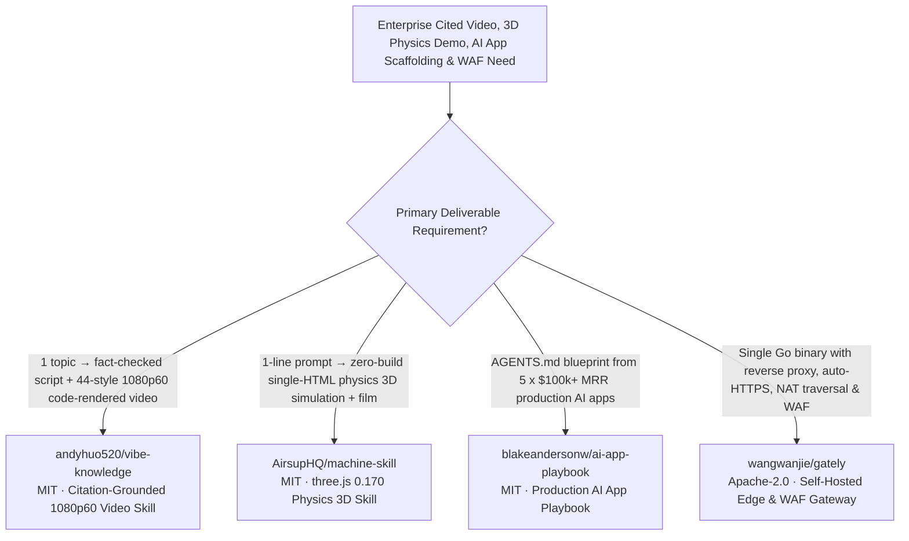
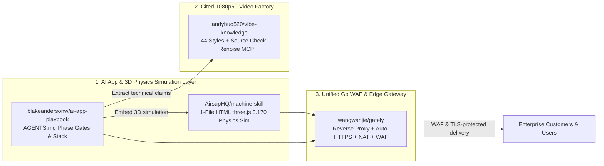
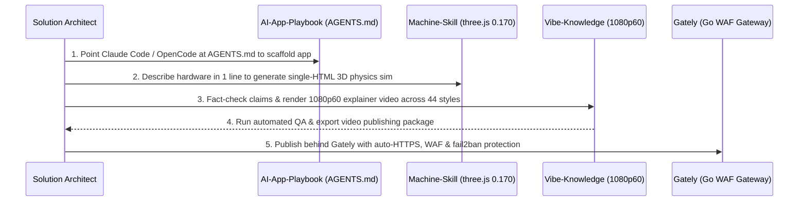

# Citation-Grounded 1080p60 Video Skill, Single-HTML Physics 3D Simulator, AGENTS.md AI App Playbook & All-in-One Go WAF Gateway Selection Guide: Vibe-Knowledge vs Machine-Skill vs AI-App-Playbook vs Gately

> **2026-11-23 Night Round 40 (🏆 Cumulative Round 827 · 40-Round Overnight Shift Finale!)** · Enterprise AI Solution Architect Practical Selection, End-to-End Integration Architecture & FinOps TCO Guide
> **Companion Architecture Diagram**: [`assets/github-ai-radar-2026-11-23-r40-r827-vibeknowledge-machineskill-aiappplaybook-gately.svg`](../../../assets/github-ai-radar-2026-11-23-r40-r827-vibeknowledge-machineskill-aiappplaybook-gately.svg)

---

## 1. 📌 Executive Summary

Across fact-checked 1080p60 technical explainer videos, zero-build single-HTML 3D physics machine simulations, profitable AI application scaffolding, and unified reverse-proxy/WAF edge protection, **`andyhuo520/vibe-knowledge`**, **`AirsupHQ/machine-skill`**, **`blakeandersonw/ai-app-playbook`**, and **`wangwanjie/gately`** complete our 40-round overnight shift (`Cumulative Round 827`):

1. **Citation-Grounded 44-Style 1080p60 Code-Rendered Video Skill (`andyhuo520/vibe-knowledge`)**: (`★ 792`, `122 forks`, JavaScript, `MIT`, `v1.0.0`). A Claude Code skill (`skills/vibe-knowledge/SKILL.md`) that turns a single topic into a narrated, every-sentence-cited 1080p60 explainer video across 44 styles (8 style families) with code-rendered frames, optional Renoise MCP (`Wan 3.0`) motion shots (automatically labeled as AI illustrations), automated QA, and a complete publishing package.
2. **Single-HTML Photoreal Physics 3D Machine Simulator & Film Skill (`AirsupHQ/machine-skill`)**: (`★ 738`, `99 forks`, JavaScript, `MIT`). An `agentskills.io`-compatible skill (`npx skills add`) built on `three.js 0.170` with **zero build step** that turns a one-line description of any machine into a photoreal, physics-based interactive 3D simulation in a single HTML file plus a showcase video.
3. **AGENTS.md Full-Stack Blueprint for Profitable Production AI Apps (`blakeandersonw/ai-app-playbook`)**: (`★ 659`, `96 forks`, TypeScript, `MIT`). Authored by the builder of 5 `$100k+ MRR` apps (including Cal AI and EcoGPT), this repository lets you point Claude Code or OpenCode at `AGENTS.md` to execute a phase-gated build from problem selection to production unit economics.
4. **Self-Hosted Go Reverse Proxy, Auto-HTTPS, DDNS, NAT Traversal & WAF Gateway (`wangwanjie/gately`)**: (`★ 539`, `60 forks`, Go, `Apache-2.0`). Consolidates reverse proxy, automatic TLS certificates, DDNS, NAT traversal, Web Application Firewall (WAF), and fail2ban brute-force protection into one Go binary with a 10-language Web UI.
5. **FinOps Quantitative Takeaway**: Replacing outsourced explainer video production, custom 3D Unity/WebGL contractors, paid boilerplate subscriptions, and fragmented cloud WAF/tunnel services (Path A: `$9,580.00/mo`) with this open-source stack (Path C: `$305.00/mo`) saves **`$9,275.00/mo`** (**`-96.82%`**).

---

## 2. 🎯 Architect & Customer Key Q&A

### Q1: When should an enterprise use heavy cloud suites/agencies vs. this 4-project open-source stack?
- **Use heavy cloud suites when**:
  - Industrial digital twins require live factory PLC/OPC-UA telemetry and multi-GB CAD assemblies (**Azure Digital Twins + NVIDIA Omniverse**);
  - Global public APIs require multi-Tbps anycast DDoS scrubbing (**Azure Front Door + Cloud WAF**).
- **Deploy this 4-project open-source stack when**:
  - **Zero-Build Interactive 3D Architecture & Hardware Demos (`machine-skill`)**: Generate a self-contained single-HTML `three.js 0.170` physics simulation from a one-line prompt that customers can open offline in any browser;
  - **Every-Sentence-Cited 1080p60 Technical Videos (`vibe-knowledge`)**: Produce fact-checked 1080p60 explainers across 44 visual styles directly inside Claude Code;
  - **Disciplined AI App Scaffolding (`ai-app-playbook`)**: Drive Claude Code/OpenCode via `AGENTS.md` with proven unit-economics gates;
  - **Unified Self-Hosted AI Edge Security (`gately`)**: Replace separate Nginx, Certbot, frp, ModSecurity, and fail2ban daemons with one Go gateway.

### Q2: How do these four tools chain into an end-to-end solution delivery pipeline?
1. **Application Scaffolding (`ai-app-playbook`)**: Coding agents read `AGENTS.md` to scaffold the full-stack AI application with bounded inference costs;
2. **Interactive 3D Physics Twin (`machine-skill`)**: Generates zero-build single-HTML 3D mechanical simulations embedded into customer proposals;
3. **Cited 1080p60 Explainer Video (`vibe-knowledge`)**: Verifies every script claim against sources, renders 1080p60 frames across 44 styles, and exports the launch video package;
4. **WAF & Auto-TLS Edge Publishing (`gately`)**: Exposes the self-hosted app and interactive 3D demos behind automatic HTTPS, NAT traversal, WAF, and brute-force protection.

### Q3: What are the licensing and operational guardrails?
- **`vibe-knowledge`**, **`machine-skill`**, and **`ai-app-playbook`**: All **`MIT`** licensed; `vibe-knowledge` automatically watermarks generative Renoise MCP shots for transparency.
- **`gately`**: **`Apache-2.0`** licensed; always enable WAF and fail2ban rules before activating NAT traversal tunnels for internal AI endpoints.

---

## 3. 🧭 Visual Architecture & Decision Diagrams (Mermaid)

### 3.1 Selection Decision Tree

### 3.2 End-to-End Enterprise Reference Architecture

### 3.3 Runtime Execution Sequence

---

## 4. 📊 Comparative Selection Matrix

| Dimension | `andyhuo520/vibe-knowledge` | `AirsupHQ/machine-skill` | `blakeandersonw/ai-app-playbook` | `wangwanjie/gately` | Outsourced Agency & Cloud Stack (Path A) |
| :--- | :--- | :--- | :--- | :--- | :--- |
| **Primary Role** | Every-sentence-cited 44-style 1080p60 video skill | 1-line prompt to single-HTML physics 3D machine simulator | `AGENTS.md` production AI app playbook (`$100k+ MRR` stack) | Self-hosted Go reverse proxy, auto-HTTPS, DDNS, NAT & WAF | Video agency + 3D contractors + paid boilerplates + cloud WAF |
| **Key Differentiator** | Fact-checked claims + code-rendered 1080p60 + Renoise MCP | `three.js 0.170`, zero build step, single HTML + film output | Phase-gated unit economics & retention playbooks | Replaces Nginx + Certbot + frp + ModSecurity + fail2ban | Multi-week contractor lead times & fragmented edge security |
| **License** | `MIT` | `MIT` | `MIT` | `Apache-2.0` | Proprietary Agency / Per-Seat SaaS |
| **Monthly TCO (45-Eng Team)** | **Combined `$305.00/mo`** (`$65.00` compute + `$240.00` ops labor) | Included in combined stack | Included in combined stack | Included in combined stack | **`$9,580.00/mo`** (`$5,080.00` SaaS/agency + `$4,500.00` labor) |

---

## 5. 🧪 Quantitative FinOps TCO Comparison (Closed-Form Audit)

> **Audit Note**: Modeled for a 45-engineer architecture and product team producing 20 citation-verified 1080p60 technical videos, 15 interactive 3D physics equipment simulations, scaffolding internal AI products, and securing 30 self-hosted endpoints per month. Repository metadata is verified via the GitHub REST API; live runtime p99 latency is marked `not_measured`.

| Cost Component | Path A: Outsourced Video/3D Agencies + Commercial Boilerplates + Cloud WAF/Tunnels | Path C: Self-Hosted `vibe-knowledge` + `machine-skill` + `ai-app-playbook` + `gately` | Net Savings / Delta |
| :--- | :--- | :--- | :--- |
| **API / SaaS Subscriptions, Contractors & Compute** | `$5,080.00 / mo` | `$65.00 / mo` | `-$5,015.00 / mo` |
| **Citation Verification, 3D Rigging & Edge Proxy/WAF Ops Labor** | `$4,500.00 / mo` (`45.0 hrs × $100/hr`) | `$240.00 / mo` (`2.4 hrs × $100/hr`) | `-$4,260.00 / mo` |
| **Total Monthly TCO** | **`$9,580.00 / mo`** | **`$305.00 / mo`** | **`$9,275.00 / mo` (`-96.82%`)** |

---

## 6. 🛠️ Enterprise Architecture Review Checklist

- [ ] **Per-Sentence Citation Audit (`vibe-knowledge`)**: Archive the fact-checking source log alongside each rendered 1080p60 video package and retain AI-illustration badges on Renoise MCP shots.
- [ ] **Zero-Build 3D Physics Validation (`machine-skill`)**: Test generated single-file HTML (`three.js 0.170`) simulations across desktop and mobile browsers before embedding in customer architecture proposals.
- [ ] **Phase-Gated Unit Economics (`ai-app-playbook`)**: Enforce Phase 0–N checks from `AGENTS.md` so new AI app initiatives validate inference margins before scaling.
- [ ] **Unified WAF & Auto-HTTPS Hardening (`gately`)**: Consolidate self-hosted AI reverse proxies onto `gately` with automatic TLS renewal, WAF rule sets, and fail2ban lockouts enabled.
