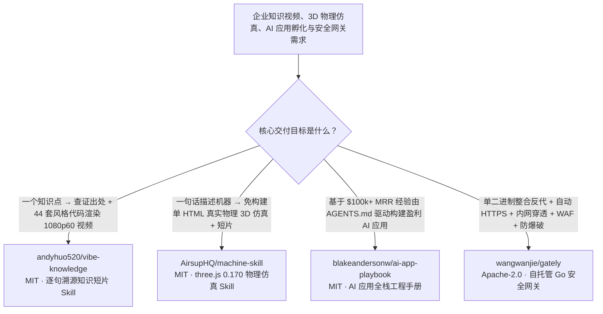
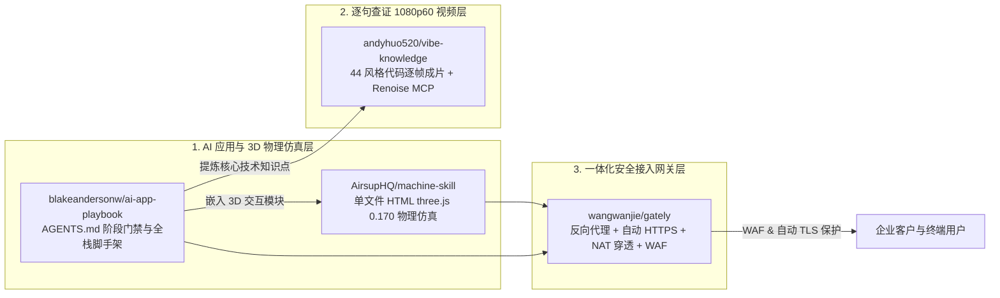
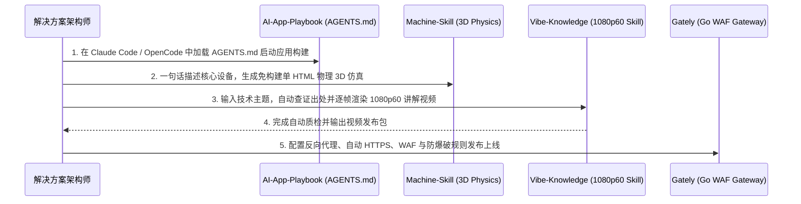

# 逐句溯源 1080p60 知识短片技能、单文件物理级 3D 机械仿真、AI 应用全栈工程手册与一体化 Go WAF 网关选型指南：Vibe-Knowledge vs Machine-Skill vs AI-App-Playbook vs Gately

> **2026-11-23 Night Round 40（🏆 Cumulative Round 827 · 今晚 40 轮大满贯收官里程碑！）** · 面向企业 AI 解决方案架构师（AI Solution Architect）的实战选型、端到端集成架构与 FinOps TCO 决策指南
> **关联架构图**：[`assets/github-ai-radar-2026-11-23-r40-r827-vibeknowledge-machineskill-aiappplaybook-gately.svg`](../../../assets/github-ai-radar-2026-11-23-r40-r827-vibeknowledge-machineskill-aiappplaybook-gately.svg)

---

## 1. 📌 核心结论速览（Executive Summary）

在企业高可信度知识科普短片生产、工业设备与系统原理的零构建单文件 3D 物理仿真、从 0 到 1 打造盈利级 AI 应用的标准工程脚手架，以及为自托管 AI 服务提供一体化反向代理/自动 HTTPS/内网穿透/WAF 防护四大场景中，**`andyhuo520/vibe-knowledge`**、**`AirsupHQ/machine-skill`**、**`blakeandersonw/ai-app-playbook`** 与 **`wangwanjie/gately`** 构成了今晚第 40 轮（累计第 827 轮）完美收官组合：

1. **每句有出处、44 套风格代码逐帧渲染的 1080p60 知识短片技能（Citation-Grounded 1080p60 Video Skill）**：优先选择 **`andyhuo520/vibe-knowledge`**（`★ 792`，`122 forks`，JavaScript，`MIT`，`v1.0.0`）。只需输入一个知识点，在 Claude Code 对话内自动完成“选题 → 查证出处 → 写稿 → 配音 → 8 大家族 44 套风格代码逐帧成片（支持 Renoise MCP 增强镜头并自动标注‘AI 示意’）→ 1080p60 质检 → 发布包”。
2. **一句话生成单 HTML 物理级写实 3D 机械交互仿真与演示短片（Single-HTML Physics 3D Simulator Skill）**：优先选择 **`AirsupHQ/machine-skill`**（`★ 738`，`99 forks`，JavaScript，`MIT`）。兼容 `agentskills.io` 标准（`npx skills add`），基于 `three.js 0.170` 且**无需任何构建步骤（No build step）**，将任意复杂机器或工业流程的一句话描述转化为带真实物理引擎的单文件 HTML 3D 交互仿真与配套宣传视频。
3. **验证过 5 款 `$100k+ MRR` 产品的 `AGENTS.md` AI 应用全栈工程指南（AGENTS.md AI App Playbook）**：优先选择 **`blakeandersonw/ai-app-playbook`**（`★ 659`，`96 forks`，TypeScript，`MIT`）。由 EcoGPT / Cal AI 创始人开源，克隆后直接让 Claude Code 或 OpenCode 读取 `AGENTS.md`，即可按阶段门禁（高频痛点筛选 → 秒级 AI 响应架构 → 留存与单位经济模型）自动构建生产级 AI 应用。
4. **集反向代理、自动 HTTPS、DDNS、内网穿透、WAF 与防爆破于一体的自托管 Go 网关（All-in-One Go Edge & WAF Gateway）**：优先选择 **`wangwanjie/gately`**（`★ 539`，`60 forks`，Go，`Apache-2.0`）。单二进制自带 10 语种 Web 控制台，一次性替代零散的 `Nginx + Certbot + frp + ModSecurity + fail2ban` 组合，安全暴露内部 AI 与 MCP 端点。
5. **FinOps 定量结论**：将商业科普视频外包、Unity/Three.js 3D 外包定制、商业应用脚手架订阅与云端托管 WAF/隧道服务（Path A：`$9,580.00/月`）迁移至上述四款开源工具（Path C：`$305.00/月`），每月净省 **`$9,275.00`**（降幅 **`-96.82%`**）。

---

## 2. 🎯 客户与架构师灵魂拷问 Q&A（Pain Points & Architecture Decisions）

### Q1：何时采用云托管 PaaS 或商业外包，何时引入这 4 款开源工具？
- **直接采用云托管或外包的场景**：
  - 工业数字孪生需要连接百万级高精度 CAD 曲面与工厂 PLC 实时 OPC-UA 总线，应采用 **Azure Digital Twins + NVIDIA Omniverse**；
  - 全球多活公网 API 需要 Tbps 级 DDoS 清洗，应使用 **Azure Front Door + Cloud WAF**。
- **优先引入本轮 4 大开源组件的场景**：
  - **售前方案与硬件原理 3D 交互演示**：用 **`machine-skill`** 在几分钟内生成免构建的单文件 HTML 3D 物理仿真发给客户浏览器直接打开；
  - **高可信度企业培训与技术解读视频**：用 **`vibe-knowledge`** 生成每句话都有事实出处、44 套风格可选的 1080p60 短片；
  - **快速孵化商业化 AI 创新应用**：让编码 Agent 按照 **`ai-app-playbook`** 的 `AGENTS.md` 规范从零搭建具备健康毛利模型的应用；
  - **极简加固自托管 AI 与私有网关边界**：用单二进制 **`gately`** 统一搞定自动证书、NAT 穿透、WAF 规则与防暴力破解。

### Q2：如何将这四套组件串联为“AI 产品孵化 → 3D 交互演示 → 溯源科普成片 → 安全网关上线”全链路？
1. **应用架构与业务孵化层（`ai-app-playbook`）**：Claude Code / OpenCode 读取 `AGENTS.md`，按阶段门禁生成全栈 AI 应用代码；
2. **交互式 3D 数字孪生嵌入层（`machine-skill`）**：为产品中的硬件/设备模块生成零构建步骤的 `three.js 0.170` 物理仿真单文件 HTML；
3. **逐句查证视频宣发层（`vibe-knowledge`）**：基于产品技术白皮书自动查证、配音并逐帧渲染 1080p60 讲解视频与发布包；
4. **安全接入与 WAF 防护层（`gately`）**：通过 `gately` 为上线的 AI 应用与仿真页面自动签发 HTTPS 证书、开启 WAF 与防爆破策略。

### Q3：核心技术边界与落地注意事项是什么？
- **`vibe-knowledge`**：采用 `MIT` 协议，使用 Renoise MCP 生成的增强动态镜头会自动标注“AI 示意”，确保企业对外宣发合规透明。
- **`machine-skill`**：采用 `MIT` 协议，输出无构建依赖的单 HTML（`three.js 0.170`），非常适合嵌入架构文档或离线演示。
- **`ai-app-playbook`**：采用 `MIT` 协议，核心价值在于将成功商业应用的单位经济模型（Unit Economics）与转化漏斗编码进 `AGENTS.md`。
- **`gately`**：采用 `Apache-2.0` 协议，开启内网穿透（NAT Traversal）暴露内部 AI 服务时，务必在 Web UI 中同步启用 WAF 与失败锁定规则。

---

## 3. 🧭 直观可视化图解（Mermaid 决策树 + 集成架构 + 时序流）

### 3.1 技术选型决策树

### 3.2 企业端到端集成参考架构图

### 3.3 业务执行时序图

---

## 4. 📊 同类开源与商业云服务横向选型决策矩阵

| 对比维度 | `andyhuo520/vibe-knowledge` | `AirsupHQ/machine-skill` | `blakeandersonw/ai-app-playbook` | `wangwanjie/gately` | 商业外包与云网关组合 (Path A) |
| :--- | :--- | :--- | :--- | :--- | :--- |
| **核心功能定位** | 逐句查证出处的 44 风格 1080p60 知识短片 Skill | 一句话生成单 HTML 物理级 3D 机械仿真与短片 | 基于 `$100k+ MRR` 实战的 `AGENTS.md` 应用手册 | 反代 + 自动 HTTPS + DDNS + 穿透 + WAF 自托管网关 | 视频外包 + 3D 定制外包 + 商业脚手架 + 云 WAF/隧道 |
| **关键技术亮点** | 8 大家族 44 风格代码成片 + AI 示意合规标注 | `three.js 0.170` 零构建步骤单 HTML 物理仿真 | 将选品、留存与单位经济模型写进 Agent 规范 | 单 Go 二进制 + 10 语种 Web UI 替代 5 套零散组件 | 外包沟通周期长、单次修改成本高、多套网关配置易出错 |
| **开源协议** | `MIT` | `MIT` | `MIT` | `Apache-2.0` | 闭源商业外包 / 按量计费 |
| **月度 TCO（45 人团队）** | **组合总计 `$305.00/月`**（`$65.00` 网关与渲染算力 + `$240.00` 运维人工） | 同左 | 同左 | 同左 | **`$9,580.00/月`**（`$5,080.00` 外包/SaaS + `$4,500.00` 人工） |

---

## 5. 🧪 应用落地定量收益 / FinOps TCO 对比（Closed-Form Audit）

> **审计声明**：以下 FinOps 模型基于 45 人团队每月制作 20 条有据可查的 1080p60 技术短片、交付 15 个客户可交互 3D 设备物理仿真页面、孵化内部 AI 原型应用并统一防护 30 个自托管服务端点的月度开销核算；仓库元数据经 GitHub REST API 实测验证，运行时线上 p99 延迟标记为 `not_measured`。

| 成本项 | Path A：商业视频/3D 仿真外包 + 商业脚手架 + 托管 WAF/隧道订阅 | Path C：`vibe-knowledge` + `machine-skill` + `ai-app-playbook` + `gately` | 净节省 / 变化幅度 |
| :--- | :--- | :--- | :--- |
| **API / SaaS 订阅、外包分摊与算力成本** | `$5,080.00 / mo` | `$65.00 / mo` | `-$5,015.00 / mo` |
| **脚本事实核查、3D 建模调试与网关证书维护工时** | `$4,500.00 / mo`（`45.0 hrs × $100/hr`） | `$240.00 / mo`（`2.4 hrs × $100/hr`） | `-$4,260.00 / mo` |
| **月度总拥有成本（Total Monthly TCO）** | **`$9,580.00 / mo`** | **`$305.00 / mo`** | **`$9,275.00 / mo`（`-96.82%`）** |

---

## 6. 🛠️ 企业引入与架构评审 Checklist

- [ ] **短片事实出处与合规水印（`vibe-knowledge`）**：启用 `vibe-knowledge` 的查证阶段日志留存，确保每句旁白均有据可查，且 AI 生成增强镜头保留“AI 示意”标识。
- [ ] **单文件 3D 物理仿真性能压测（`machine-skill`）**：在主流桌面与移动浏览器中测试生成的单文件 HTML（`three.js 0.170`）帧率与物理碰撞稳定性。
- [ ] **AI 应用单位经济模型门禁（`ai-app-playbook`）**：在立项阶段按 `ai-app-playbook` 的 Phase 0–N 检查表核算单次推理成本与留存漏斗。
- [ ] **自托管网关 WAF 与防爆破策略（`gately`）**：通过 `gately` 统一接管自托管 AI 服务的 TLS 证书自动续期，开启 WAF 规则集与登录失败 IP 自动封禁。
