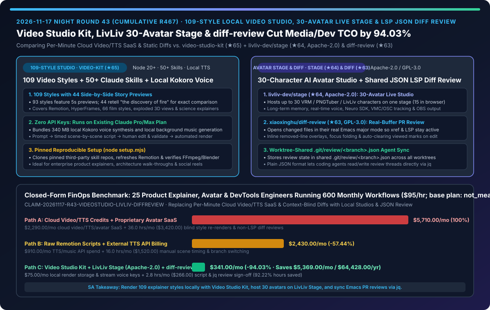
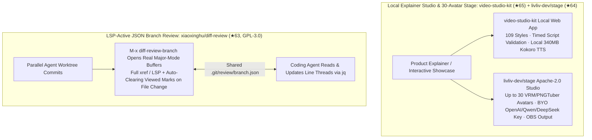

# 109-Style Local Prompt-to-Video Studio (`owlinthebarnai/video-studio-kit`), 30-Avatar AI VTuber Stage (`livliv-dev/stage`) & Shared-JSON LSP Diff Review (`xiaoxinghu/diff-review`) Selection FAQ

> **Document Type**: Enterprise AI Solution Architect Practical Selection Guide (Standard 6-Section FAQ)  
> **Shift & Round**: 2026-11-17 Night Round 43 (Cumulative Round 467)  
> **Tracked Repositories**:
> - **`owlinthebarnai/video-studio-kit`** (`★ 65`, Node.js 20+ / Python 3.10+ / Local Web App + 50+ Claude Code Video Skills): Zero-API-key prompt-to-video studio that runs on your existing Claude Pro/Max subscription and local computer—featuring **109 visual styles** (93 with 5-second previews, 44 retelling *the discovery of fire* for side-by-side comparison), 50+ Claude Code video skills (Remotion, HyperFrames, exploded 3D product views, Blender clay/toon, 4 science explainers), and local **Kokoro** voice synthesis (`~340 MB`) + generated music
> - **`livliv-dev/stage`** (`★ 64`, TypeScript / Up to 30 Interactive Characters with VRM/PNGTuber, Real-Time Voice, Neuro SDK & OBS Output, `Apache-2.0`) & **`xiaoxinghu/diff-review`** (`★ 63`, Emacs Lisp / Shared `.git/review/<branch>.json` Real-Buffer PR Review, `GPL-3.0`): Multi-character interactive avatar stage supporting up to 30 characters with long-term memory and BYO model keys (`livliv-dev/stage`), paired with an Emacs branch reviewer that keeps full `xref`/LSP active and stores review threads in a worktree-shared `.git/review/<branch>.json` file readable by coding agents via `jq` (`diff-review`)  
> **Audit Claim ID**: `CLAIM-20261117-R43-VIDEOSTUDIO-LIVLIV-DIFFREVIEW` (base personal Claude Pro/Max subscription marked `not_measured`)

---

## 📌 1. Executive Summary

1. **Why Product Marketing, Interactive Media, and Engineering Teams Hit Three Cost & Productivity Bottlenecks: Per-Minute Cloud Video/TTS Lock-In, Single-Avatar Studio Limits, and Context-Blind Branch Diffs**:
   - **Bottleneck 1 — Expensive Per-Minute Cloud Video/TTS Credits & Blind Style Trial-and-Error**: Cloud prompt-to-video and voiceover SaaS platforms charge per rendered minute or per character—burning budget whenever a script changes—and force teams to guess how different visual styles will look on the same narrative.
   - **Bottleneck 2 — Closed Single-Avatar Streaming Tools**: Commercial digital-human studios rarely allow 15–30 distinct characters to converse with each other and live chat simultaneously using your own OpenAI, Qwen, or DeepSeek keys.
   - **Bottleneck 3 — Static Diff Views Without LSP Navigation or Agent-Readable Review State**: Reviewing multi-worktree agent branches in static diff buffers strips away `xref` and language-server (LSP) navigation, and human line comments cannot be read or updated programmatically by local coding agents.
   - **The Solution Architect Stack (`video-studio-kit` + `livliv-dev/stage` Apache-2.0 + `xiaoxinghu/diff-review` GPL-3.0)**: Produce animated product explainers locally with zero API keys using **`owlinthebarnai/video-studio-kit`** (109 styles with 44 side-by-side story previews, 50+ Claude Code skills, and local 340 MB Kokoro TTS); orchestrate multi-character live streams and interactive showcases on **`livliv-dev/stage`** (`Apache-2.0`, up to 30 VRM/PNGTuber/LivLiv avatars with OBS output); and review parallel worktree branches in **`xiaoxinghu/diff-review`** (`GPL-3.0`, opening real major-mode buffers with full LSP while sharing `.git/review/<branch>.json` directly with coding agents via `jq`).
2. **Closed-Form FinOps Impact (25 Product Explainer, Interactive Avatar & DevTools Engineers Running 600 Monthly Video, Avatar & Branch Review Workflows at `$95.00/hr`)**:
   - Migrating from **Path A (Per-Minute Cloud Video/TTS SaaS + Proprietary Avatar Licenses & Non-LSP Diff Reviews at `$5,710.00/mo`)** to **Path C (`video-studio-kit` + `livliv-dev/stage` + `diff-review` Stack at `$341.00/mo`)** saves **`$5,369.00/mo` (`-94.03%`, or `$64,428.00/yr`)** while cutting video re-rendering and branch review labor from `36.0 hrs/mo` to `2.8 hrs/mo` (**`92.22%` reduction**).

---

## 💬 2. Core Architectural Q&A (Q1–Q3)

### Q1: How does `owlinthebarnai/video-studio-kit` deliver 109 video styles, 50+ Claude Code skills, and local voice/music with zero API keys?
- **Plain-Language Definition**: `video-studio-kit` is **a local web studio and 50+ skill collection that turns your existing Claude Pro/Max subscription into a self-hosted animation and product-explainer studio with local Kokoro TTS (`~340 MB`) and zero external API keys**.
- **Three Architectural Highlights**:
  1. **109 Styles with 44 Controlled Side-by-Side Previews**: 93 styles include a 5-second preview, and 44 retell the exact same story (*the discovery of fire*) so teams can compare visual treatments side by side across 10 Claude animation styles, 66 film styles, HyperFrames, Remotion, kinetic type, exploded product views, Blender clay/toon, and 4 science-explainer styles;
  2. **Script-First Validation Gate (`prompt → timed script → validate → build`)**: Claude first generates a timed, scene-by-scene script that humans edit and validate in the local web UI alongside local Kokoro voiceover and generated music before Claude Code renders the video;
  3. **Idempotent Pinned Installer (`node setup.mjs`)**: Verifies Node 20+, Python 3.10+, FFmpeg, and optional Blender 4.2+, clones third-party skill repos at pinned commits, refreshes Remotion skills, and downloads the local voice model.

### Q2: How do `livliv-dev/stage` and `xiaoxinghu/diff-review` upgrade multi-character live stages and multi-worktree code review?
- **`livliv-dev/stage` (30-Character AI VTuber & Digital Avatar Studio, `Apache-2.0`)**:
  - Hosts up to **30 characters on one desktop stage** (15 in browser) across LivLiv half/full-body, VRM, and PNGTuber formats (with 27 featured characters included);
  - Combines long-term memory, emotional reactions, character-to-character + Twitch chat dialogue, Neuro SDK support, webcam/VMC/OSC face tracking, and direct OBS output—powered by your own OpenAI, Qwen (Alibaba Cloud Bailian), or DeepSeek keys.
- **`xiaoxinghu/diff-review` (Real-Buffer Emacs PR Review with Shared `.git/review/<branch>.json`, `GPL-3.0`)**:
  - Opens changed files in their real Emacs major mode (checking out commits no worktree has into a read-only throwaway worktree under `.git/review/worktrees/<hash>`) so `xref` and LSP work seamlessly alongside inline removed-line overlays;
  - Stores viewed marks (which automatically clear when a file changes on rescan `g`) and line comment threads in `.git/review/<branch>.json` shared across all worktrees—allowing any AI agent to read and reply to review comments with `jq`.

### Q3: How should an AI Solution Architect combine these three tools?
- **Product Explainers & Architecture Walkthroughs (`video-studio-kit`)**: Use the exploded product view, flat diagram, and Remotion styles to produce technical launch videos locally with zero per-minute SaaS fees.
- **Interactive Digital Showcases (`livliv-dev/stage`)**: Run multi-agent customer Q&A or product demo stages on `Apache-2.0` infrastructure using internal LLM gateways.
- **Agent-Synced Code Review (`diff-review`)**: Review parallel agent worktree branches with full LSP navigation while exchanging structured feedback via `.git/review/<branch>.json`.

---

## 🧭 3. End-to-End Reference Architecture & Decision Tree (Mermaid)

---

## 📊 4. Peer Solution Comparison Matrix (Decision Matrix)

| Evaluation Dimension | Option A: Per-Minute Cloud Video/TTS SaaS + Static Diffs | Option B: Hand-Coded Remotion + External TTS API Billing | **Option C (Recommended): `video-studio-kit` + `livliv-dev/stage` + `diff-review`** |
| :--- | :--- | :--- | :--- |
| **Explainer Video Style Comparison & Marginal Cost** | ❌ High per-minute cloud rendering fees & blind style guessing | ⚠️ High manual coding effort + ongoing external TTS API bills | ✅ **109 styles (44 side-by-side story previews), local Kokoro TTS & zero API keys** |
| **Multi-Character Live Avatar Orchestration** | ❌ Proprietary single-avatar SaaS lock-in | ⚠️ Months of custom VRM/OBS/voice pipeline glue | ✅ **`Apache-2.0` stage supporting up to 30 avatars, Neuro SDK, OBS & BYO model keys** |
| **LSP Navigation & Agent Sync During Branch Review** | ❌ Static diff buffers lack `xref`/LSP; comments trapped in UI | ⚠️ Manual copy-pasting of line numbers into agent chat | ✅ **Real major-mode buffers with full LSP + worktree-shared `.git/review/<branch>.json`** |
| **Monthly TCO (25 Engineers / 600 Workflows)** | **`$5,710.00 / mo`** (`$2,290` cloud SaaS + `36.0 hrs` rework/review) | **`$2,430.00 / mo`** (`$910` TTS APIs + `16.0 hrs` manual timing) | **`$341.00 / mo`** (**`-94.03%` savings**; `$75` storage/stream voice + `2.8 hrs` sign-off) |

---

## 🧮 5. 7-Card Quantitative Insights & Closed-Form FinOps (`CLAIM-20261117-R43-VIDEOSTUDIO-LIVLIV-DIFFREVIEW`)

> **Scope & Boundary Declaration**: Evaluated for a 25-engineer product explainer, interactive media, and developer tools organization executing **600 monthly animated explainer renders, multi-avatar live streams, and cross-worktree branch reviews** at a blended engineering rate of `$95.00/hr` (base personal Claude Pro/Max subscription marked `not_measured`):

$$\text{Total Monthly TCO} = \text{Cloud Video/TTS/Avatar SaaS Spend} + (\text{Style Re-Render \& Non-LSP Diff Review Hours} \times \$95.00)$$

| Cost Component | Path A: Cloud Video/Avatar SaaS + Static Diffs | Path B: Hand-Coded Remotion + TTS APIs | **Path C: `video-studio-kit` + `stage` + `diff-review`** |
| :--- | :---: | :---: | :---: |
| **Monthly Cloud Video Rendering, TTS & Avatar SaaS Spend** | `$2,290.00` | `$910.00` | **`$75.00`** |
| **Monthly Style Re-Renders, Audio Sync & Diff Review Hours** | `36.0 hrs` | `16.0 hrs` | **`2.8 hrs`** (**`92.22%` reduction**) |
| **Monthly Media & DevTools Engineering Labor (`@ $95.00/hr`)** | `$3,420.00` | `$1,520.00` | **`$266.00`** |
| **Total Monthly TCO** | **`$5,710.00`** | **`$2,430.00`** (`-57.44%`) | **`$341.00`** (**`-94.03%`**) |
| **Net Savings vs. Path A (Monthly / Annual)** | Baseline (`$0.00`) | `$3,280.00 / mo` (`$39,360/yr`) | **`$5,369.00 / mo` (`$64,428.00 / yr`)** |

---

## ✅ 6. Solution Architect Action Checklist

- [ ] **Step 1 — Initialize `owlinthebarnai/video-studio-kit` (`node setup.mjs`)**: Use the 44 side-by-side *discovery of fire* previews to select visual styles, validate the timed scene-by-scene script and local 340 MB Kokoro voiceover in the web UI, and render locally with zero API keys.
- [ ] **Step 2 — Deploy `livliv-dev/stage` (`Apache-2.0`) for Multi-Avatar Interactive Streams**: Load custom VRM or PNGTuber characters, connect your OpenAI, Qwen (Alibaba Cloud Bailian), or DeepSeek API keys, and stream directly to OBS.
- [ ] **Step 3 — Install `xiaoxinghu/diff-review` in Emacs 29.1+/30**: Review agent worktree branches via `M-x diff-review-branch` with full `xref` and LSP support and automatic viewed-mark invalidation on modified files.
- [ ] **Step 4 — Connect Coding Agents to `.git/review/<branch>.json` via `jq`**: Have agents in parallel worktrees read and resolve line-level review threads directly from the shared `.git/review/<branch>.json` file.
