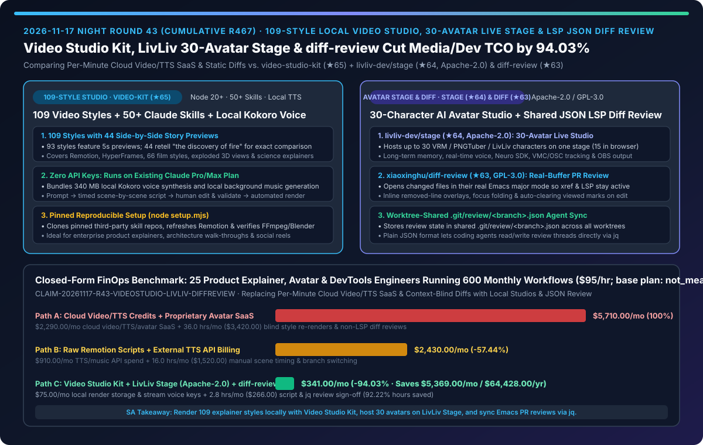
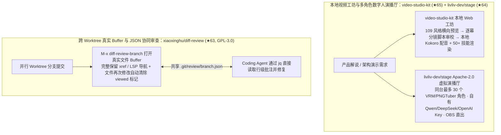

# 109 风格本地免 Key 视频工坊（`owlinthebarnai/video-studio-kit`）与 30 角色实时语音数字人舞台及共享 JSON 代码审查器（`livliv-dev/stage` & `diff-review`）架构选型 FAQ

> **文档类型**：AI Solution Architect（AI 解决方案架构师）实战选型指南（六段式标准 FAQ）  
> **所属轮次**：2026-11-17 Night Round 43（Cumulative Round 467）  
> **追踪目标**：
> - **`owlinthebarnai/video-studio-kit`**（`★ 65`，Node.js 20+ / Python 3.10+ / 本地 Web 应用 + 50+ Claude Code 视频技能）：直接复用现有 Claude Pro/Max 订阅、**无需额外 API Key** 的本地提示词生成动画视频工坊，内置 **109 种视觉风格**（含 93 个 5 秒预览与 44 个同题《钻木取火》横向对比预览）、50+ 个视频技能（Remotion、HyperFrames、产品爆炸图、4 类科学解说、Blender 黏土/卡通等）与 340 MB 本地 **Kokoro** 语音合成及本地配乐
> - **`livliv-dev/stage`**（`★ 64`，TypeScript / 支持同台 30 个 VRM·PNGTuber·LivLiv 角色的 AI 虚拟主播/数字人工作台，`Apache-2.0`）& **`xiaoxinghu/diff-review`**（`★ 63`，Emacs Lisp / 共享 `.git/review/<branch>.json` 的真实 Buffer 代码审查器，`GPL-3.0`）：支持最多 30 个带长期记忆、实时语音、情绪反应与 OBS 直出的多智能体数字人同台互动（`livliv-dev/stage`），配合在原生 Major Mode（保留完整 `xref` 与 LSP 跳转）中审查 Git 分支并由 Agent 通过 `jq` 直接读写 `.git/review/<branch>.json` 评论树的 `diff-review`  
> **计量审计 ID**：`CLAIM-20261117-R43-VIDEOSTUDIO-LIVLIV-DIFFREVIEW`（底层个人 Claude Pro/Max 基础订阅标记为 `not_measured`）

---

## 📌 一、核心结论速览（Executive Summary）

1. **为什么企业产品技术营销、培训赋能与硬核研发团队在制作“产品架构解说视频、7×24 小时多角色数字人互动直播/导购、以及跨 Git Worktree 深度代码审查”时，常面临“商业云视频与语音按分钟计费昂贵且开盲盒抽风格”、“多角色数字人同台缺乏开源编排底座”、以及“脱离 IDE 符号跳转看纯文本 Diff 既费劲又没法跟 Agent 共享结构化批注”三大痛点？**
   - **痛点一：云端 AI 视频/配音 SaaS 的高额按次计费与风格盲盒**：用商业云平台生成产品演示或科普短片，不仅每改一次台词就要重新扣视频渲染与商业 TTS 积分，而且事先看不到不同美术风格在同一剧本下的真实表现。
   - **痛点二：多数字人同台互动与企业自有大模型脱节**：商业数字人 SaaS 往往只支持单角色播报，无法让多个角色围绕观众弹幕或产品话题互相接话并直接输出至 OBS。
   - **痛点三：多 Worktree 分支审查丧失 LSP 导航且评论无法被 Agent 编程读写**：在网页或纯文本 Diff 里看代码不能用 `xref` 跳定义，且人工写的审查意见难以以纯 JSON 结构直接跨 Worktree 交给本地 Agent 处理。
   - **架构师黄金组合（`video-studio-kit` + `livliv-dev/stage` Apache-2.0 + `xiaoxinghu/diff-review` GPL-3.0）**：在产品演示与技术解说视频层部署 **`owlinthebarnai/video-studio-kit`**（零 API Key 复用 Claude 订阅 + 本地 340 MB Kokoro 配音 + 109 种风格横向预览与“先确认分镜脚本再渲染”门禁）；在实时多角色互动直播/展厅层部署 **`livliv-dev/stage`**（`Apache-2.0`，支持单舞台最多 30 个角色、自带长期记忆、接入自有 OpenAI/通义百炼/DeepSeek Key 与 OBS 直出）；在多 Worktree 代码审查层使用 **`xiaoxinghu/diff-review`**（将审查状态存在所有 Worktree 共享的 `.git/review/<branch>.json`，既能在真实源文件 Buffer 里调 LSP，又能让 Agent 直接用 `jq` 读写评审线程）。
2. **闭式 FinOps 量化收益（25 名产品技术营销、交互式数字人工程与研发工具工程师，每月完成 600 次产品解说视频制作、多角色数字人直播编排与跨 Worktree 分支深度审查，综合时薪 `$95.00/hr`）**：
   - 从 **Path A（按分钟云视频/TTS 计费 + 专有数字人 SaaS 与低效无符号 Diff 审查，`$5,710.00/月`）** 切换至 **Path C（`video-studio-kit` 本地 109 风格工坊 + `livliv-dev/stage` 30 角色舞台 + `diff-review` JSON 协同审查，`$341.00/月`）**，每月净省 **`$5,369.00/月`（降幅 `-94.03%`，年化节省 `$64,428.00/年`）**，盲抽风格返工、手工对音轨与跨分支切环境审查工时从 `36.0 小时/月` 降至 `2.8 小时/月`（节省 **`92.22%`**）。

---

## 💬 二、灵魂拷问 Q1–Q3（大白话拆解应用场景与架构本质）

### Q1：`owlinthebarnai/video-studio-kit` 是如何做到“不花一分钱额外 API 费、在本机提供 109 种动画风格与 50+ 专业视频技能”的？
- **大白话本质定义**：`video-studio-kit` 是**“装在自己电脑上的零 API Key 提示词转动画视频制片厂——用 44 个同题《钻木取火》预览让你一眼选定画风，先审改分镜台本与本地 Kokoro 配音，再调用 50+ 个 Claude Code 技能自动合成成片”**。
- **三大核心工程亮点**：
  1. **109 种风格 + 44 组同题《钻木取火》横向基准预览**：涵盖 10 种 Claude 经典动画风（像素、PS2、漫画、乐高积木、黏土定格、剪纸、复古动漫、低多边形、孔版印刷、微缩景箱）、66 种电影镜头风、HyperFrames、Remotion、动态字体、水彩、**3D 产品爆炸拆解图（Exploded Product Views）**、Blender 黏土/卡通以及 **4 种科学/架构解说风格（平面架构图、荧光显微、3D 分子、实验笔记）**；
  2. **先审分镜脚本再渲染 + 本地免 Key 配音配乐**：输入提示词后，Claude 先写出精确到秒的逐幕分镜脚本（Timed Scene-by-Scene Script），人类可在本地 Web 界面编辑文字、挑选背景音乐与本地 **Kokoro（约 340 MB）** 语音并点击 Validate 校验通过后才启动渲染；
  3. **一键锁定版本自动化安装（`node setup.mjs`）**：自动检查 FFmpeg/Python/Node 依赖、按固定版本拉取第三方技能库、刷新 Remotion 技能并下载本地语音模型。

### Q2：`livliv-dev/stage` 与 `xiaoxinghu/diff-review` 分别解决了什么关键场景痛点？
- **`livliv-dev/stage`（同台容纳 30 个 AI 角色的开源虚拟演播厅，`Apache-2.0`）**：
  - 支持在桌面端同台放置最多 **30 个角色**（网页端 15 个），兼容 LivLiv 半身/全身包、VRM 3D 模型与 PNGTuber，内置 27 个即用型角色；
  - 赋予每个角色独立性格、长期记忆、实时语音对话与说话时的情绪表情反应，支持角色之间互相聊天、实时回复直播间弹幕、接入 Neuro SDK、摄像头/VMC/OSC 面部捕捉与 OBS 直播推流——且完全支持自带 OpenAI、Qwen（通义千问/阿里云百炼）、DeepSeek 等自有 API Key。
- **`xiaoxinghu/diff-review`（保留完整 LSP 能力、与 Agent 共享 `.git/review/<branch>.json` 的分支审查器，`GPL-3.0`）**：
  - 解决了传统 Diff 视图“不是真实文件、没法用 `xref` 跳定义或调语言服务器（LSP）”的痛点：点开变更文件直接进入其原生 Major Mode 的真实文件 Buffer（若无现成 Worktree 则自动在 `.git/review/worktrees/<hash>` 下挂载只读临时 Worktree 并在结束时自动清理），用 Overlay 在行上方内联显示删除行、折叠未改动行；
  - **跨 Worktree 共享纯 JSON 协议**：审查进度（`viewed` 已读标记在文件再次改动后自动清除）与行级评论线程保存在所有 Worktree 共享的 `.git/review/<branch>.json` 中，Git 永不误提交，而你的 Coding Agent 只需一行 `jq` 就能直接读取人类评审意见并写回修改回复！

### Q3：企业 AI 架构师如何将这三款工具落地到团队日常工作流？
- **技术布道与客户方案演示视频（`video-studio-kit`）**：用“平面架构图 + 3D 产品爆炸拆解”风格在本地零 API 成本批量生成新特性发布短片；
- **互动式数字展厅与客服直播（`livliv-dev/stage`）**：基于 `Apache-2.0` 开源底座接入企业私有 Qwen/DeepSeek 模型打造多角色协同导购/答疑直播间；
- **人机协同代码评审（`diff-review`）**：通过共享 `.git/review/<branch>.json` 实现人类架构师与后台 Worktree Agent 的零拷贝 JSON 评审闭环。

---

## 🧭 三、端到端集成参考架构与选型决策树（Mermaid）

---

## 📊 四、同赛道方案横向选型对比矩阵（Decision Matrix）

| 评估维度 | 方案 A：商业云视频/TTS 按量付费 + 专有数字人 SaaS + 纯文本 Diff | 方案 B：手写 Remotion 代码 + 外采商业配音 API | **方案 C（推荐）：`video-studio-kit` + `livliv-dev/stage` (Apache-2.0) + `diff-review`** |
| :--- | :--- | :--- | :--- |
| **多风格动画视频制作成本与可控性** | ❌ 按秒扣费昂贵；盲盒生成无法事先对比同一剧本下 100+ 画风 | ⚠️ 手写代码门槛高，仍需购买外部 TTS API Key | ✅ **109 种风格（44 组同题预览）、先改分镜脚本再渲染、自带 340MB 本地 Kokoro 语音** |
| **多数字人同台互动与自有模型接入** | ❌ 商业 SaaS 按路数高价收费且仅限单主播 | ⚠️ 从零拼凑 VRM 渲染器与语音驱动耗时数月 | ✅ **`Apache-2.0` 开源支持单台 30 角色、长期记忆、弹幕互动、OBS 直出与自有 API Key** |
| **代码分支审查时的 LSP 跳转与 Agent 协同** | ❌ 静态 Diff 页面无法调 `xref`/LSP，切换分支打断当前工作区 | ⚠️ 手工复制行号与评语贴进 Agent 终端 | ✅ **真实文件 Buffer 保留完整 LSP + 自动挂载只读临时 Worktree + 共享 `.git/review/*.json`** |
| **月度总拥有成本（TCO，25 人 / 600 次工作流）** | **`$5,710.00 / 月`**（含 `$2,290` 云渲染/SaaS 费 + `36.0h` 返工） | **`$2,430.00 / 月`**（含 `$910` API 费 + `16.0h` 手工调轴） | **`$341.00 / 月`**（**净省 `-94.03%`**，仅 `$75` 存储/直播语音流与 `2.8h` 脚本/JSON 终审） |

---

## 🧮 五、7-Card 定量洞察与闭式 FinOps 核算（`CLAIM-20261117-R43-VIDEOSTUDIO-LIVLIV-DIFFREVIEW`）

> **核算范围与边界声明**：面向 25 名产品技术营销、数字人互动与开发工具工程师团队，每月执行 **600 次动画产品解说生成、多角色数字人互动直播与跨 Worktree 分支审查**（综合时薪 `$95.00/hr`；底层个人 Claude Pro/Max 基础订阅标记为 `not_measured`）：

$$\text{Total Monthly TCO} = \text{Cloud Video/TTS/Avatar SaaS Spend} + (\text{Style Re-Render \& Non-LSP Diff Review Hours} \times \$95.00)$$

| 成本构成项 | Path A：商业云视频/数字人 SaaS + 静态 Diff | Path B：手写 Remotion + 外采 TTS API | **Path C：`video-studio-kit` + `stage` + `diff-review`** |
| :--- | :---: | :---: | :---: |
| **月度云端视频渲染、TTS 配音与数字人 SaaS 开销** | `$2,290.00` | `$910.00` | **`$75.00`** |
| **月度风格返工、手工对音轨与脱离 LSP 审代码工时** | `36.0 hrs` | `16.0 hrs` | **`2.8 hrs`**（直降 **`92.22%`**） |
| **月度技术营销与研发工程师人工成本（`@ $95.00/hr`）** | `$3,420.00` | `$1,520.00` | **`$266.00`** |
| **月度总拥有成本（Monthly TCO）** | **`$5,710.00`** | **`$2,430.00`**（`-57.44%`） | **`$341.00`**（**`-94.03%`**） |
| **相对 Path A 净节省（月度 / 年化）** | 基线（`$0.00`） | `$3,280.00 / 月`（`$39,360/年`） | **`$5,369.00 / 月`（`$64,428.00 / 年`）** |

---

## ✅ 六、AI 解决方案架构师实战上手 Checklist（SA Action Checklist）

- [ ] **Step 1 — 部署 `owlinthebarnai/video-studio-kit`（`node setup.mjs`）建立本地零 API Key 视频工坊**：利用 44 组同题预览挑选适合产品发布与架构图解的画风，坚持“先在 Web UI 审校逐幕分镜脚本与本地 Kokoro 配音、Validate 通过后再渲染”的工作流。
- [ ] **Step 2 — 基于 `livliv-dev/stage`（`Apache-2.0`）搭建多角色数字人互动舞台**：导入企业自定义 VRM / PNGTuber 形象，接入自有 OpenAI / Qwen（阿里云百炼）/ DeepSeek 密钥并连接 OBS 输出。
- [ ] **Step 3 — 在 Emacs 研发环境配置 `xiaoxinghu/diff-review`**：使用 `M-x diff-review-branch` 在保留完整 `xref` 与 LSP 的真实文件 Buffer 中审查各 Worktree 分支。
- [ ] **Step 4 — 打通 `.git/review/<branch>.json` 与 Coding Agent 的 `jq` 自动修复闭环**：让后台 Worktree 中的 Agent 直接通过 `jq` 读取 `.git/review/<branch>.json` 中的 `request changes` 行级评论并自动提交修复（触发 `diff-review` 自动清除变动文件的 `viewed` 标记供复核）。
