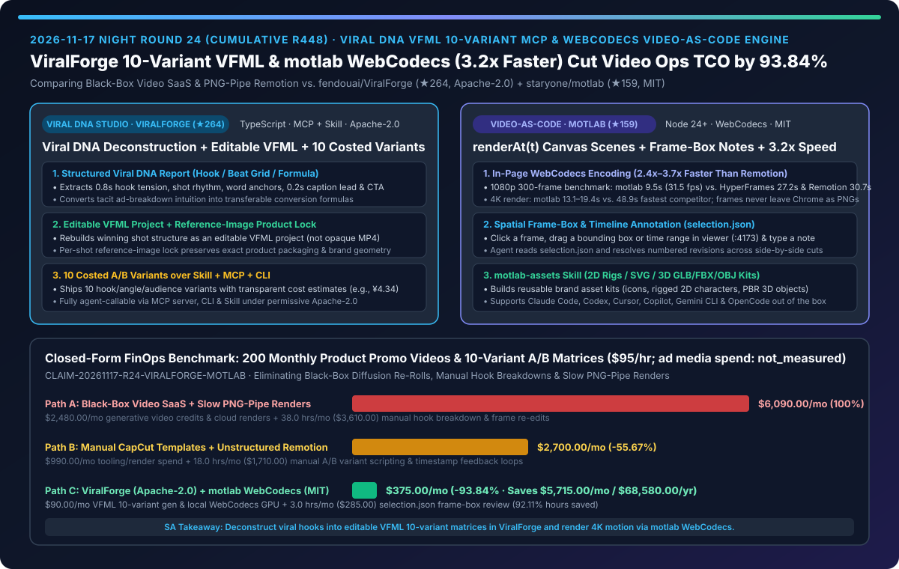
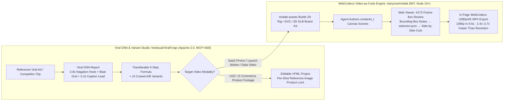

# Viral DNA 10-Variant Video Studio (`fendouai/ViralForge`) & WebCodecs Video-as-Code Engine (`staryone/motlab`) Selection FAQ

> **Document Type**: Enterprise AI Solution Architect Practical Selection Guide (Standard 6-Section FAQ)  
> **Shift & Round**: 2026-11-17 Night Round 24 (Cumulative Round 448)  
> **Tracked Repositories**:
> - **`fendouai/ViralForge`** (`★ 264`, TypeScript / Node 22.15+ / MCP + Skill + CLI, `Apache-2.0`): Agent-native viral short-video studio that deconstructs reference videos into a structured **Viral DNA report** (`0.8s` negation hook, shot rhythm, word anchors, `0.2s` caption lead, emotional curve, and conversion formula), rebuilds the structure into an editable **`VFML` project** with per-shot reference-image product locks, and ships **10 costed A/B variants**
> - **`staryone/motlab`** (`★ 159`, JavaScript / Node 24+ / WebCodecs + Headless Chrome + FFmpeg, `MIT`): Deterministic Video-as-Code engine (`renderAt(t)`) and dual agent skill suite (`motlab` + `motlab-assets`) featuring a frame-accurate web review viewer (`:4173`) where dragged bounding-box notes save to `selection.json` for agent revisions, and in-page WebCodecs encoding renders **1080p in `9.5s` (`2.4x–3.2x` faster than Remotion) and 4K in `13.1–19.4s` (`2.5x–3.7x` faster)**  
> **Audit Claim ID**: `CLAIM-20261117-R24-VIRALFORGE-MOTLAB` (external paid social media ad-buying budget marked `not_measured`)

---

## 📌 1. Executive Summary

1. **Why Enterprise Growth & Product Marketing Teams Struggle with Both Black-Box Generative Video SaaS and Traditional PNG-Pipe Programmatic Video**:
   - **The Black-Box Generative Video Trap**: Prompting end-to-end diffusion video models produces uneditable MP4s, distorts brand logos and product packaging, ignores proven short-form conversion mechanics (the first `0.8s` hook tension, `0.2s` caption-before-voice lead, and beat timing), and burns expensive credits on unguided re-rolls.
   - **The Traditional Programmatic Video Bottleneck**: Code-driven frameworks like Remotion avoid visual hallucinations for UI/SaaS promos, but exporting every frame out of headless Chrome as a serialized PNG image makes 1080p/4K rendering slow (`30.7s` at 1080p and `48.9s+` at 4K for 300 frames), while giving spatial feedback to an AI coding agent (*"move the card in the top-right corner at 0:04"*) is tedious in plain text.
   - **The Solution Architect Stack (`ViralForge` Apache-2.0 + `motlab` MIT)**: Deploy **`fendouai/ViralForge`** (`Apache-2.0`) to extract structured **Viral DNA reports**, lock product reference images inside editable **`VFML` projects**, and generate **10 costed A/B variants** over MCP/Skill/CLI; pair it with **`staryone/motlab`** (`MIT`) for deterministic `renderAt(t)` UI/product motion videos where reviewers drag bounding boxes directly on frames in `:4173` (`selection.json`) and render 1080p/4K MP4s **`2.4x–3.7x` faster** via in-page WebCodecs.
2. **Closed-Form FinOps Impact (200 Monthly Product Launch Promos & 10-Variant A/B Short-Video Matrices at `$95.00/hr`)**:
   - Transitioning from **Path A (Black-Box Generative Video SaaS + Slow PNG-Pipe Renders at `$6,090.00/mo`)** to **Path C (`ViralForge` Apache-2.0 + `motlab` MIT WebCodecs Engine at `$375.00/mo`)** saves **`$5,715.00/mo` (`-93.84%`, or `$68,580.00/yr`)** while cutting manual ad deconstruction, diffusion re-rolls, and revision turnaround from `38.0 hrs/mo` to `3.0 hrs/mo` (**`92.11%` reduction**).

---

## 💬 2. Core Architectural Q&A (Q1–Q3)

### Q1: How does `fendouai/ViralForge` turn manual short-video ad teardowns into an agent-callable MCP and `VFML` pipeline?
- **Plain-Language Definition**: `ViralForge` (`Apache-2.0`) is an **agent-native viral short-video deconstruction and variant-generation studio** exposed via MCP server, Agent Skill, and CLI.
- **Three Core Engineering Capabilities**:
  1. **Viral DNA Report (Deconstructing Conversion Psychology, Not Just Pixels)**: Given a high-performing reference clip (e.g., the 15s GLOW LAB serum benchmark at 96 BPM with `41.2%` completion and `78%` 3s retention), `ViralForge` extracts:
     - **0.0–0.8s Counter-Intuitive Negation Hook**: Creates immediate cognitive tension (*"Stop paying the stupid tax"*);
     - **Delayed Product Reveal (`0:05`)**: Sells the concrete problem cuts during the first 5 seconds before introducing the bottle;
     - **0.2s Caption Pre-Lead**: Lands captions `0.2s` ahead of spoken audio to boost viewer retention;
     - **Transferable 5-Step Formula**: `negation → 3 concrete pains → 1 core mechanism → 7-day split-screen proof → low-friction sample CTA`.
  2. **Editable `VFML` Project + Per-Shot Reference-Image Lock**: Instead of outputting an uneditable black-box MP4, `ViralForge` compiles an editable `VFML` project with per-shot product reference-image locks so your real product geometry stays consistent across shots.
  3. **10 Costed Variants for A/B Testing**: Automatically generates 10 hook, angle, and audience variants with explicit per-variant cost estimates (e.g., `¥1.86` for a 15s replica and `¥4.34` across all 10 variants).

### Q2: Why is `staryone/motlab` `2.4x–3.7x` faster than Remotion and HyperFrames, and how does `selection.json` transform human-agent video review?
- **Why Traditional Programmatic Video Engines Are Slow**:
  - Frameworks that screenshot every frame out of headless Chrome as a PNG/JPEG pay a massive serialization and IPC penalty across hundreds of frames.
- **`motlab`'s Three Architectural Innovations (`MIT`, Node 24+)**:
  1. **In-Page WebCodecs Hardware/Software Encoding**: Every scene is a canvas page implementing `renderAt(t)`. Frames are encoded directly inside the Chrome page via **WebCodecs**, so raw frame bitmaps never leave the browser. On the 1080p 300-frame benchmark (160 animated cards, Ryzen 7 5800H + RTX 3060 Laptop):
     - **`motlab`**: **`9.5s` (`31.5 fps`, `--encoder sw`) / `12.6s` (`23.7 fps`, default)**;
     - **HyperFrames `0.9.52`**: `27.2s` (`11.0 fps`, `2.2x–2.9x` slower);
     - **Remotion `4.0.543`**: `30.7s` (`9.8 fps`, `2.4x–3.2x` slower);
     - **At 4K Resolution**: `motlab` renders in **`13.1–19.4s` vs. `48.9s`** for the fastest competitor (**`2.5x–3.7x` faster**).
  2. **Frame-Box & Timeline Spatial Annotations (`selection.json`)**: In the live viewer (`http://127.0.0.1:4173`), you step frame by frame, drag a box over the exact visual element (or highlight a time range), and type a note. The coding agent reads `selection.json` and resolves each numbered note while keeping side-by-side version cuts.
  3. **Reusable Brand Asset Kits (`motlab-assets` Skill)**: Generates consistent transparent PNG/SVG icons, rigged 2D characters, and PBR-textured 3D assets (`GLB/FBX/OBJ`) shared across every video.

### Q3: How should an AI Solution Architect combine `ViralForge` and `motlab`?
- **Growth Hook & Variant Planning Layer (`ViralForge` MCP)**: Use `ViralForge` to deconstruct winning industry ads into beat grids, `VFML` structures, and 10 costed A/B hook variants.
- **Deterministic Rendering & Visual Review Layer (`motlab`)**: Feed the beat grid and brand reference folder (`./promo-refs`) into `motlab` for SaaS/product promos, refine frames interactively via `:4173` bounding-box notes (`selection.json`), and export 4K MP4s in seconds via WebCodecs.

---

## 🧭 3. End-to-End Reference Architecture & Decision Tree (Mermaid)

---

## 📊 4. Peer Solution Comparison Matrix (Decision Matrix)

| Evaluation Dimension | Option A: Black-Box Generative Video SaaS + Slow PNG-Pipe Renders | Option B: Manual CapCut Templates + Unstructured Remotion | **Option C (Recommended): `ViralForge` (Apache-2.0) + `motlab` (MIT)** |
| :--- | :--- | :--- | :--- |
| **Hook Deconstruction & 10-Variant A/B Scaling** | ❌ Blind prompt lottery with no beat-grid or hook structure | ❌ Hours of manual pause-and-copy breakdown per reference clip | ✅ **Automated `Viral DNA` report, editable `VFML` project & 10 costed variants** |
| **Product Packaging Fidelity & Crisp UI Text** | ❌ Diffusion models warp product bottles, logos, and UI typography | ✅ Clean assets, but manual keyframing does not scale | ✅ **`ViralForge` per-shot reference-image lock + `motlab` pixel-exact `renderAt(t)` canvas** |
| **1080p / 4K 300-Frame Render Speed** | ⚠️ Multi-minute cloud queue + per-second generation fees | ⚠️ Remotion `30.7s` (1080p) / `48.9s+` (4K) due to PNG IPC overhead | ✅ **In-page WebCodecs: `9.5s` (`31.5 fps`) at 1080p and `13.1–19.4s` at 4K (`2.4x–3.7x` faster)** |
| **Spatial Frame Review & Revision Loop** | ❌ Uneditable MP4 requires full re-generation | ⚠️ Verbal timestamp descriptions lead to agent misplacement | ✅ **Drag a bounding box on any frame in `:4173` → `selection.json` → side-by-side cuts** |
| **Monthly TCO (200 Promo Videos & Matrices/Mo)** | **`$6,090.00 / mo`** (`$2,480` SaaS credits + `38.0 hrs` breakdown/re-rolls) | **`$2,700.00 / mo`** (`$990` tooling + `18.0 hrs` manual edits) | **`$375.00 / mo`** (**`-93.84%` savings**; `$90` local render/variants + `3.0 hrs` frame review) |

---

## 🧮 5. 7-Card Quantitative Insights & Closed-Form FinOps (`CLAIM-20261117-R24-VIRALFORGE-MOTLAB`)

> **Scope & Boundary Declaration**: Evaluated for an enterprise growth and product marketing engineering team producing **200 monthly product launch promos and 10-variant short-video A/B matrices** at a blended rate of `$95.00/hr` (external social media ad-buying spend marked `not_measured`):

$$\text{Total Monthly TCO} = \text{Video Generation \& Render Spend} + (\text{Deconstruction, Re-Roll \& Revision Hours} \times \$95.00)$$

| Cost Component | Path A: Black-Box Video SaaS + Slow PNG-Pipe | Path B: Manual Templates + Unstructured Remotion | **Path C: `ViralForge` (Apache-2.0) + `motlab` (MIT)** |
| :--- | :---: | :---: | :---: |
| **Monthly Video Generation Credits & Render Compute** | `$2,480.00` | `$990.00` | **`$90.00`** |
| **Monthly Hook Breakdown, Re-Roll & Revision Hours** | `38.0 hrs` | `18.0 hrs` | **`3.0 hrs`** (**`92.11%` reduction**) |
| **Monthly Growth & Frontend Engineering Labor (`@ $95.00/hr`)** | `$3,610.00` | `$1,710.00` | **`$285.00`** |
| **Total Monthly TCO** | **`$6,090.00`** | **`$2,700.00`** (`-55.67%`) | **`$375.00`** (**`-93.84%`**) |
| **Net Savings vs. Path A (Monthly / Annual)** | Baseline (`$0.00`) | `$3,390.00 / mo` (`$40,680/yr`) | **`$5,715.00 / mo` (`$68,580.00 / yr`)** |

---

## ✅ 6. Solution Architect Action Checklist

- [ ] **Step 1 — Deploy `ViralForge` (Node 22.15+) & Register Its MCP Server**: Clone `fendouai/ViralForge` and expose its MCP tools and Skill to your growth agent to turn winning reference videos into structured `Viral DNA` reports and 10 costed A/B variants.
- [ ] **Step 2 — Enforce Per-Shot Reference-Image Locks in `VFML`**: Bind official product photography to each shot in the generated `VFML` project so product packaging never warps across variants.
- [ ] **Step 3 — Install `@motlab/cli` & Both Agent Skills (`motlab` + `motlab-assets`)**: Run `npm install -g @motlab/cli && npx @motlab/cli setup --skill claude,agents` and verify Chrome WebCodecs and FFmpeg readiness via `motlab doctor`.
- [ ] **Step 4 — Standardize on `:4173` Frame-Box Annotations (`selection.json`)**: Launch `motlab edit <project>`, mark spatial bounding-box notes directly on frames in the web viewer, let the coding agent apply numbered fixes from `selection.json`, and export 4K MP4s via WebCodecs.
